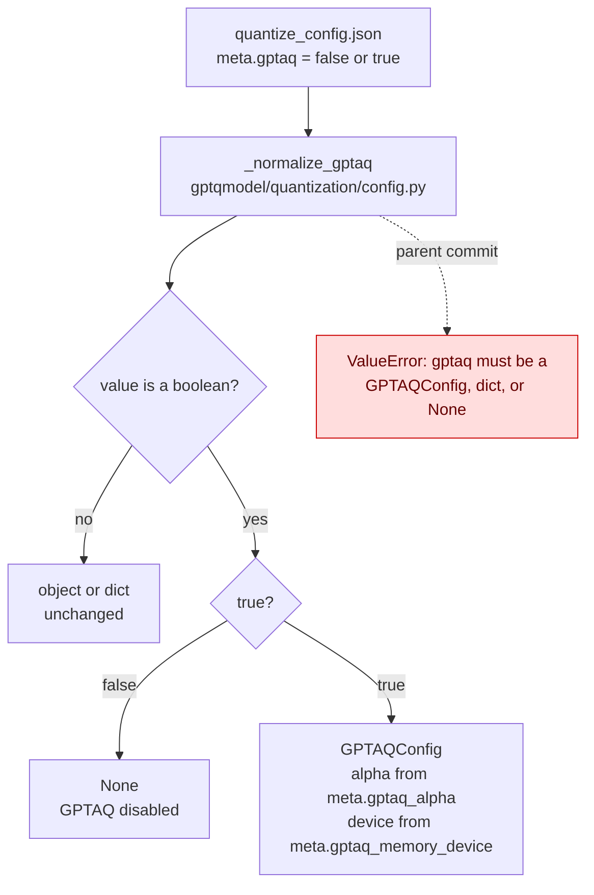
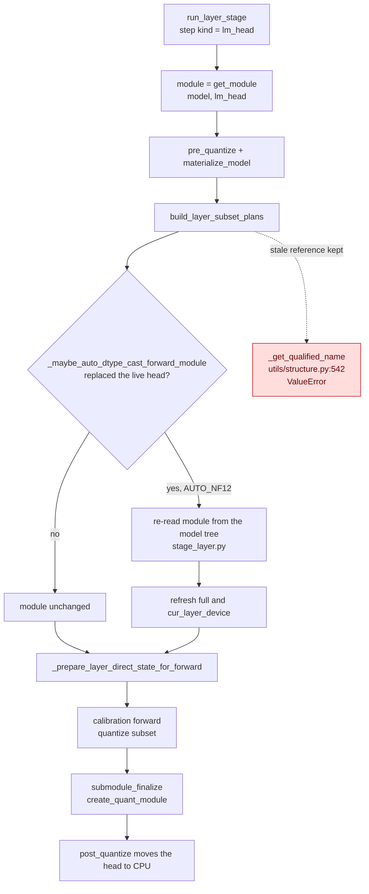
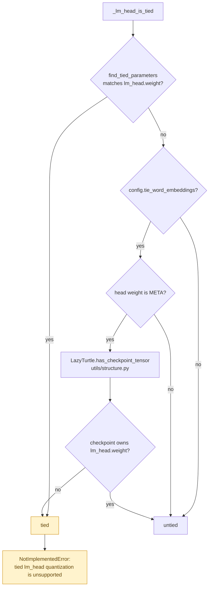
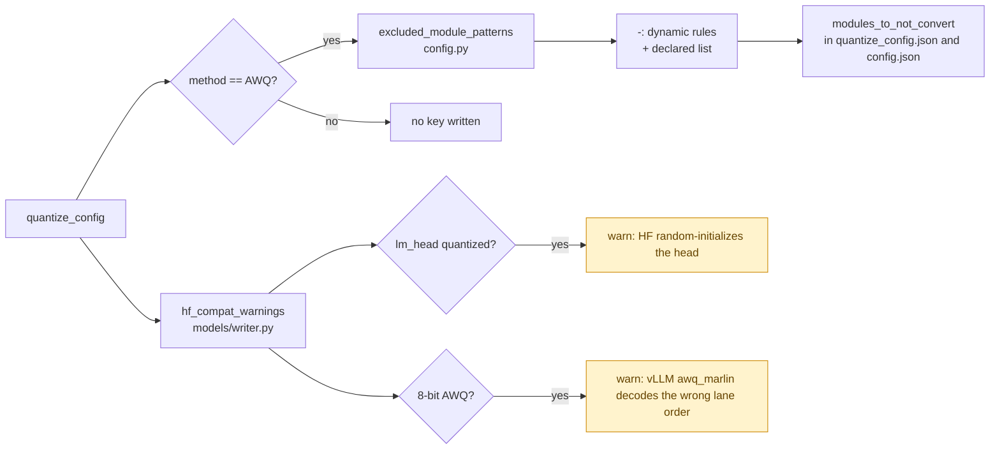

<!-- SPDX-FileCopyrightText: 2026 ModelCloud.ai
SPDX-License-Identifier: Apache-2.0 -->

# Checkpoint compatibility

A GPT-QModel checkpoint is read by three very different consumers: GPT-QModel
itself, plain Transformers (`AutoModelForCausalLM`), and inference servers such
as vLLM. They do not agree on how much metadata they need, and none of them
fail loudly when a key is missing or written in an older shape. This page
records the rules that keep the three cases apart: what a legacy checkpoint
still means, when a head can be quantized at all, and which metadata a
non-GPT-QModel loader needs to reproduce the same numbers.

The flows below are the shipped code, not a design sketch. `file:line`
references point at the current implementation; the "before" column names the
parent commit's behaviour.

## 1. Legacy `meta.gptaq` booleans

GPTQModel 5.4.x stored the GPTAQ switch as a bare boolean and kept its
coefficient and device in sibling keys. 5.x replaced the boolean with a
`GPTAQConfig` object, and the normalizer rejected everything else, so every
5.4.x checkpoint failed to parse.

`_normalize_foem` takes the same shapes. No released build wrote a boolean
`meta.foem`, but the two normalizers had the same contract before the object
form, and a boolean there has one unambiguous meaning.

| Mechanism | Before | After |
| --- | --- | --- |
| boolean `meta.gptaq` | rejected (`config.py:3513` on the parent commit) | `False` maps to `None`, `True` maps to `GPTAQConfig` (`config.py:2187`) |
| `meta.gptaq_alpha` | no config field, dropped as unknown | folded into `GPTAQConfig.alpha` |
| `meta.gptaq_memory_device` | no config field, dropped as unknown | folded into `GPTAQConfig.device` |
| boolean `meta.foem` | rejected (`config.py:3523` on the parent commit) | same on/off mapping (`config.py:3578`) |
| top-level boolean `gptaq` / `foem` | rejected | same mapping through the payload normalizer |

## 2. The `lm_head` quantization stage

`lm_head=True` adds a pseudo-layer after the decoder layers. Unlike a decoder
layer it *is* the projection, so anything that replaces the live module also
replaces the stage's own reference to it.

Two independent defects lived in that path:

| Mechanism | Before | After |
| --- | --- | --- |
| stage reference after subset planning | stale `HookedLinear`, no longer in the tree, so direct-state materialization raised `Could not find the given module within the target model` (`structure.py:542`) | re-read from `model.named_modules()` (`stage_layer.py:948`) |
| AUTO_NF12 packing of the head | packed the head as a forward wrapper, detaching the quant source from the tree so `post_quantize` never moved it and `create_quant_module` saw CUDA tensors | the head is excluded from the calibration-source pack (`models/base.py:3938`); its dense source stays the module in the tree |
| tied head | identity check missed lazily loaded shells, so quantization ran until `Cannot reload quantization source: missing checkpoint tensors ['weight']` (`models/base.py:3607` on the parent commit) | `_lm_head_is_tied` also asks the checkpoint (`module_looper.py:1384`) |

## 3. Detecting a tied head in a lazy shell

`find_tied_parameters` compares materialized parameter identities. A lazily
loaded model keeps the embedding and the head as independent META parameters
until the loader ties them, so identity never matches even though the
checkpoint has one weight.

`has_checkpoint_tensor` resolves the same runtime-to-checkpoint aliases as the
materializers but never loads a tensor, so the check stays cheap on a 70B
checkpoint.

## 4. Metadata for non-GPT-QModel loaders

Two checkpoint shapes are valid for GPT-QModel and wrong for another loader.
Both are now reported at save time, and the AWQ exclusion list is written where
HF and vLLM look for it.

| Mechanism | Before | After |
| --- | --- | --- |
| AWQ `-:` exclusions in the payload | absent (`config.py:5200` on the parent commit), so HF built uninitialized AWQ layers | written to `modules_to_not_convert` (`config.py:5299`) |
| quantized `lm_head` | silent | save-time warning from `hf_compat_warnings` (`writer.py:292`) |
| 8-bit AWQ | silent | save-time warning from `hf_compat_warnings` |

`modules_to_not_convert` is a compatibility mirror, not a second source of
truth: the `-:` rules in `dynamic` stay authoritative and the mirror is
recomputed on every save.

## 5. 8-bit AWQ lane order

GPT-QModel packs and reads 8-bit AWQ in natural lane order: lane `i` of a
32-bit word is output column `i`. vLLM's `awq_marlin` repack and AutoAWQ undo a
`[0, 2, 1, 3]` interleave for every non-4-bit width, which swaps lanes 1 and 2.
Only the 4-bit layout is interleaved in GPT-QModel.

This change keeps natural order as GPT-QModel's canonical layout and warns on
export instead of silently writing a checkpoint vLLM decodes incorrectly. The
reasoning is in the [AWQ packed layout](awq-packed-layout.md#8-bit-lane-order-and-vllm)
page.

Measured with an independent FP64 oracle (`out_features=64`,
`in_features=128`, `group_size=32`, 8-bit codes):

| Decode | Max absolute weight error vs the FP64 oracle |
| --- | --- |
| natural order (GPT-QModel) | 4.12e-07 |
| vLLM `[0, 2, 1, 3]` order | 8.42 |

## Contracts

- A checkpoint written by GPTQModel 5.4.x parses on 5.x; `meta.gptaq: false`
  never becomes an enabled GPTAQ objective.
- `lm_head=True` is supported for untied heads and rejected with
  `NotImplementedError` for tied ones, before any source reload is attempted.
- `lm_head` quantization is not packed as an AUTO_NF12 calibration source; its
  dense source stays the module in the model tree.
- AWQ `-:` exclusions appear in `modules_to_not_convert`; a checkpoint without
  exclusions writes no such key.
- A save that produces a checkpoint a plain HF loader cannot consume logs the
  reason instead of leaving the caller with random weights.
- 8-bit AWQ stays in natural lane order and is documented as not loadable by
  vLLM `awq_marlin`.

## Validation

| Test | Invariant |
| --- | --- |
| `tests/test_checkpoint_compat.py::test_legacy_boolean_gptaq_false_disables_gptaq` | 5.4.x `false` maps to no GPTAQ |
| `tests/test_checkpoint_compat.py::test_legacy_boolean_gptaq_true_keeps_alpha_and_device` | `true` keeps the recorded coefficient and device |
| `tests/test_checkpoint_compat.py::test_legacy_boolean_foem_meta` | the sibling normalizer follows the same contract |
| `tests/test_checkpoint_compat.py::test_awq_dynamic_exclusions_are_written_to_modules_to_not_convert` | `-:` rules reach the HF/vLLM key and survive reload |
| `tests/test_checkpoint_compat.py::test_hf_compat_warning_for_quantized_lm_head` | the head caveat is reported |
| `tests/test_checkpoint_compat.py::test_hf_compat_warning_for_8bit_awq` | the 8-bit AWQ caveat is reported |
| `tests/test_checkpoint_compat.py::test_awq_8bit_lane_order_is_natural` | the 8-bit packer matches an independent lane-order reference |
| `tests/test_checkpoint_compat.py::test_awq_8bit_vllm_order_would_swap_lanes_one_and_two` | the vLLM undo is not this layout |
| `tests/test_checkpoint_compat.py::test_untied_lm_head_quantizes_and_reloads` | untied head quantizes, saves, reloads, forwards |
| `tests/test_checkpoint_compat.py::test_tied_lm_head_is_rejected_with_the_explicit_error` | tied head raises `NotImplementedError` |

Introduced in [PR #4034](https://github.com/ModelCloud/GPTQModel/pull/4034) for
[issue #4013](https://github.com/ModelCloud/GPTQModel/issues/4013).
