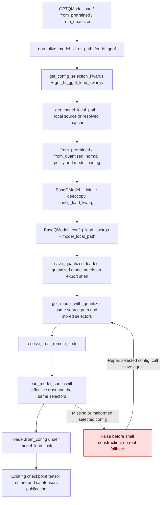

<!-- SPDX-FileCopyrightText: 2026 ModelCloud.ai
SPDX-License-Identifier: Apache-2.0 -->

# GPT-QModel checkpoint config selection

Loading and re-saving must read the same selected configuration, not a decoy
`config.json` at the repository root. GPT-QModel keeps the resolved source
directory and the config selectors separately: `model_local_path` identifies
the local source or resolved Hub snapshot; `_config_load_kwargs` selects a
config within it. Rebuilding an export shell uses both values.

This contract is part of the [Transformers 5 migration](https://github.com/ModelCloud/GPTQModel/pull/4620).

## Before and after

The old writer behavior is visible at migration base `3c177fbe7`,
`gptqmodel/models/writer.py:2588-2595`. The save caller already supplied
`self.model_local_path`, but both policy resolution and config loading omitted
the separate selectors.

| Concern | Before | Now |
| --- | --- | --- |
| Source | Resolved `model_local_path` | Same resolved path; no new Hub snapshot resolution |
| Config within source | Implicit root config | Captured `get_config_selection_kwargs` selection |
| Selected GGUF metadata | Filename lost during shell config reads | Normalized `get_hf_gguf_load_kwargs` filename retained |
| Ordinary quantized reload | No reliable `_model_init_kwargs` record | Constructor-owned `_config_load_kwargs` |
| Optional Qwen-Drive hook | Writer invoked it before policy selection | Writer delegates to the shared trust/config helpers |
| Failed config read | Could read a valid but wrong root decoy | Selected read fails; repairing the selected file permits retry |

For the tiny CPU regression, the selected model has hidden width **32** and
the root decoy has width **16**. Before the fix, re-saving a loaded quantized
model fails when loading a `[64, 32]` embedding into the root-derived
`[64, 16]` export shell. Loading the root without a subfolder is the control
and remains valid.

## Selected config lifecycle



The two ordinary `from_pretrained` constructor paths and both
`from_quantized` constructor paths receive the record. It does not depend on
HF model implementation attributes, tokenizer/processor state, or a later
inspection of caller-owned model-init kwargs. Copying the record also isolates
nested dictionaries such as proxy settings from later caller mutation.

The selected config is read again when rebuilding a shell. There is no new
process-global metadata or trust cache: repairing a config at the same path
is visible on the next attempt. A changed file is not silently replaced with
the root config.

## Selector and ownership rules

- `get_config_selection_kwargs` retains the existing subfolder, revision,
  cache, authentication, download, proxy and commit selectors. Explicit false
  and empty values keep their existing helper semantics.
- `get_hf_gguf_load_kwargs` translates the internal normalized GGUF selector
  into the HF `gguf_file` config-read argument.
- Runtime options such as dtype, backend and device placement are not part of
  the selection record. The public loaders build it from the existing helpers.
- Authentication selectors are in-memory load state, not newly published
  checkpoint configuration fields.
- `model_local_path` stays on the already-resolved source. Retaining a revision
  selector does not resolve a moving Hub branch again during a save.
- Shared helpers still own package-local/native model selection and remote-code
  permission. This change neither grants checkpoint Python access nor adds a
  separate Qwen-Drive registration policy.

## Validation and limits

The public regression
`tests/test_checkpoint_subfolder_resolution.py::test_public_resave_keeps_selected_config_and_exact_checkpoint`
uses real tiny Llama models and the CPU GPTQ Torch backend. Both root and nested
selection perform `quantize -> pack -> forward -> save -> load -> forward ->
re-save -> reload -> forward -> re-save -> reload -> forward`. The reloads
exercise both public `GPTQModel.load` and `GPTQModel.from_quantized`.

It compares the entire saved tensor-key set, every storage dtype and tensor
payload byte, including packed projections, dense embeddings, norms and biases.
BF16 logits are bit-exact across the lifecycle. Ordinary quantized reload is
asserted to lack `_model_init_kwargs`. Corrupting the selected config must raise
without publishing safetensors or mutating live tensors; restoring that file
must allow the same model instance to forward and retry the same save directory.

Additional tests cover `load`/`from_pretrained` constructor records and the
actual GGUF metadata reader reaching both writer policy/config consumers,
including requested trust false/true and caller-record mutation. The existing
GGUF public loader policy test checks capture of its normalized filename and
revision/local-only selectors. Its native weight-loading boundary remains a
test double; it does not qualify native GGUF weight re-saving.

Run the focused family from the repository root:

```bash
python -s -m pytest -q tests/test_checkpoint_subfolder_resolution.py \
  tests/test_gguf_load_policy_env_removal.py
```

After preserving main's `CalibrationConfig` API merge, the combined writer,
loader, tokenizer, processor, security and Qwen-Drive support run passed
**181 tests, no skips, 15 warnings in 23.39 seconds** on Python 3.14.6t,
Transformers 5.23.0, Torch 2.15.0+cpu and released Tokenicer 0.0.19. The two
public resave cases retain the original samples, batch size and minimum length
through `CalibrationConfig`; no legacy quantize API is restored.

```bash
PYTHON_GIL=0 OMP_NUM_THREADS=1 python -m pytest -q \
  tests/test_qwen_drive_support.py tests/test_local_model_loading.py \
  tests/test_local_processor_loading.py tests/test_local_tokenizer_loading.py \
  tests/test_local_model_paths.py tests/test_trust_remote_code_isolation.py \
  tests/test_checkpoint_subfolder_resolution.py \
  tests/test_gguf_load_policy_env_removal.py --tb=short -ra \
  -o addopts= -o log_cli=false
```

Native quantized `.gguf` import uses a dedicated tensor reader in the loader;
the writer's loaded-model reconstruction still uses the existing checkpoint
restore path. Retaining a GGUF filename and qualifying its metadata selection
does **not** add or qualify a native GGUF weight-resave lifecycle. No new tensor
container is introduced: published tensor payloads remain safetensors.

This change does not widen `dequantize_model`, which does not expose
subfolder/revision selectors. Callers must provide the already-selected
directory. GPU kernels, external inference engines and
uncached Hub downloads are not qualified by this CPU/local-source regression.
