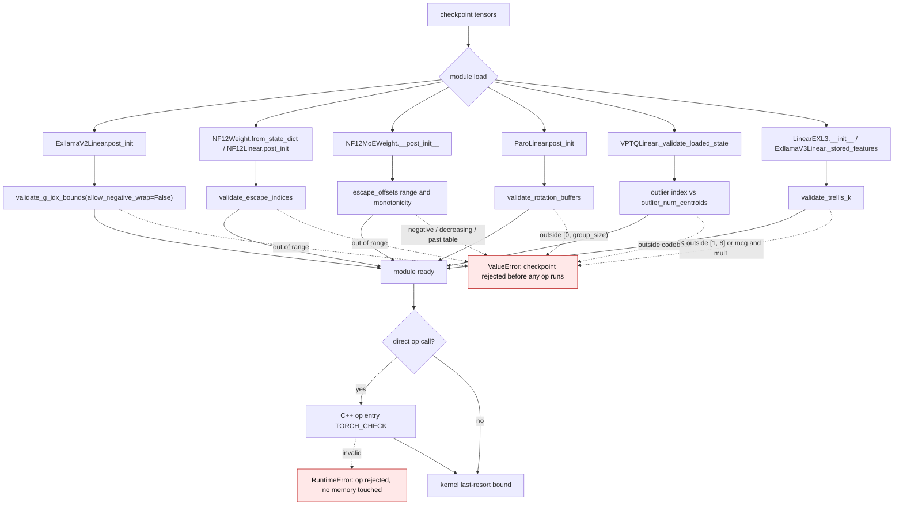
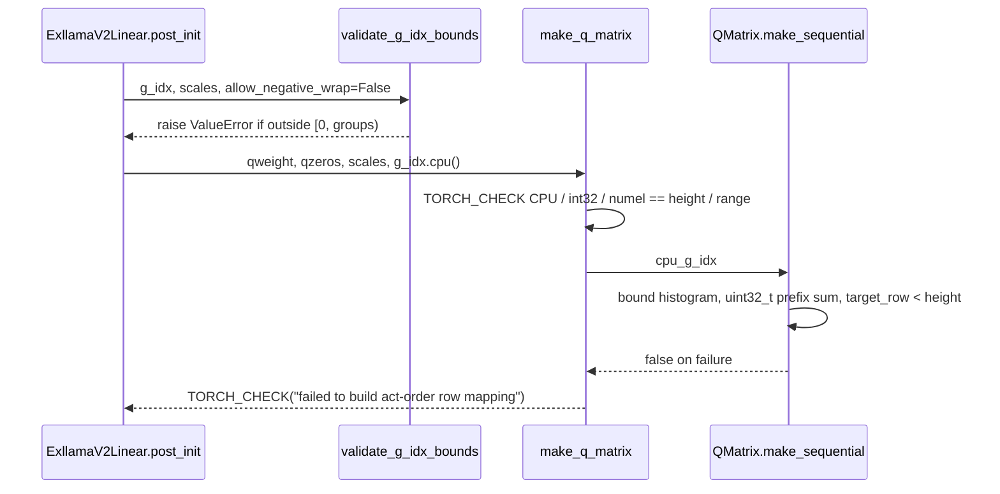
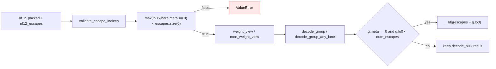

# Checkpoint index validation

Quantized checkpoints carry integer tensors that are used as *indices*, not as
weights: GPTQ act-order `g_idx`, NF12 escape indices and MoE escape offsets,
ParoQuant rotation pairs, VPTQ outlier codes, and the EXL3 trellis `K`. A
crafted checkpoint can put any value in them. Native kernels previously used
those values directly, so a bad value read or wrote past a histogram, an
escape table, a codebook, shared memory, or a function-pointer table.

The contract is now **fail closed at load, and fail closed again at the op
entry**:

1. Each format validates its checkpoint index tensors once, when the module is
   loaded (`post_init` or `from_state_dict`).
2. Each C++ op entry repeats the checks it can afford, so direct
   `torch.ops`/C API callers that bypass the loader are protected too.
3. Kernels keep a last-resort bound (`g.lo0 < num_escapes`, pair masking) so a
   missed caller cannot corrupt memory.

Introduced by issue #3971.

## New flow

## Before / after

| Sink | Old behaviour (`origin/main`) | New guard |
| --- | --- | --- |
| ExLlamaV2 `g_idx` host heap write | `ext_gptq.cpp:10` checked only int32; `q_matrix.cu:553` `calloc(groups,4)` then `:559` `cpu_g_idx_map[cpu_g_idx[i]]++`; `:582` `cpu_x_map[cpu_x_map_inv[row]] = row` | `ext_gptq.cpp:77-91` checks CPU/int32/length/range; `q_matrix.cu:556-607` bounds every write and uses `uint32_t` for the prefix sum |
| ExLlamaV2 `short` truncation | `q_matrix.cu:565` `short tmp = cpu_g_idx_map[i]`; a group of 32768 rows made the prefix sum negative | `q_matrix.cu:583` `uint32_t tmp` plus `acc > height` / `target_row < height` checks |
| NF12 escape index (CUDA) | `format.cuh:78,107` `__ldg(escapes + g.lo0)`; `gemv.cu:159`, `mma.cuh:523,720,868,1034`, `sm100/large_m_tc_kernel.cuh:670` | `format.cuh:72-88` and `:106-113` take `num_escapes` and check `g.lo0 < num_escapes`; every linear/decode kernel passes its count |
| NF12 escape index (HIP) | `nf12_format_hip.cuh:134-145` `escapes[g.lo0]` | `nf12_format_hip.cuh:134-141` checks `g.lo0 < num_escapes`; decode/WMMA/MoE pass the count |
| NF12 MoE `escape_offsets` | `nf12/csrc/torch/ops.cpp:484-517` checked only contiguity/int64/E+1 | `nf12/csrc/torch/ops.cpp:508-524` checks `>= 0`, monotone, `offsets[E] <= escapes.size(0)` |
| ParoQuant `pairs` | `rotation.cu:1003-1030` checked device/dtype/rank; `rotation.cuh:73-81,148-160` used int16 pairs as shared-memory rows | `rotation.cu:1028-1040` checks `idx.size(1) == h`, theta/scale geometry; `rotation.cuh` masks pairs into `GROUP_SIZE` |
| VPTQ `outlier_indices` | `vptq_kernel.cu:428,491` passed any int32 to `:73` `code * outlier_vector_len`; loader checked only shape | `vptq_torch.py:334-342` range check; `vptq_kernel.cu:431-444` op-entry check |
| EXL3 trellis `K` | `reconstruct.cu:100` checked only `packed.size(2)`; `:124-130` indexed a 24-entry `std::array` | `reconstruct.cu:116-122` `TORCH_CHECK(1 <= K && K <= 8 && !(mcg && mul1))`; loader checks in `exl3.py:78` and `exllamav3.py:_stored_features` |
| FloatX empty scale | `floatx_cpu.cpp:205,237,244,261` took `% count` with `count == 0` → SIGFPE | `floatx_cpu.cpp:201,236,256` reject an empty scale with `TORCH_CHECK` |
| EXL3 device tables | `exl3_devctx.cu:25-68`, `exl3_gemm.cu:37,131-143` indexed `MAX_DEVICES` arrays unchecked | `exl3_devctx.cu:26,36,54,67` and `exl3_gemm.cu:85-88` reject ordinal `>= MAX_DEVICES` |

## Per-format detail

### ExLlamaV2 act-order

`make_sequential()` runs at *load* time (`post_init` → `_ensure_q_handle` →
`exllamav2_make_q_matrix`), so the bad value never needs a forward pass.

### NF12 escapes

The escape index is stored in the packed stream (`g.lo0` when `g.meta == 0`).
The loader decodes it once; the kernels receive `num_escapes` and clamp.

## Contracts

- **Fail closed.** Every validator raises (`ValueError` at load,
  `RuntimeError`/`TORCH_CHECK` at the op entry). None of them repairs the
  tensor, and none is selectable by an environment variable.
- **Checkpoint data is untrusted.** A validator may run on CPU (before the
  module moves to the device) or on CUDA; it never mutates the checkpoint.
- **One validation pass per format.** The load-time pass is the primary gate.
  The op-entry checks are deliberately cheap shape/range checks; the NF12 MoE
  offset check copies `E + 1` integers, and the VPTQ outlier check scans the
  outlier codes.
- **Kernels keep a bound.** `g.lo0 < num_escapes` and the ParoQuant pair mask
  remain in device code so a missed caller cannot read or write out of bounds.
