# Checkpoint interop: module filters, format changes, save, Marlin, export, and mixed-bit dequantization

This page describes how GPT-QModel reads third-party checkpoints and how it
saves and exports them without changing the caller's live model. It covers the
interop fixes shipped for issue #4053: producer module filters, format-changing
re-saves, `save_pretrained()` layout safety, `save()` model replacement, Marlin
activation-order indices, `is_marlin_format`, `GPTQModel.export`, and
per-module `dynamic` bit widths in `dequantize_model`.

Two rules run through every flow: the checkpoint's stored metadata and tensors
are authoritative, and a layout that cannot be reproduced exactly fails closed
instead of silently writing different tensors under the same names.

## 1. Producer-declared module filters

Third-party producers describe unquantized modules outside GPT-QModel's
`dynamic` map:

| Producer | Key | Meaning |
| --- | --- | --- |
| AutoAWQ / HF `AwqConfig` | `modules_to_not_convert` | substrings / names left dense |
| llm-compressor | `ignore` | names / patterns left dense |
| Optimum GPTQ | `modules_in_block_to_quantize` | list of lists of module suffixes that **are** quantized |

`QuantizeConfig.from_quant_config` folds the two exclusion lists into `-:`
rules, and records the Optimum inclusion list for the loader:

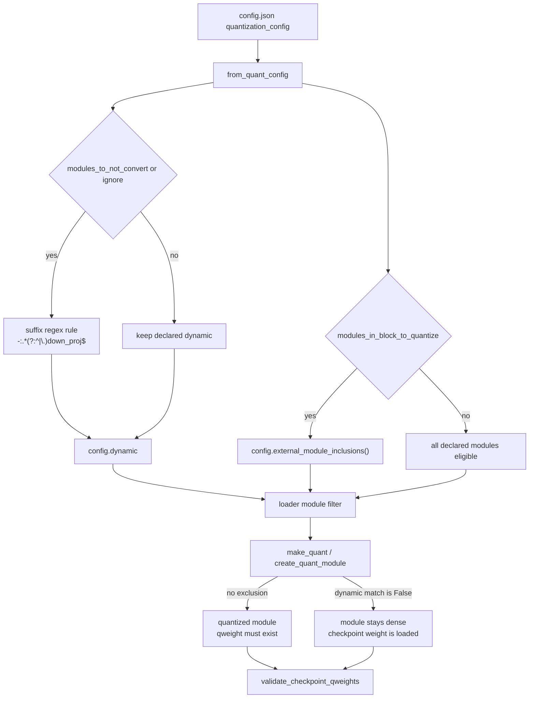

`-:` rules are first-match and therefore inserted before any positive rule.
Plain names become a dot-boundary suffix regex because `dynamic` matching is
start-anchored while the producer keys are substring/suffix matches.

`validate_checkpoint_qweights` now covers the AWQ formats (and shared
Marlin/BitBLAS formats) as well as GPTQ. A module the loader decided to quantize
must have its `qweight` in the checkpoint; otherwise the load raises instead of
leaving a zero-filled placeholder that produces NaN.

## 2. Re-saving a loaded checkpoint under a different format

`models/loader.py` records the on-disk layout and the core packing parameters
when a checkpoint is loaded. `models/writer.py::save_quantized` validates the
requested target before writing anything, and `get_model_with_quantize` applies
the exact conversion when it rebuilds the export shell.

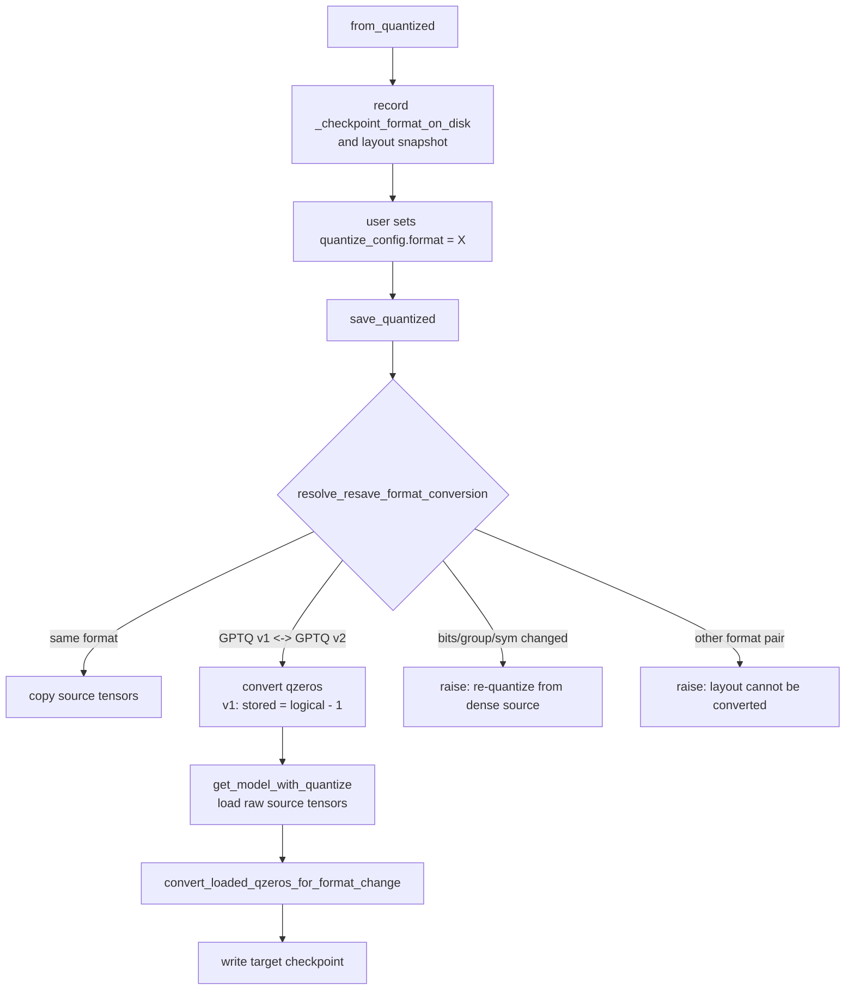

The only supported layout change is the qzero shift between GPTQ v1 and GPTQ
v2. It decodes each stored zero point, applies `+1` or `-1` in logical space,
and repacks, so a packed word never carries into its neighbour. Every other
format change (for example GPTQ to Marlin, or GEMM to GEMV) needs a different
weight layout and is refused with an actionable error.

## 3. `save_pretrained()` and runtime kernel layouts

`transformers`' `save_pretrained()` calls `state_dict()`, which serializes the
live module buffers. Some kernels keep a converted runtime layout:

| Kernel | Runtime state | Save behaviour |
| --- | --- | --- |
| Torch / Triton v2 | v2 qzeros | emits v1 qzeros when the checkpoint is v1 |
| Marlin / AWQ Marlin | repacked `qweight`, empty `qzeros`/`g_idx` | raises |
| ExLlamaV2 / AWQ ExLlamaV2 | shuffled `qweight` | raises |

`GPTQQuantLinear._save_to_state_dict` compares `_qzeros_format` with
`_checkpoint_format_on_disk` and writes a converted copy into the destination;
it never mutates the live module. Kernels whose weight permutation has no
inverse raise from their own `_save_to_state_dict`.

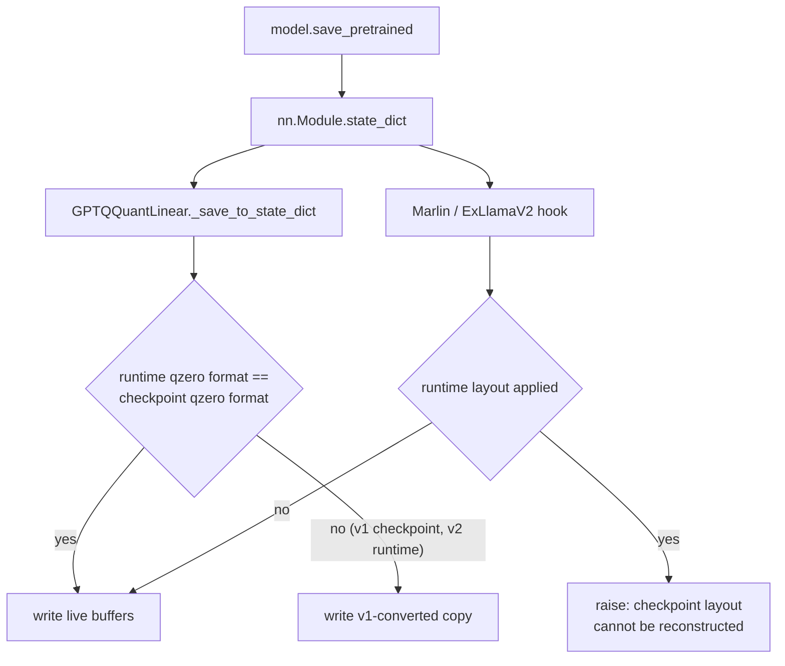

`GPTQModel.save()` is unaffected: it rebuilds the export shell from the source
checkpoint and never serializes the runtime kernel layout.

## 4. Save keeps the live model

`save_quantized()` needs a shell model that owns the raw checkpoint tensors for
loaded quantized models. It builds that shell with
`get_model_with_quantize()` but keeps it in a local (`model_for_save`).
`self.model` is never replaced, so inference after `save()` still uses the
kernel the caller loaded.

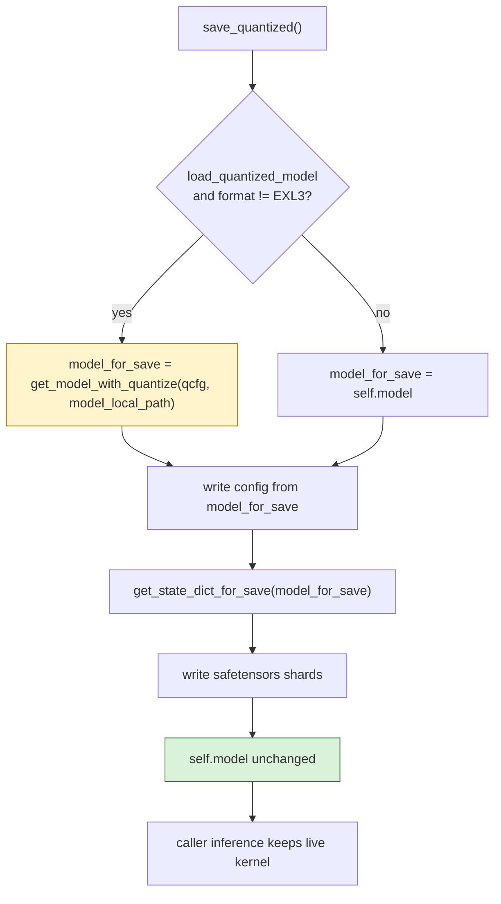

Before this change `save_quantized()` assigned the shell to `self.model`. For a
Marlin checkpoint that shell was an fp16 `TorchCpuAvx512Linear` model with no
`post_init`, and the caller's logits moved by relative 1.47 after `save()`.

## 5. Marlin honors a non-contiguous `g_idx`

`MarlinLinear.post_init()` now compares the stored `g_idx` with the contiguous
mapping `arange(K) // group_size`. When `desc_act=False` but the index is
non-contiguous, the module switches to the activation-order path: it sorts the
index with `marlin_sort_g_idx()`, repacks `qweight` with
`g_idx_sort_indices`, and sets `is_k_full=True`. Shapes that cannot run the
activation-order kernel fail closed instead of decoding contiguous groups.

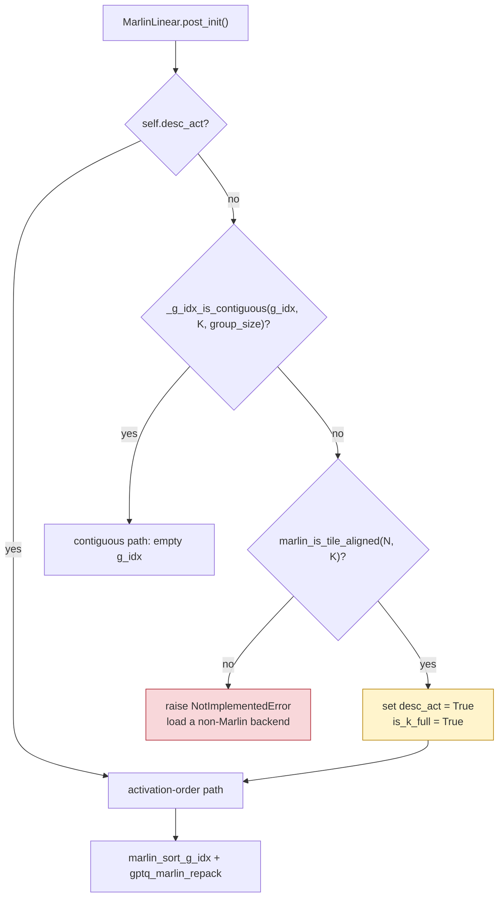

The motivating checkpoint, `Qwen2-1.5B-Instruct-GPTQ-4bits-gp32`, declares
`desc_act: false` and stores a block-permuted `g_idx`. Layer-0 `q_proj`
relative error against the Torch decode was 0.13885 before the change and
0.00000 after it.

## 6. `is_marlin_format` accepts `false`

AutoGPTQ and hugging-quants checkpoints persist `is_marlin_format: false`.
Only the removed `true` value requested the legacy Marlin runtime layout, so
`false` (or a string `"false"`) is dropped silently and `true` still raises.

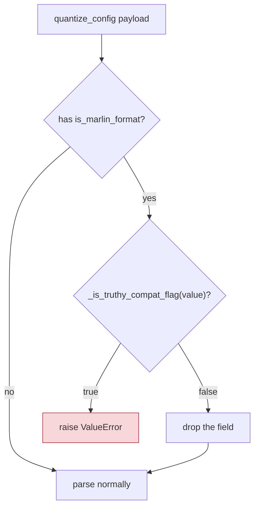

## 7. `export(..., "hf")` routes through the checkpoint dequantizer

`GPTQModel.export()` sends `format="hf"` to
`gptqmodel.utils.model_dequant.dequantize_model()` before selecting a runtime
backend. That decoder handles AWQ GEMM/GEMV layouts, GPTQ, quantized
embeddings, and checkpoints that only ship `quantize_config.json`. The output
is a dense Transformers directory that reloads with
`AutoModelForCausalLM.from_pretrained()`.

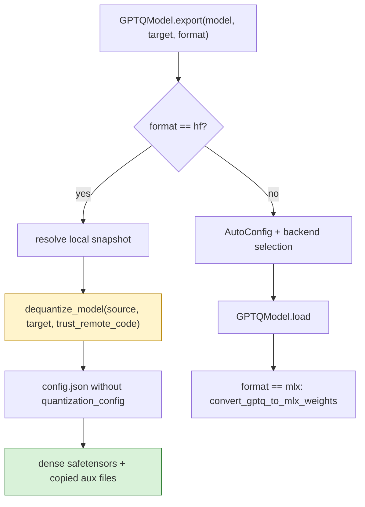

The old path loaded the model with a runtime backend and called
`nn_modules.qlinear.torch.dequantize_model()`. That function accepted only
`TorchLinear` (so AWQ failed), turned quantized embeddings into `nn.Linear`
(shape error on forward), and hard-coded fp16. The new path never selects a
runtime kernel for `hf`.

## 8. `dequantize_model` resolves per-module bits

`convert_gptq_file()` resolves each module's width through
`dynamic_get(dynamic, prefix, "bits", default)`, mirroring the AWQ path. The
default itself is normalized with `quant_bits_width`, so a string `"4"` is
accepted. `dequantize_model()` also merges a legacy `quantize_config.json`
into `config.json`'s `quantization_config` when the latter is missing fields.

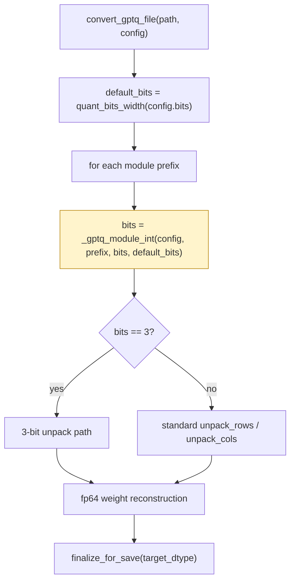

A mixed 3-bit body with a 4-bit `lm_head` previously decoded every module with
the 3-bit default and raised
`3-bit GPTQ qzeros expects columns divisible by 3`. A 4-bit body with an 8-bit
`lm_head` raised a size mismatch. Both now decode exactly against an fp64
oracle.

## 9. `load_state_dict()` round-trips and partial loads

`state_dict()` emits checkpoint-layout qzeros (v1 for a v1 checkpoint) while
the Torch/Triton kernels keep v2 words in memory. `GPTQQuantLinear._load_from_state_dict`
must therefore convert a self round-trip back to v2, and must not touch the
runtime layout when the incoming state dict has no `qzeros` (PEFT adapters and
other partial loads).

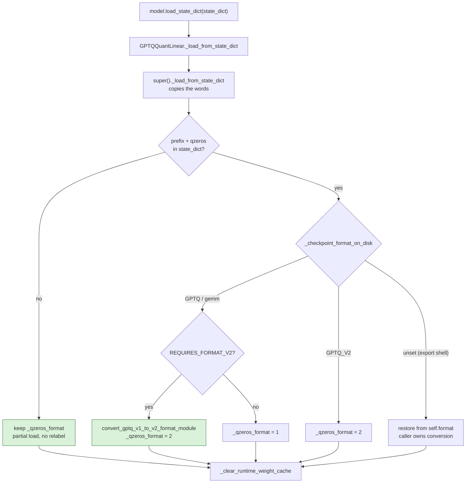

Before this change a v1 model loaded with `load_state_dict(state_dict())`
copied `0x77777777` into the live v2 buffer and set `_qzeros_format = 1`; every
zero point decoded one high and `strict=True` still reported all keys matched.
On the synthetic 1-layer fixture the logits moved by relative `0.406`; the
round trip is now bit-identical. A partial `load_state_dict({}, strict=False)`
used to flip `_qzeros_format` from 2 to 1 while the buffer stayed v2, so the
next save wrote `0x88888888` under the v1 label. It now leaves the layout and
the saved bytes unchanged.

## 10. HF `quant_method` for RTN AWQ exports and packed GGUF

`BaseQuantizeConfig.to_dict()` publishes `export_quant_method()`, not the
internal quantizer `method`. An RTN config with `format="gemm"` therefore
writes `method: gptq` with `quant_method: awq`, which is what
`AutoModelForCausalLM.from_pretrained` needs to select an AWQ loader.
`quant_method` is a deprecated alias for `method`; when both keys are present
the canonical `method` value wins, so the alias cannot switch the quantizer
back to GPTQ.

Packed GGUF is different: `transformers` owns the `gguf` name and routes it to
`GgufHfQuantizer`, which expects a `.gguf` file. GPT-QModel publishes
`gptqmodel_gguf` instead and registers a refusing quantizer for that name.
Every other GPT-QModel-only layout (`exl3`, `qqq`, `paroquant`, `macaq`,
`nf12`, `tt-blockfloat`) is registered from
`REFUSED_HF_QUANT_METHODS` in `gptqmodel/_quant_methods.py`.

The registration only exists after `import gptqmodel`. Plain `transformers`
without that import does **not** raise for these names; `5.22` logs
`Unknown quantization type, got <name> ... skip the quantization` and then
random-initializes every linear layer. Importing `gptqmodel` (or loading
through `GPTQModel.load`) installs the refusing quantizer, which turns the
same checkpoint into an actionable `ValueError`.

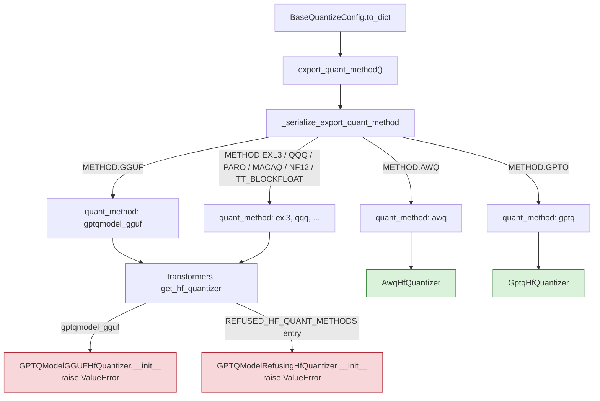

Already-published GGUF checkpoints keep `quant_method: "gguf"` (plus
`method: "gguf"`) and still load through `GPTQModel.load`; `gguf` remains
accepted by `_normalize_quant_method`. Only new checkpoints publish the
non-colliding name. `hf_compat_warnings` also warns at save time that a packed
GGUF checkpoint is not loadable by plain Transformers, and emits the same
save-time warning for every method in `REFUSED_HF_QUANT_METHODS`.

## 11. `torch.save(model)` after `optimize()`

`optimize()` may replace an eager callable with a `torch.compile` wrapper,
which pickle cannot serialize: `TorchLinear` shadows `dequantize_weight`,
VPTQ shadows `dequantize`, and the FP8/EXL3 Torch kernels store
`_compiled_forward`. `BaseQuantLinear.__getstate__` (via
`gptqmodel/nn_modules/compiled_state.py`) and
`ExllamaV3TorchLinear.__getstate__` drop those wrappers and reset `optimized`.
The eager class method is the fallback, so the unpickled module keeps working
without the compiled callable.

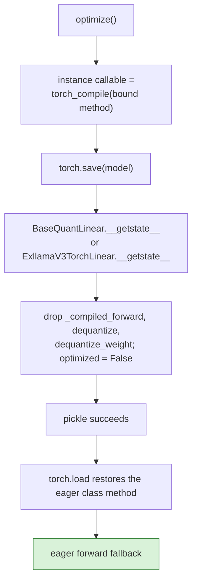

## Failure contract

### Producer filters, format changes, and `save_pretrained` (items 1-3)

| Situation | Before | After |
| --- | --- | --- |
| AWQ `modules_to_not_convert` lists a dense module | loader quantizes it, NaN / missing-buffer error | module stays dense, checkpoint weight loads |
| Optimum inclusion list omits a module | loader quantizes it, `Missing required quantized weights` | only listed modules are quantized |
| Missing `qweight` on an AWQ module | no validation, zero placeholder | clear `Missing required quantized weights` |
| Format changed to another qzero layout | stale words copied under the new label | exact v1/v2 conversion |
| Format changed to a different packing | stale words copied, silent garbage | `ValueError` before writing |
| `save_pretrained()` on a Marlin/ExLlamaV2 model | runtime layout written as v1 | `RuntimeError` naming the kernel |

### State-dict round-trips, HF methods, and pickling (items 9-11)

| Situation | Before | After |
| --- | --- | --- |
| `load_state_dict(model.state_dict())` on a v1 model | v1 words copied into a v2 kernel, logits drift | exact v1 to v2 conversion, bit-identical |
| Partial `load_state_dict` without `qzeros` | `_qzeros_format` flipped to 1, next save garbage | runtime layout kept |
| RTN `format="gemm"` config | `quant_method: gptq` with `format: gemm` | `quant_method: awq` |
| New packed GGUF checkpoint in plain HF | `gguf` routed to `GgufHfQuantizer`, random weights | `gptqmodel_gguf` raises an actionable `ValueError` once `gptqmodel` is imported; otherwise HF only warns |
| `exl3` / `qqq` / `paroquant` / `macaq` / `nf12` / `tt-blockfloat` checkpoint in plain HF | `Unknown quantization type ... skip the quantization`, random weights | refusing quantizer raises once `gptqmodel` is imported; save-time warning otherwise |
| `torch.save(model)` after `optimize()` | `PicklingError` on the compiled bound method (FP8, EXL3 Torch, VPTQ) | round-trips; unpickled module runs eager |

### Save, Marlin, export, and mixed-bit dequantization (items 4-8)

| Situation | Behavior |
| --- | --- |
| `is_marlin_format: true` | `ValueError` (removed layout) |
| `is_marlin_format: false` | accepted and dropped |
| Non-contiguous `g_idx`, `desc_act=False`, tile-aligned | activation-order decode |
| Non-contiguous `g_idx`, `desc_act=False`, misaligned | `NotImplementedError`; use a non-Marlin backend |
| `export("hf")` on AWQ / quantized embeddings / legacy config | dense reloadable directory |
| Unknown/undetectable export format | `ValueError` from `detect_format` |
| `dynamic` bits override | applied per module, not globally |

## Tests

`tests/test_checkpoint_interop_4053.py` covers the synthetic AWQ exclusion
oracle, the Optimum inclusion parse, v1 to v2 re-save, the refusal path, the
`save_pretrained` qzero bytes, the runtime-layout refusal hooks, the
`load_state_dict(state_dict())` identity (Torch and Triton), the partial-load
layout, `torch.save`/`torch.load`, and the packed-GGUF refusal. The items 4-8
tests live beside their modules (`tests/test_q4_marlin.py`,
`tests/test_model_dequant_dynamic_bits.py`, `tests/test_export.py`, and the
Marlin `g_idx` regressions). `tests/qcfg/test_config_serialization.py` pins the
RTN export method, and `tests/test_checkpoint_compat.py` pins the GGUF
`quant_method` alias and save-time warning.
