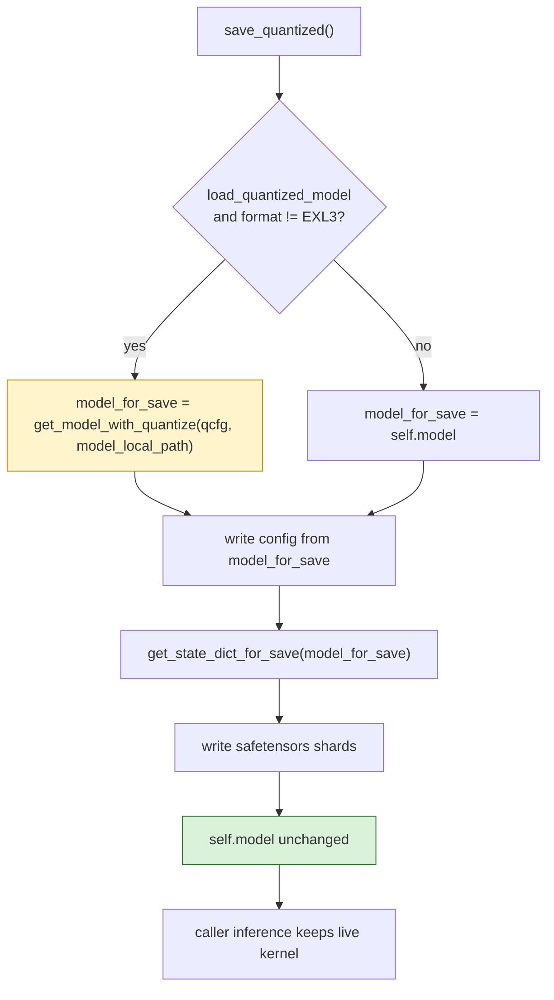
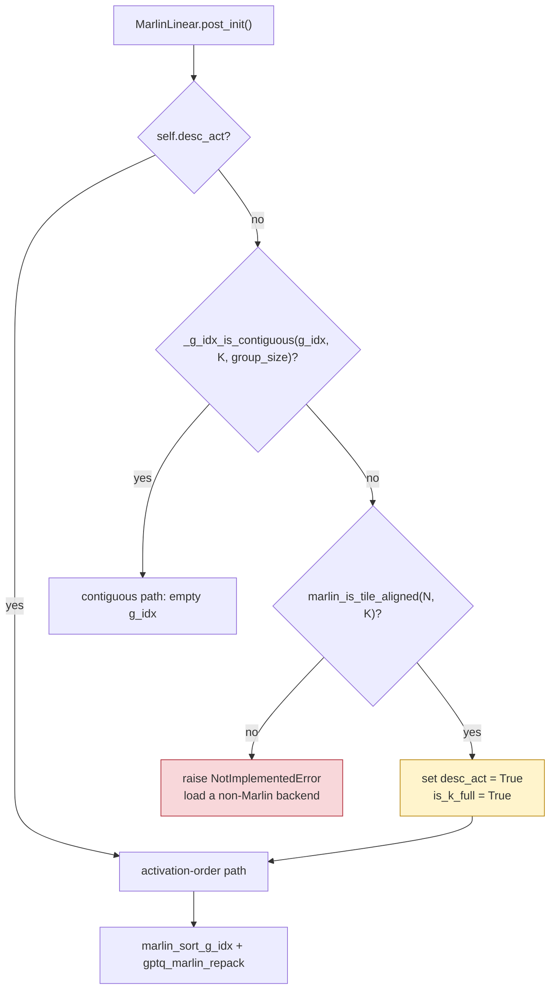
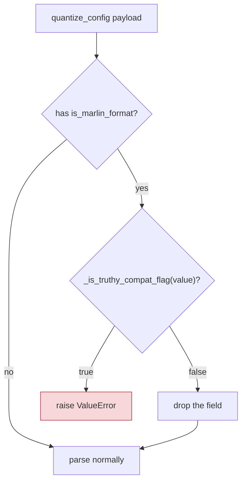
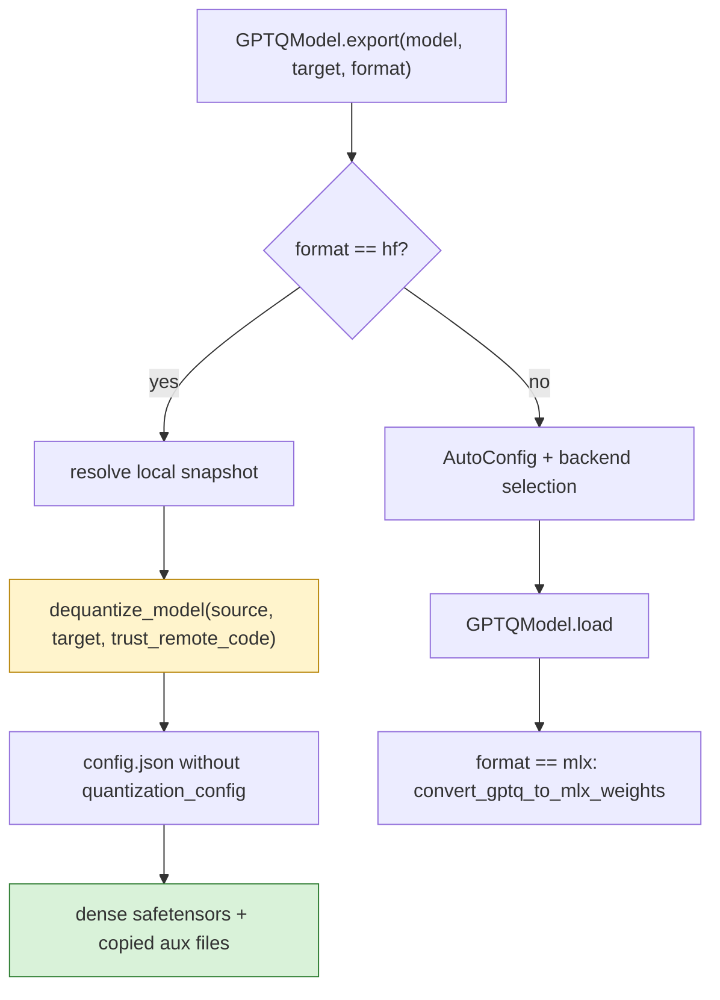
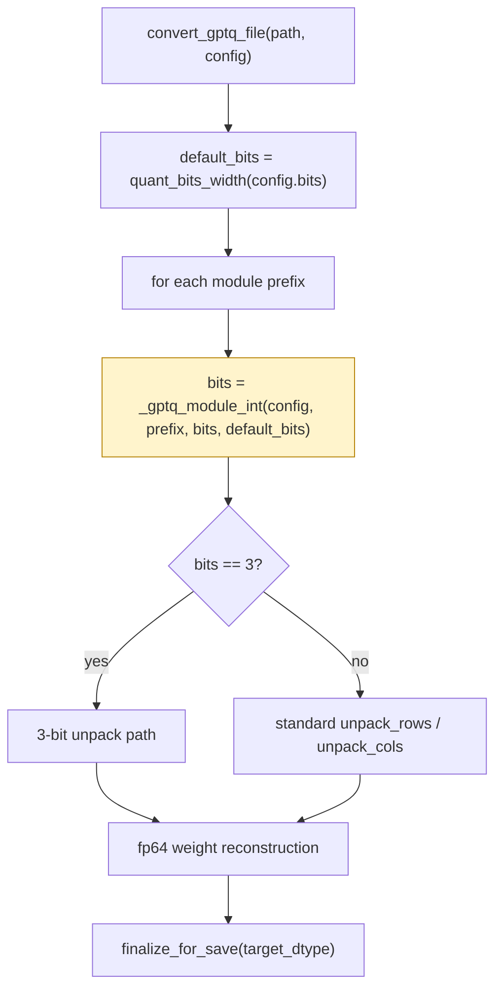

# Checkpoint interop: save, Marlin `g_idx`, format flags, export, and mixed-bit dequantization

This page describes how GPT-QModel reads third-party checkpoints and how it
saves and exports them without changing the caller's live model. It covers the
interop fixes shipped for issue #4053 items 4-8: `save()` model replacement,
Marlin activation-order indices, `is_marlin_format`, `GPTQModel.export`, and
per-module `dynamic` bit widths in `dequantize_model`.

The rule behind all five flows is the same: the checkpoint's stored metadata
and tensors are authoritative. A runtime layout, a legacy flag, or a global
default must not silently replace them.

## 1. Save keeps the live model

`save_quantized()` needs a shell model that owns the raw checkpoint tensors for
loaded quantized models. It builds that shell with
`get_model_with_quantize()` but keeps it in a local (`model_for_save`).
`self.model` is never replaced, so inference after `save()` still uses the
kernel the caller loaded.

Before this change `save_quantized()` assigned the shell to `self.model`. For a
Marlin checkpoint that shell was an fp16 `TorchCpuAvx512Linear` model with no
`post_init`, and the caller's logits moved by relative 1.47 after `save()`.

## 2. Marlin honors a non-contiguous `g_idx`

`MarlinLinear.post_init()` now compares the stored `g_idx` with the contiguous
mapping `arange(K) // group_size`. When `desc_act=False` but the index is
non-contiguous, the module switches to the activation-order path: it sorts the
index with `marlin_sort_g_idx()`, repacks `qweight` with
`g_idx_sort_indices`, and sets `is_k_full=True`. Shapes that cannot run the
activation-order kernel fail closed instead of decoding contiguous groups.

The motivating checkpoint, `Qwen2-1.5B-Instruct-GPTQ-4bits-gp32`, declares
`desc_act: false` and stores a block-permuted `g_idx`. Layer-0 `q_proj`
relative error against the Torch decode was 0.13885 before the change and
0.00000 after it.

## 3. `is_marlin_format` accepts `false`

AutoGPTQ and hugging-quants checkpoints persist `is_marlin_format: false`.
Only the removed `true` value requested the legacy Marlin runtime layout, so
`false` (or a string `"false"`) is dropped silently and `true` still raises.

## 4. `export(..., "hf")` routes through the checkpoint dequantizer

`GPTQModel.export()` sends `format="hf"` to
`gptqmodel.utils.model_dequant.dequantize_model()` before selecting a runtime
backend. That decoder handles AWQ GEMM/GEMV layouts, GPTQ, quantized
embeddings, and checkpoints that only ship `quantize_config.json`. The output
is a dense Transformers directory that reloads with
`AutoModelForCausalLM.from_pretrained()`.

The old path loaded the model with a runtime backend and called
`nn_modules.qlinear.torch.dequantize_model()`. That function accepted only
`TorchLinear` (so AWQ failed), turned quantized embeddings into `nn.Linear`
(shape error on forward), and hard-coded fp16. The new path never selects a
runtime kernel for `hf`.

## 5. `dequantize_model` resolves per-module bits

`convert_gptq_file()` resolves each module's width through
`dynamic_get(dynamic, prefix, "bits", default)`, mirroring the AWQ path. The
default itself is normalized with `quant_bits_width`, so a string `"4"` is
accepted. `dequantize_model()` also merges a legacy `quantize_config.json`
into `config.json`'s `quantization_config` when the latter is missing fields.

A mixed 3-bit body with a 4-bit `lm_head` previously decoded every module with
the 3-bit default and raised
`3-bit GPTQ qzeros expects columns divisible by 3`. A 4-bit body with an 8-bit
`lm_head` raised a size mismatch. Both now decode exactly against an fp64
oracle.

## Failure contract

| Situation | Behavior |
| --- | --- |
| `is_marlin_format: true` | `ValueError` (removed layout) |
| `is_marlin_format: false` | accepted and dropped |
| Non-contiguous `g_idx`, `desc_act=False`, tile-aligned | activation-order decode |
| Non-contiguous `g_idx`, `desc_act=False`, misaligned | `NotImplementedError`; use a non-Marlin backend |
| `export("hf")` on AWQ / quantized embeddings / legacy config | dense reloadable directory |
| Unknown/undetectable export format | `ValueError` from `detect_format` |
| `dynamic` bits override | applied per module, not globally |
