# Checkpoint interop: module filters, format changes, save, Marlin, and dequantization

This page describes how GPT-QModel reads third-party checkpoints and how it
saves and dequantizes them without changing the caller's live model. It covers the
interop fixes shipped for issue #4053: producer module filters, format-changing
re-saves, `save_pretrained()` layout safety, `save()` model replacement, Marlin
activation-order indices, `is_marlin_format`, dense dequantization, and
per-module `dynamic` bit widths in `dequantize_model`.

Two rules run through every flow: the checkpoint's stored metadata and tensors
are authoritative, and a layout that cannot be reproduced exactly fails closed
instead of silently writing different tensors under the same names.

For GPTQ zero points the contract is: the live `qzeros` buffer stays in the
kernel's runtime layout (recorded by `_qzeros_format`), the checkpoint marker
records only the emitted layout, and the v1/v2 conversion runs only when a
state dict crosses a serialization boundary. It is idempotent and driven by the
layout marker that travels with that same state dict. Checkpoints never persist
the marker itself.

## 1. Producer-declared module filters

Third-party producers describe unquantized modules outside GPT-QModel's
`dynamic` map:

| Producer | Key | Meaning |
| --- | --- | --- |
| AutoAWQ / HF `AwqConfig` | `modules_to_not_convert` | substrings / names left dense |
| llm-compressor | `ignore` | names / patterns left dense |
| Optimum GPTQ | `modules_in_block_to_quantize` | list of lists of module suffixes that **are** quantized |

`QuantizeConfig.from_quant_config` folds the two exclusion lists into `-:`
rules, and records the Optimum inclusion list for the loader:

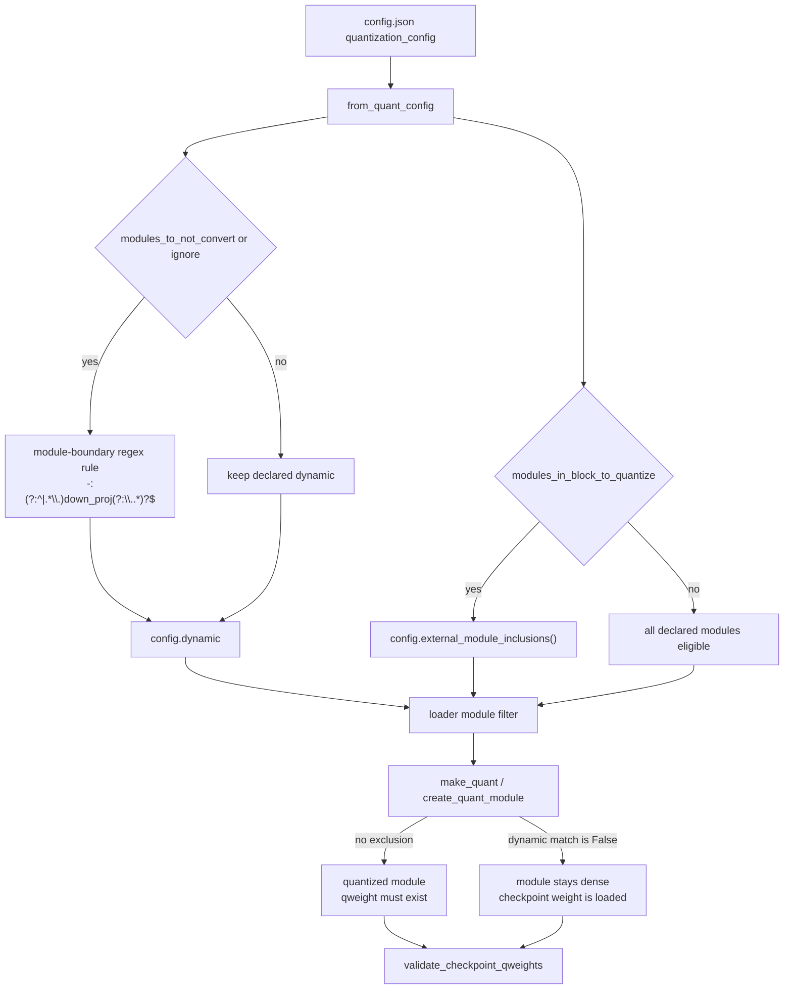

`-:` rules are first-match and therefore inserted before any positive rule.
Plain names become a module-boundary regex that also covers children because
`dynamic` matching is start-anchored while the producer keys name modules
(substrings / prefixes). llm-compressor's `re:` prefix is stripped and the
regex kept verbatim. On export, `-:` exclusions are written to
`modules_to_not_convert` as plain module names (not `pcre.escape`d regexes) so
substring-matching consumers such as vLLM can skip them.

`validate_checkpoint_qweights` now covers the AWQ formats (and shared
Marlin/BitBLAS formats) as well as GPTQ. A module the loader decided to quantize
must have its `qweight` in the checkpoint; otherwise the load raises instead of
leaving a zero-filled placeholder that produces NaN.

## 2. Re-saving a loaded checkpoint under a different format

`models/loader.py` records the on-disk layout and the core packing parameters
when a checkpoint is loaded. `models/writer.py::save_quantized` validates the
requested target before writing anything, and `get_model_with_quantize` applies
the exact conversion when it rebuilds the export shell.

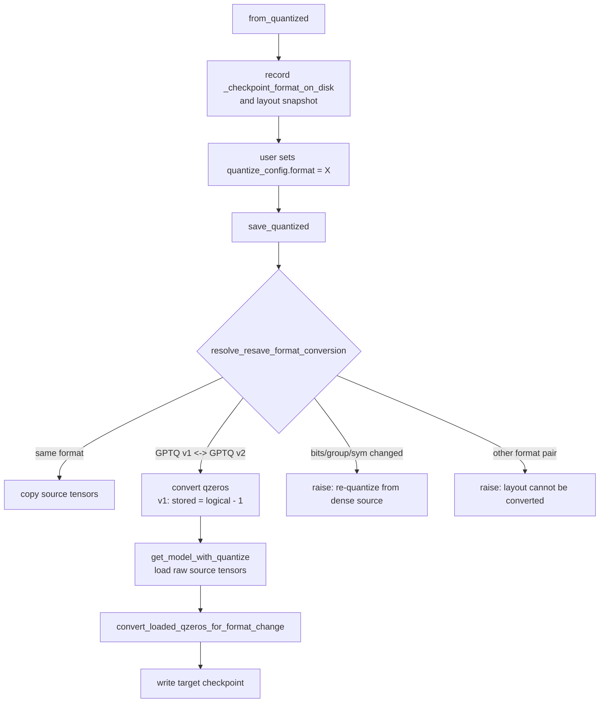

The only supported layout change is the qzero shift between GPTQ v1 and GPTQ
v2. It decodes each stored zero point, applies `+1` or `-1` in logical space,
and repacks, so a packed word never carries into its neighbour. Every other
format change (for example GPTQ to Marlin, or GEMM to GEMV) needs a different
weight layout and is refused with an actionable error.

## 3. `save_pretrained()` and runtime kernel layouts

`transformers`' `save_pretrained()` calls `state_dict()`, which serializes the
live module buffers. Some kernels keep a converted runtime layout:

| Kernel | Runtime state | Save behaviour |
| --- | --- | --- |
| Torch / Triton v2 | v2 qzeros | emits v1 qzeros when the checkpoint is v1 |
| Marlin / AWQ Marlin | repacked `qweight`, empty `qzeros`/`g_idx` | raises on a checkpoint write; read-only `state_dict()` returns the runtime tensors |
| Machete | prepacked `qweight`, sorted `g_idx`, float `qzeros` offsets | raises on a checkpoint write; read-only `state_dict()` returns the runtime tensors |
| Swordfish / AWQ Swordfish | prepacked `qweight`, float `qzeros` offsets | raises on a checkpoint write; read-only `state_dict()` returns the runtime tensors |
| BitBLAS (repacked from GPTQ/AWQ) | BitBLAS-compressed `qweight`/`qzeros` | raises on a checkpoint write; a natively loaded BitBLAS checkpoint still round-trips |
| ExLlamaV2 / AWQ ExLlamaV2 | shuffled `qweight` | raises on a checkpoint write; read-only `state_dict()` returns the runtime tensors |
| TorchAten / TorchFused / AVX512, GPTQ and AWQ | int4pack `qweight`, float affine offsets | emits the captured checkpoint snapshot |
| AllSpark / AWQ AllSpark | checkpoint tensors authoritative; the kernel layout lives in non-persistent `*_packed` buffers | emits the checkpoint tensors |

`GPTQQuantLinear._save_to_state_dict` compares `_qzeros_format` with
`_checkpoint_format_on_disk` and writes a converted copy into the destination;
it never mutates the live module.

### 3.1 Incoming layout and idempotent load conversion

The live `qzeros` buffer holds zero points in the kernel's runtime convention.
`_qzeros_format` records that convention, and `_checkpoint_format_on_disk`
records the convention the next checkpoint write emits. The v1 convention
stores `zero_point - 1`; the v2 convention stores the logical zero point.
Conversion happens only at the two serialization boundaries: incoming state
dict to live (`_load_from_state_dict`) and live to emitted
(`checkpoint_layout_qzeros`).

The incoming layout is taken from the marker that belongs to the same state
dict, never from the module's default buffer. When the words and their marker
already match the live layout, the load is a no-op. That matters because
`accelerate` with `device_map=None` loads a sharded checkpoint by calling
`set_model_state_dict` once per shard and refilling every missing key from the
module's own buffers. Converting those refilled words again shifted every zero
point once per shard (issue #4166). The export shell used by `save()` also
declares the source layout before loading and passes `device_map={"": "cpu"}`
so each tensor is loaded exactly once.

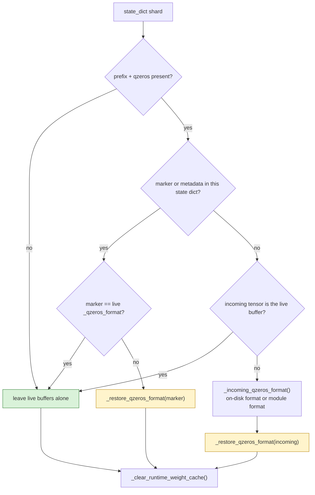

Kernels whose weight permutation has no inverse raise from their own
`_save_to_state_dict`, but only while a checkpoint is actually being written.
`gptqmodel.utils.checkpoint_state.checkpoint_serialization()` marks that scope
with a `ContextVar`; outside it, `state_dict()` is a read-only collection and
returns the runtime tensors. This is required because PEFT's
`set_peft_model_state_dict` calls `model.state_dict()`, so an unconditional
raise made *loading* an adapter fail on the default CUDA kernel.

`PreTrainedModel.save_pretrained()` is wrapped once at import
(`gptqmodel._patch_transformers_save_pretrained_runtime_layout_guard`) so it
runs inside that scope. Without the wrapper the Transformers writer collected
`state_dict()` on the read-only side and published the private layout with no
error: the directory then reloaded as garbage (ExLlamaV2) or with a shape error
(Marlin), and AUTO picks those kernels by default on CUDA.

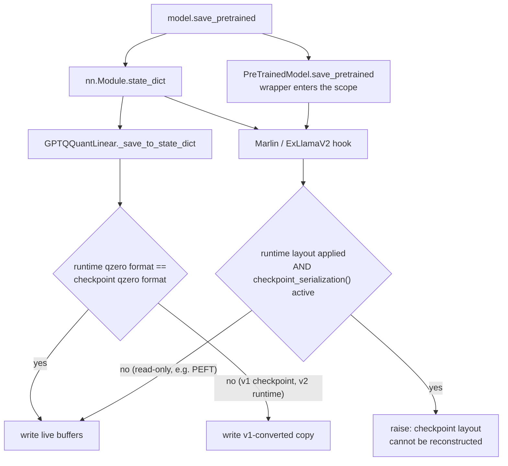

GPT-QModel's own writers enter that scope before they collect tensors: the
module-replacement path in `models/writer.py` wraps `module.state_dict()`, and
the Transformers wrapper covers `PreTrainedModel.save_pretrained()`.
`save_quantized()` builds a separate export shell that owns the raw checkpoint
tensors, so it never serializes a runtime layout in the first place.

A caller that bypasses both writers — `torch.save(model.state_dict())` — cannot
be intercepted at save time, so the payload marks itself instead: the
`qzeros_format` buffer is written as `0` for a runtime layout, and
`_load_from_state_dict` raises `RuntimeError` when that value reaches a module
holding checkpoint tensors. The save succeeds and the mismatched reload fails
loudly, which is the minimum contract for a transport this library does not
own. A module that is *itself* in a runtime layout keeps its own round trip,
because that is how ExLlamaV2 rebinds finalized words between matching layers.

That marker is deliberately **not** persisted in a checkpoint.
`PackedGroupedQuantLinear._write_state_dict_layout_marker` removes the
persistent buffer from the destination while `checkpoint_serialization()` is
active, so HF `save_pretrained()` writes exactly the tensor set that
`GPTQModel.save()` writes: no `*.qzeros_format` key per quantized layer. The
tensor is still emitted for read-only `state_dict()` transports — a plain dict
copy or a safetensors round trip within a live process — which is what keeps
the v1/v2 label attached when `_metadata` is dropped (#4125 item 3). A
checkpoint reload resolves its layout from `config.json`'s `checkpoint_format`,
so the persisted marker is redundant and was only publishing a key that the
GPTQ/AWQ format does not describe.

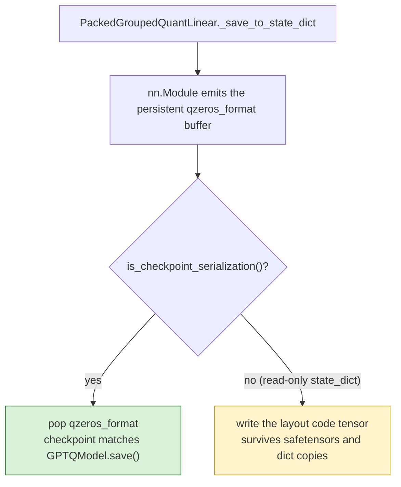

`GPTQModel.save()` is unaffected: it rebuilds the export shell from the source
checkpoint and never serializes the runtime kernel layout.

## 4. Save keeps the live model

`save_quantized()` needs a shell model that owns the raw checkpoint tensors for
loaded quantized models. It builds that shell with
`get_model_with_quantize()` but keeps it in a local (`model_for_save`).
`self.model` is never replaced, so inference after `save()` still uses the
kernel the caller loaded.

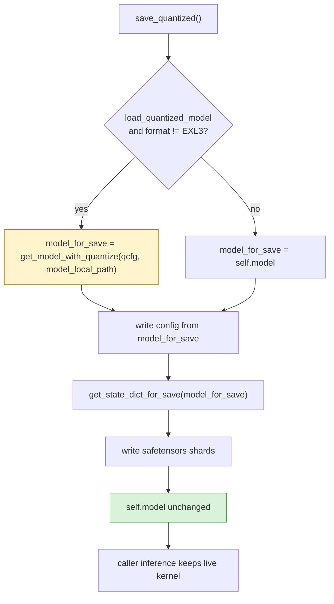

Before this change `save_quantized()` assigned the shell to `self.model`. For a
Marlin checkpoint that shell was an fp16 `TorchCpuAvx512Linear` model with no
`post_init`, and the caller's logits moved by relative 1.47 after `save()`.

## 5. Marlin honors a non-contiguous `g_idx`

`MarlinLinear.post_init()` now compares the stored `g_idx` with the contiguous
mapping `arange(K) // group_size`. When `desc_act=False` but the index is
non-contiguous, the module switches to the activation-order path: it sorts the
index with `marlin_sort_g_idx()`, repacks `qweight` with
`g_idx_sort_indices`, and sets `is_k_full=True`. Shapes that cannot run the
activation-order kernel fail closed instead of decoding contiguous groups.

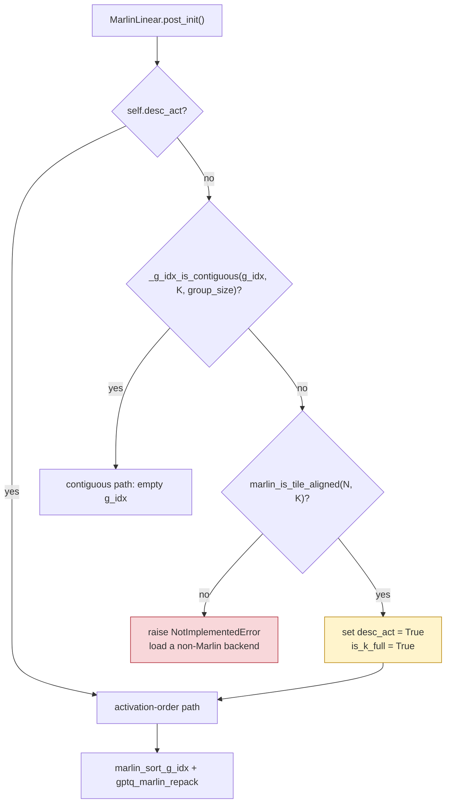

The guard reads `g_idx` before any checkpoint is loaded, so the constructor
placeholder is part of the contract. `MarlinLinear.__init__` seeds `g_idx` with
the canonical `arange(K) // group_size` mapping instead of `torch.empty()`. The
canonical mapping is the identity ordering: a checkpoint that omits `g_idx`
for a `desc_act=False` layer stays on the contiguous path (and no longer fails
tile-alignment validation for shapes such as K=288/N=200), while a
`desc_act=True` module built without a checkpoint starts from the identity
ordering rather than from uninitialised memory. A checkpoint that does store a
real permutation still takes the activation-order path above.

The motivating checkpoint, `Qwen2-1.5B-Instruct-GPTQ-4bits-gp32`, declares
`desc_act: false` and stores a block-permuted `g_idx`. Layer-0 `q_proj`
relative error against the Torch decode was 0.13885 before the change and
0.00000 after it.

## 6. `is_marlin_format` accepts `false`

AutoGPTQ and hugging-quants checkpoints persist `is_marlin_format: false`.
Only the removed `true` value requested the legacy Marlin runtime layout, so
`false` (or a string `"false"`) is dropped silently and `true` still raises.

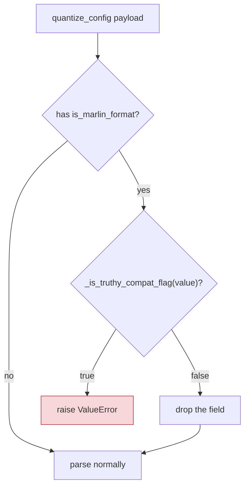

## 7. Dense dequantization with `dequantize_model`

`gptqmodel.utils.model_dequant.dequantize_model()` writes a dense Transformers
directory from a quantized checkpoint. It handles AWQ GEMM/GEMV layouts, GPTQ,
quantized embeddings, and checkpoints that only ship `quantize_config.json`.
The output reloads with `AutoModelForCausalLM.from_pretrained()`.

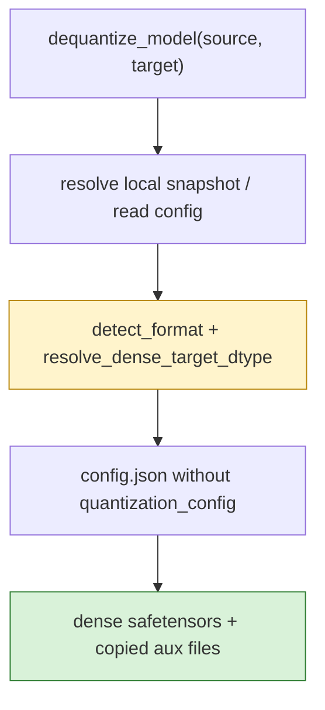

The decoder replaced the older runtime-backed path that called
`nn_modules.qlinear.torch.dequantize_model()`. That function accepted only
`TorchLinear` (so AWQ failed), turned quantized embeddings into `nn.Linear`
(shape error on forward), and hard-coded fp16. The checkpoint-level path never
selects a runtime kernel.

The dense dtype is the checkpoint's own: with no explicit `target_dtype`,
`dequantize_model()` calls `resolve_dense_target_dtype(config)`, which reads
`dtype`, legacy `torch_dtype`, or `text_config` and accepts float16, bfloat16
and float32. Only a checkpoint that declares none of them falls back to
bfloat16. An fp16 GPTQ checkpoint therefore dequantizes to `dtype=float16` with F16
tensors instead of being rewritten as bf16 (#4455).

### The `GPTQModel.export()` and MLX conversion APIs were removed

`GPTQModel.export(model_id_or_path, target_path, format)` no longer exists. It
was a static convenience wrapper that guessed a runtime backend from
`quantization_config` and then either called `dequantize_model()` (`format="hf"`)
or `GPTQModel.load()` + the MLX backend's internal conversion
(`format="mlx"`). Both destinations are checkpoint-level operations that own
their own arguments, so the wrapper only duplicated dispatch and could select a
decoder that does not understand the stored layout.

| Need | Replacement |
| --- | --- |
| Dense Transformers checkpoint | `gptqmodel.utils.model_dequant.dequantize_model(source, target, target_dtype=None, device=None, resume=False, trust_remote_code=False)` |
| MLX-LM weights and config | No public replacement. MLX inference is `GPTQModel.load(source, backend=BACKEND.MLX)`; the conversion is an internal step of that backend (`gptqmodel.utils.mlx._convert_gptq_to_mlx_weights`). Producing stock MLX-LM weights for `mlx_lm.utils.save_model` is not a supported public operation. |
| Hugging Face repo id instead of a local path | `gptqmodel.utils.hub.snapshot_download(repo_id=...)` first |

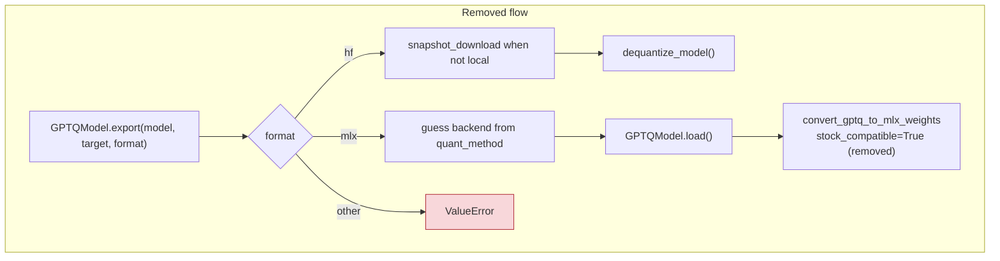

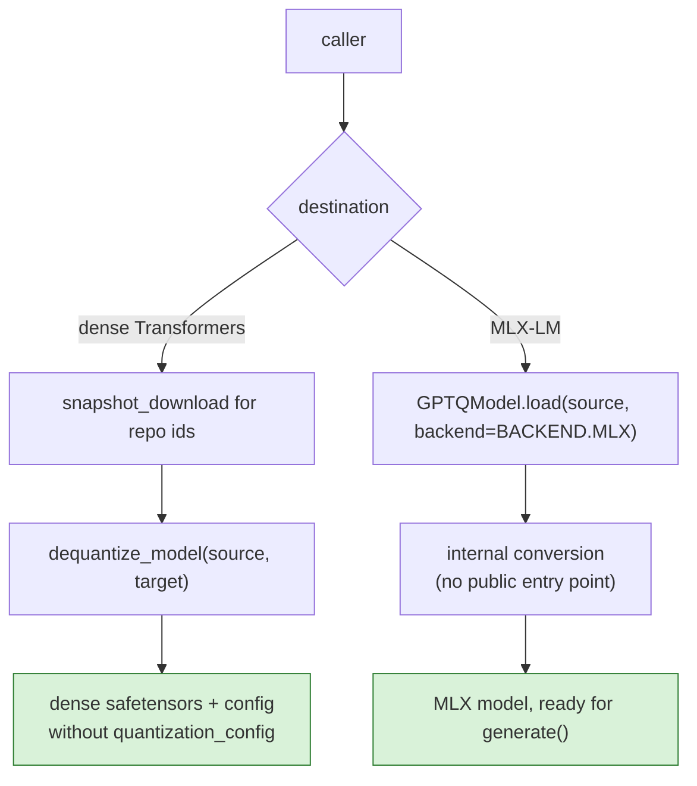

Calling `GPTQModel.export` raises `AttributeError`. There is no deprecation
shim, warning, or hidden alias; `tests/test_export_api_removed.py` pins the
absence of both the attribute and the call path.

## 8. `dequantize_model` resolves per-module bits

`convert_gptq_file()` resolves each module's width through
`dynamic_get(dynamic, prefix, "bits", default)`, mirroring the AWQ path. The
default itself is normalized with `quant_bits_width`, so a string `"4"` is
accepted. `dequantize_model()` also merges a legacy `quantize_config.json`
into `config.json`'s `quantization_config` when the latter is missing fields.

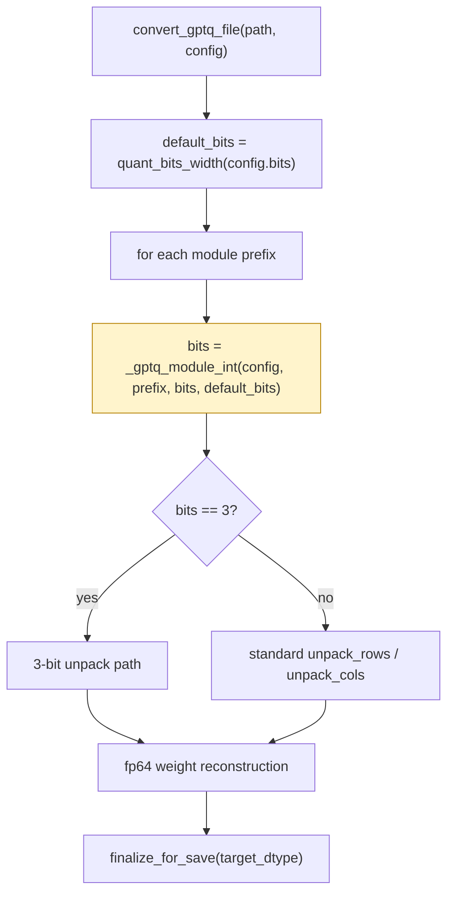

A mixed 3-bit body with a 4-bit `lm_head` previously decoded every module with
the 3-bit default and raised
`3-bit GPTQ qzeros expects columns divisible by 3`. A 4-bit body with an 8-bit
`lm_head` raised a size mismatch. Both now decode exactly against an fp64
oracle.

## 9. `load_state_dict()` round-trips and partial loads

`state_dict()` emits checkpoint-layout qzeros (v1 for a v1 checkpoint) while
the Torch/Triton kernels keep v2 words in memory. `GPTQQuantLinear._load_from_state_dict`
must therefore convert a self round-trip back to v2, and must not touch the
runtime layout when the incoming state dict has no `qzeros` (PEFT adapters and
other partial loads).

The receiving module cannot infer the *source* layout: a state dict may be
copied between a model loaded from a `gptq` (v1) checkpoint and one loaded from
`gptq_v2`, and each target has its own `_checkpoint_format_on_disk`. So
`_save_to_state_dict` records the layout it just emitted, and
`_load_from_state_dict` converts from that recorded layout.

The record travels as a tensor, not only as metadata. A per-module
`_metadata` entry is free but is not a tensor, so a safetensors round trip
(Trainer/accelerate checkpoints) or a plain
`{k: v for k, v in state_dict().items()}` copy drops it, and the receiving
module then reads v2 words as v1. The persistent `qzeros_format` int64 buffer
carries the same value inside the payload, so every transport keeps it. Values
are `1` (v1 words), `2` (v2 words) and `0` (a kernel-private runtime layout,
which is not a checkpoint; loading it raises). The buffer is optional: a
checkpoint written before this field existed has no such key, and
`_load_from_state_dict` strips it from `missing_keys` so `strict=True` loading
is unaffected. It then falls back to the metadata entry, then to
`_checkpoint_format_on_disk`, then to the module's constructed `format`.

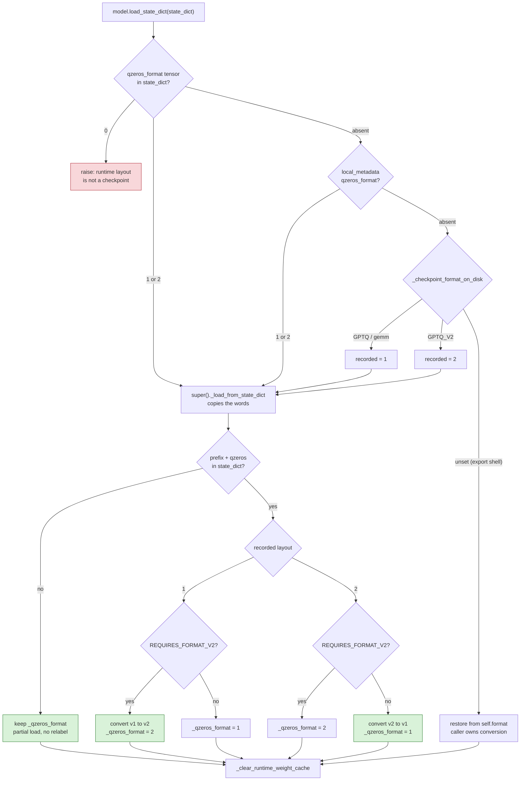

Before this change a v1 model loaded with `load_state_dict(state_dict())`
copied `0x77777777` into the live v2 buffer and set `_qzeros_format = 1`; every
zero point decoded one high and `strict=True` still reported all keys matched.
On the synthetic 1-layer fixture the logits moved by relative `0.406`; the
round trip is now bit-identical. A partial `load_state_dict({}, strict=False)`
used to flip `_qzeros_format` from 2 to 1 while the buffer stayed v2, so the
next save wrote `0x88888888` under the v1 label. It now leaves the layout and
the saved bytes unchanged.

Copying a state dict between a v1-loaded model and a v2-loaded model used the
target's marker for the source's words. On the same fixture that moved the
logits by `0.251` (v2 words into a v1-labelled target) and `0.130` (v1 words
into a v2 target); both directions are now exact because the words describe
their own layout.

## 10. HF `quant_method` for RTN AWQ exports and packed GGUF

`BaseQuantizeConfig.to_dict()` publishes `export_quant_method()`, not the
internal quantizer `method`. An RTN config with `format="gemm"` therefore
writes `method: gptq` with `quant_method: awq`, which is what
`AutoModelForCausalLM.from_pretrained` needs to select an AWQ loader.
`quant_method` is a deprecated alias for `method`; when both keys are present
the canonical `method` value wins, so the alias cannot switch the quantizer
back to GPTQ.

Packed GGUF is different: `transformers` owns the `gguf` name and routes it to
`GgufHfQuantizer`, which expects a `.gguf` file. GPT-QModel publishes
`gptqmodel_gguf` instead and registers a refusing quantizer for that name.
Every other GPT-QModel-only layout (`exl3`, `qqq`, `paro`, `macaq`,
`nf12`, `tt-blockfloat`) is registered from
`REFUSED_HF_QUANT_METHODS` in `gptqmodel/_quant_methods.py`.

The registration only exists after `import gptqmodel`. Plain `transformers`
without that import does **not** raise for these names; `5.22` logs
`Unknown quantization type, got <name> ... skip the quantization` and then
random-initializes every linear layer. Importing `gptqmodel` (or loading
through `GPTQModel.load`) installs the refusing quantizer, which turns the
same checkpoint into an actionable `ValueError`.

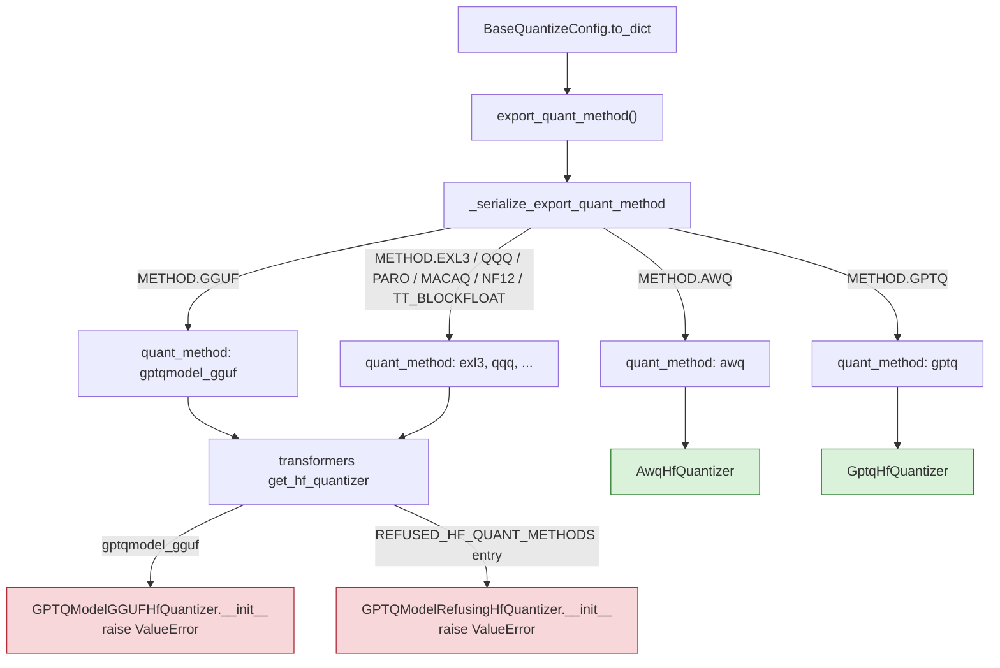

Already-published GGUF checkpoints keep `quant_method: "gguf"` (plus
`method: "gguf"`) and still load through `GPTQModel.load`; `gguf` remains
accepted by `_normalize_quant_method`. Only new checkpoints publish the
non-colliding name. `hf_compat_warnings` also warns at save time that a packed
GGUF checkpoint is not loadable by plain Transformers, and emits the same
save-time warning for every method in `REFUSED_HF_QUANT_METHODS`.

## 11. `torch.save(model)` after `optimize()`

`optimize()` may replace an eager callable with a `torch.compile` wrapper,
which pickle cannot serialize: `TorchLinear` shadows `dequantize_weight`,
VPTQ shadows `dequantize`, and the FP8/EXL3 Torch kernels store
`_compiled_forward`. `BaseQuantLinear.__getstate__` (via
`gptqmodel/nn_modules/compiled_state.py`) and
`ExllamaV3TorchLinear.__getstate__` drop those wrappers and reset `optimized`.
The eager class method is the fallback, so the unpickled module keeps working
without the compiled callable.

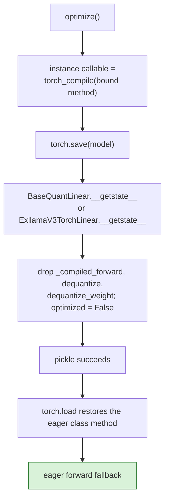

## 12. CPU int4pack kernels serialize their checkpoint snapshot

The CPU int4pack kernels — `TorchAtenLinear` (the CPU AUTO kernel for FP16),
`TorchFusedLinear` (BF16) and their AWQ counterparts, including
`TorchCpuAvx512AwqLinear`, the CPU AUTO default for AWQ — rewrite `qweight` and
`qzeros` **in place** on the first eval forward: `qweight` becomes an int4pack
operand and `qzeros` becomes float affine offsets. The original checkpoint
tensors survive only in the `_fused_train_state` snapshot captured before the
transform.

Serializing the live buffers was therefore corrupt: `checkpoint_layout_qzeros`
applies the *integer* v1 conversion to the float offsets, which yields `inf` or
`65536`, and the next `load_state_dict` produced `inf`/`NaN` logits. A
self round-trip did not catch it, because copying the runtime layout back into
the same transformed module is trivially an identity — the damage only appears
when the state dict is loaded into a module that never ran a forward.

`PackedGroupedQuantLinear._save_to_state_dict` — the shared GPTQ/AWQ base —
emits the snapshot tensors under their checkpoint names before applying the
qzero conversion. It lives on the shared base because `AWQuantLinear` had no
save hook of its own, so the AWQ CPU kernels captured a snapshot that nothing
ever wrote out: an eval forward replaced `qweight` with the int4pack operand
and `save_pretrained()` wrote that shape under the checkpoint key, which
reloaded with a shape mismatch. The snapshot is `persistent=False`, so it never
appears in the state dict itself.

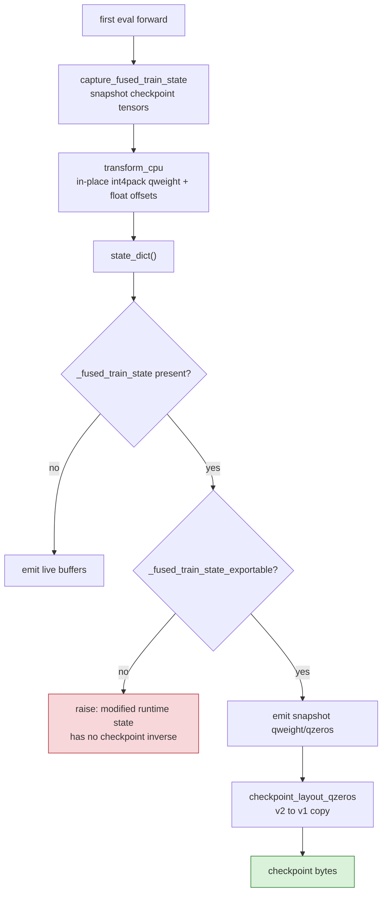

`load_state_dict` classifies the incoming operands by shape: a state dict that
matches the snapshot is a checkpoint and restores it before the copy (the next
forward re-transforms), while one that matches the live int4pack operands is
the module's own runtime layout and is copied as-is. A runtime layout that no
longer matches the snapshot has no inverse, so export raises instead of writing
`inf`.

## Failure contract

### Producer filters, format changes, and `save_pretrained` (items 1-3)

| Situation | Before | After |
| --- | --- | --- |
| AWQ `modules_to_not_convert` lists a dense module | loader quantizes it, NaN / missing-buffer error | module stays dense, checkpoint weight loads |
| Optimum inclusion list omits a module | loader quantizes it, `Missing required quantized weights` | only listed modules are quantized |
| Missing `qweight` on an AWQ module | no validation, zero placeholder | clear `Missing required quantized weights` |
| Format changed to another qzero layout | stale words copied under the new label | exact v1/v2 conversion |
| Format changed to a different packing | stale words copied, silent garbage | `ValueError` before writing |
| `save_pretrained()` on a Marlin/ExLlamaV2 model | runtime layout written as v1 | `RuntimeError` naming the kernel; read-only `state_dict()` still returns the runtime tensors |

### State-dict round-trips, HF methods, and pickling (items 9-11)

| Situation | Before | After |
| --- | --- | --- |
| `load_state_dict(model.state_dict())` on a v1 model | v1 words copied into a v2 kernel, logits drift | exact v1 to v2 conversion, bit-identical |
| Partial `load_state_dict` without `qzeros` | `_qzeros_format` flipped to 1, next save garbage | runtime layout kept |
| `state_dict()` on a transformed CPU int4pack layer | int4pack `qweight`, float offsets, `inf`/`65536` qzeros | checkpoint snapshot emitted |
| `state_dict()` on a transformed **AWQ** CPU int4pack layer | int4pack `qweight` under the checkpoint key | checkpoint snapshot emitted |
| State dict copied between v1 and v2 models | source words read as the target's layout, logits drift | layout recorded in the payload, exact both ways |
| State dict copied through safetensors or a plain dict | layout metadata dropped, logits drift | layout recorded in the `qzeros_format` tensor, exact |
| `PeftModel.from_pretrained()` on a Marlin base | `RuntimeError` from `state_dict()` | adapter loads; only checkpoint writes refuse |
| RTN `format="gemm"` config | `quant_method: gptq` with `format: gemm` | `quant_method: awq` |
| New packed GGUF checkpoint in plain HF | `gguf` routed to `GgufHfQuantizer`, random weights | `gptqmodel_gguf` raises an actionable `ValueError` once `gptqmodel` is imported; otherwise HF only warns |
| `exl3` / `qqq` / `paro` / `macaq` / `nf12` / `tt-blockfloat` checkpoint in plain HF | `Unknown quantization type ... skip the quantization`, random weights | refusing quantizer raises once `gptqmodel` is imported; save-time warning otherwise |
| `torch.save(model)` after `optimize()` | `PicklingError` on the compiled bound method (FP8, EXL3 Torch, VPTQ) | round-trips; unpickled module runs eager |

### Save, Marlin, export, and mixed-bit dequantization (items 4-8)

| Situation | Behavior |
| --- | --- |
| `is_marlin_format: true` | `ValueError` (removed layout) |
| `is_marlin_format: false` | accepted and dropped |
| Non-contiguous `g_idx`, `desc_act=False`, tile-aligned | activation-order decode |
| Non-contiguous `g_idx`, `desc_act=False`, misaligned | `NotImplementedError`; use a non-Marlin backend |
| `dequantize_model()` on AWQ / quantized embeddings / legacy config | dense reloadable directory |
| Unknown/undetectable checkpoint format | `ValueError` from `detect_format` |
| `dynamic` bits override | applied per module, not globally |

## Tests

`tests/test_checkpoint_interop_4053.py` covers the synthetic AWQ exclusion
oracle, the Optimum inclusion parse, v1 to v2 re-save, the refusal path, the
`save_pretrained` qzero bytes, the runtime-layout refusal hooks, the
`load_state_dict(state_dict())` identity (Torch and Triton), the partial-load
layout, `torch.save`/`torch.load`, and the packed-GGUF refusal. The items 4-8
tests live beside their modules (`tests/test_q4_marlin.py`,
`tests/test_model_dequant_dynamic_bits.py`, `tests/test_model_dequant_dense.py`, and the
Marlin `g_idx` regressions). `tests/qcfg/test_config_serialization.py` pins the
RTN export method, and `tests/test_checkpoint_compat.py` pins the GGUF
`quant_method` alias and save-time warning.
