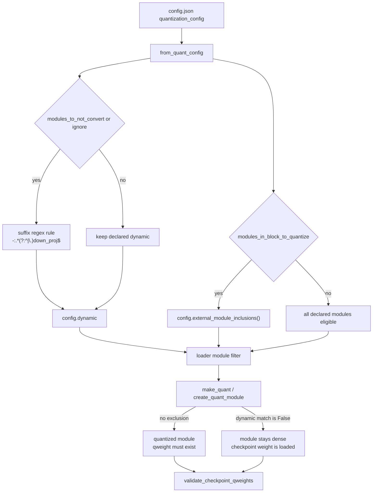
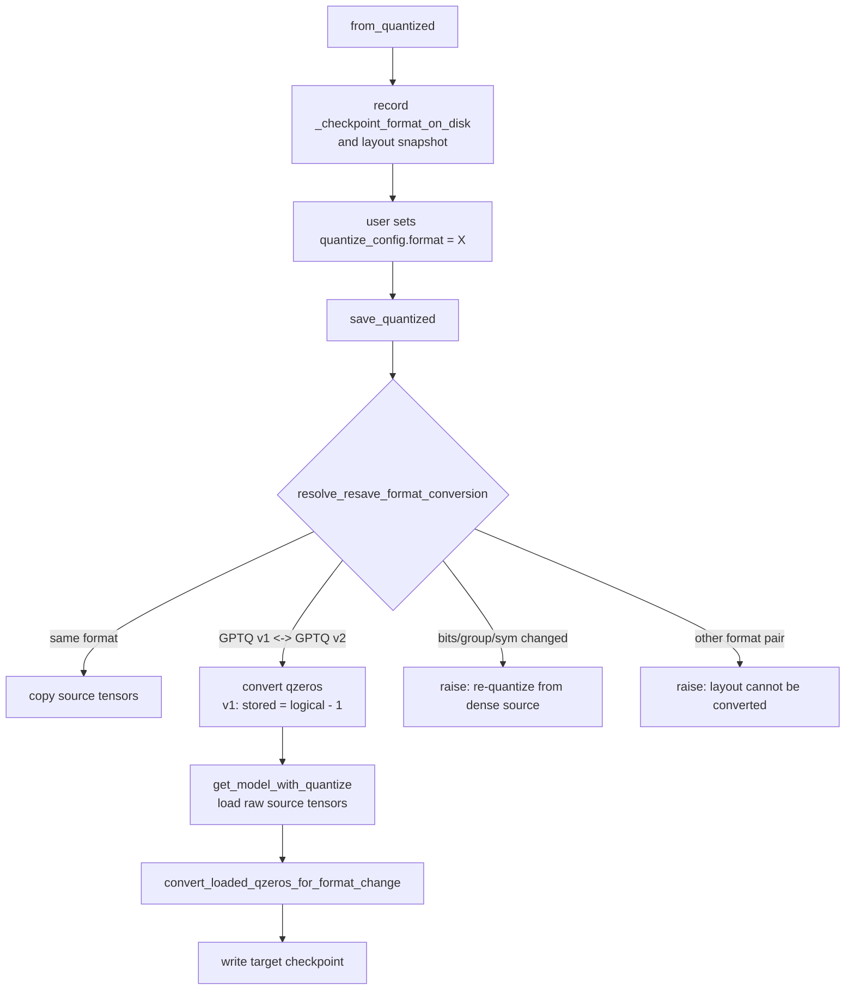
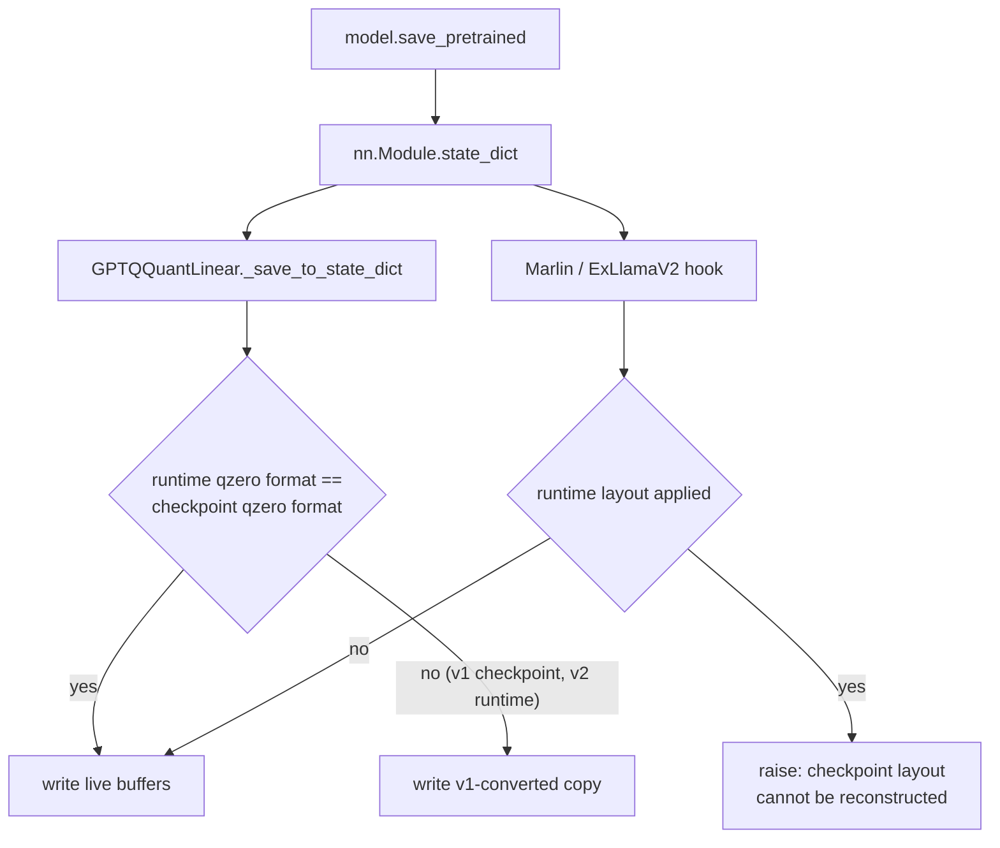

# Checkpoint interop: producer exclusions, format changes, and `save_pretrained`

This page describes how GPT-QModel decides which modules a third-party
checkpoint quantized, how it handles a request to re-save a loaded checkpoint
under a different format, and what `transformers`' `save_pretrained()` is
allowed to write for a kernel whose runtime layout is not the checkpoint layout.
It is the reference page for the loader/writer half of issue #4053.

The guiding rule is **fail closed**: a checkpoint that cannot be reproduced
exactly must raise, not silently write different tensors under the same names.

## 1. Producer-declared module filters

Third-party producers describe unquantized modules outside GPT-QModel's
`dynamic` map:

| Producer | Key | Meaning |
| --- | --- | --- |
| AutoAWQ / HF `AwqConfig` | `modules_to_not_convert` | substrings / names left dense |
| llm-compressor | `ignore` | names / patterns left dense |
| Optimum GPTQ | `modules_in_block_to_quantize` | list of lists of module suffixes that **are** quantized |

`QuantizeConfig.from_quant_config` folds the two exclusion lists into `-:`
rules, and records the Optimum inclusion list for the loader:

`-:` rules are first-match and therefore inserted before any positive rule.
Plain names become a dot-boundary suffix regex because `dynamic` matching is
start-anchored while the producer keys are substring/suffix matches.

`validate_checkpoint_qweights` now covers the AWQ formats (and shared
Marlin/BitBLAS formats) as well as GPTQ. A module the loader decided to quantize
must have its `qweight` in the checkpoint; otherwise the load raises instead of
leaving a zero-filled placeholder that produces NaN.

## 2. Re-saving a loaded checkpoint under a different format

`models/loader.py` records the on-disk layout and the core packing parameters
when a checkpoint is loaded. `models/writer.py::save_quantized` validates the
requested target before writing anything, and `get_model_with_quantize` applies
the exact conversion when it rebuilds the export shell.

The only supported layout change is the qzero shift between GPTQ v1 and GPTQ
v2. It decodes each stored zero point, applies `+1` or `-1` in logical space,
and repacks, so a packed word never carries into its neighbour. Every other
format change (for example GPTQ to Marlin, or GEMM to GEMV) needs a different
weight layout and is refused with an actionable error.

## 3. `save_pretrained()` and runtime kernel layouts

`transformers`' `save_pretrained()` calls `state_dict()`, which serializes the
live module buffers. Some kernels keep a converted runtime layout:

| Kernel | Runtime state | Save behaviour |
| --- | --- | --- |
| Torch / Triton v2 | v2 qzeros | emits v1 qzeros when the checkpoint is v1 |
| Marlin / AWQ Marlin | repacked `qweight`, empty `qzeros`/`g_idx` | raises |
| ExLlamaV2 / AWQ ExLlamaV2 | shuffled `qweight` | raises |

`GPTQQuantLinear._save_to_state_dict` compares `_qzeros_format` with
`_checkpoint_format_on_disk` and writes a converted copy into the destination;
it never mutates the live module. Kernels whose weight permutation has no
inverse raise from their own `_save_to_state_dict`.

`GPTQModel.save()` is unaffected: it rebuilds the export shell from the source
checkpoint and never serializes the runtime kernel layout.

## Failure contract

| Situation | Before | After |
| --- | --- | --- |
| AWQ `modules_to_not_convert` lists a dense module | loader quantizes it, NaN / missing-buffer error | module stays dense, checkpoint weight loads |
| Optimum inclusion list omits a module | loader quantizes it, `Missing required quantized weights` | only listed modules are quantized |
| Missing `qweight` on an AWQ module | no validation, zero placeholder | clear `Missing required quantized weights` |
| Format changed to another qzero layout | stale words copied under the new label | exact v1/v2 conversion |
| Format changed to a different packing | stale words copied, silent garbage | `ValueError` before writing |
| `save_pretrained()` on a Marlin/ExLlamaV2 model | runtime layout written as v1 | `RuntimeError` naming the kernel |

## Tests

`tests/test_checkpoint_interop_4053.py` covers the synthetic AWQ exclusion
oracle, the Optimum inclusion parse, v1 to v2 re-save, the refusal path, the
`save_pretrained` qzero bytes, and the runtime-layout refusal hooks.
