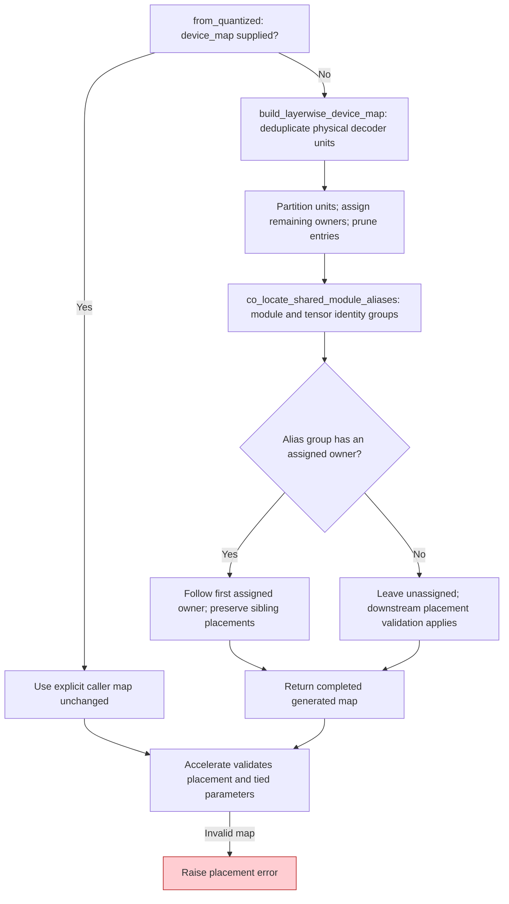
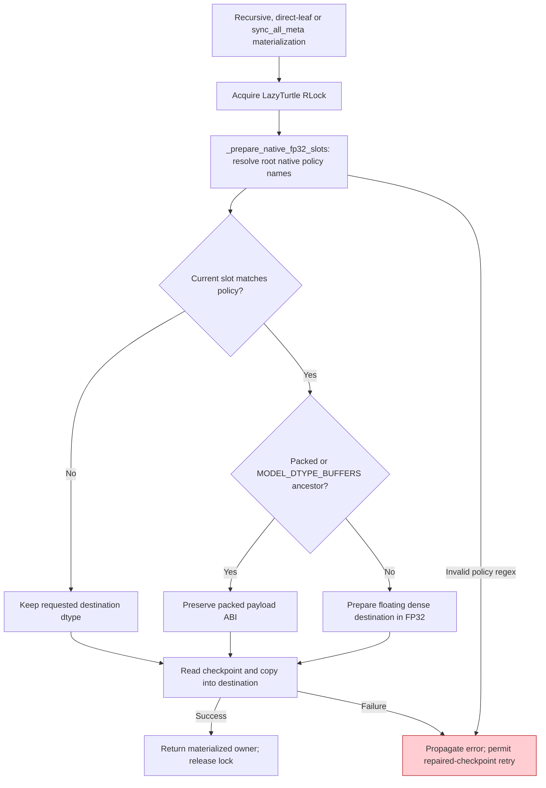
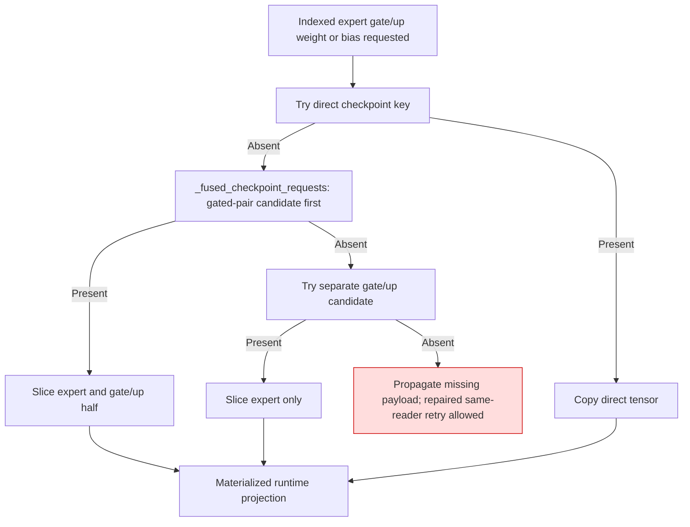

# GPT-QModel checkpoint ownership during placement and materialization

Generated device maps must cover every registered alias of a shared tensor.
Lazy dense loading must also preserve a native model's declared FP32 policy
before copying checkpoint values into a lower-precision shell. These are shared
loading contracts; individual ports do not repair either behavior themselves.
Introduced with the Transformers 5 migration in [#4620](https://github.com/ModelCloud/GPTQModel/pull/4620).

## Completing generated placement maps

`build_layerwise_device_map` partitions physical decoder units once, assigns
remaining owners, and prunes redundant entries. `co_locate_shared_module_aliases`
then visits `named_modules(remove_duplicate=False)` and groups modules sharing
the same tensor object. Every alias follows the first registered owner with an
assigned placement. Splitting an inherited parent placement preserves unrelated
siblings. This changes map metadata without moving tensors; device family
labels and concrete ordinals remain intact. Explicit caller maps bypass this
completion step.

This fixes the observed default public AWQ reload failure for an embedding
registered both as the decoder input embedding and an n-gram embedding alias.
The regression also exercises a real native Llama with tied input/output weights
and an additional embedding alias. CUDA/XPU ordinal tests validate map labels
using meta tensors; they do not qualify execution on those accelerators.

## Preparing native FP32 destinations

`LazyTurtle._prepare_native_fp32_slots` resolves
`_native_fp32_checkpoint_names(root, dtype)` and caches immutable name sets with
weak model keys. Production materialization calls hold the existing `RLock`
across preparation and checkpoint reads. Current owners are checked on every
preparation, including after dense projections have been replaced with packed
modules. `BaseQuantLinear` and `MODEL_DTYPE_BUFFERS` owners retain their payload
ABI. Only floating destinations selected by the native policy are widened;
ordinary dense tensors still follow the requested model dtype.

For example, native Nemotron-H declares `e_score_correction_bias` strictly FP32,
but constructs its buffer using the ambient default dtype. Reading an exact
FP32 checkpoint into an FP16 shell previously narrowed that buffer during
offload. Preparing the destination first preserves the source values. This is
not a policy to retain every FP32 checkpoint tensor.

| Mechanism | Before | Current behavior |
| --- | --- | --- |
| Shared placement | `69b40c425^:gptqmodel/models/loader.py:3091` used deduplicated owner discovery in generated maps | Complete module/tensor aliases after partitioning and pruning; explicit maps bypass completion |
| Dense offload dtype | `2c28301e1^:gptqmodel/utils/structure.py:3592` copied checkpoint values into existing shell destinations | Prepare only native-policy FP32 dense slots before copying |
| Direct/sync materialization | `2c28301e1^:gptqmodel/utils/structure.py:1789,1857` had no native FP32 destination preparation | Same root policy and packed-owner exclusions under the existing lock |

## Resolving separate and gated expert tensors

Runtime indexed experts can come from a checkpoint storing three-dimensional
`experts.gate_up_proj`, or separate `experts.gate_proj` and `experts.up_proj`.
`LazyTurtle._fused_checkpoint_requests` keeps the existing gated-pair candidate
first, then offers the separate projection with expert-index slicing only.
Biases follow the same ordering. An indexed checkpoint remains a direct read.
This prevents native Nemotron-H's separate-up checkpoint from leaving defused
runtime experts on meta during lazy public AWQ loading.

Before `7f84e0da7`, `utils/structure.py:2823-2826` returned only the gated-pair
candidate for gate/up. It now adds separate candidates after that existing
candidate; a conflicting decoy separate tensor cannot change gated semantics.
The 28 cases in `tests/test_lazy_turtle_separate_expert_materialization.py`
cover native Nemotron-H, Qwen3-MoE and Inkling shared experts, direct indexed
storage, gated precedence, biases, three dtypes, recursive/direct leaves,
two evictions, strict-FP32 exclusions and missing-shard repair. The integrated
shared materialization/conversion batch passes **119 tests, no skips in 4.91s**.

`tests/test_shared_module_placement.py` covers public quantize/save/reload,
explicit maps, independent aliases, integer ordinals, label preservation and
idempotence. `tests/test_lazy_turtle_native_fp32.py` covers FP16/BF16 destinations,
recursive/direct/sync paths, dense Parameters and buffers, packed replacements,
strict/legacy native policies and failure/repair/retry. CPU tests under
`PYTHON_GIL=0` do not establish concurrent PyTorch or multi-GPU safety; the
[GIL=0 ledger](../pytorch_gil_0_compat.md) remains authoritative.
