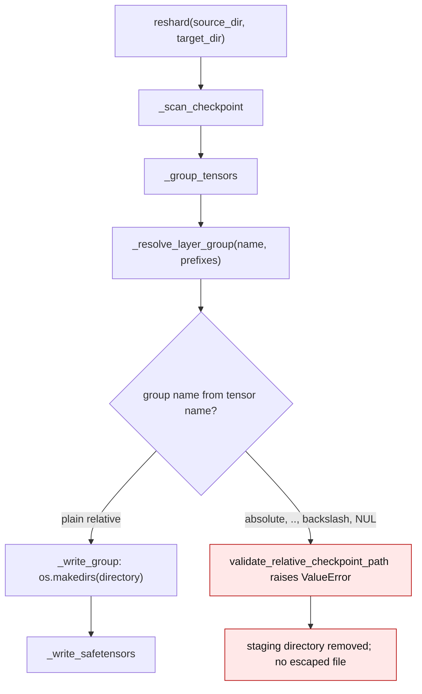
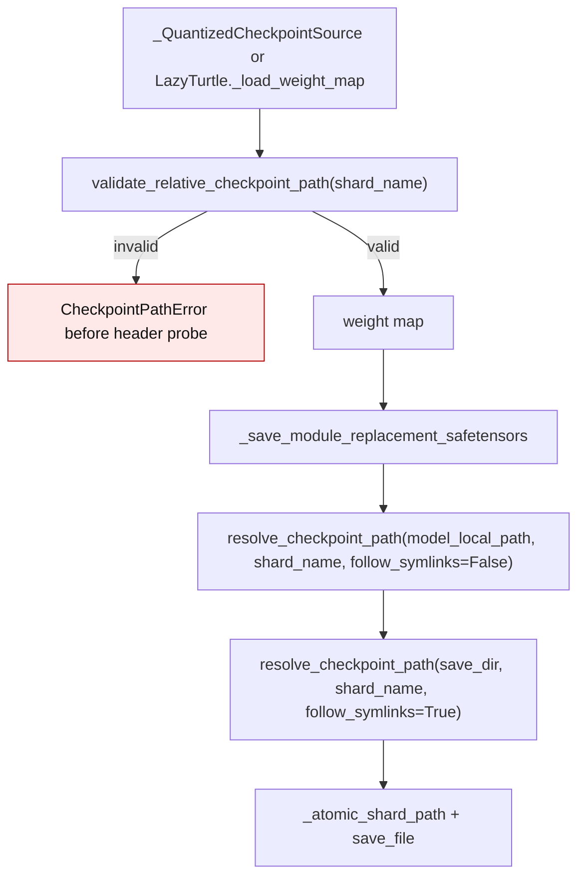
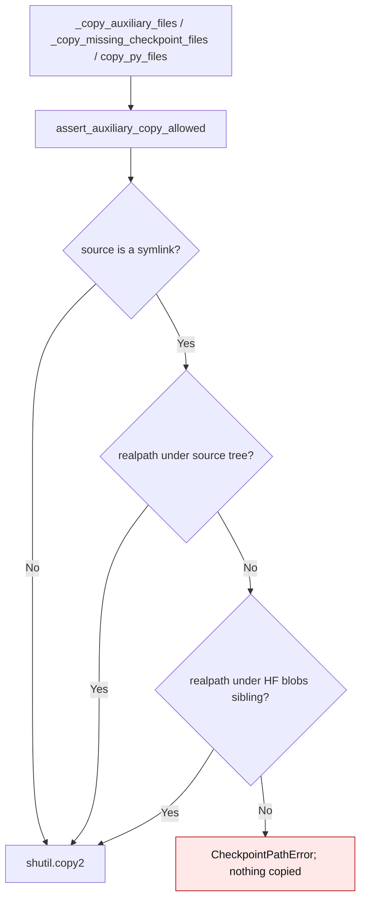

# Checkpoint path containment

Checkpoint indexes, safetensors headers, and model configuration files are
untrusted input. Two kinds of values in them are used as filesystem paths:

1. **Tensor names** drive the per-layer directory names that `reshard()`
   creates.
2. **`weight_map` shard names** drive the files that a module-replacement
   `save()` reads and rewrites.

A value such as `../../../victim/model.layers.0.w` or an absolute
`/tmp/x/a.layers.3.w` used to be joined directly to the output directory, so a
checkpoint could write outside it. The same risk applies to auxiliary files:
`shutil.copy2` follows symlinks, so a repository containing
`README.md -> ~/.ssh/id_rsa` copied the key into the output directory.

All checkpoint-derived paths now pass through
`gptqmodel/utils/checkpoint_paths.py`. The helper is fail-closed: a name that
is absolute, drive-qualified, contains a backslash or NUL, or has an empty,
`.` or `..` component raises `CheckpointPathError` (a `ValueError`) before any
directory is created or file is opened. A path that is written must also
resolve (after `realpath`) under the destination root. A source shard may be a
Hugging Face cache symlink into the sibling blob store, so read-only
resolution is lexical; auxiliary symlinks are allowed only when they resolve
inside the source tree or its HF blob store.

## `reshard()`: tensor names to layer directories

`_resolve_layer_group()` derives a group name such as `model.layers.0` from a
tensor name. `_group_tensors()` now validates that group before
`_write_group()` calls `os.makedirs()`.

## Module replacement: `weight_map` shard names

The shard name is validated when the checkpoint source is built
(`_QuantizedCheckpointSource`, `LazyTurtle._load_weight_map`) and again at the
writer sink, so a fake or stale `_weight_map` cannot bypass the check.

## Auxiliary files: symlink containment

`reshard._copy_auxiliary_files`, `writer._copy_missing_checkpoint_files`, and
`utils.model.copy_py_files` call `assert_auxiliary_copy_allowed()` before
`shutil.copy2()`.

## Before / after

Line numbers are from audit revision `93d3ae7a`.

| Path | Before | After |
| --- | --- | --- |
| Reshard layer directory | `directory = os.path.join(staging_dir, group_name)` (`gptqmodel/reshard.py:882`) joined an unvalidated tensor-derived group | `_group_tensors` validates the group with `validate_relative_checkpoint_path` before `_write_group` |
| Quantized checkpoint source | `_QuantizedCheckpointSource` only proved `safe_open` succeeded (`gptqmodel/models/base.py:304-312`) | every `weight_map` value is validated, then resolved lexically under `model_local_path` |
| Lazy turtle weight map | `_load_weight_map` returned raw index values (`gptqmodel/utils/structure.py:1494-1499`) | values are validated before they enter `_weight_map` |
| Writer shard target | `target_path = os.path.join(save_dir, shard_name)` (`gptqmodel/models/writer.py:506-524`) | `resolve_checkpoint_path` validates and realpath-checks both source and target |
| Auxiliary copies | bare `shutil.copy2` (`gptqmodel/reshard.py:729-741`, `gptqmodel/models/writer.py:530-549`, `gptqmodel/utils/model.py:2110-2116`) | `assert_auxiliary_copy_allowed` rejects escaping symlinks; HF blob links still copy |
| EXL3 passthrough | `_is_safe_relative_checkpoint_shard` had its own rule list (`gptqmodel/models/writer.py:1036`) | delegates to `validate_relative_checkpoint_path`, so one rule set covers every sink |

## Contract

| Situation | Result |
| --- | --- |
| Tensor-derived group is `../../../victim/model.layers.0` | `ValueError`; staging directory is removed |
| Tensor-derived group is `/tmp/x/a.layers.3` | `ValueError`; no absolute directory is created |
| `weight_map` shard is `../outside.safetensors` or absolute | `CheckpointPathError` before the shard header is opened |
| Shard is `model.layers.0/layer.safetensors` | accepted (nested relative path) |
| Shard is a symlink into the HF blob store | accepted for reads |
| Auxiliary symlink resolves outside the source tree and blob store | `CheckpointPathError`; nothing is copied |
| Auxiliary symlink resolves into the HF blob store | copied as before |

Regression coverage lives in `tests/test_reshard.py` and
`tests/test_checkpoint_path_security.py`. The fix for issue #3969 introduced
this contract.
