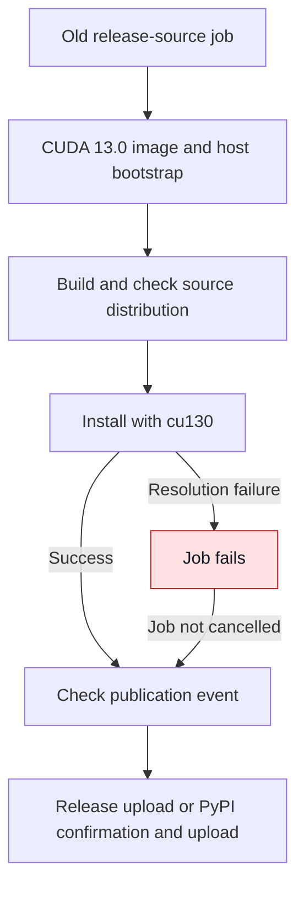
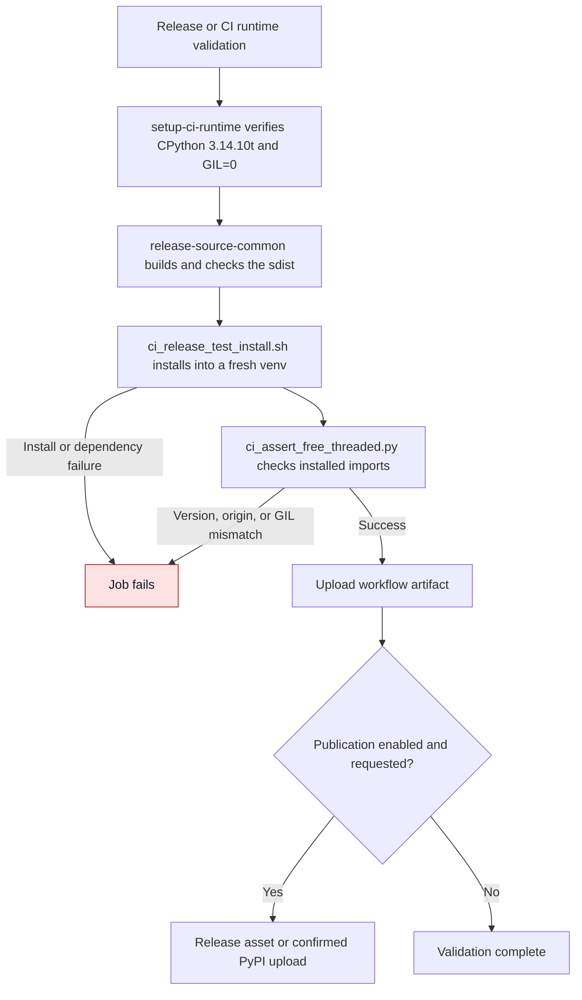
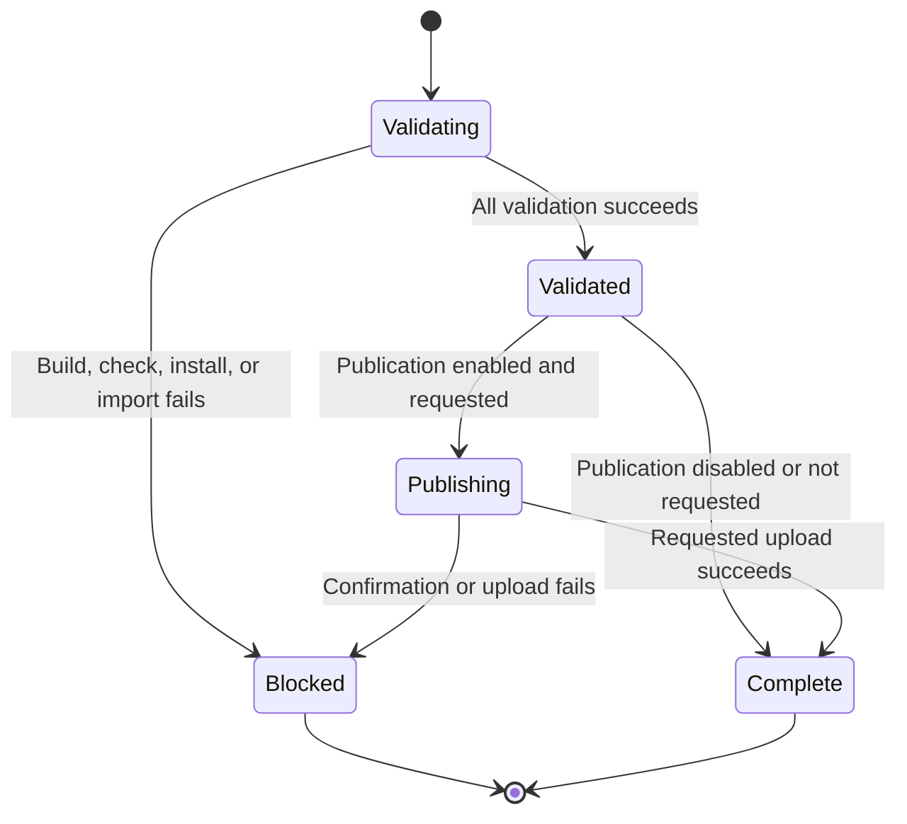

<!-- SPDX-FileCopyrightText: 2026 ModelCloud.ai
SPDX-License-Identifier: Apache-2.0 -->

# CUDA CI runtime and source release validation

The CUDA unit and source release jobs use a digest-pinned public CUDA 13.2.1
development image, managed CPython 3.14.10t with `PYTHON_GIL=0`, and PyTorch
2.15.0+cu132. The release jobs build the source distribution and install it in
a second virtual environment before publishing that same file. The installation
and import smoke can run without a GPU. The setup action and Dockerfile
install Rust 1.94.0 for dependencies that build from source on CPython
3.14t, including safetensors.

| Situation | Before | Current |
| --- | --- | --- |
| Select the toolkit and interpreter | The CUDA 13.0 image depended on runner-mounted Python and uv bootstrap scripts. The release resolver could report 3.14t while uv still selected ordinary Python 3.14. | The workflows pin the public CUDA image digest and use the repository's `setup-ci-runtime` action to create and verify the exact managed interpreter. |
| Resolve PyTorch | The cu130 wheel index stopped below the package's `torch>=2.15.0` requirement on Python 3.14. The unit matrix pinned an older Torch and bypassed the safety gate. | `torch-cu132.txt` constrains Torch to 2.15.0+cu132 and uv selects the cu132 backend explicitly. The normal Torch safety gate applies. |
| Install TorchAO | The default CUDA TorchAO wheel uses an ABI tag that free-threaded CPython 3.14 cannot load. The old compatibility check installed a private wheel. | The CI constraints select the public TorchAO 0.18.0 universal wheel by URL and hash. The smoke checks the NVFP4 Python imports. Native TorchAO operators require separate GPU validation. |
| Publish after installation fails | The shared action used `!cancelled()` for release upload and PyPI steps, so a failed install could still reach publication. | Release upload and PyPI confirmation and upload require a successful install step, an overall successful job, an explicit publication opt-in, and the corresponding release event or manual request. |
| Exercise free-threading | Only the dedicated concurrency job forced the GIL off. | Both release jobs and all CUDA unit jobs force it off before the model stack loads. The dedicated lane retains its CPU and multi-GPU concurrency cases. |





The publication lifecycle is owned by
`.github/actions/release-source-common/action.yml:60` (installation) and
`:81` (publication gates). The previous `!cancelled()` gates at lines 77,
85, and 92 of the base version admitted a failed installation.



## Validate without publishing

The [CI runtime validation workflow](../.github/workflows/ci_runtime.yml)
runs the contract tests when a pull request changes workflow or CI test files.
Its manual run also builds, checks, installs, and imports the source
distribution on a GitHub-hosted runner. It uses read-only repository
permissions and the shared action's default publication setting.

The same smoke can run in Docker on an x86-64 machine. From the repository
root, build the image and copy the read-only checkout into the container.

```bash
docker build --platform linux/amd64 -f .github/ci/Dockerfile -t gptqmodel-ci:cu132 .
docker run --rm --platform linux/amd64 -e PYTHON_GIL=0 \
  -v "$PWD:/checkout:ro" gptqmodel-ci:cu132 bash -euc '
    cp -a /checkout/. /workspace/
    uv venv --managed-python --python 3.14.10t /tmp/build-venv
    source /tmp/build-venv/bin/activate
    python .github/scripts/ci_assert_free_threaded.py --python-only
    export GITHUB_ENV=/tmp/release-env
    bash .github/scripts/ci_release_build_sdist.sh
    bash .github/scripts/ci_release_check_dist.sh
    source "$GITHUB_ENV"
    bash .github/scripts/ci_release_test_install.sh "$PKG_NAME"
  '
```

The CUDA unit jobs still need the self-hosted runner's model and dataset
mounts, GPU allocator, and NVIDIA driver compatible with the CUDA image.
The self-hosted jobs share a data-only uv package cache. They install uv,
Python, and Rust using the repository bootstrap. A
CPU-only smoke verifies dependency resolution and imports. The dedicated
unit lane covers stream execution and two-GPU P2P on the self-hosted runner.
