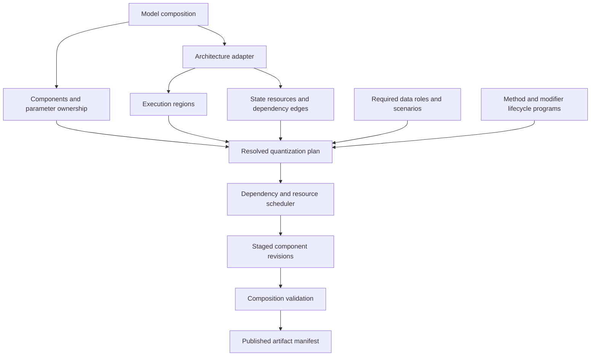
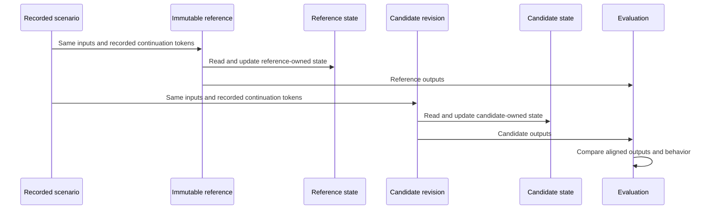
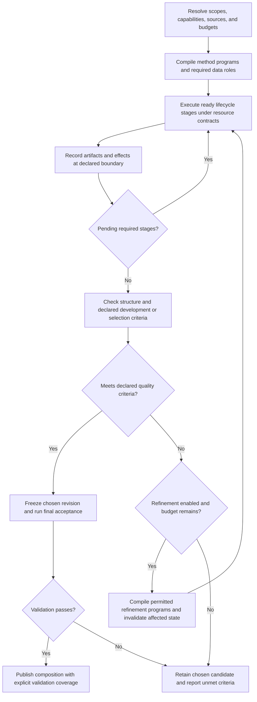
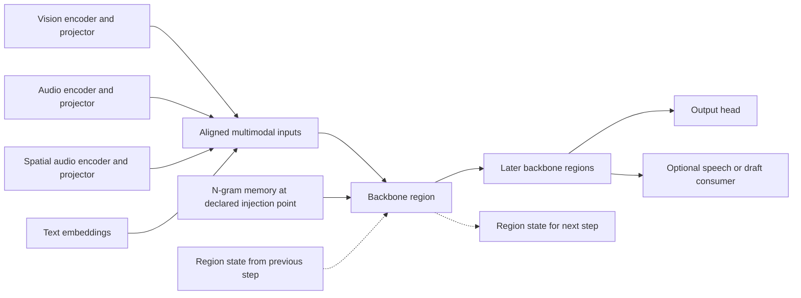
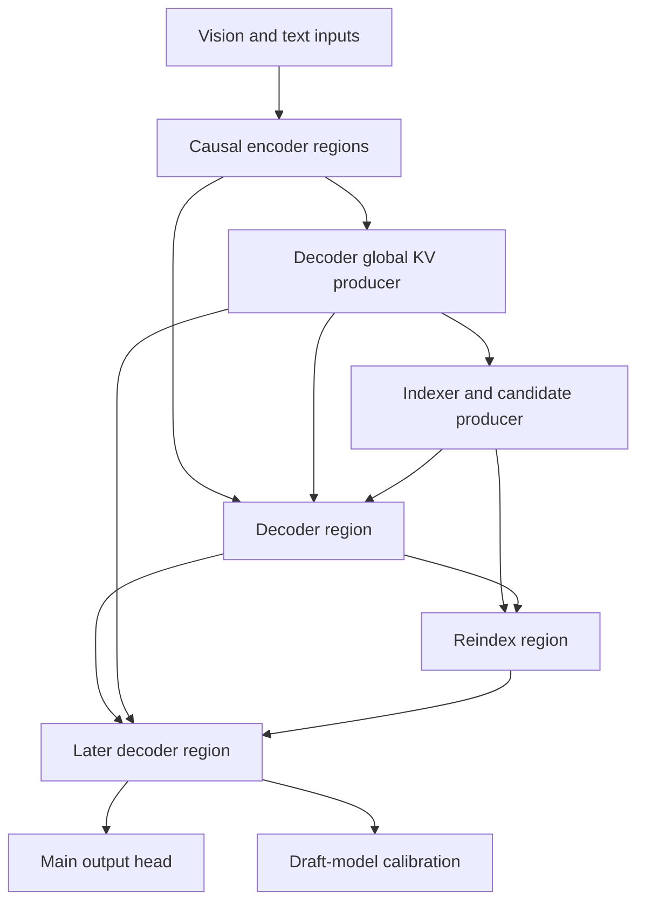
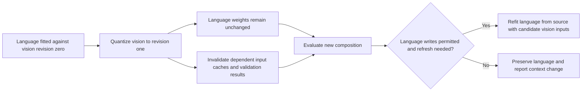
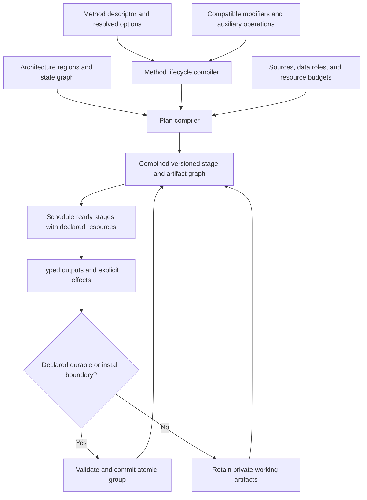

<!-- SPDX-FileCopyrightText: 2026 ModelCloud.ai
SPDX-License-Identifier: Apache-2.0 -->

# Draft design for component and phased quantization

**Status:** design discussion, revision 0.5, 2026-10-29.

**Related issue:** [#2928](https://github.com/ModelCloud/GPTQModel/issues/2928).

**Scope:** architecture, proposed APIs, execution flows, alternatives, and validation criteria. No implementation or quantization experiments accompany this proposal.

GPTQModel should support quantizing independently selected parts of a composite
model, while coordinating the numerical dependencies between those parts.
Vision, language, audio, projectors, memory modules, and draft models can have
different recipes and lifecycles. Their calibration inputs and execution state
still depend on the assembled model.

The proposed direction is one coordinated run over **method-owned lifecycle
programs**. The coordinator respects dependencies between model regions; each
method declares its own observations, transformations, optimization stages,
artifacts, and installation boundaries. Candidate replay and selective
refinement are composition policies when applicable, not mandatory steps for
every quantizer. Multi-GPU execution is a first-class capability: the scheduler
supports independent jobs and cooperative distributed stages under explicit
numerical/resource contracts. Serial execution remains a reference/debug profile.

Read the companion [method lifecycle inventory](quantization-method-lifecycles.md)
for the source audit behind this revision. The design must accommodate every
current method route and admit future methods without adding another hardcoded
method branch to a universal layer loop. Four further companions define the
architecture, parallel, API, and data contracts:

| Document | Purpose |
| --- | --- |
| [2026 architecture audit](quantization-architecture-2026.md) | Source-backed family/pattern coverage, compatibility gaps, and adapter acceptance cases. |
| [Parallel execution](quantization-parallel-execution.md) | Multi-GPU capture, fitting, model partitioning, resource scheduling, and failure/continuation contracts. |
| [Public API](quantization-plan-api.md) | Direct operations, immutable chaining, recipe composition, explicit order, selectors, and serialized plans. |
| [Data contract](quantization-data-contract.md) | `QDataSet`, modality schemas, lifecycle-role bindings, preparation, streaming, sharding, and provenance. |

Backward compatibility is **not a requirement and should not constrain this
design**. Compatibility shims and preservation of the legacy lifecycle are
discouraged. Existing numerical implementations may be reused behind new contracts.
API examples below are illustrative, not APIs available in the current package.
All choices labeled proposed remain open to revision. Discussion or acceptance
of this document does not start implementation; execution requires a separate
decision after the design questions have been resolved.

## 1. Problem and current baseline

The original issue describes a language-only quantization tree and text-only
calibration for a multimodal workload. These are distinct concerns: which weights
change and which inputs produce representative calibration statistics.

At GPTQModel commit
[`536b7f9b`](https://github.com/ModelCloud/GPTQModel/tree/536b7f9b6af3c1e39f1e7a1b2e58a50d8793af4e):

- `BaseQModel` owns global `quantized` and `quantize_config` state. Regular
  `quantize()` is guarded by that global state; `requantize()` currently has
  embedding/norm-specific semantics. [Base model][gptq-base]
- Layer discovery accepts multiple containers, then flattens them into one layer
  sequence. That alone does not describe component boundaries or state
  dependencies. [Layer discovery][gptq-discovery]
- Current Qwen3.5-MoE inherits the multimodal calibration base, although its
  quantization tree remains language-scoped. The issue's older inheritance
  diagnosis must not be treated as the current implementation. [Definition][gptq-qwen]
- Method lifecycles already differ substantially: weight-only conversion,
  grouped AWQ capture, ParoQuant optimization, staged GSQ training, specialized
  VPTQ/EXL3 payloads, and native MLX execution. `METHOD` is not sufficient to
  identify a lifecycle: RTN has a separate configuration, and FP8 has both
  weight-only and calibrated routes. [Lifecycle audit](quantization-method-lifecycles.md)

The design must support all of the following independently:

| Concern | Example |
| --- | --- |
| Weight selection | Quantize language while preserving vision weights. |
| Calibration execution | Execute vision to supply image-conditioned language inputs. |
| Recipe selection | Use different supported precision and algorithms for vision and language. |
| Lifecycle | Quantize vision after language has already been saved and reloaded. |
| Numerical context | Record that language was calibrated against an earlier vision revision. |
| Persistence | Save and restore the complete mixed dense/packed composition. |

Global mutable state and assumptions about one decoder stack are constraints to
remove. A usable redesign must also preserve and generalize the repository's
existing parallel capture, module/expert work, offload, and distributed training.
A serial prototype alone does not establish acceptable quantization cost.

## 2. Architectural evidence and its limits

The [broader 2026 audit](quantization-architecture-2026.md) covers public families
from Qwen, DeepSeek, Kimi, Gemma, GLM, Hunyuan, Nemotron, MiMo, MiniMax, Liquid AI,
Meta, Reflection, and others, plus diffusion, streaming speech, and action models.
It records structural compatibility separately from implemented adapters and
measured quantization quality. Private/undisclosed architectures and uninspected
successor checkpoints cannot be certified from a family name. The following were
the initial anchor examples; they no longer define the limits of the design.

Qwen3.8 is a family. Qwen3.8-Flash-Next is the forward-looking open architecture
used here; the Qwen3.8-Omni report supplies an additional multimodal reference.
Do not assume every Qwen3.8 checkpoint has these exact structures.

| Reference | Relevant structure | Design implication |
| --- | --- | --- |
| Qwen3.8-Flash-Next | Gated DeltaNet interleaved with sparse attention, four residual branches, and n-gram memory. [Report][qwen-report] | Replay boundaries must include recurrent state and the complete residual representation. |
| Qwen3.8-Omni | Visual, general-audio, and spatial-audio encoders feed a shared Thinker with aligned inputs. [Report][omni-report] | Independent branches require composition-level calibration and evaluation. |
| DeepSeek V4.1 | Causal encoder/decoder organization; decoder global KV derives from encoder output; CSA2 reuses KV and sparse selections. [Report][deepseek-report] | Track memory producers and consumers across nonadjacent layers. |
| DeepSeek V4.1 reference implementation | Shared attention state is held outside ordinary module arguments. Draft blocks alias the main embedding and output head. [Code][deepseek-code] | Capture ambient state explicitly and preserve shared parameter identity. |

The inspected Qwen implementation also carries recurrent, convolution, and
indexer cache state, and injects n-gram information within decoder layers.
[Implementation][qwen-code]

These architectures motivate the proposal. Their reports do not establish that
the proposed post-training quantization schedule is optimal. Multimodal
co-training does not imply text-to-vision feedback during ordinary inference.
For the inspected vision paths, image features feed the backbone.

The released DeepSeek checkpoint already declares FP8 quantization and FP4
expert weights. An immutable source snapshot of that release is not an original
BF16 model. Source precision and native numerical behavior must be recorded.
[Checkpoint configuration][deepseek-config]

The expanded audit adds several concrete requirements: Gemma 4 Unified makes
modality routes distinct from parameter ownership; Kimi K3 adds depth-history
dependencies; HRM-Text reuses parameter owners across nested invocations;
DiffusionGemma/TwoTower and streaming audio require sampler/event traces. These
are contract changes, not a claim that an unmodified decoder loop supports the
models. See the companion matrix for primary sources and acceptance cases.

## 3. Proposed contracts

1. **Selection determines what may change.** Calibration can execute outside
   that selection, but cannot silently expand the weight write scope.
2. **Components own representation and revisions.** Root status is a derived
   summary, not a global quantized boolean.
3. **Dependencies determine scheduling.** Python containment, modality labels,
   and module traversal order do not define numerical execution order.
4. **Source lineage is immutable.** Each stage identifies its source, derived
   teacher, quantized initializer, or optimization master. A quantized initializer
   is valid when the method declares it; it must never masquerade as the original
   source. A refit identifies its source policy explicitly.
5. **Reference and candidate execution state are isolated.** A cache produced by
   one cannot be substituted into the other without changing the experiment.
6. **Candidate replay uses deployment semantics.** Native cache precision,
   routing, positional transforms, and applicable execution modes are preserved.
7. **A recipe is a capability-checked operation.** Unsupported operators,
   cross-boundary writes, and unresolved aliases fail during planning.
8. **Results retain provenance.** Every fitted region records its source,
   applicable data/observation roles, dependency revisions, and algorithm settings.
9. **Methods own their lifecycle.** Required optimization, deferred group work,
   fallback branches, and native-backend operations are explicit programs. The
   coordinator does not impose a GPTQ-shaped capture/solve/replay/pack sequence.
10. **Requirements are conditional and precise.** A data-free operation does
    not require calibration data or a teacher forward. An activation-only or
    norm-only operation does not require rewriting packed weights.
11. **Installation preserves the fitted result.** An already-fitted payload is
    not silently requantized by a generic finalizer. Quantization fused with
    encoding is itself a declared numerical stage.
12. **Parallel execution has numerical semantics.** Replicas, shards, independent
    tasks, reductions, collectives, and their state ownership are distinct
    capabilities. A scheduler cannot change an objective to make work parallel.
13. **Public composition is explicit and immutable.** Direct calls and fluent or
    serialized plans compile through the same capability checks. Order, overrides,
    and typed extension stacking cannot conceal a different numerical experiment.
14. **Final evaluation has no fitting feedback edge.** Selection and refinement
    use declared development data; final acceptance reads the chosen revision
    without changing it or choosing another candidate from its score.

## 4. Core objects and ownership

| Object | Owns or describes |
| --- | --- |
| `ModelComposition` | Component registry, parameter aliases, architecture adapter, and assembled revision. |
| `Component` | Stable public identity, owned parameter/buffer references, per-operator representations, recipes, and revision history. |
| `Route` | A supported input/output path and modality/task semantics; several routes may execute the same parameter owners. |
| `Region` | A semantic computation boundary with complete inputs, outputs, state effects, and supported method capabilities. |
| `StateResource` | KV, recurrence/convolution state, depth history, retrieval indices, per-layer inputs, sampler/stream state, or another resource with explicit producers and consumers. |
| `InvocationTrace` | Region visits with sample/episode, logical time, recurrence/sampler/stream/branch axes, state lineage, and observation weighting. |
| `QDataSet` / `DataBindings` | Typed raw or prepared sources, modality/schema identity, and explicit calibration, initialization, training, validation, selection, adapter, evaluation, profiling, or plugin-defined roles. `CalibrationDataSet(QDataSet)` is a role-aware view, not a text-only container. |
| `DataRequirement` / `DataPipeline` | Method-declared role/access/coverage needs and architecture-route preparation from samples to model-ready batches and invocation traces. |
| `RecipeExtension` | Registered typed contribution selected by `Recipe.use()`: modifier, preparation, or output format, with versioned configuration, effects, and composition constraints. |
| `LifecycleProgram` | A versioned method/operation program with stages, bounded control flow, typed artifacts, effects, resource requirements, and safe continuation points. |
| `Plan` | Immutable public specification of operations, recipes/modifiers, data bindings, order constraints, resource policy, and validation. |
| `ResolvedPlan` | Frozen canonical selection, sources, writes, dependency graph, compiled lifecycle programs, and validation policy after compilation. |
| `ExecutionLayout` | Physical stage placement, replica/shard ownership, resource reservations, transfers, and collective groups under the resolved numerical plan. |
| `QuantizationRun` | Program/stage progress, staged candidate revisions, checkpoints, observations, and evaluation results. |



Components are logical identities such as `vision.encoder`, `vision.projector`,
`language`, or `audio.encoder`. A named selection such as `vision` can expand to
several components without becoming another mutable owner.

Modality labels do not guarantee separate owners. An encoder-free model can have
image/audio/text routes through one backbone. `inspect()` must report affected
routes and missing selections honestly: changing shared weights changes all
their consumers, even if calibration uses one modality.

Resolve ownership using canonical parameter identities, including storage aliases
and overlapping views. Attribute paths are bindings, not identities. A projector
nested inside a vision module must not be selected twice. Shared/tied parameters
require one representation and one declared ownership group. Incompatible recipes
must fail before mutation; explicit untying is a separate structural operation.

A region might be a transformer block, a projector, or an adapter-defined
computation. A lifecycle stage is the schedulable unit: it may cover one region,
wait for a group, or perform a declared operation across regions. Reconstruction
can span components when the plan's write scope permits it. Evaluation scope may
be wider than fitting scope: a KV producer can be fitted locally and evaluated
through many consumers.

## 5. Discovery and execution dependencies

Discovery inventories all modules, parameters, buffers, aliases, and existing
packed representations. Architecture adapters then define semantic regions,
routes, and replay contracts. Automatic inspection can propose candidates, but a
`ModuleList` or `Linear` scan cannot establish arbitrary execution semantics.

`inspect()` should report discovered, quantizable, preserved, and unsupported
operators, plus unresolved regions. No selected operator may disappear silently
because it is outside a familiar text-decoder pattern.

The dependency representation needs distinct edge types:

| Edge | Example | Scheduling effect |
| --- | --- | --- |
| Tensor data | Vision output consumed by a projector. | Producer output must be available at the required revision. |
| Shared state | Several attention layers read one KV source. | Rebuild dependent state when its producer changes. |
| Control | Indexer selects entries; router selects experts. | Replay the candidate's actual selection path. |
| Temporal state | Recurrent state advances across tokens/chunks. | Preserve sequence boundaries, history, and state lineage. |
| Depth history | Attention Residuals consumes earlier block representations. | Preserve the full history interface and keep its producers live until consumed. |
| Sampler/event state | A denoiser revisits a canvas; duplex audio receives new input while producing output. | Order bounded logical-time invocations, commits, and stream events explicitly. |
| Parameter alias | Drafter and main model share an output head. | Enforce one write owner and compatible representation. |
| Objective coupling | Reconstruction loss spans a projector and consuming block. | Declare the optimization region and its permitted writes. |

Shared state alone does not require simultaneous optimization. Joining every
producer and consumer into one fitting region would collapse much of the model
into a single expensive job.

Temporal feedback must not accidentally collapse the whole autoregressive model
into one graph cycle either. Represent time/step transitions explicitly and use
bounded traces. A genuine same-step cycle requires an adapter-defined joint
region or supported iterative execution contract; otherwise planning fails.

Adapters declare possible paths. Observed traces validate coverage but do not
prove that unobserved branches or experts are unreachable.

One owner can be invoked repeatedly in recurrence or denoising. Discovery must
not manufacture a separate parameter owner for every unrolled visit. The method
declares how observations across visits are weighted or jointly optimized; the
trace records their individual state and logical coordinates.

## 6. Public API sketch

Loading establishes structure and representations. Recipes belong to operations.
Direct calls, immutable fluent plans, and configuration files compile through
one planner. The [API companion](quantization-plan-api.md) defines stacking,
ordering, selector precedence, fragments, serialization, and parallel policy.
Names/signatures remain proposals; examples are independent sketches.

```python
model = GPTQModel.load("source-checkpoint")
model.inspect()

calibration = CalibrationDataSet(
    source=MultiModalDataSet(image_text_samples),
    route="image_text",  # Registered by the architecture adapter.
    scenarios=("prefill", "decode"),
)

run = model.quantize(
    target="language",
    recipe=GPTQ(bits=4, group_size=128),
    data=calibration,
    devices=Local(gpus="all"),
)

# Language is packed; the selected vision weights are still dense.
run = model.quantize(
    target="vision.encoder",
    recipe=GPTQ(bits=8, group_size=64),
    data=calibration,
)
run.save("mixed-model")

model.requantize(
    target="vision.encoder",
    recipe=GPTQ(bits=4, group_size=64),
    source=SourceSnapshot("source-checkpoint"),
    data=calibration,
)
```

| Operation | Proposed meaning |
| --- | --- |
| `quantize(target=...)` | Execute the selected method program for dense weights; reject already-packed weights within the resolved write selection. Data is required only when the resolved program requires it. |
| `requantize(target=..., source=...)` | Replace selected packed representations using an identified source policy. |
| `repack(target=..., format=...)` | Convert storage layout without changing quantized numerical values, where supported. |
| `run.save(...)` / `model.save(...)` | Persist the run's assembled revision or the current composition, respectively, including untouched components and validation status. |

Dequantizing current low-bit weights and fitting them again must be an explicit
source policy. It does not recover lost precision. Preflight reports mixed source
representations and any additional lossy conversion.

The convenience APIs compile into the same planner as a coordinated operation:

```python
model = GPTQModel.load("source-checkpoint")
plan = (
    Plan()
    .data(calibration=calibration)
    .devices(Local(gpus=[0, 1, 2, 3]))
    .add(Quantize("vision.encoder", GPTQ(bits=8), name="vision"))
    .add(Quantize("language", GPTQ(bits=4), name="language"))
    .evaluate(suite=held_out_suite, data=held_out_data)
)
resolved = plan.compile(model)
print(resolved.explain())
run = model.run(resolved)
run.save("mixed-model")
```

`add` declares operations and lets the compiler infer mandatory dependencies;
`then` adds explicit completion order; `parallel` creates legal fork/join branches;
`after` names a targeted dependency. A requested parallel group with a true
dependency or shared-write conflict fails with an explanation. Resource policy
determines feasible overlap and whether a stage uses replicas, shards, or
cooperative optimization. Ordering syntax cannot override method semantics.

Recipes can be reused and composed through one typed operation:

```python
text_recipe = Recipe(GPTQ(bits=4, group_size=128)).use(EoRA(rank=32))
awq_recipe = Recipe(AWQ(bits=4)).use(StagedGSQ(epochs=2))
```

`Recipe.use(...)` includes typed behavior in a new immutable recipe. The supplied
object's registered type determines its contribution: modifier, preparation
transform, or output format. Chained and variadic forms produce the same
immutable specification. Unknown, ambiguous,
duplicate, or incompatible extensions fail explicitly; no class-name branches
are added to the coordinator. The [API contract](quantization-plan-api.md)
defines dispatch, ordering, and serialization.

Composition compiles the combined program, including any earlier teacher
capture it needs; it is not a list of callbacks run after the base quantizer.
An EoRA operation binds calibration and adapter data explicitly, while staged
GSQ declares its initialization, training, and validation roles.
Preservation rules and conflicting overrides resolve explicitly, and unknown
options or zero-match selectors fail before numerical execution.

The preview distinguishes `modify`, `execute`, `observe`, `preserve`, and
`validate` scopes. It resolves transforms that also change norms, scales, or
neighboring projections, including AWQ-style coupling. It also shows teacher/data
roles, parallel layouts, memory estimates, serialized bottlenecks, and validation
coverage. No undeclared write is permitted simply because an algorithm normally
performs it.

The coordinated sketch is an activation-calibrated GPTQ example. A data-free operation
can instead be as small as:

```python
model.quantize(target="vision.encoder", recipe=RTN(bits=8))
```

The resolved method/backend must support that target. No forward is needed just
to satisfy a common lifecycle interface. Optional task evaluation can request
data separately. The plan vocabulary also needs explicit operations for adapter
generation, activation calibration, norm tuning, structural transforms, and
precision allocation. They cannot all be aliases for fitting dense weights.

The preview exposes method-required training stages independently of optional
composition refinement. For example, disabling `refinement` does not remove
ParoQuant optimization or any stage required by a selected GSQ training recipe.

## 7. Reference, candidate, and data state

The source snapshot describes available weights, configuration, native numerical
formats, and required preprocessing. A reference role executes an identified
behavior derived from that source or another explicitly frozen revision. The
candidate contains staged changes. Methods declare whether they require a
reference at all and the precise stage at which each teacher is frozen.

| Input to the process | Origin |
| --- | --- |
| Weights being fitted | Declared source/derived weight role, quantized initializer, or retained optimization master. |
| Fitting observations, when required | Candidate, native, clean, or other method-declared stream, with aligned sample/position identity. Progressive calibrated recipes normally consume current candidate upstream inputs. |
| Reconstruction targets, when required | The declared reference role and objective, frozen at an identified lifecycle boundary. |
| Candidate state | Candidate execution under its own revisions and numerical profile. |

There is no universal rule to reset every teacher to the raw model. Staged AWQ
GSQ freezes a scaled, pre-clipping teacher. ParoQuant can require separate clean
and noisy streams for grouped optimization. Staged GSQ retains original teacher
roles while initializing trainable candidates from quantized projections. These
roles must remain distinguishable in provenance and cache keys.

Source immutability protects lineage; it does not prohibit a method's declared
reparameterization or derived teacher. A candidate-dependent teacher also needs
an explicit frozen revision and refresh policy, never a live alias to mutating
candidate state. The paired execution diagram applies when the objective calls
for a reference, not to every weight-only operation.



Reference and candidate caches never alias. An adapter must expose ambient state
as well as positional arguments and keyword arguments. Model-instance globals,
hooks, mutable buffers, and RNG state need appropriate isolation or restoration.
An adapter that cannot isolate state cannot support paired replay safely.

A replay boundary includes structured arguments, sequence identity, positions,
execution mode, valid-observation masks, and required state snapshots or recipes
to regenerate them. Repeated invocations of the same component must remain
distinct. Captured tensor views cannot remain attached to buffers later mutated
by another forward.

`InvocationTrace` extends identity beyond token position: depth history,
recurrence iteration, canvas/denoising step, stream event/time, and speculative
branch are recorded where applicable. Sampler/stream adapters own reset, step,
commit, mask, noise, and temporal-alignment semantics. Bidirectional encoders also
require their noncausal attention/convolution context and actual task heads;
neither causal replay nor next-token evaluation is universal. The method declares
how observations from repeated visits are combined; there is no universal
one-hook-call-per-layer assumption.

Calibration scenarios should cover applicable modes: multimodal prefill,
continuation decode, chunked/streaming execution, cache restoration, and drafting
or verification. Fixed-token traces align reference and candidate measurements;
generation-based evaluation separately tests behavioral divergence.

When observations are required, dataset mixtures, context-length buckets,
preprocessing, modality alignment, and observation weighting are explicit.
Count valid observations and expert coverage.
Do not force artificial routing to fill missing statistics without declaring an
algorithm-specific policy. Empty observations require an explicit fallback,
preserved representation, or failure.

Caches are bounded and can be streamed to CPU/disk or recomputed. No phase assumes
all Hessians, all activations, or two complete models fit in device memory.
Training, initialization, selection, adapter generation, profiling, and final
acceptance data have distinct roles; the program declares which roles may share
samples. A forward-only calibration API cannot implicitly stand in for an
optimizer's training contract. The
[data contract](quantization-data-contract.md) defines source/schema identity,
role bindings, preparation, splits, streaming, and distributed cursors.

## 8. Proposed phased schedule

Two orders interact: the composition's data/state dependencies and each method's
own stage/artifact dependencies. The planner combines them. A method may require
native capture before a producer changes, candidate capture afterward, several
internal training stages, or no capture. "Upstream first" is a useful policy for
candidate-conditioned fitting, not a universal ordering rule for every stage.



### Phase A: Resolve, freeze, and compile

Freeze source identities and resolve reference roles, input data, and required
baseline-measurement stages from the programs and validation policy. Check
operator capabilities, shared ownership, state contracts, preprocessing, effects,
and observation requirements before mutation. Resolve method/modifier/backend
combinations rather than checking a method name alone.

Compile stage dependencies, parallel capabilities, and resource budgets into a
resolved numerical plan and physical execution layout. Derived teachers are
frozen at their declared stages, which can be later than this phase. Source
reference outputs can be generated lazily. Compilation resolves metadata without
opening dataset cursors or executing the model. Materialization, content checks,
baseline measurement, and profiling are explicit stages executed only when
required. Unknown coverage or content cannot be certified by a static preview.

### Phase B: Execute required method programs

Execute ready stages in the combined dependency graph. For methods that accept
progressive candidate inputs, finish the required producer revision and rebuild
its state before capturing consumers. Native/clean captures use their declared
snapshot independently. A weight-only program can directly quantize/encode and
install. AWQ waits for required feature groups; ParoQuant and GSQ execute their
intrinsic optimization programs, including any recapture or reinitialization.

Maintain algorithm-specific true-sequential processing without making it the
only permitted execution model. Publish a stage result to dependents only at a
declared stable artifact boundary. Intermediate optimizer states are private
unless the method explicitly exports a frozen revision for another stage.

Independent stages may execute concurrently when effects, versioned reads, state
isolation, and complete resource reservations permit it. A stage may itself use
replicated observations, a sharded model forward, or a cooperative distributed
optimizer when supported. These are separate declared capabilities; GPU count
does not imply a legal decomposition. Method-owned stages and dependent
producer/consumer revisions keep their required ordering.

### Phase C: Check the assembled candidate on development data

Structural/representation checks always apply. Task evaluation and paired replay
apply when selected by the validation profile or required by a method. Data-free
conversion must be usable with structural validation only, recorded as task
quality **not evaluated**. If task-quality thresholds are requested, their data
and execution requirements must be satisfied; they cannot silently be skipped.

For task-validated multimodal runs, execute the complete candidate on declared
scenarios with independent candidate state. Measure composition-level errors in
addition to local fitting loss. Reference indices, KV, or recurrent state must
not be substituted into the deployment candidate path merely to improve its score.

When measurements can trigger refinement or candidate selection, bind them to
`select` or the method's `validate` role. Reserve `evaluate` data for Phase E;
checking a final holdout on every refinement pass turns it into selection data.

Observe task quality, boundary reconstruction, long-sequence state behavior,
sparse selection, and routing where relevant. Selection/routing differences are
diagnostics; the declared task acceptance criteria remain authoritative.

### Phase D: Optional selective refinement

Choose permitted interventions using measured regressions: increased precision,
refitting on refreshed candidate inputs, or a declared region reconstruction
algorithm. Cross-component fitting requires a write scope containing all changed
parameters. Shared producers can have a wider evaluation scope than write scope.

This phase is additional composition repair. Disabling it does not disable
training stages intrinsic to a chosen method. Every intervention compiles into
the same lifecycle/effect contracts and may have a different program from the
initial conversion.

After any relevant change, regenerate affected state and evaluate again. Bound
passes and resource use; retain the best candidate on a separate selection set.
Reserve a held-out set for final acceptance. Alternating updates have no assumed
convergence or monotonic improvement guarantee.

### Phase E: Validate and publish

Publish an assembled revision with validation dimensions and coverage recorded:
structural integrity, numerical/codec checks, and task quality as applicable.
Intermediate results remain durable checkpoints with explicit provisional status.
An unmet requested quality criterion produces a report and retained candidate,
not a false success. A structural-only artifact must not be labeled task-validated.
Saving a provisional candidate is allowed with its status explicit.

Freeze the chosen revision before terminal task evaluation. A failing final
score cannot trigger another automated fitting pass or choose a different winner
in this run. Later work informed by that score records the feedback as selection
evidence and needs fresh independent data for a new held-out claim. Final data
must be disjoint from calibration, initialization, training, adapter fitting,
validation, and selection wherever a strict held-out guarantee is requested.

## 9. Model-specific scheduling sketches

These diagrams illustrate adapter responsibilities, not complete executable
graphs or exact module path mappings.

### Multimodal branches and shared backbone



Select only the branches present in the architecture. For progressive
candidate-conditioned fitting, complete selected upstream branches before
capturing shared-backbone inputs. Preserve the full residual
representation at region boundaries. Recurrent transitions are temporal edges;
they are replayed over a declared trace rather than treated as an ordinary
acyclic layer chain.

For a recurrent region, the initial local fit can change the region's own future
state distribution. Rebuild its state and measure continuations after fitting;
an additional fit or reconstruction pass is optional and must be validated.

### Shared encoder and decoder memory



The DeepSeek configuration explicitly names KV sources, index sources, and a
candidate source. Adapters should use this structure to express dependencies.
[Configuration][deepseek-config]

At each shared-memory boundary used for candidate-conditioned observations,
finish the required producer revision, regenerate memory with candidate numerical
semantics, and fit dependent consumers. A later producer change invalidates
derived memory and evaluations across its dependent consumers, including
nonadjacent layers.

The draft model should be evaluated against the finalized main candidate,
including acceptance and throughput measurements when supported. DSpark's
reported staged training provides architectural context, not evidence that a
particular quantization schedule will be optimal. [Report][deepseek-report]

## 10. Ordering alternatives and numerical objectives

| Strategy | Benefit | Limitation | Proposed role |
| --- | --- | --- | --- |
| Independent fitting against one source snapshot | Simple isolation and parallelism. | Downstream fits do not observe upstream quantization effects. | Experimental baseline. |
| One progressive dependency-ordered pass | Consumers observe updated upstream computation. | Local objectives may miss composition-level or temporal errors; a method's native-capture requirements still apply. | Default for compatible candidate-conditioned fitting stages. |
| Method programs with progressive fitting, candidate replay, and selective refinement | Preserves algorithm lifecycles while measuring interactions and targeting repair work. | Additional replay cost; refinement algorithm and stopping policy need validation. | Proposed task-validated composition workflow. |
| Independent weight-only conversion | No activation dependency between separately owned weights. | Does not measure composition task quality by itself. | Valid data-free route; add task evaluation explicitly. |
| Joint end-to-end optimization of all selected weights | Can optimize a shared downstream objective. | Memory/compute cost, differentiability issues, and no guaranteed superiority. | Optional research/plugin path. |

Simultaneously installing independently fitted results does not make their
optimization joint. Alternating vision layer zero and language layer zero is not
a meaningful schedule merely because both are transformers.

Coordinating both components in one plan means their stage reads, writes,
teachers, and invalidations are resolved together. It does not require running
their optimizers at the same time or freezing all calibration statistics before
any quantization. A shared objective, coupled scale transform, or actual feedback
path can require a joint region; modality labels alone cannot.

For an illustrative linear layer, ordinary local reconstruction has the form
`min ||(W_source - W_quantized) X_candidate||^2`. A cross-region objective instead
compares `F_candidate(trace)` and `F_reference(trace)` at declared boundaries.
These are different optimization problems. A scheduler must not imply that
ordinary GPTQ automatically compensates for arbitrary upstream errors or performs
end-to-end reconstruction.

For bounded refinement, either refit from source weights or retain explicit
optimization-master state. Do not repeatedly dequantize the last candidate and
treat that degraded approximation as the original source. Any lossy source policy
must be visible in the plan and provenance.

### Text first, then vision

For a conventional vision-to-language path, language weights are downstream and
do not affect vision's local GPTQ inputs. The opposite dependency matters:
language may have been fitted using features from the earlier vision revision.



The previous language fit remains a valid historical result with recorded
provenance. Its weights do not become corrupt or automatically unquantized. Its
upstream context has changed. Vision-only operations must not silently rewrite
language; a coordinated plan selecting both may do so within its declared policy.

End-to-end objectives or actual feedback paths require additional dependency and
objective declarations. They cannot inherit the assumptions of local GPTQ.

## 11. Cache lineage, transactions, and persistence

Cache identity includes source/candidate revision, actual producer dependencies,
region/boundary identity, dataset and preprocessing fingerprints, scenario and
positions, numerical profile, adapter version, lifecycle stage/iteration,
reference/observation role, objective, validity masks/weighting, and relevant
execution settings. Distributed statistics also identify partition membership,
merge/reduction semantics, and any layout-dependent state; trace identity includes
the applicable sampler/stream/recurrence axes. Hashes of a component name or model
path alone are insufficient. Identical module inputs do not establish
interchangeable GPTQ, GPTAQ, FOEM, or reconstruction statistics. Deduplication
requires a matching statistic schema and observation contract as well as
matching lineage.

Changing a producer invalidates transitive derived activations/state and affected
validation results. Independent caches remain reusable. A state checkpoint can
be reused only when its producer lineage and continuation contract match.
Otherwise rebuild from a valid prefix or reset point. Restarting every chunk from
zero is not equivalent to continuing a recurrent sequence.

Persistent representation and job progress are separate:

```text
Per-operator representation: Dense(dtype) | Packed(codec, metadata)
Other installed resources: activation scales, runtime transforms, adapters, norms
Method output: TypedArtifact(schema, version, payload, provenance)
Stage progress: pending -> ready -> running -> completed | failed | cancelled
Run: planned -> executing -> validating -> accepted | unmet | failed | cancelled
Validation dimensions: structural, numerical/codec, task quality and coverage
```

Use immutable staged tensor artifacts and private runtime overlays. Completed
method boundaries can be checkpointed when that program supports continuation,
without publishing the entire composition as validated. Failed work leaves
earlier published revisions intact. A coupled transformation commits all affected
parameters, auxiliary resources, and alias changes together.

Private parallel work uses canonical read/write ownership and resource leases;
an exclusive installation lease can protect the live composition without
serializing every numerical task. Commit checks expected owner revisions and
the program's exact read dependencies. A live-candidate input that changed during
fitting cannot silently become the accepted input lineage. Independent results
merge by canonical owner into the assembled revision, preserving other committed
branches. Frozen-source experiments remain valid under their declared policy and
report changed candidate context explicitly.

Resume checks the plan, source weights, dependency revisions, prepared data,
numerical profile, algorithm and stage-schema versions, continuation/optimizer
state, RNG, and supported
device/runtime identity. Mismatches fail with a specific reason rather than
silently replaying incompatible statistics. Resume is a capability of a resolved
program, not an automatic promise for every algorithm. A method may support only
completed-group or completed-block checkpoints. Quiesce workers and collectives
before checkpointing; otherwise restart from the last declared durable boundary.
Exact cross-device reproducibility and relaxed resume are separate open questions.

An immutable source does not require a full dense runtime copy. Materialize only
the working region and stream from checkpoint-backed storage. Inference weights
must stay packed between consuming operations, consistent with repository
guidance. A persistent dense or expanded inference cache is not a rollback
mechanism. Explicit optimization masters, if required by a fitting algorithm,
have a bounded fitting lifetime and are not installed as inference caches.

The native artifact manifest describes the complete composition:

- Schema, architecture, adapter, source, and assembled revision identities.
- Components, canonical parameters, aliases, and shared ownership groups.
- Route/owner mappings, logical tensor identities, and complete shard metadata
  where the saved representation is partitioned.
- Per-operator dense or packed representations and codec metadata.
- Runtime transforms, activation scales, adapters, and structural changes.
- Resolved method/variant/modifier programs and source/dependency/teacher
  provenance for fitted regions; training-only continuation is stored separately.
- Numerical profiles and required runtime capabilities.
- Validation status, scenario coverage, and relevant reports.
- Model configuration, tokenizer, processor, and required inference assets.

Runtime session caches are separate from the model artifact. They belong in a
continuation checkpoint only when the replay contract requires them.

Inference loading is self-contained and does not require the source checkpoint.
Original-source references support future refitting but are not inference
dependencies. Saving preserves untouched packed and dense tensors. Backend
selection is per operator. External formats are explicit exporters that reject
unrepresentable mixtures; a single global quantization config is not authoritative.

## 12. Implementation boundaries under consideration

| Boundary | Responsibility |
| --- | --- |
| Architecture adapter | Discovery, bindings, region boundaries, setup/restoration stages, execution modes, state/alias effects, and replay equivalence. |
| Planner | Resolve scopes and method programs; combine architecture and lifecycle dependencies, effects, parallel capabilities, budgets, and physical layout constraints. |
| Executor | Schedule ready stages and collective groups, isolate state, reserve complete resources, manage transfers/artifact lifetime, and enforce durable/transaction boundaries. |
| Method/operation plugin | Declare a versioned lifecycle program, observation/reference roles, transformations, objectives, outputs, fallback branches, and continuation capabilities. |
| Recipe extension registry/plugin | Dispatch `use()` by a registered typed descriptor; compose modifier, preparation, and format contributions through typed artifacts and declared effects. |
| Representation codec | Encode/decode artifacts and convert layout where supported. Numerical quantization fused with encoding is explicitly a method stage. |
| Runtime backend | Execute supported packed operators under the declared numerical profile. |
| Artifact store | Immutable objects, manifests, checkpoints, integrity, and publication. |

### 12.1 Method descriptors and compilation

A versioned method descriptor identifies its algorithm and variants independently
of file format. It advertises supported region/operator contracts, source/result
representations, modifiers, numerical profiles, backends, and available lifecycle
capabilities. Capability checks resolve the whole combination, including options
that change data requirements or stage structure.

Compilation is free of numerical execution and live mutation. It may resolve
read-only metadata, then binds region/parameter handles, source roles, data
requirements, effects, and resource limits into a `LifecycleProgram`. Dataset
materialization, content checks, and profiling appear as stages with budgets and
dependencies. Fitting waits for its required runtime checks. The compiler must
explain unmet requirements rather than silently falling back to an unrelated
method. A declared numerical fallback is different:
it is a visible program branch whose chosen path enters the result provenance.

The program is a dependency graph with declared bounded loops and conditional
branches. Stage names and artifact schemas are namespaced and extensible; they
are not a closed enum of `capture`, `fit`, and `pack`. Existing numerical code can
execute inside a stage. The design does not require translating optimizer math
into a universal graph language.

Architecture preparation and restoration also compile into the graph. For
example, reattaching a decoder alias after an encoder module is replaced is an
installation dependency, not an untracked root-level `after_quantize` side
effect. Cancellation must restore temporary capture hooks/runtime modes even
when no numerical stage completes.



The executor dispatches registered stage implementations by contract, not an
`if method == ...` chain. A future method may introduce new stages and artifact
schemas. If it needs a new execution capability, that capability receives an
explicit versioned extension; an opaque callback cannot bypass scope, lineage,
resource, or publication rules.

### 12.2 What a stage must declare

The following is a contract sketch, not a finalized Python API or implemented
serialization schema.

| Declaration | Required meaning |
| --- | --- |
| Identity and implementation | Stable stage ID, implementation/schema version, resolved method options, and numerical signature. |
| Inputs | Typed/versioned artifacts and exact resource reads; distinguish raw source, transformed source, clean/native observations, candidate observations, and quantized initializers. |
| Outputs | Typed artifact schemas with provenance and consumers; outputs need not be scalar scales/zeros/group indices. |
| Observation contract | Whether a forward/backward is needed; route, sample alignment, masks, weighting, coverage, sufficient statistics, and full-context requirements. None is a valid requirement. |
| Reference/objective contract | Teacher derivation and freeze point, objective scope, differentiation scope, optimizer/master roles, and target-refresh policy. |
| Effects | Parameter/buffer/alias/runtime-state reads and writes, structural changes, invalidation closure, and atomic installation group. |
| Dependencies/control flow | Required predecessor artifacts, capture-completion barriers, bounded repeats/iterations, conditional fallback, and any permitted subprogram expansion. |
| Execution resources | Framework, device/memory/offload needs, autograd/inference mode, RNG, distributed participants/collectives, and stream ownership. |
| Parallel contract | Legal independent splits, replica/shard identities, observation reducers, cooperative group operations, process reentrancy, and supported topology/resume rules. |
| Lifetime | When temporary teachers, statistics, uncorrected weights, optimizer state, and native resources can be released or recomputed. |
| Completion and validation | Output invariants, stable candidate revision boundary, replay semantics where needed, and codec/runtime checks. |
| Continuation/failure | Supported checkpoint boundaries and versioned state, restart semantics, cancellation points, quiescence/cleanup, and retry safety. |

These contracts need parameter handles and staged writes that the coordinator can
check. Conformance tests must detect misdeclared effects. They do not constitute
a sandbox for untrusted arbitrary plugin code.

A data-dependent branch may select among predeclared legal fallbacks. A global
search such as precision allocation may emit a new resolved plan within a
declared search space and budget. Capability/ownership validation runs again
before installing it. No optimizer may expand its write scope dynamically merely
because a larger fit would improve loss.

### 12.3 Artifacts, typed composition, and finalization

Scalar quantization parameters, VPTQ codebooks/indices, EXL3 trellis payloads,
FP8 bytes/scales, rotation metadata, LoRA factors, activation scales, and norm
deltas are distinct artifact schemas. Each declares its codec/runtime consumers.
A temporary reconstructed weight can serve fitting replay without becoming the
authoritative export payload or a persistent dense inference cache.

Method stages may fuse fitting and encoding, as in direct weight-only packing.
Other stages produce an exact encoded result, as in calibrated FP8 or EXL3.
Installation validates and installs that result. It must not repeat a lossy fit
through an assumed scalar intermediate. For methods that use pseudo weights
during fitting, declare how that replay relates to the packed runtime and verify
the deployment path separately.

`Recipe.use()` dispatch selects the registered extension contract; it does not
determine execution time from the call position. Compose contributions by
matching declared input/output contracts, ordered-transform constraints, and
effects. EoRA consumes a source residual and the **uncorrected** quantized base;
its corrected
temporary replay weight must not be packed as the base and then corrected again
by the saved adapter. AWQ/GSQ needs the teacher frozen between scaling and
clipping. GPTAQ/FOEM needs native observations before candidate perturbation.
These are dependencies, not optional ordering hints.

Release an artifact after its final declared consumer and successful publication
or checkpoint requirements. A global reverse-finalizer list is insufficient for
future programs with branching consumers. Recompute/offload policies must fit
the budget; unavailable necessary artifacts cause a planning/runtime error, not
silent use of a different teacher or approximation.

Autograd mode belongs to the stage. Wrapping the entire run in Torch inference
mode would break optimizers; requiring Torch hooks would exclude native MLX.
Framework adapters must isolate their state and satisfy the same effects,
artifact, parallel-execution, and cleanup contracts.

### 12.4 Parallel execution and cost

The [parallel execution proposal](quantization-parallel-execution.md) distinguishes
independent component/module/expert work, data-parallel capture, distributed
optimization, model partitioning, partitioned quantizer solves, and I/O overlap.
Current device pools, replicated forwards, Hessian partials, asynchronous workers,
and distributed GSQ are evidence for these separate contracts; they are not proof
that every method already supports every layout.

A `ParallelContract` declares legal splits and exact observation/reduction
semantics. A `PartitionSpec` preserves canonical tensor identity, shard axes,
expert ownership, and quantizer group geometry. An `ExecutionLayout` places ready
work with complete device/memory reservations and ordered collective groups.
Replica-local means cannot be blindly averaged when observation counts differ;
arbitrary column/token splitting cannot drop coupling or sequence state to fit
memory. Unsupported required layouts fail before execution.

Memory estimates include teachers, optimizer state, statistics, activations,
data decode/preparation, prefetch queues, transfers, and packing buffers as well
as source/candidate weights. Placement changes preserve logical sample selection,
batching, optimizer steps, and RNG semantics within the declared reproducibility
profile; unsupported changes require a new numerical plan. Checkpoints
and installed results require complete validated shard groups. Worker loss,
collective failure, retry, and changed-topology resume have explicit contracts.
Serial/multi-GPU runs are compared for both numerical behavior and elapsed time,
GPU-hours, peak memory, and communication cost. The planner reports unknown
estimates rather than promising a speedup from the device count.

Existing algorithms and kernels are reuse candidates. The new orchestration
should not be a wrapper around the old global lifecycle. A one-component text
model uses exactly the same contracts as a composite model.

The first implementation, if approved later, should prove that these different
existing lifecycle families fit the contract before treating a text-only GPTQ
demo as architectural validation. Its usable execution milestone must include
parallel capture/merging, independent fitting work, and a cooperative optimization
path, with explicit supported combinations and cost evidence. Establish state
handling, mixed persistence, and applicable assembled replay before adding new
reconstruction mathematics. Mandatory whole-model QAT, a universal tensor-graph
compiler, and speculative auto-detection of arbitrary remote-code semantics are
outside the initial scope. Existing methods' required training/native execution
and multi-GPU resource handling remain in scope.

## 13. Validation and experiment plan

No implementation tests or quantization benchmarks have been run for this design.
The following are proposed acceptance criteria and experiments.

| ID | Proposed check | Required evidence |
| --- | --- | --- |
| V1 | Incremental quantization | Language -> save/load -> vision preserves unselected language tensors, packing metadata, and aliases. |
| V2 | Multimodal calibration | Language-only selection executes vision where required and receives image-conditioned observations. |
| V3 | Dependency invalidation | Producer changes invalidate exactly the affected cache/validation closure, including nonadjacent consumers. |
| V4 | Replay equivalence | Unmodified region replay matches root execution across supported prefill, decode, and streaming modes. |
| V5 | State isolation | Interleaved reference/candidate runs and repeated scenarios do not leak KV, indexer, recurrent, convolution, or ambient state. |
| V6 | Ownership and scope | Overlaps, conflicting shared-weight recipes, and undeclared algorithm writes fail before mutation. |
| V7 | Failure and resume | Injection of failures at fitting, replay, checkpoint, and publication boundaries preserves published artifacts and rejects incompatible resumes. |
| V8 | Persistence | Mixed dense/packed recipes and native source formats round-trip without requiring original weights for inference. |
| V9 | Coverage | Missing modality paths or observations trigger the declared policy; excluded and unsupported operators appear in reports. |
| V10 | Numerical semantics | Local fitting, packed execution, and state formats are checked against independent applicable oracles before any implementation is accepted. |
| V11 | Lifecycle inventory | Every concrete config route in the companion audit, including ordinary/calibrated FP8, RTN, staged GSQ, and native MLX, has a descriptor/conformance case or an explicit unsupported capability. Method/modifier combinations are checked separately. |
| V12 | Data-free execution | A supported weight-only route succeeds without tokenizer, dataset preparation, activation capture, or teacher forward; structural-only validation reports task quality as not evaluated. |
| V13 | Group barriers and scope | AWQ/ParoQuant do not fit before their required captures complete; coupled scale/structural changes commit only within the resolved write group. |
| V14 | Teacher roles and statistics | AWQ freezes its scaled pre-clipping teacher; native/clean/candidate observations remain distinct and aligned; incompatible statistics cannot be deduplicated. |
| V15 | Required optimization | Staged GSQ preserves Q/K -> V/O -> MLP dependencies, its selected initializer/reinitialization policy, and original teacher roles. Turning off composition refinement leaves method-required training intact. |
| V16 | Representation fidelity | Calibrated FP8/EXL3 install their exact fitted payloads; VPTQ retains its codebooks/indices; no generic scalar pack step changes the result. |
| V17 | Modifier artifact lifetime | EoRA receives the uncorrected base and residual before cleanup, and saved base-plus-adapter applies the correction once, including specialized method handoffs. |
| V18 | Auxiliary operations | Activation calibration and norm tuning respect distinct write scopes on packed models; adapter generation and endpoint replacement preserve unselected payloads and aliases. |
| V19 | Execution resources | Native framework paths need no Torch hooks; training stages receive autograd; declared distributed operations quiesce and propagate failure before continuation/publication. |
| V20 | Continuation contracts | Each supported combination resumes only at its declared boundaries; unsupported resume granularity fails preflight and partial optimizer/capture state is not mistaken for a durable result. |
| V21 | Global allocation | A precision-search result is capability/ownership checked before installation; its search budget, candidate lineage, and resolved allocation are recorded. |
| V22 | Future-method admission | A synthetic plugin adds a custom observation type, bounded optimization loop, derived teacher, and non-scalar artifact without edits to coordinator method dispatch. Undeclared effects and unsupported capabilities fail visibly. |
| V23 | Shared multimodal ownership | Encoder-free routes expose their actual shared owners; a vision-only selector cannot imply independent ownership of a shared backbone. |
| V24 | Nonstandard execution traces | Depth history, nested recurrence, diffusion canvas/commit steps, and duplex stream events retain correct invocation/state identity under capture, replay, and resume. |
| V25 | Parallel numerical semantics | Serial and supported parallel paths satisfy declared reducers, weighting, shard identities, collective order, and continuation guarantees; companion gates P1-P9 cover failure, resource pressure, cost, and logical batches. |
| V26 | Quantization cost | Supported 1/2/4/8-device cases report quality plus time, GPU-hours, memory, transfer volume, and bottlenecks at matched numerical settings; no silent serial fallback for a required layout. |
| V27 | Composable public API | Direct/fluent/file plans resolve equivalent semantics; immutable reuse, named dependencies, fork/join, fragments, selector overrides, and invalid composition diagnostics behave as specified. |
| V28 | Architecture claims | Checkpoint-pinned adapter reports distinguish structural discovery, working replay, method/layout support, and measured quality; new family names do not automatically imply compatibility. |
| V29 | Dataset contracts | `QDataSet` modality/schema identity, role bindings, preparation lineage, splits/aliases, streaming cursors, distributed partitions, and actual consumed coverage satisfy companion checks QD1-QD15. |
| V30 | Typed recipe composition | Chained/variadic `use()` and serialized extensions resolve the same program; unknown/ambiguous/conflicting types fail, and `configure()` revalidates the composed recipe. |
| V31 | Compilation and final acceptance | Compilation consumes no data or model forward; pending runtime checks gate fitting. Final evaluation reads the frozen winner and has no automated feedback edge to refinement or selection. |
| V32 | Concurrent publication | Independent branch commits retain each other's outputs; changed live-candidate read dependencies and conflicting owner revisions reject stale publication without losing prior committed work. |

The inventory is a maintained coverage checklist, not proof that the current
repository already supports all those combinations. Migrating every kernel at
once is unnecessary, but a proposed contract that cannot express an existing
method family is incomplete. Conformance should validate semantics rather than
merely checking that stage names appear in a graph.

For schedule comparisons, hold calibration data, source, intended precision,
grouping, exclusions, and evaluation scenarios fixed. Compare independent fitting,
one progressive pass, and progressive fitting with selective refinement. Record
actual resource use; compare at matched budgets where possible. If refinement
changes precision, report the resulting memory/quality tradeoff separately.

Measure held-out text and multimodal task quality, prefill/decode differences,
boundary reconstruction, state drift over relevant context lengths, routing and
retrieval diagnostics, draft acceptance where applicable, elapsed time, memory,
and I/O. Local reconstruction loss alone is not the acceptance metric.

Use a source baseline before attributing regressions to quantization. Prompt
rendering, preprocessing, token IDs, and numerical profiles must match the
declared comparison. Native low-precision releases need their native baseline;
do not label it a full-precision baseline.

## 14. Decision register and open questions

The compatibility constraint comes from the requested scope. Other entries are
proposed defaults, not final design approval.

| ID | Proposed position | Question to resolve |
| --- | --- | --- |
| D1 | Component ownership with region scheduling. | How much region structure can be declared rather than coded per adapter? |
| D2 | Method programs with progressive candidate-conditioned fitting where legal. | Which observations must precede mutation, and which quality/resource criteria justify composition refinement? |
| D3 | Explicit state resources and isolated execution contexts. | Where is snapshotting preferable to prefix recomputation, and how are ambient globals adapted? |
| D4 | Immutable lineage with explicit stage-specific teacher/initializer roles. | How should APIs distinguish raw/derived references, native packed sources, candidate initializers, and retained optimization masters? |
| D5 | Explicit shared parameter groups. | What is the smallest useful public selection and conflict-reporting vocabulary? |
| D6 | Bounded optional composition refinement, separate from required method optimization. | Which additional objectives and regions improve quality at practical cost? |
| D7 | Checkpoint declared durable method boundaries; publish explicit validation coverage. | What atomicity is required for cross-component transforms and live model replacement? |
| D8 | Parallel-capable scheduling and distributed stages are core; serial remains a reference profile. | Which legal decompositions and memory/topology policies deliver practical cost reductions for the first supported combinations? |
| D9 | Native mixed-representation manifest. | Which external export formats can represent which mixtures? |
| D10 | Scenario-aware calibration with explicit weighting. | What coverage requirements are feasible for sparse experts, rare modalities, and long contexts? |
| D11 | Actual candidate routing during final replay. | When should indexers, routers, and residual gates be preserved at source precision or refined? |
| D12 | No backward-compatibility constraint. | Which numerical implementations can be reused without importing global orchestration assumptions? |
| D13 | Versioned method-owned lifecycle programs. | What is the smallest graph/control-flow contract that expresses every audited route without opaque orchestration bypasses? |
| D14 | Typed artifacts and producer/consumer lifetime. | Which schemas can be shared, and which require method-specific representations or exact-payload installation? |
| D15 | Capability checks for complete method/modifier/backend combinations. | Which combinations are admitted first, and what evidence is required for each continuation guarantee? |
| D16 | Required data roles and explicit validation profiles. | Which task-quality checks should convenience APIs default to when callers supply no evaluation data? |
| D17 | Separate route, component-owner, and invocation registries. | How should selectors explain shared multimodal writes and repeated visits without overwhelming common workflows? |
| D18 | Architecture-owned sampler/stream/depth-state contracts. | Which bounded traces and task evaluators are required before admitting diffusion, duplex, or action-model adapters? |
| D19 | Direct operations plus immutable fluent/file plans and typed `Recipe.use()` composition. | Which extension categories can repeat, and how should instance identities and order conflicts appear in common workflows? |
| D20 | Explicit observation reducers, partition schemas, and complete collective/shard commits. | Which numerical/reproducibility guarantees survive changed device topology, and which require restart? |
| D21 | `QDataSet` sources with orthogonal modality schemas and lifecycle-role bindings. | Which additional built-in role views and modality classes deserve convenience names beyond the proposed core? |

Unresolved research topics include whether interface reconstruction suffices for
most multimodal error, how to detect a beneficial coupling region, how many replay
passes are worth their cost, and when simultaneous versus alternating fitting is
preferable. None should be resolved solely from model architecture diagrams.

## 15. Revision process and gates before execution

Keep this PR in draft while the contracts and tradeoffs are being revised. Future
revisions should update the current proposal and decision register together;
superseded choices should not remain presented as current defaults.

Before implementation, agree on ownership/write semantics, reference and state
contracts, lifecycle/typed-artifact/parallel/data contracts, public composition
semantics, the first supported combinations and adapters, and a budgeted
experiment plan.
A later implementation proposal can stage work as follows:

1. Contract examples for every audited lifecycle family, including data-free,
   deferred grouped, optimization-based, auxiliary, and framework-native routes.
2. Conformance harness plus one-component adapters proving distinct lifecycles;
   enumerate supported combinations and explicit gaps rather than claiming
   universal support from a GPTQ-only demonstration.
3. Multi-GPU capture/statistic merging, independent jobs, and a cooperative
   optimizer, including failure/resume and bounded materialization or supported
   sharded execution for a model larger than one device.
4. Vision + projector + language and shared-backbone route discovery, incremental
   operations, and persistence, driven by direct and composed API forms.
5. Recurrent/shared-memory/depth/sampler replay with failure and invalidation checks.
6. Controlled schedule/cost comparisons and optional reconstruction experiments.

These are discussion gates, not an approved execution checklist or timeline.

| Revision | Change |
| --- | --- |
| 0.1, 2026-10-27 | Initial clean-sheet proposal covering independent targets, phased coordination, explicit state, source/candidate separation, and open design questions. |
| 0.2, 2026-10-27 | Audit all current method configurations and auxiliary routes; replace the universal fitting loop with method-owned lifecycle programs, stage-specific references/data, typed artifacts, conditional replay, and explicit future-method/continuation contracts. |
| 0.3, 2026-10-27 | Broaden the sourced 2026 architecture audit; make route/owner/invocation distinctions explicit; require parallel scheduling, distributed stages, reducers and partition contracts; add a fluent, typed, serializable API with defined chaining/stacking semantics. |
| 0.4, 2026-10-29 | Audit current data paths; introduce an inheritable `QDataSet`, modality/schema subclasses, `CalibrationDataSet` views, extensible lifecycle-role bindings, architecture-owned preparation, streaming/distributed cursors, and split/leakage provenance. |
| 0.5, 2026-10-29 | Unify recipe composition through typed `use()` dispatch; review all six documents and tighten effective data roles, modality coverage, view identity, compilation boundaries, final-evaluation isolation, distributed batching/cursor commits, and concurrent publication. |

## Sources

Repository observations are pinned to the inspected GPTQModel commit. Checkpoint
links are pinned where a revision was inspected. The Transformers link is a
moving implementation reference inspected on 2026-10-27. Architecture reports
support the structural observations, not the proposed quantization outcomes.

[gptq-base]: https://github.com/ModelCloud/GPTQModel/blob/536b7f9b6af3c1e39f1e7a1b2e58a50d8793af4e/gptqmodel/models/base.py
[gptq-discovery]: https://github.com/ModelCloud/GPTQModel/blob/536b7f9b6af3c1e39f1e7a1b2e58a50d8793af4e/gptqmodel/utils/model.py
[gptq-qwen]: https://github.com/ModelCloud/GPTQModel/blob/536b7f9b6af3c1e39f1e7a1b2e58a50d8793af4e/gptqmodel/models/definitions/qwen3_5_moe.py
[qwen-report]: https://arxiv.org/html/2608.30320v1
[qwen-code]: https://github.com/huggingface/transformers/blob/main/src/transformers/models/qwen4_exp/modeling_qwen4_exp.py
[omni-report]: https://arxiv.org/html/2609.25611v1
[deepseek-report]: https://arxiv.org/html/2609.19969v1
[deepseek-code]: https://huggingface.co/deepseek-ai/DeepSeek-V4.1-Flash-1017/blob/1bae0e1088993b9b82de08f59de5be5a34e42170/inference/model.py
[deepseek-config]: https://huggingface.co/deepseek-ai/DeepSeek-V4.1-Flash-1017/blob/1bae0e1088993b9b82de08f59de5be5a34e42170/config.json

Additional inspected checkpoint:
[Qwen3.8-Flash-Next configuration](https://huggingface.co/Qwen/Qwen3.8-Flash-Next/blob/de4b8e4d43b917e7706784d8bb445c9af86a3540/config.json).
