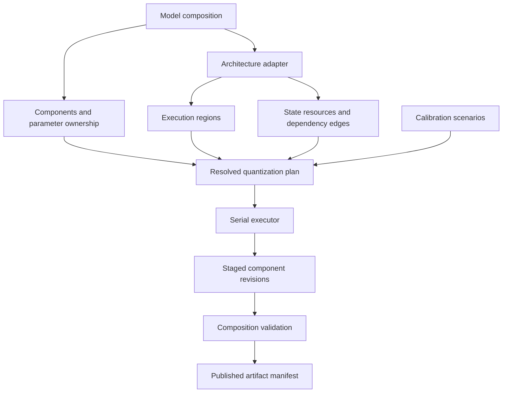
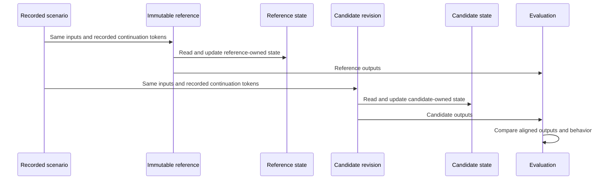
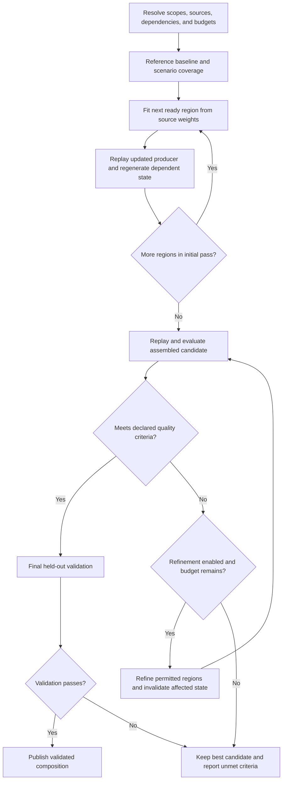
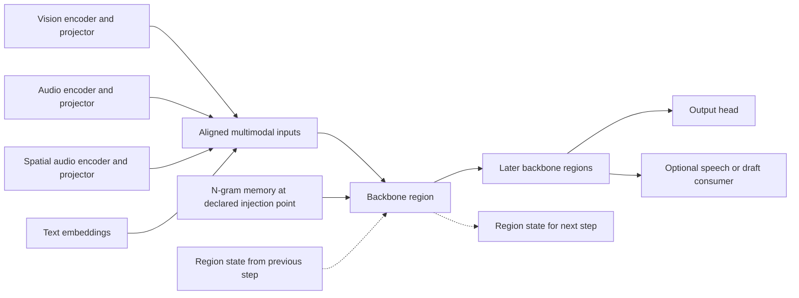
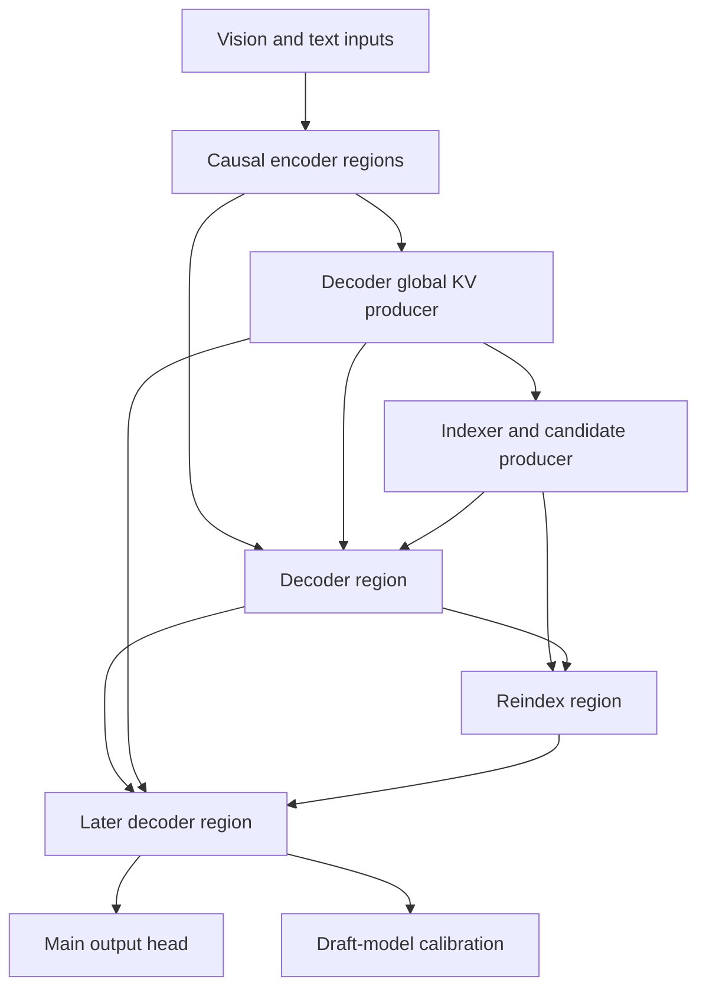
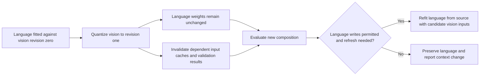

<!-- SPDX-FileCopyrightText: 2026 ModelCloud.ai
SPDX-License-Identifier: Apache-2.0 -->

# Draft design for component and phased quantization

**Status:** design discussion, revision 0.1, 2026-10-27.

**Related issue:** [#2928](https://github.com/ModelCloud/GPTQModel/issues/2928).

**Scope:** architecture, proposed APIs, execution flows, alternatives, and validation criteria. No implementation or quantization experiments accompany this proposal.

GPTQModel should support quantizing independently selected parts of a composite
model, while coordinating the numerical dependencies between those parts.
Vision, language, audio, projectors, memory modules, and draft models can have
different recipes and lifecycles. Their calibration inputs and execution state
still depend on the assembled model.

The proposed direction is one coordinated, phased quantization run with
dependency-ordered fitting, candidate replay, and optional selective refinement.
The executor can remain serial. Components own weights and revisions; execution
regions and explicit state dependencies determine scheduling.

Backward compatibility is **not a requirement and should not constrain this
design**. Compatibility shims and preservation of the legacy lifecycle are
discouraged. Existing numerical implementations may be reused behind new contracts.
API examples below are illustrative, not APIs available in the current package.
All choices labeled proposed remain open to revision. Discussion or acceptance
of this document does not start implementation; execution requires a separate
decision after the design questions have been resolved.

## 1. Problem and current baseline

The original issue describes a language-only quantization tree and text-only
calibration for a multimodal workload. These are distinct concerns: which weights
change and which inputs produce representative calibration statistics.

At GPTQModel commit
[`536b7f9b`](https://github.com/ModelCloud/GPTQModel/tree/536b7f9b6af3c1e39f1e7a1b2e58a50d8793af4e):

- `BaseQModel` owns global `quantized` and `quantize_config` state. Regular
  `quantize()` is guarded by that global state; `requantize()` currently has
  embedding/norm-specific semantics. [Base model][gptq-base]
- Layer discovery accepts multiple containers, then flattens them into one layer
  sequence. That alone does not describe component boundaries or state
  dependencies. [Layer discovery][gptq-discovery]
- Current Qwen3.5-MoE inherits the multimodal calibration base, although its
  quantization tree remains language-scoped. The issue's older inheritance
  diagnosis must not be treated as the current implementation. [Definition][gptq-qwen]

The design must support all of the following independently:

| Concern | Example |
| --- | --- |
| Weight selection | Quantize language while preserving vision weights. |
| Calibration execution | Execute vision to supply image-conditioned language inputs. |
| Recipe selection | Use different supported precision and algorithms for vision and language. |
| Lifecycle | Quantize vision after language has already been saved and reloaded. |
| Numerical context | Record that language was calibrated against an earlier vision revision. |
| Persistence | Save and restore the complete mixed dense/packed composition. |

Serial execution is sufficient for an initial implementation. Global mutable
state and assumptions about one decoder stack are the constraints to remove.

## 2. Architectural evidence and its limits

Qwen3.8 is a family. Qwen3.8-Flash-Next is the forward-looking open architecture
used here; the Qwen3.8-Omni report supplies an additional multimodal reference.
Do not assume every Qwen3.8 checkpoint has these exact structures.

| Reference | Relevant structure | Design implication |
| --- | --- | --- |
| Qwen3.8-Flash-Next | Gated DeltaNet interleaved with sparse attention, four residual branches, and n-gram memory. [Report][qwen-report] | Replay boundaries must include recurrent state and the complete residual representation. |
| Qwen3.8-Omni | Visual, general-audio, and spatial-audio encoders feed a shared Thinker with aligned inputs. [Report][omni-report] | Independent branches require composition-level calibration and evaluation. |
| DeepSeek V4.1 | Causal encoder/decoder organization; decoder global KV derives from encoder output; CSA2 reuses KV and sparse selections. [Report][deepseek-report] | Track memory producers and consumers across nonadjacent layers. |
| DeepSeek V4.1 reference implementation | Shared attention state is held outside ordinary module arguments. Draft blocks alias the main embedding and output head. [Code][deepseek-code] | Capture ambient state explicitly and preserve shared parameter identity. |

The inspected Qwen implementation also carries recurrent, convolution, and
indexer cache state, and injects n-gram information within decoder layers.
[Implementation][qwen-code]

These architectures motivate the proposal. Their reports do not establish that
the proposed post-training quantization schedule is optimal. Multimodal
co-training does not imply text-to-vision feedback during ordinary inference.
For the inspected vision paths, image features feed the backbone.

The released DeepSeek checkpoint already declares FP8 quantization and FP4
expert weights. An immutable source snapshot of that release is not an original
BF16 model. Source precision and native numerical behavior must be recorded.
[Checkpoint configuration][deepseek-config]

## 3. Proposed contracts

1. **Selection determines what may change.** Calibration can execute outside
   that selection, but cannot silently expand the weight write scope.
2. **Components own representation and revisions.** Root status is a derived
   summary, not a global quantized boolean.
3. **Dependencies determine scheduling.** Python containment, modality labels,
   and module traversal order do not define numerical execution order.
4. **The source is immutable.** Refits start from an identified source or an
   explicitly retained optimization master, never silently from a previous
   quantized approximation.
5. **Reference and candidate execution state are isolated.** A cache produced by
   one cannot be substituted into the other without changing the experiment.
6. **Candidate replay uses deployment semantics.** Native cache precision,
   routing, positional transforms, and applicable execution modes are preserved.
7. **A recipe is a capability-checked operation.** Unsupported operators,
   cross-boundary writes, and unresolved aliases fail during planning.
8. **Results retain provenance.** Every fitted region records its source,
   calibration scenario, dependency revisions, and algorithm settings.

## 4. Core objects and ownership

| Object | Owns or describes |
| --- | --- |
| `ModelComposition` | Component registry, parameter aliases, architecture adapter, and assembled revision. |
| `Component` | Stable public identity, owned parameter/buffer references, per-operator representations, recipes, and revision history. |
| `Region` | An executable capture/fit/replay boundary with complete inputs, outputs, state effects, and algorithm capabilities. |
| `StateResource` | KV, recurrent state, convolution history, retrieval indices, token history, or another execution resource with explicit producers and consumers. |
| `CalibrationSuite` | Prepared inputs, routes, scenario traces, weighting, and coverage requirements. |
| `QuantizationPlan` | Immutable resolved selection, parameter writes, sources, dependencies, recipes, budgets, and validation policy. |
| `QuantizationRun` | Phase progress, staged candidate revisions, checkpoints, observations, and evaluation results. |



Components are logical identities such as `vision.encoder`, `vision.projector`,
`language`, or `audio.encoder`. A named selection such as `vision` can expand to
several components without becoming another mutable owner.

Resolve ownership using canonical parameter identities, including storage aliases
and overlapping views. Attribute paths are bindings, not identities. A projector
nested inside a vision module must not be selected twice. Shared/tied parameters
require one representation and one declared ownership group. Incompatible recipes
must fail before mutation; explicit untying is a separate structural operation.

A region is the scheduling and replay unit. It might be a transformer block, a
projector, or an adapter-defined computation. A reconstruction region can span
components when the plan's write scope permits it. Evaluation scope may be wider
than fitting scope: a KV producer can be fitted locally and evaluated through
many consumers.

## 5. Discovery and execution dependencies

Discovery inventories all modules, parameters, buffers, aliases, and existing
packed representations. Architecture adapters then define semantic regions,
routes, and replay contracts. Automatic inspection can propose candidates, but a
`ModuleList` or `Linear` scan cannot establish arbitrary execution semantics.

`inspect()` should report discovered, quantizable, preserved, and unsupported
operators, plus unresolved regions. No selected operator may disappear silently
because it is outside a familiar text-decoder pattern.

The dependency representation needs distinct edge types:

| Edge | Example | Scheduling effect |
| --- | --- | --- |
| Tensor data | Vision output consumed by a projector. | Producer output must be available at the required revision. |
| Shared state | Several attention layers read one KV source. | Rebuild dependent state when its producer changes. |
| Control | Indexer selects entries; router selects experts. | Replay the candidate's actual selection path. |
| Temporal state | Recurrent state advances across tokens/chunks. | Preserve sequence boundaries, history, and state lineage. |
| Parameter alias | Drafter and main model share an output head. | Enforce one write owner and compatible representation. |
| Objective coupling | Reconstruction loss spans a projector and consuming block. | Declare the optimization region and its permitted writes. |

Shared state alone does not require simultaneous optimization. Joining every
producer and consumer into one fitting region would collapse much of the model
into a single expensive job.

Temporal feedback must not accidentally collapse the whole autoregressive model
into one graph cycle either. Represent time/step transitions explicitly and use
bounded traces. A genuine same-step cycle requires an adapter-defined joint
region or supported iterative execution contract; otherwise planning fails.

Adapters declare possible paths. Observed traces validate coverage but do not
prove that unobserved branches or experts are unreachable.

## 6. Public API sketch

Loading establishes structure and representations. Recipes belong to operations.
Names, signatures, and return types remain open questions.

```python
model = GPTQModel.load("source-checkpoint")
model.inspect()

calibration = CalibrationSuite(
    samples=image_text_samples,
    route="image_text",  # Registered by the architecture adapter.
    scenarios=["prefill", "decode"],
)

model.quantize(
    target="language",
    recipe=GPTQ(bits=4, group_size=128),
    calibration=calibration,
)

# Language is packed; the selected vision weights are still dense.
model.quantize(
    target="vision.encoder",
    recipe=GPTQ(bits=8, group_size=64),
    calibration=calibration,
)
model.save("mixed-model")

model.requantize(
    target="vision.encoder",
    recipe=GPTQ(bits=4, group_size=64),
    weights=SourceSnapshot("source-checkpoint"),
    calibration=calibration,
)
```

| Operation | Proposed meaning |
| --- | --- |
| `quantize(target=...)` | Fit selected dense weights; reject already-packed weights within the resolved write selection. |
| `requantize(target=..., weights=...)` | Replace selected packed representations using an identified source. |
| `repack(target=..., format=...)` | Convert storage layout without changing quantized numerical values, where supported. |
| `save(...)` | Persist the complete current composition. Validation status is recorded. |

Dequantizing current low-bit weights and fitting them again must be an explicit
source policy. It does not recover lost precision. Preflight reports mixed source
representations and any additional lossy conversion.

The convenience APIs compile into the same planner as a coordinated operation:

```python
plan = model.plan(
    targets={
        "vision": GPTQ(bits=8, group_size=64),
        "language": GPTQ(bits=4, group_size=128),
    },
    reference=SourceSnapshot("source-checkpoint"),
    calibration=calibration,
    schedule=PhasedSchedule(
        initial_fit="dependency_order",
        replay="candidate",
    ),
    refinement=SelectiveRefinement(
        algorithm=RegionReconstruction(),  # Optional, capability-checked plugin.
        write_scope="selected",
        max_passes=2,  # Illustrative budget, not an established optimum.
    ),
)
print(plan)
model.run(plan, executor="serial")
```

The preview distinguishes `modify`, `execute`, `observe`, `preserve`, and
`validate` scopes. It resolves transforms that also change norms, scales, or
neighboring projections, including AWQ-style coupling. No undeclared write is
permitted simply because an algorithm normally performs it.

## 7. Reference, candidate, and calibration state

The source snapshot describes available weights, configuration, native numerical
formats, and required preprocessing. The reference executes that identified
behavior. The candidate contains the staged quantization changes.

| Input to the process | Origin |
| --- | --- |
| Weights being fitted | Immutable source, or an explicitly retained optimization master. |
| Initial fitting activations | Current candidate upstream regions, according to the schedule. |
| Reconstruction targets | The declared reference objective. |
| Candidate state | Candidate execution under its own revisions and numerical profile. |



Reference and candidate caches never alias. An adapter must expose ambient state
as well as positional arguments and keyword arguments. Model-instance globals,
hooks, mutable buffers, and RNG state need appropriate isolation or restoration.
An adapter that cannot isolate state cannot support paired replay safely.

A replay boundary includes structured arguments, sequence identity, positions,
execution mode, valid-observation masks, and required state snapshots or recipes
to regenerate them. Repeated invocations of the same component must remain
distinct. Captured tensor views cannot remain attached to buffers later mutated
by another forward.

Calibration scenarios should cover applicable modes: multimodal prefill,
continuation decode, chunked/streaming execution, cache restoration, and drafting
or verification. Fixed-token traces align reference and candidate measurements;
generation-based evaluation separately tests behavioral divergence.

Dataset mixtures, context-length buckets, preprocessing, modality alignment, and
observation weighting are explicit. Count valid observations and expert coverage.
Do not force artificial routing to fill missing statistics without declaring an
algorithm-specific policy. Empty observations require an explicit fallback,
preserved representation, or failure.

Caches are bounded and can be streamed to CPU/disk or recomputed. No phase assumes
all Hessians, all activations, or two complete models fit in device memory.

## 8. Proposed phased schedule



### Phase A: Freeze and characterize

Freeze source and reference identities, resolve the calibration scenarios, and
establish baseline measurements. Check operator capabilities, shared ownership,
state contracts, preprocessing, and observation coverage before mutation.
Reference outputs can be generated lazily at chosen boundaries. This phase does
not collect and retain every Hessian in the model.

### Phase B: Initial fitting

Fit regions in data/state dependency order. Each region starts from its declared
source weights and receives current candidate upstream inputs. Replay updated
producers before fitting their consumers. Preserve algorithm-specific
true-sequential processing inside a region.

Independent branches may belong to one phase while executing serially. A future
parallel executor may overlap jobs only when read/write sets, state isolation,
dependency versions, and memory budgets permit it. A job cannot consume a
partially updated producer.

### Phase C: Assembled candidate replay

Execute the complete candidate on the calibration scenarios with independent
candidate state. Measure composition-level errors in addition to local fitting
loss. Reference indices, reference KV, or reference recurrent state must not be
substituted into the final candidate path merely to improve its score.

Observe task quality, boundary reconstruction, long-sequence state behavior,
sparse selection, and routing where relevant. Selection/routing differences are
diagnostics, not automatically failures: the task-level acceptance criteria
remain authoritative.

### Phase D: Optional selective refinement

Choose permitted interventions using measured regressions: increased precision,
refitting on refreshed candidate inputs, or a declared region reconstruction
algorithm. Cross-component fitting requires a write scope containing all changed
parameters. Shared producers can have a wider evaluation scope than write scope.

After any change, regenerate affected state and evaluate again. Bound passes and
resource use; retain the best candidate on a separate selection set. Reserve a
held-out set for final acceptance. Alternating updates have no assumed convergence
or monotonic improvement guarantee.

### Phase E: Validate and publish

Publish an assembled revision after final validation. Intermediate component
results remain durable checkpoints with explicit provisional status. An unmet
quality criterion produces a report and a retained candidate, not a false
validated-success result. Saving an unvalidated candidate is allowed only with
its status made explicit.

## 9. Model-specific scheduling sketches

These diagrams illustrate adapter responsibilities, not complete executable
graphs or exact module path mappings.

### Multimodal branches and shared backbone



Select only the branches present in the architecture. Complete selected upstream
branches before capturing shared-backbone inputs. Preserve the full residual
representation at region boundaries. Recurrent transitions are temporal edges;
they are replayed over a declared trace rather than treated as an ordinary
acyclic layer chain.

For a recurrent region, the initial local fit can change the region's own future
state distribution. Rebuild its state and measure continuations after fitting;
an additional fit or reconstruction pass is optional and must be validated.

### Shared encoder and decoder memory



The DeepSeek configuration explicitly names KV sources, index sources, and a
candidate source. Adapters should use this structure to express dependencies.
[Configuration][deepseek-config]

At each shared-memory boundary, finalize the selected producer transformations,
regenerate memory with candidate numerical semantics, and fit dependent
consumers. A later producer change invalidates derived memory and evaluations
across its dependent consumers, including nonadjacent layers.

The draft model should be evaluated against the finalized main candidate,
including acceptance and throughput measurements when supported. DSpark's
reported staged training provides architectural context, not evidence that a
particular quantization schedule will be optimal. [Report][deepseek-report]

## 10. Ordering alternatives and numerical objectives

| Strategy | Benefit | Limitation | Proposed role |
| --- | --- | --- | --- |
| Independent fitting against one source snapshot | Simple isolation and parallelism. | Downstream fits do not observe upstream quantization effects. | Experimental baseline. |
| One progressive dependency-ordered pass | Consumers observe updated upstream computation. | Local objectives may miss composition-level or temporal errors. | Initial fitting default. |
| Progressive fitting plus candidate replay and selective refinement | Measures interactions and targets repair work. | Additional replay cost; refinement algorithm and stopping policy need validation. | Proposed coordinated workflow. |
| Joint end-to-end optimization of all selected weights | Can optimize a shared downstream objective. | Memory/compute cost, differentiability issues, and no guaranteed superiority. | Optional research/plugin path. |

Simultaneously installing independently fitted results does not make their
optimization joint. Alternating vision layer zero and language layer zero is not
a meaningful schedule merely because both are transformers.

For an illustrative linear layer, ordinary local reconstruction has the form
`min ||(W_source - W_quantized) X_candidate||^2`. A cross-region objective instead
compares `F_candidate(trace)` and `F_reference(trace)` at declared boundaries.
These are different optimization problems. A scheduler must not imply that
ordinary GPTQ automatically compensates for arbitrary upstream errors or performs
end-to-end reconstruction.

For bounded refinement, either refit from source weights or retain explicit
optimization-master state. Do not repeatedly dequantize the last candidate and
treat that degraded approximation as the original source. Any lossy source policy
must be visible in the plan and provenance.

### Text first, then vision

For a conventional vision-to-language path, language weights are downstream and
do not affect vision's local GPTQ inputs. The opposite dependency matters:
language may have been fitted using features from the earlier vision revision.



The previous language fit remains a valid historical result with recorded
provenance. Its weights do not become corrupt or automatically unquantized. Its
upstream context has changed. Vision-only operations must not silently rewrite
language; a coordinated plan selecting both may do so within its declared policy.

End-to-end objectives or actual feedback paths require additional dependency and
objective declarations. They cannot inherit the assumptions of local GPTQ.

## 11. Cache lineage, transactions, and persistence

Cache identity includes source/candidate revision, actual producer dependencies,
region/boundary identity, dataset and preprocessing fingerprints, scenario and
positions, numerical profile, adapter version, and relevant execution settings.
Hashes of a component name or model path alone are insufficient.

Changing a producer invalidates transitive derived activations/state and affected
validation results. Independent caches remain reusable. A state checkpoint can
be reused only when its producer lineage and continuation contract match.
Otherwise rebuild from a valid prefix or reset point. Restarting every chunk from
zero is not equivalent to continuing a recurrent sequence.

Persistent representation and job progress are separate:

```text
Per-operator representation: Dense(dtype) | Packed(codec, metadata)
Region job: planned -> fitting -> replaying -> staged | failed
Run: preparing -> fitting -> evaluating -> refining -> validated | unmet | failed
Artifact: provisional | validated
```

Use immutable staged tensor artifacts and private runtime overlays. Completed
regions/components can be checkpointed without publishing the entire composition
as validated. Failed work leaves earlier published revisions intact. A coupled
transformation commits all affected parameter changes together.

The initial executor can use an exclusive mutation lease. Resume checks the plan,
source weights, dependency revisions, prepared data, numerical profile, algorithm
continuation, RNG, and supported device/runtime identity. Mismatches fail with a
specific reason rather than silently replaying incompatible statistics. Exact
cross-device reproducibility and relaxed resume are separate open questions.

An immutable source does not require a full dense runtime copy. Materialize only
the working region and stream from checkpoint-backed storage. Inference weights
must stay packed between consuming operations, consistent with repository
guidance. A persistent dense or expanded inference cache is not a rollback
mechanism. Explicit optimization masters, if required by a fitting algorithm,
have a bounded fitting lifetime and are not installed as inference caches.

The native artifact manifest describes the complete composition:

- Schema, architecture, adapter, source, and assembled revision identities.
- Components, canonical parameters, aliases, and shared ownership groups.
- Per-operator dense or packed representations and codec metadata.
- Resolved recipes and source/dependency provenance for fitted regions.
- Numerical profiles and required runtime capabilities.
- Validation status, scenario coverage, and relevant reports.
- Model configuration, tokenizer, processor, and required inference assets.

Runtime session caches are separate from the model artifact. They belong in a
continuation checkpoint only when the replay contract requires them.

Inference loading is self-contained and does not require the source checkpoint.
Original-source references support future refitting but are not inference
dependencies. Saving preserves untouched packed and dense tensors. Backend
selection is per operator. External formats are explicit exporters that reject
unrepresentable mixtures; a single global quantization config is not authoritative.

## 12. Implementation boundaries under consideration

| Boundary | Responsibility |
| --- | --- |
| Architecture adapter | Discovery, bindings, region boundaries, execution modes, state effects, and replay equivalence. |
| Planner | Resolve scopes, sources, recipes, dependencies, write sets, capabilities, and budgets. |
| Executor | Scheduling, state contexts, materialization, devices, cleanup, and transaction boundaries. |
| Algorithm plugin | Observation requirements, declared transforms, fitting objective, numerical results, and continuation state. |
| Weight codec | Pack/unpack and lossless layout conversion where supported. |
| Runtime backend | Execute supported packed operators under the declared numerical profile. |
| Artifact store | Immutable objects, manifests, checkpoints, integrity, and publication. |

Existing algorithms and kernels are reuse candidates. The new orchestration
should not be a wrapper around the old global lifecycle. A one-component text
model uses exactly the same contracts as a composite model.

The first implementation, if approved later, should establish dependency-aware
fitting, explicit state handling, assembled replay, and mixed persistence before
adding new reconstruction mathematics. Mandatory whole-model QAT, a universal
graph compiler, speculative auto-detection of arbitrary remote-code semantics,
and parallel execution are outside that initial scope.

## 13. Validation and experiment plan

No implementation tests or quantization benchmarks have been run for this design.
The following are proposed acceptance criteria and experiments.

| ID | Proposed check | Required evidence |
| --- | --- | --- |
| V1 | Incremental quantization | Language -> save/load -> vision preserves unselected language tensors, packing metadata, and aliases. |
| V2 | Multimodal calibration | Language-only selection executes vision where required and receives image-conditioned observations. |
| V3 | Dependency invalidation | Producer changes invalidate exactly the affected cache/validation closure, including nonadjacent consumers. |
| V4 | Replay equivalence | Unmodified region replay matches root execution across supported prefill, decode, and streaming modes. |
| V5 | State isolation | Interleaved reference/candidate runs and repeated scenarios do not leak KV, indexer, recurrent, convolution, or ambient state. |
| V6 | Ownership and scope | Overlaps, conflicting shared-weight recipes, and undeclared algorithm writes fail before mutation. |
| V7 | Failure and resume | Injection of failures at fitting, replay, checkpoint, and publication boundaries preserves published artifacts and rejects incompatible resumes. |
| V8 | Persistence | Mixed dense/packed recipes and native source formats round-trip without requiring original weights for inference. |
| V9 | Coverage | Missing modality paths or observations trigger the declared policy; excluded and unsupported operators appear in reports. |
| V10 | Numerical semantics | Local fitting, packed execution, and state formats are checked against independent applicable oracles before any implementation is accepted. |

For schedule comparisons, hold calibration data, source, intended precision,
grouping, exclusions, and evaluation scenarios fixed. Compare independent fitting,
one progressive pass, and progressive fitting with selective refinement. Record
actual resource use; compare at matched budgets where possible. If refinement
changes precision, report the resulting memory/quality tradeoff separately.

Measure held-out text and multimodal task quality, prefill/decode differences,
boundary reconstruction, state drift over relevant context lengths, routing and
retrieval diagnostics, draft acceptance where applicable, elapsed time, memory,
and I/O. Local reconstruction loss alone is not the acceptance metric.

Use a source baseline before attributing regressions to quantization. Prompt
rendering, preprocessing, token IDs, and numerical profiles must match the
declared comparison. Native low-precision releases need their native baseline;
do not label it a full-precision baseline.

## 14. Decision register and open questions

The compatibility constraint comes from the requested scope. Other entries are
proposed defaults, not final design approval.

| ID | Proposed position | Question to resolve |
| --- | --- | --- |
| D1 | Component ownership with region scheduling. | How much region structure can be declared rather than coded per adapter? |
| D2 | Progressive initial fitting plus assembled replay. | Which quality/resource criteria justify refinement? |
| D3 | Explicit state resources and isolated execution contexts. | Where is snapshotting preferable to prefix recomputation, and how are ambient globals adapted? |
| D4 | Immutable source and separate reference/candidate behavior. | How should APIs distinguish native packed sources, higher-precision sources, and retained optimization masters? |
| D5 | Explicit shared parameter groups. | What is the smallest useful public selection and conflict-reporting vocabulary? |
| D6 | Bounded optional refinement plugins. | Which initial objective and region boundaries improve quality at practical cost? |
| D7 | Checkpoint components; publish validated composition revisions. | What atomicity is required for cross-component transforms and live model replacement? |
| D8 | Serial executor first. | What read/write and memory contracts must exist now to allow later safe concurrency? |
| D9 | Native mixed-representation manifest. | Which external export formats can represent which mixtures? |
| D10 | Scenario-aware calibration with explicit weighting. | What coverage requirements are feasible for sparse experts, rare modalities, and long contexts? |
| D11 | Actual candidate routing during final replay. | When should indexers, routers, and residual gates be preserved at source precision or refined? |
| D12 | No backward-compatibility constraint. | Which numerical implementations can be reused without importing global orchestration assumptions? |

Unresolved research topics include whether interface reconstruction suffices for
most multimodal error, how to detect a beneficial coupling region, how many replay
passes are worth their cost, and when simultaneous versus alternating fitting is
preferable. None should be resolved solely from model architecture diagrams.

## 15. Revision process and gates before execution

Keep this PR in draft while the contracts and tradeoffs are being revised. Future
revisions should update the current proposal and decision register together;
superseded choices should not remain presented as current defaults.

Before implementation, agree on ownership/write semantics, reference and state
contracts, the first supported adapters, artifact boundaries, and a budgeted
experiment plan. A later implementation proposal can stage work as follows:

1. One-component text adapter using the new plan/state contracts.
2. Vision + projector + language discovery, incremental fitting, and persistence.
3. Recurrent/shared-memory replay with failure and invalidation checks.
4. Controlled schedule comparisons and optional reconstruction experiments.

These are discussion gates, not an approved execution checklist or timeline.

| Revision | Change |
| --- | --- |
| 0.1, 2026-10-27 | Initial clean-sheet proposal covering independent targets, phased coordination, explicit state, source/candidate separation, and open design questions. |

## Sources

Repository observations are pinned to the inspected GPTQModel commit. Checkpoint
links are pinned where a revision was inspected. The Transformers link is a
moving implementation reference inspected on 2026-10-27. Architecture reports
support the structural observations, not the proposed quantization outcomes.

[gptq-base]: https://github.com/ModelCloud/GPTQModel/blob/536b7f9b6af3c1e39f1e7a1b2e58a50d8793af4e/gptqmodel/models/base.py
[gptq-discovery]: https://github.com/ModelCloud/GPTQModel/blob/536b7f9b6af3c1e39f1e7a1b2e58a50d8793af4e/gptqmodel/utils/model.py
[gptq-qwen]: https://github.com/ModelCloud/GPTQModel/blob/536b7f9b6af3c1e39f1e7a1b2e58a50d8793af4e/gptqmodel/models/definitions/qwen3_5_moe.py
[qwen-report]: https://arxiv.org/html/2608.30320v1
[qwen-code]: https://github.com/huggingface/transformers/blob/main/src/transformers/models/qwen4_exp/modeling_qwen4_exp.py
[omni-report]: https://arxiv.org/html/2609.25611v1
[deepseek-report]: https://arxiv.org/html/2609.19969v1
[deepseek-code]: https://huggingface.co/deepseek-ai/DeepSeek-V4.1-Flash-1017/blob/1bae0e1088993b9b82de08f59de5be5a34e42170/inference/model.py
[deepseek-config]: https://huggingface.co/deepseek-ai/DeepSeek-V4.1-Flash-1017/blob/1bae0e1088993b9b82de08f59de5be5a34e42170/config.json

Additional inspected checkpoint:
[Qwen3.8-Flash-Next configuration](https://huggingface.co/Qwen/Qwen3.8-Flash-Next/blob/de4b8e4d43b917e7706784d8bb445c9af86a3540/config.json).
