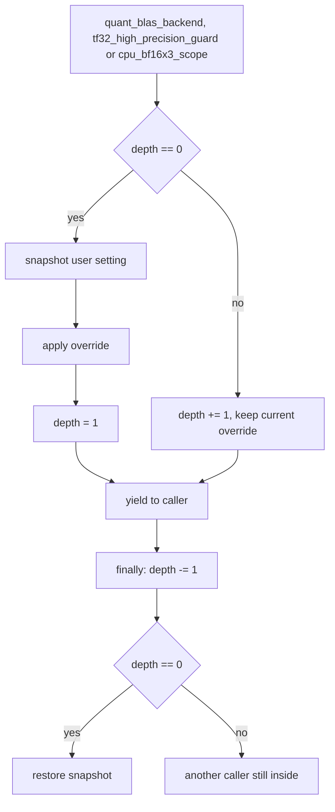
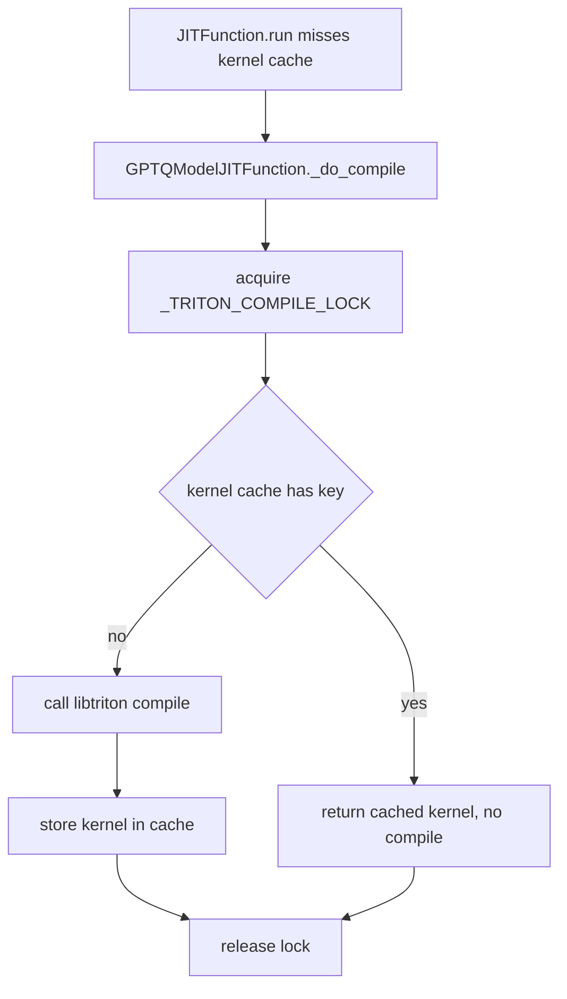
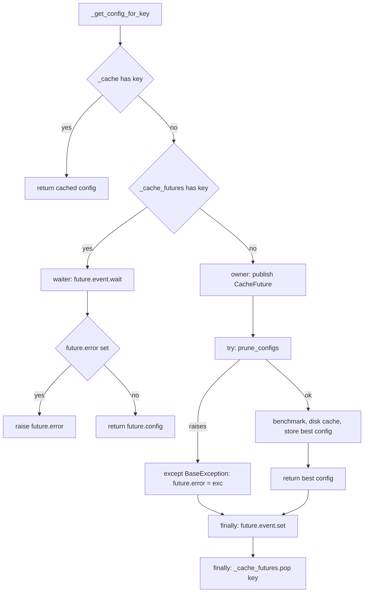
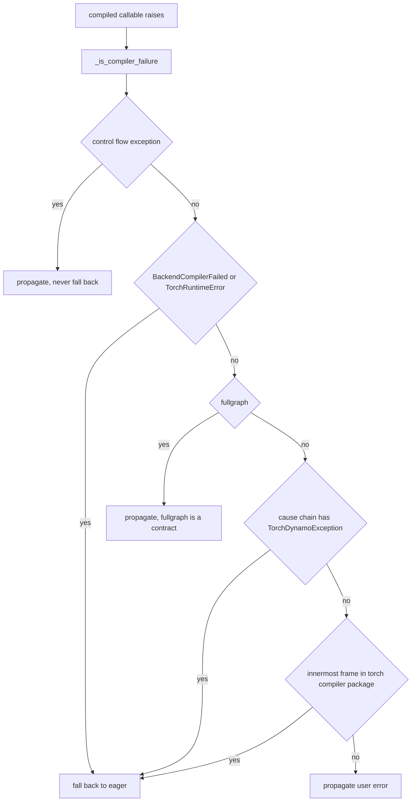
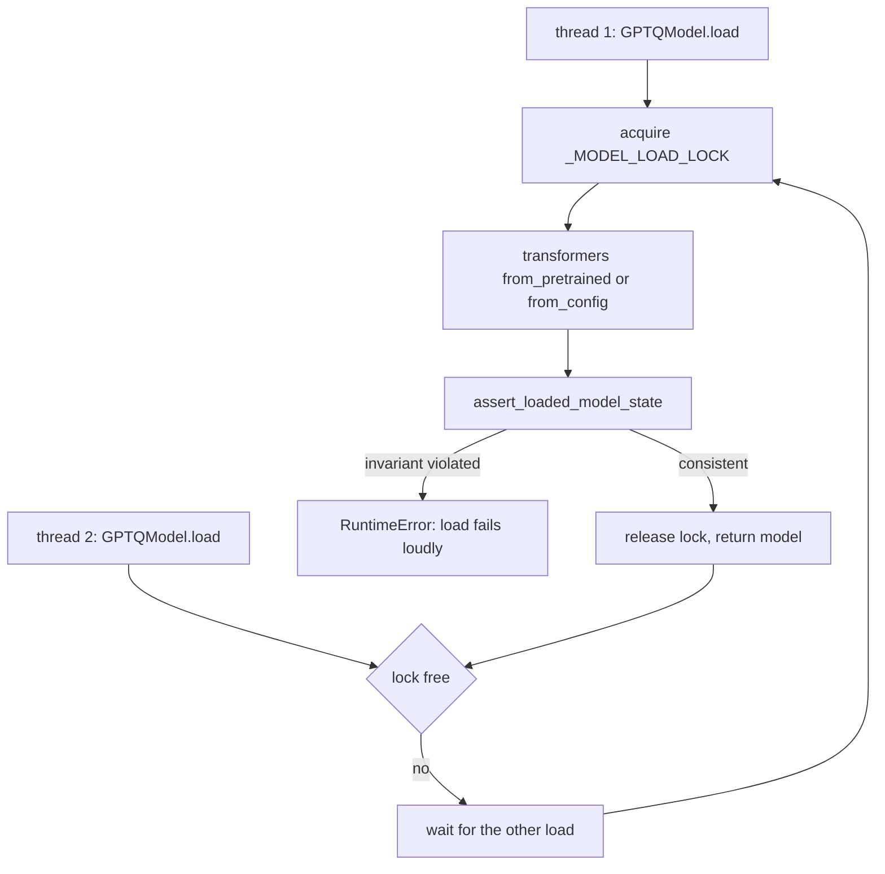
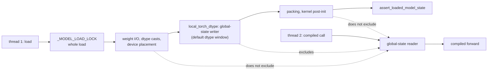
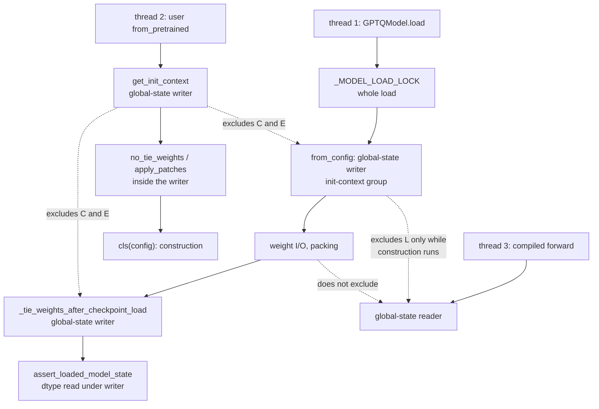
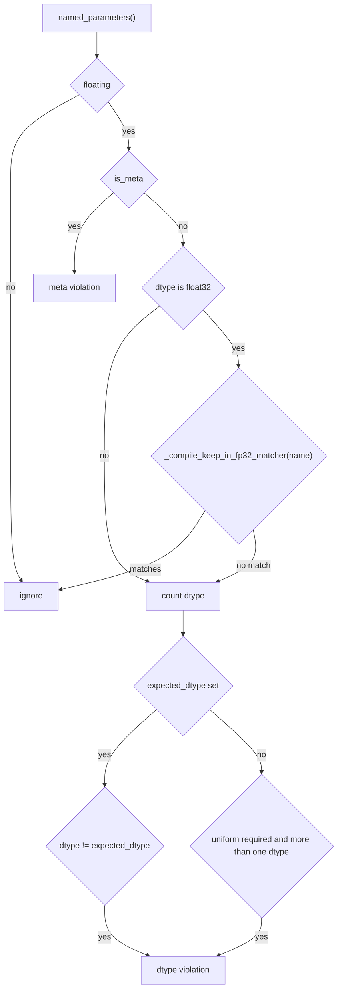

<!-- SPDX-FileCopyrightText: 2026 ModelCloud.ai -->
<!-- SPDX-License-Identifier: Apache-2.0 -->

# Concurrency guards

GPT-QModel runs quantization and inference from several threads, including on
free-threaded CPython (`PYTHON_GIL=0`). Five process-global resources are
shared by those threads: the ROCm BLAS backend selection, the TF32 precision
setting, the CPU oneDNN BF16x3 matmul precision, libtriton's JIT compiler, and
the transformers model-construction state (default dtype plus the meta-device
and no-init contexts). This page documents how the guards for those resources
behave, and why they are reference-counted, serialized, or classified as
compiler failures.

The shapes are deliberate: a guard that saves and restores a process-global
value per entry is wrong as soon as two callers overlap, and a compiler that is
assumed to be thread-safe is wrong as soon as two threads miss the same kernel
cache entry.

## 1. BLAS, TF32 and CPU BF16x3 guards are reference-counted

`quant_blas_backend` (`gptqmodel/utils/rocm.py`) and
`tf32_high_precision_guard` (`gptqmodel/utils/torch.py`) protect a
process-global setting. They now keep one depth counter and one saved value
under a module-level `RLock`. The first entry captures the user's setting and
applies the override; every later entry only increments the depth. Only the
last exit restores the captured value.

`cpu_bf16x3_scope` (`gptqmodel/utils/cpu_features.py`) is the same shape for
`torch.backends.mkldnn.matmul.fp32_precision`. It is shared by every CPU caller
that runs FP32 matmuls as BF16x3: GGUF CPU and bitsandbytes CPU go through
`cpu_bf16x3_matmul()`, and the EXL3 torch kernel enters the scope directly after
its own shape and environment gate. The lock is an `RLock` because the scope is
re-entrant; a plain `Lock` would deadlock a nested entry.

The same flow serves a single caller, a nested caller on one thread, and two
concurrent `quantize()` calls. The first caller to *enter* owns the snapshot;
the first caller to *exit* does not restore anything unless it is also the
last one inside.

Before the change, each entry snapshotted the current value and each exit
restored it. Quantize A entered first and set rocBLAS; quantize B entered
second, saw rocBLAS, and skipped the override; A returned and restored
hipBLASLt while B was still quantizing. B's remaining layers then ran on the
backend whose per-process kernel selection #4075/#4079 removed.

| Mechanism | Before | After |
| --- | --- | --- |
| BLAS depth | none; per-entry save/restore (`utils/rocm.py:240-283` at `718256fd7`) | `_QUANT_BLAS_GUARD_LOCK`, `_QUANT_BLAS_GUARD_DEPTH`, `_QUANT_BLAS_GUARD_PREVIOUS`, `_QUANT_BLAS_GUARD_TARGET` |
| TF32 depth | none; per-entry save/restore (`utils/torch.py:1021` at `718256fd7`) | `_TF32_GUARD_LOCK`, `_TF32_GUARD_DEPTH`, `_TF32_GUARD_PREVIOUS` |
| BF16x3 depth | none; per-entry save/restore in two copies (`utils/cpu_features.py:88` and `nn_modules/exllamav3_torch.py:74` at `fe302047d`) | `_CPU_BF16X3_LOCK` (`RLock`), `_CPU_BF16X3_DEPTH`, `_CPU_BF16X3_RESTORE` in `cpu_features.py`; the EXL3 copy is deleted |
| Restore rule | every exit restores | only the exit that reaches depth 0 restores |

The BLAS guard also carries a *target*, because a quantization run may need
rocBLAS (it accumulates a Hessian) or hipBLASLt (it does not). Runs that need
the same target share the refcount. Runs that need different targets cannot
share one process-wide setting, so the later run waits for the active one to
finish rather than flipping the backend under it; without that, a concurrent
AWQ run quantized part of its layers on each backend and its checkpoint
depended on when the other thread exited (issue #4123). See
[ROCm default process environment](rocm-default-environment.md#quantization-blas-scope).

The BF16x3 guard used to exist twice. `nn_modules/exllamav3_torch.py` kept its
own `_cpu_bf16x3_matmul` copy of the save/restore pair next to the one in
`utils/cpu_features.py`, so the EXL3 forward and the GGUF/bitsandbytes forward
could restore each other's precision. There is now one implementation; the EXL3
module keeps only its environment-variable and shape gates.

The failure was the same shape as the BLAS one: caller A entered first and
selected BF16x3, caller B entered while A held it (B's copy saw BF16x3 and
skipped its own switch), then A exited and restored `none`, so B's remaining
matmuls ran in IEEE FP32. Measured on a 2048-wide `ExllamaV3TorchLinear` CPU
forward with the GGUF/bitsandbytes scope as A: chunk precisions
`bf16, bf16, none, none` and 5/5 forwards differing from the all-BF16x3
reference. After the change all four chunks stay `bf16` and 0/5 differ.

The three switches are also part of dynamo's `GLOBAL_STATE` guard: a trace
snapshots them when it starts and writes them back when it ends. The depth-0
transitions therefore take the model-global-state writer
(`model_global_state_write_guard()`), which excludes in-flight compiled calls
and their traces, so a trace in another thread cannot restore the user's value
mid-window (issue #5390). The writer is held for the switch only, never for the
whole quantization. A caller that is already inside a compiled call holds the
shared side and skips it instead of deadlocking.

The lock cannot fix the other half of that hazard: "am I being traced" itself.
`torch.compiler.is_compiling()` reads a module-level flag that the compile
session sets for the whole process, so every eager thread in the process sees
`True` while *any* thread compiles (#5427). Kernels that took their trace-only
branch on that signal (NF12's exponent-base cache fill, the `optimize()` proxy's
eager short-circuit, the `_awq_shifts`/`ret_idx` caches) therefore degraded or
crashed whenever an unrelated thread compiled. Every call site now goes through
`utils/torch.py:dynamo_is_compiling()`, which uses
`torch.compiler.is_dynamo_compiling()`: a constant `False` in eager code that
dynamo folds to `True` inside the traced frame, so another thread's session
cannot leak in. `torch.compiler.is_exporting()` is folded in for export, which
is process-scoped but single-threaded.

The guards stay scoped where they are entered. #4092 narrows
`quant_blas_backend` to the Hessian/linalg phase; the counting works for that
placement too, because it depends only on entry and exit, not on which phase
wraps the context.

## 2. Triton JIT compilation is single-flight and globally serialized

GPT-QModel kernels are built with `gptqmodel.utils.triton_jit.jit`, which
returns a package-owned `JITFunction` subclass (Triton itself is never
patched; the former `TritonPatch` was removed). Its `_do_compile` takes
`_TRITON_COMPILE_LOCK`, rechecks the per-device kernel cache for the requested
specialization key, and compiles only if the key is still missing.

Two threads that miss the same specialization are collapsed into one compile.
Different specializations are serialized too, because the unsafe nanobind
state lives in libtriton as a whole, not in one `JITFunction`. The lock is only
taken on a cache miss; steady-state launches take the existing fast path and
never touch it.

Before the change, `utils/nogil_patcher.py` patched only the autotuner. With an
empty `TRITON_CACHE_DIR` and `PYTHON_GIL=0`, 24 threads launching
`awq_gemm_kernel` together aborted the process with
`Critical nanobind error: inst_dealloc ... attempted to delete an unknown
instance` and exit code 134. The same wrapper covers the MACaQ Triton kernels,
which launch through the same `JITFunction.run` path.

| Mechanism | Before | After |
| --- | --- | --- |
| Autotuner state | thread-local `nargs`/`best_config`, locked cache | unchanged |
| JIT compile | unsynchronized, one compile per missing thread | `_single_flight_triton_compile` under `_TRITON_COMPILE_LOCK` |
| Cold-start cost | concurrent compiles race | cold compiles run one at a time; the first caller pays the compile, the rest wait and reuse it |

### Autotuner single-flight futures resolve on every owner exit

`_get_config_for_key` publishes one `CacheFuture` per tuning key and collapses
concurrent misses for that key onto it. The owner used to call
`prune_configs()` *before* entering the `try/finally` that sets
`future.event` and removes the future from `_cache_futures`. A pruning
exception therefore escaped with the future still pending: every waiter parked
on `future.event.wait()` with no timeout, and every same-key retry reused the
unresolved future. The exception was catchable; the hang was not.

Pruning now runs inside the owner-finalization scope, so every exit path
resolves the future and removes the key.

| Mechanism | Before | After |
| --- | --- | --- |
| Owner scope | `prune_configs` outside the `try` (`utils/nogil_patcher.py:355` at `461b42023`) | `prune_configs` inside the owner `try` |
| Pruning exception | future retained, Event unset, `error` unset | `future.error` set, Event set, key popped |
| Same-key retry | reuses the pending future and blocks forever | becomes a new owner and completes |
| Waiter | `future.event.wait()` with no timeout | wakes on success or re-raises the owner error |

## 3. Dynamo guard failures fall back to eager

`_is_compiler_failure` (`gptqmodel/utils/torch.py`) classifies an exception by
its innermost traceback frame. Any exception raised inside `torch/_dynamo`,
`torch/_inductor`, or `torch/_functorch` is a compiler failure and the eager
implementation serves the call. User code raising the same exception type has
its own frame at the origin, so it still propagates and is never retried.

The dynamo guard `AssertionError` (`Guard failed on the same frame it was
created ... GLOBAL_STATE changed: default_dtype`) is raised from
`torch/_dynamo/guards.py`, so the last decision sends it to the eager path.
Before the change the frame check ran only for `RuntimeError`; the guard
assertion escaped and aborted a forward that raced another thread's
`torch.set_default_dtype`.

| Mechanism | Before | After |
| --- | --- | --- |
| Frame-origin check | only `RuntimeError` | every non-control-flow exception |
| Guard `AssertionError` | propagated, forward failed | eager fallback, one warning |
| User `AssertionError` | propagated | propagated, no retry |

## 4. Model loads are serialized

`ModelLoader.from_pretrained` and `ModelLoader.from_quantized` are wrapped with
`_serialized_model_load` (`gptqmodel/models/loader.py`), which holds
`_MODEL_LOAD_LOCK` (an `RLock`) for the whole construction. transformers'
`from_pretrained` opens a `local_torch_dtype` window that saves, sets and
restores `torch.set_default_dtype`
(`transformers/modeling_utils.py`) and builds parameters through meta-device and
no-init contexts; `from_config` does the same for the quantized shell. Those are
process-global, so two overlapping loads interleave them and hand back models
with mixed dtypes, a meta tied weight, or untied embeddings.

Compiled calls do **not** take `_MODEL_LOAD_LOCK`. They take the shared reader
side of a separate process-global reader/writer lock
(`_MODEL_GLOBAL_STATE_LOCK`, `gptqmodel/models/loader.py`). The exclusive
writer side belongs to transformers' `local_torch_dtype` window itself
(`model_global_state_lock()`): package import calls
`install_model_global_state_dtype_guard()`
(`gptqmodel/utils/torch.py`), which wraps that context manager so the writer is
acquired when the window opens and released when it closes. Construction call
sites do not take the writer, so the window cannot be widened to a load's weight
I/O (#5304).

Dynamo's `preserve_global_state` saves and restores the default dtype around
every trace, and its `GLOBAL_STATE` guard re-reads it on every call. A call that
re-traces inside a load's bf16 window would restore bf16 after the load restored
fp32, or fail the load's invariant check (#5127). Holding the load lock for the
first call only was not enough (#5209); holding it for every call serialized all
compiled forwards and stalled them for a whole load (#5268). Holding the writer
around each construction *call* was still wrong for a dense load: that is the
entire `from_pretrained` body -- weight I/O, dtype casts, device placement,
packing and kernel post-init -- and stalled every optimized forward for the
whole load, tens of seconds for a 7B model (#5304). The writer therefore belongs
to `local_torch_dtype`, the only place that mutates the process-global dtype.

On the reported host a warm `optimize()`d decode step (a 1B GPTQ 4-bit
checkpoint) measured 16 ms p50 and 20 ms baseline max. With the load in another
thread the writer was held for 1.50 s of a 1.92 s dense `GPTQModel.load`, and
the worst decode step was 1516 ms. With the window-scoped writer the same
measurement is 21 ms of writer hold and the load body overlaps the decode loop;
the remaining spikes (106-190 ms) are the load's own host work on a
free-threaded interpreter, not the writer (the dtype window excludes them for
its 21 ms only).

### Construction is exclusive for every class-wide patch (#5421)

`local_torch_dtype` is only one of the process-global contexts a construction
opens. `PreTrainedModel.get_init_context` also opens `init.no_tie_weights()`,
which replaces `PreTrainedModel.tie_weights` for **every** class, and
`apply_patches()`, which swaps registered classes in every transformers module.
Neither held the writer, so a plain `from_pretrained` in another thread could
disable tying while a GPT-QModel shell was building or re-tying its head. A
quantized load of a tied checkpoint (the checkpoint stores only
`model.embed_tokens.weight`) then failed with
`does not provide tensors for 1 non-quantized parameter(s): lm_head.weight`.

The tie that matters for a quantized load is the post-load one: the shell is
built with weight init suspended (`suspend_hf_weight_init`), so `post_init`
does not tie anything and `_tie_weights_after_checkpoint_load` is the only
call that binds `lm_head`. It ran outside the writer too, which is why guarding
only the construction window did not close the failure.

The writer now belongs to the construction and to every consumer of those
patches, not only to the dtype window:

- `PreTrainedModel.get_init_context` prepends the writer to the returned
  context list. `ContextManagers` enters the list in order through an
  `ExitStack`, so the writer is acquired before `no_tie_weights` /
  `apply_patches` and released after them.
- `PreTrainedModel._from_config` holds it for the whole `from_config`
  construction, which opens `apply_patches` outside `get_init_context` and may
  have no dtype window at all.
- `init.no_tie_weights` and `apply_patches` take it themselves, so a direct
  use of either patch is exclusive even on a transformers version without
  `get_init_context`.
- `_tie_weights_after_checkpoint_load` takes it around the tie, so a foreign
  window cannot turn that call into a no-op.
- The default-dtype value a load captures and the one it compares against in
  `assert_loaded_model_state` are both read under the writer, so a correct load
  is not rejected as a "corrupted state" because another thread's window was
  open at that instant.

| Mechanism | Before | After |
| --- | --- | --- |
| `local_torch_dtype` window | writer | writer (unchanged) |
| `get_init_context` group (`no_tie_weights`, `apply_patches`, meta device) | no writer | writer prepended to the context list |
| `_from_config` construction | writer only when a dtype is given | writer for the whole construction |
| `init.no_tie_weights` / `apply_patches` themselves | no writer | writer for the patch window |
| post-load tie (`_tie_weights_after_checkpoint_load`) | no writer; skipped inside a foreign window | writer; waits for the foreign window |
| load default-dtype capture and check | bare `torch.get_default_dtype()` | both read under the writer |

The writer is still held for construction only -- not for a load's weight I/O,
packing or kernel post-init -- so the #5304 contract is unchanged.

A load also no longer calls `torch._dynamo.reset()`, which used to discard other
models' compiled frames and crash a concurrent forward. See
[torch compile fallback](torch-compile-fallback.md).

`quantize()` itself is not serialized: once a model is loaded, overlapping
quantization stays supported (section 1).

### Safety net

Every build ends with `assert_loaded_model_state` (`gptqmodel/utils/hf.py`),
which raises `RuntimeError` when

- `torch.get_default_dtype()` differs from the value captured before the load;
- a floating parameter is still on the meta device, which is how
  `lm_head.weight` stayed meta and the embeddings untied;
- the requested dtype is explicit and a floating parameter has another dtype;
- or, when no dtype was requested, the floating parameters disagree with each
  other.

The `offload_to_disk` meta shell is exempt from the dtype and meta checks
because it is intentionally meta until `LazyTurtle` fills each layer.

#### Declared float32 pins are exempt

transformers keeps the modules named by a model's `_keep_in_fp32_modules`
(applied for fp16 loads) and `_keep_in_fp32_modules_strict` (applied for fp16
and bf16 loads) in float32 on purpose: `_get_dtype_plan` maps each declared name
to `torch.float32` and `core_model_loading` applies it while copying each
checkpoint tensor. A uniform-dtype assertion therefore rejected valid
checkpoints (issue #4170: Ernie4.5-MoE `gate.weight` / `moe_statics`, GPT-OSS
norms, T5/mT5 `wo`, DeepSeek-V3.2 `indexer.weights_proj`).

`assert_loaded_model_state` excludes a floating parameter from both dtype checks
only when it is **float32** *and* its full parameter name matches one of the
model's declarations. Matching mirrors transformers 5.22: each declaration is
compiled as a regex (`*` becomes `.*`) and searched against the whole parameter
name, so the usual module substrings (`gate.weight`, `wo`, `norm`) behave as
substring matches. Declarations are collected from the model and every
submodule, because a composite model can register them on a child.

The exemption is deliberately narrow. A parameter that is float32 but not
declared still counts, so a genuinely mixed model (the #4140 corruption) still
raises; so does a declared module left in a dtype other than float32, or a
declared parameter stranded on the meta device.

### Init suspension is reference-counted

`suspend_hf_weight_init` (`gptqmodel/utils/hf.py`) patches process-wide torch
initializers and `PreTrainedModel.init_weights`. It keeps
`_HF_INIT_LOCK`/`_HF_INIT_DEPTH`/`_HF_INIT_SUSPENSION`: the first entry installs
the patches, overlapping entries only increment the depth, and the last exit
restores the originals. The old per-entry restore let the first caller to leave
re-enable init for a thread still building a model, and the second exit then
restored the no-op stubs for the rest of the process.

### No cross-run AWQ scratch size

`quantize()` used to write `AWQ_BATCH_SIZE` into `os.environ`, and
`gptqmodel_post_init` read it to size the AWQ ExLlamaV2 scratch on a later load,
so one run could size another run's scratch. The variable is gone from both
sides: `gptqmodel_post_init(..., awq_batch_size=...)` takes the value explicitly
and defaults to 1.

## Failure and ambiguity contract

| Situation | Result |
| --- | --- |
| Platform refuses the BLAS switch | guard yields without counting; caller keeps its backend |
| User already selected a non-hipBLASLt backend | guard yields without counting |
| Caller already selected BF16x3, or oneDNN refuses the switch | `cpu_bf16x3_scope` yields without counting; nothing to restore |
| Restore raises | swallowed; the quantization result is already computed |
| Triton compile raises | lock is released; the next miss retries the compile |
| Triton autotuner pruning raises | future error is set, waiters re-raise it, the key is removed, and the next call retries |
| Triton cache already populated | no lock, no compile |
| Dynamo guard fails on a user frame | exception propagates; no double execution |
| `fullgraph=True` capture failure | exception propagates; no silent fallback |
| Two `GPTQModel.load()` calls overlap | the second waits, then builds; both models are consistent |
| A first `TorchLinear` compile overlaps a load | the compile waits for the load lock, then traces with fp32; steady-state forwards stay lock-free |
| A dense `GPTQModel.load()` overlaps an `optimize()`d forward | the forward waits only for the load's `local_torch_dtype` window, not for weight I/O (#5304) |
| A construction site forgets to take the writer | impossible: the writer is inside the init-context group and `_from_config`, not at the call site |
| A user `from_pretrained` runs while a GPT-QModel load builds or ties its shell | the load waits for the foreign construction window; the head stays tied (#5421) |
| A load ends while another thread's dtype window is open | the invariant compares the settled default dtype; no false "corrupted state" (#5421) |
| A construction site runs on a transformers version without `get_init_context` | `local_torch_dtype` and the guarded patches still take the writer |
| A load leaves a mixed dtype, a meta tied weight, or a changed default dtype | `RuntimeError`; the corrupted model is never returned |
| A float32 parameter is declared by `_keep_in_fp32_modules` / `_keep_in_fp32_modules_strict` | exempt from the dtype checks; still must be materialized |
| A float32 parameter is *not* declared, or a declared module is left in a half dtype | `RuntimeError`; the corrupted model is never returned |
| Overlapping `suspend_hf_weight_init` scopes | patches stay installed until the last exit |

## Validation

The regressions are covered by `tests/test_compile_load_scope_5304.py`,
`tests/test_quantize_load_global_state_5301.py`,
`tests/test_compile_lock_scope_5268.py`, `tests/test_concurrency_guards.py`,
`tests/test_load_state_assertions.py`, `tests/test_concurrent_load.py`,
`tests/test_construction_global_state_5421.py`,
`tests/test_hf_init_guard.py`, `tests/test_triton_patch_api.py`,
`tests/test_awq_triton_cold_jit.py`, and `tests/test_torch_compile_fallback.py`.
The cold-JIT test runs a child process
with `PYTHON_GIL=0`, an empty `TRITON_CACHE_DIR`, and 24 threads, and asserts a
clean exit; it is skipped on GIL builds and when the AWQ checkpoint is absent.

Measured on 2026-11-15 with the ROCm 10.1 R9700 (`gfx1201`) venv and the CUDA
2.16.0.dev+cu130 venv:

| Check | Before | After |
| --- | --- | --- |
| Overlapping quantize, tensors differing from serial | 268 of 504, 2/2 runs | 0 of 504, 3/3 runs |
| BLAS seen by the second quantize after the first guard exits | 76 hessian calls on Cublaslt | 76 hessian calls on Cublas |
| TF32 setting after two concurrent guards | first exit restores while the second is inside | restored only by the last exit |
| Cold concurrent AWQ Triton JIT, 24 threads | exit 134, 4/4 runs at 24 threads (8/8 at 24-32) | exit 0, 4/4 runs |
| Dynamo dtype race, `PYTHON_GIL=0`, 40 iterations | 18 ok / 22 failed | 40 ok / 0 failed |
| Dynamo dtype race, `PYTHON_GIL=1`, 40 iterations | 2 failed in the initial 40-run probe | 40 ok / 0 failed |
| Natural 3-thread load+forward, TorchLinear | intermittent; deterministic race used for the regression | 3 ok / 0 failed |
| BF16x3 guard order A-in/B-in/A-out, both former call sites | B sees `none` after A exits | B sees `bf16` after A exits |
| BF16x3 chunks in a 2048-wide EXL3 CPU forward while the other call site exits | `bf16, bf16, none, none`; 5/5 forwards differ | `bf16, bf16, bf16, bf16`; 0/5 differ |
| BF16x3 race, 30 trials, `PYTHON_GIL=0` | 11/30 forwards differ | 0/30 forwards differ |
| BF16x3 race, 30 trials, `PYTHON_GIL=1` | 2/30 forwards differ | 0/30 forwards differ |
| Concurrent dense loads of Qwen2.5-0.5B and Qwen3-0.6B at fp16, 6 rounds, `PYTHON_GIL=0` | 6/6 rounds corrupted (an earlier run: 5/6) | 0/6 rounds corrupted |
| Same loads, 6 rounds, `PYTHON_GIL=1` | 5/6 rounds corrupted (an earlier run: 6/6) | 0/6 rounds corrupted |
| Tied-checkpoint load next to a plain `from_pretrained` loop, 20 loads (2026-11-19) | 7 failed: 5 default-dtype flips, 2 missing `lm_head.weight` | 0 failed |
| Same race, 40 loads | not measured (the 20-load run already failed) | 0 failed |

The 268/504 count is this host's reproduction; the issue measured 177-210 of
794 on its checkpoint layout. Both counts are the same defect: the second
quantize's later layers ran on the backend selected by the first quantize's
restore.

The #5421 rows use a 16-layer GPTQ 4-bit checkpoint whose shard stores only
`model.embed_tokens.weight` (the normal tied-save layout) and a dense
`from_pretrained` in another thread. The deterministic regression is
`tests/test_construction_global_state_5421.py`, which holds each foreign
window open until the test releases it instead of relying on the race.

The BF16x3 numbers use a CPU host with AVX512-BF16 and the
`Llama-3.2-1B-Instruct-EXL3-W4-ALL` checkpoint: a 2048-wide
`ExllamaV3TorchLinear` forward (`q_proj`) against a shorter EXL3 forward on
another thread, 16-row activations, reference computed inside the scope. The
issue measured 5/30 (`PYTHON_GIL=0`) and 1/30 (GIL on) on its own host; the hit
rate depends on how much of the guarded window is matmul rather than weight
decode, so the ordering probe above is the stable regression.
