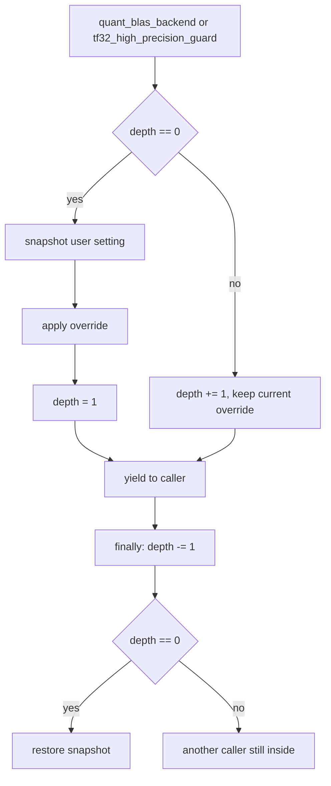
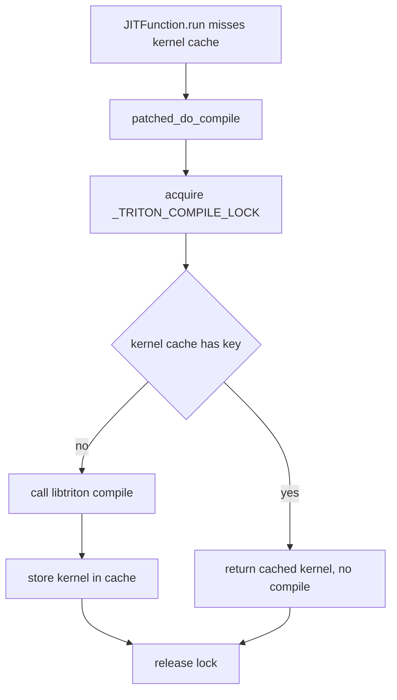
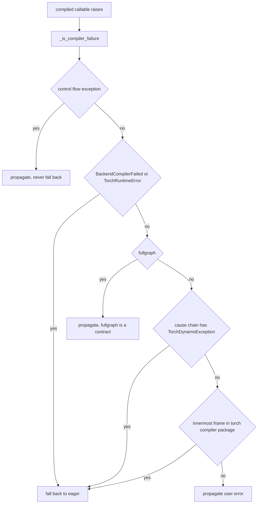

<!-- SPDX-FileCopyrightText: 2026 ModelCloud.ai -->
<!-- SPDX-License-Identifier: Apache-2.0 -->

# Concurrency guards

GPT-QModel runs quantization and inference from several threads, including on
free-threaded CPython (`PYTHON_GIL=0`). Three process-global resources are
shared by those threads: the ROCm BLAS backend selection, the TF32 precision
setting, and libtriton's JIT compiler. This page documents how the guards for
those resources behave after issue #4094, and why they are reference-counted,
serialized, or classified as compiler failures.

The shapes are deliberate: a guard that saves and restores a process-global
value per entry is wrong as soon as two callers overlap, and a compiler that is
assumed to be thread-safe is wrong as soon as two threads miss the same kernel
cache entry.

## 1. BLAS and TF32 guards are reference-counted

`quant_blas_backend` (`gptqmodel/utils/rocm.py`) and
`tf32_high_precision_guard` (`gptqmodel/utils/torch.py`) protect a
process-global setting. They now keep one depth counter and one saved value
under a module-level `RLock`. The first entry captures the user's setting and
applies the override; every later entry only increments the depth. Only the
last exit restores the captured value.

The same flow serves a single caller, a nested caller on one thread, and two
concurrent `quantize()` calls. The first caller to *enter* owns the snapshot;
the first caller to *exit* does not restore anything unless it is also the
last one inside.

Before the change, each entry snapshotted the current value and each exit
restored it. Quantize A entered first and set rocBLAS; quantize B entered
second, saw rocBLAS, and skipped the override; A returned and restored
hipBLASLt while B was still quantizing. B's remaining layers then ran on the
backend whose per-process kernel selection #4075/#4079 removed.

| Mechanism | Before | After |
| --- | --- | --- |
| BLAS depth | none; per-entry save/restore (`utils/rocm.py:240-283` at `718256fd7`) | `_QUANT_BLAS_GUARD_LOCK`, `_QUANT_BLAS_GUARD_DEPTH`, `_QUANT_BLAS_GUARD_PREVIOUS` |
| TF32 depth | none; per-entry save/restore (`utils/torch.py:1021` at `718256fd7`) | `_TF32_GUARD_LOCK`, `_TF32_GUARD_DEPTH`, `_TF32_GUARD_PREVIOUS` |
| Restore rule | every exit restores | only the exit that reaches depth 0 restores |

The guards stay scoped where they are entered. #4092 narrows
`quant_blas_backend` to the Hessian/linalg phase; the counting works for that
placement too, because it depends only on entry and exit, not on which phase
wraps the context.

## 2. Triton JIT compilation is single-flight and globally serialized

`TritonPatch.apply()` now installs `patch_triton_jit_compile()` in addition to
the autotuner patch. The wrapper around `JITFunction._do_compile` takes
`_TRITON_COMPILE_LOCK`, rechecks the per-device kernel cache for the requested
specialization key, and compiles only if the key is still missing.

Two threads that miss the same specialization are collapsed into one compile.
Different specializations are serialized too, because the unsafe nanobind
state lives in libtriton as a whole, not in one `JITFunction`. The lock is only
taken on a cache miss; steady-state launches take the existing fast path and
never touch it.

Before the change, `utils/nogil_patcher.py` patched only the autotuner. With an
empty `TRITON_CACHE_DIR` and `PYTHON_GIL=0`, 24 threads launching
`awq_gemm_kernel` together aborted the process with
`Critical nanobind error: inst_dealloc ... attempted to delete an unknown
instance` and exit code 134. The same wrapper covers the MACaQ Triton kernels,
which launch through the same `JITFunction.run` path.

| Mechanism | Before | After |
| --- | --- | --- |
| Autotuner state | thread-local `nargs`/`best_config`, locked cache | unchanged |
| JIT compile | unsynchronized, one compile per missing thread | `_single_flight_triton_compile` under `_TRITON_COMPILE_LOCK` |
| Cold-start cost | concurrent compiles race | cold compiles run one at a time; the first caller pays the compile, the rest wait and reuse it |

## 3. Dynamo guard failures fall back to eager

`_is_compiler_failure` (`gptqmodel/utils/torch.py`) classifies an exception by
its innermost traceback frame. Any exception raised inside `torch/_dynamo`,
`torch/_inductor`, or `torch/_functorch` is a compiler failure and the eager
implementation serves the call. User code raising the same exception type has
its own frame at the origin, so it still propagates and is never retried.

The dynamo guard `AssertionError` (`Guard failed on the same frame it was
created ... GLOBAL_STATE changed: default_dtype`) is raised from
`torch/_dynamo/guards.py`, so the last decision sends it to the eager path.
Before the change the frame check ran only for `RuntimeError`; the guard
assertion escaped and aborted a forward that raced another thread's
`torch.set_default_dtype`.

| Mechanism | Before | After |
| --- | --- | --- |
| Frame-origin check | only `RuntimeError` | every non-control-flow exception |
| Guard `AssertionError` | propagated, forward failed | eager fallback, one warning |
| User `AssertionError` | propagated | propagated, no retry |

## Failure and ambiguity contract

| Situation | Result |
| --- | --- |
| Platform refuses the BLAS switch | guard yields without counting; caller keeps its backend |
| User already selected a non-hipBLASLt backend | guard yields without counting |
| Restore raises | swallowed; the quantization result is already computed |
| Triton compile raises | lock is released; the next miss retries the compile |
| Triton cache already populated | no lock, no compile |
| Dynamo guard fails on a user frame | exception propagates; no double execution |
| `fullgraph=True` capture failure | exception propagates; no silent fallback |

## Validation

The regressions are covered by `tests/test_concurrency_guards.py`,
`tests/test_triton_patch_api.py`, `tests/test_awq_triton_cold_jit.py`, and
`tests/test_torch_compile_fallback.py`. The cold-JIT test runs a child process
with `PYTHON_GIL=0`, an empty `TRITON_CACHE_DIR`, and 24 threads, and asserts a
clean exit; it is skipped on GIL builds and when the AWQ checkpoint is absent.

Measured on 2026-11-15 with the ROCm 10.1 R9700 (`gfx1201`) venv and the CUDA
2.16.0.dev+cu130 venv:

| Check | Before | After |
| --- | --- | --- |
| Overlapping quantize, tensors differing from serial | 268 of 504, 2/2 runs | 0 of 504, 3/3 runs |
| BLAS seen by the second quantize after the first guard exits | 76 hessian calls on Cublaslt | 76 hessian calls on Cublas |
| TF32 setting after two concurrent guards | first exit restores while the second is inside | restored only by the last exit |
| Cold concurrent AWQ Triton JIT, 24 threads | exit 134, 4/4 runs at 24 threads (8/8 at 24-32) | exit 0, 4/4 runs |
| Dynamo dtype race, `PYTHON_GIL=0`, 40 iterations | 18 ok / 22 failed | 40 ok / 0 failed |
| Dynamo dtype race, `PYTHON_GIL=1`, 40 iterations | 2 failed in the initial 40-run probe | 40 ok / 0 failed |
| Natural 3-thread load+forward, TorchLinear | intermittent; deterministic race used for the regression | 3 ok / 0 failed |

The 268/504 count is this host's reproduction; the issue measured 177-210 of
794 on its checkpoint layout. Both counts are the same defect: the second
quantize's later layers ran on the backend selected by the first quantize's
restore.
