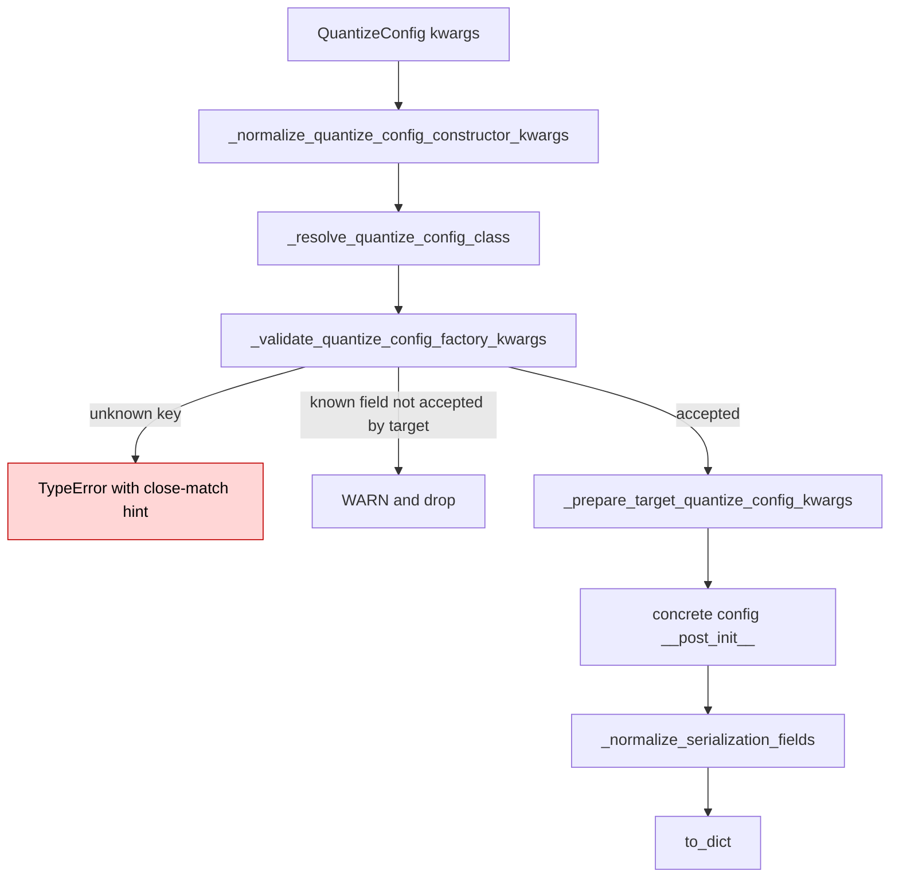
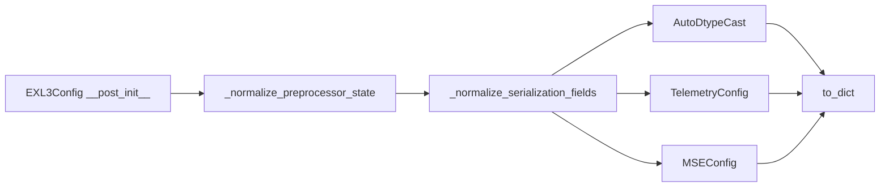
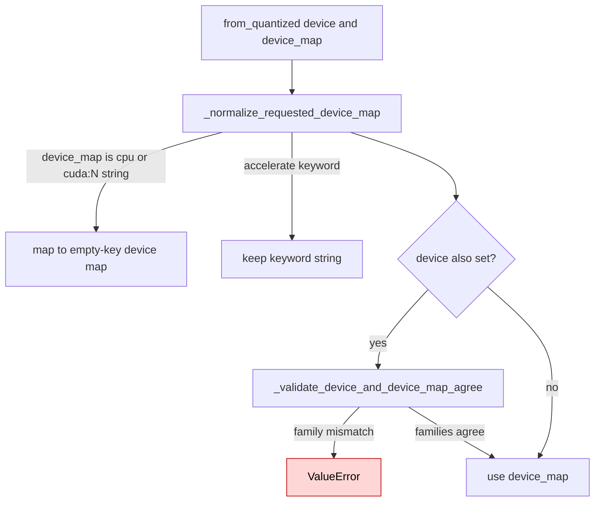
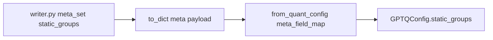

# Quantization config serialization

GPT-QModel has two config entry points that must not be confused:

- `QuantizeConfig(...)` is the user-facing factory. A misspelled or
  method-incompatible keyword is a user error, so it fails closed.
- `from_quant_config(...)` reads `quantize_config.json` from an existing
  checkpoint. It stays lenient so old checkpoints keep loading.

Every concrete config class must normalise the fields that `to_dict()` assumes
are already `Enum` or dataclass instances. `EXL3Config` overrides
`__post_init__` without delegating to the base class, so it calls the shared
`_normalize_serialization_fields()` helper directly.

Introduced for issue #4052.

## Factory dispatch and validation

The factory validates the raw keyword set before target-specific normalisation.
`weight_only` is a constructor-only key consumed by the RTN/GGUF/FP8/BnB
normalisers. `backend` and `zero_point` are serialized compatibility keys; the
factory accepts them so `QuantizeConfig(**config.to_dict())` keeps working, and
`zero_point` is translated to `sym`.

## EXL3 normalisation

Before this change, `EXL3Config(auto_dtype_cast="off").to_dict()` raised
`AttributeError: 'str' object has no attribute 'value'`, a reloaded EXL3
checkpoint kept `telemetry` as a dict and `auto_dtype_cast` as a string, and a
re-save raised `TypeError: asdict() should be called on dataclass instances`.

## Device and device_map resolution

Hugging Face accepts `device_map="cpu"` and `device_map="cuda:0"` as shorthand
for an empty-key map. GPT-QModel now does the same, and an explicit `device`
that selects a different device family from `device_map` raises instead of
being silently replaced.

## Checkpoint metadata round trip

`static_groups` was written to `meta` by the writer but missing from the
`from_quant_config` meta field map, so QQQ re-quantization from a loaded config
always saw `False`.

## Before and after

| Area | Before | After |
| --- | --- | --- |
| Factory kwargs | `_filter_quantize_config_payload_for_target_cls` dropped unknown and foreign keys silently | `_validate_quantize_config_factory_kwargs` raises for unknown keys and warns for foreign known fields (`config.py:4012`) |
| EXL3 fields | `EXL3Config.__post_init__` bypassed base normalisation (`config.py:6303` before this change) | calls `_normalize_serialization_fields` (`config.py:6401`) |
| Serialization helper | duplicated in `BaseQuantizeConfig.__post_init__` | shared `_normalize_serialization_fields` (`config.py:4429`) |
| Bool fields | `bool()` accepted the string `"False"` as `True` (`config.py:4450` before this change) | `_validate_bool_fields` raises `TypeError` (`config.py:4452`); `desc_act` likewise |
| Calibration examples | `isinstance(example, dict)` rejected `BatchEncoding` (`calibration.py:352` before this change) | `isinstance(example, Mapping)` (`calibration.py:356`) |
| Device placement | explicit `device` replaced by `device_map` without a check (`loader.py:1735` before this change) | `_normalize_requested_device_map` (`loader.py:569`) validates agreement and maps HF device strings |
| `static_groups` | written to `meta`, absent from the reload map | mapped in `from_quant_config` (`config.py:4831`) |

## Failure contract

| Situation | Before | After |
| --- | --- | --- |
| `QuantizeConfig(bits=4, damp_percnt=0.1)` | typo dropped, `damp_percent` stayed `0.05` | `TypeError` with a `damp_percent` hint |
| `QuantizeConfig(method="awq", static_groups=True)` | field dropped silently | `WARN` naming the target class and ignored keys |
| Legacy checkpoint JSON with unknown keys | loaded | still loaded; `from_quant_config` remains lenient |
| `EXL3Config(auto_dtype_cast="bogus")` | accepted | `ValueError` |
| `[tokenizer(text)]` calibration input | rejected as unsupported | accepted as a mapping |
| `device="cpu", device_map="auto"` on a GPU host | loaded on CUDA | `ValueError` |
| `device_map="cpu"` or `"cuda:0"` | `ValueError` | accepted as an empty-key device map |
| `GPTQConfig(desc_act="False")` | became `True` | `TypeError` |

## Tests

| Test | Invariant |
| --- | --- |
| `tests/qcfg/test_config_serialization.py` | every concrete config normalises `auto_dtype_cast`, `telemetry`, and `mse`; EXL3 round-trips; `static_groups` reloads; bool fields reject strings and ints |
| `tests/qcfg/test_config_dispatch.py` | unknown factory kwargs raise, foreign known fields warn, `from_quant_config` stays lenient |
| `tests/test_calibration_mapping_input.py` | `BatchEncoding` calibration rows are accepted |
| `tests/test_loader.py` | HF device-map strings are accepted and device/device_map conflicts raise |

Measured with the commands in the pull request:

- Before the fix, the new and copied tests reported `20 failed, 42 passed`.
- After the fix, the same set reported `62 passed` on CUDA and ROCm.
- The related `tests/qcfg`, calibration, and loader set reported `139 passed`
  on both runtimes.
- An EXL3 `bits=2, auto_dtype_cast="off"` quantize and `save()` completed on
  both an RTX 4090 and an R9700; before the fix the same run quantized and then
  raised `AttributeError` inside `writer.py`.

## Not in scope

`QuantizeConfig(method="gptq", format="gemm")` still auto-selects AWQ with a
warning, and `GPTQModel.load(quantized_path, quantize_config=X)` still ignores
`X` (as `from_pretrained` warns). Those are separate dispatch contracts.
