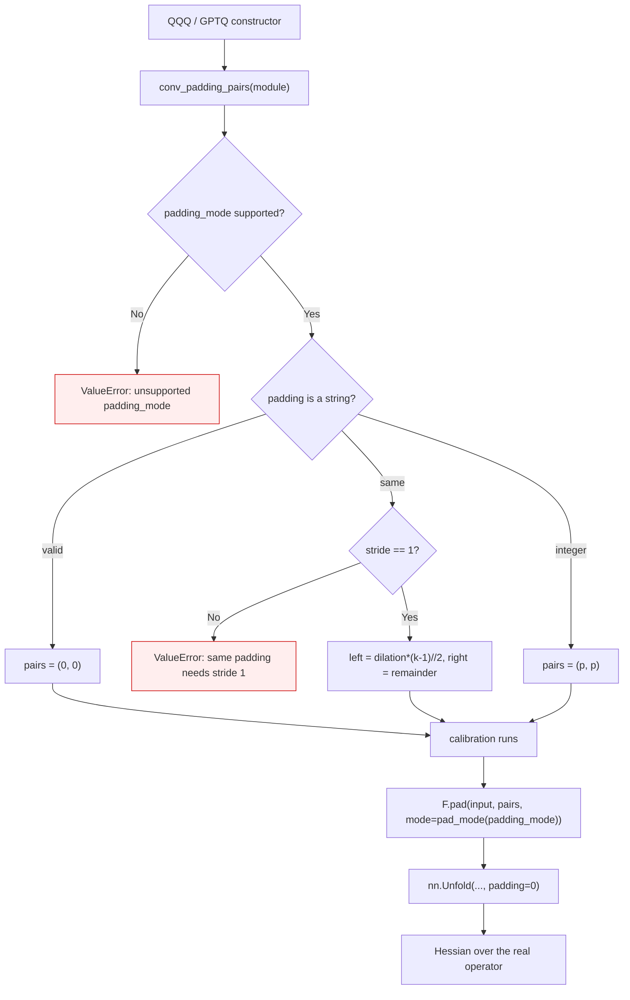

<!-- SPDX-FileCopyrightText: 2026 ModelCloud.ai -->
<!-- SPDX-License-Identifier: Apache-2.0 -->

# Convolution capture padding

QQQ and GPTQ build their calibration Hessian from an im2col view of each
layer's input. That view has to describe the convolution that will actually
run: the Hessian weights the quantization error of the operator it was
captured for, so a view with different geometry silently optimizes a different
function.

`nn.Unfold` can only express integer zero padding. It cannot take
`padding="same"`, and it has no notion of `padding_mode`, so capture applies the
layer's own padding first and unfolds the already-padded input.

## Flow



`conv_padding_pairs` returns one `(left, right)` pair per spatial dimension.
`pad_mode` translates `nn.Conv*d`'s `"zeros"` to `F.pad`'s `"constant"`; every
other supported mode has the same spelling in both APIs.

## Why `same` is asymmetric

PyTorch splits `padding="same"` with the floor on the left:

```
total = dilation * (kernel_size - 1)
left  = total // 2
right = total - left
```

For an even kernel this is not symmetric (`k=2` gives `left=0, right=1`). Passing
`total // 2` to both sides shifts the im2col windows by one position relative to
the convolution, which is exactly the class of error this page exists to prevent.
The test oracle rebuilds the convolution output from the im2col rows, so an
asymmetric split fails before the Hessian comparison runs.

## Previous behavior

| Mechanism | Location at `origin/main` | Consequence |
| --- | --- | --- |
| QQQ Conv1d unfold | `gptqmodel/quantization/qqq.py:553-558` | `padding=(0, self.layer.padding[0])` raises `TypeError` for `"same"`/`"valid"` |
| QQQ Conv2d unfold | `gptqmodel/quantization/qqq.py:563-568` | always zero-padded, so `reflect`/`replicate`/`circular` captured the wrong geometry |
| GPTQ Conv1d unfold | `gptqmodel/quantization/gptq.py:977` | `self.module.padding + (0,)` raises `TypeError` for a string padding |
| GPTQ Conv2d unfold | `gptqmodel/quantization/gptq.py:992` | always zero-padded |
| Validation | `qqq.py:359-367`, `gptq.py:595-596` | accepted every padding setting |

## Failure and ambiguity contract

| Situation | Before | After |
| --- | --- | --- |
| `padding="same"`, stride 1 | `TypeError` from `nn.Unfold` | captured with PyTorch's floor split |
| `padding="same"`, stride > 1 | `TypeError` | `ValueError` before calibration (PyTorch itself rejects this combination) |
| `padding="valid"` | `TypeError` | captured with zero padding |
| `padding_mode` in reflect/replicate/circular | silently zero-padded | captured with the real mode |
| Unknown padding string or mode | silently zero-padded or `TypeError` | `ValueError` before calibration |
| Grouped convolution | QQQ: `ValueError`; GPTQ: captured per group | unchanged (QQQ rejects, GPTQ captures each group's own channels) |

Validation runs in the constructor, so an unsupported setting fails before any
calibration batch is consumed rather than after a wrong Hessian is built.

## Validation

`tests/test_conv_capture_padding.py` covers both quantizers. Every case compares
the captured Hessian against `2 * P^T P / rows`, where `P` is built from the
convolution's own output positions, and first asserts that `P` reproduces
`conv(x)` so a geometry mismatch cannot hide in the Hessian comparison.

| Test | Invariant |
| --- | --- |
| `test_conv1d_same_padding_matches_the_convolution[k2/k3/k4-qqq/gptq]` | Even and odd kernels use PyTorch's floor split |
| `test_conv1d_nonzero_padding_mode_matches_the_convolution[reflect/replicate/circular-qqq/gptq]` | Non-zero padding modes are reproduced |
| `test_conv1d_valid_padding_ignores_no_tokens[qqq/gptq]` | `valid` drops no token and adds no padding |
| `test_conv2d_same_and_padding_mode_match_the_convolution[zeros/reflect-qqq/gptq]` | The 2-D branch matches on both axes |
| `test_conv1d_strided_same_padding_is_rejected_before_calibration` | Fail-closed at construction |
| `test_conv1d_unknown_padding_string_is_rejected` / `..._mode_is_rejected` | Fail-closed at construction |
| `test_gptq_grouped_conv1d_capture_covers_every_group` | GPTQ keeps each group's own channels |
| `test_conv_padding_pairs_matches_pytorch_same_padding` | The helper agrees with PyTorch for k=2..5 and dilation=2 |

Measured on an RTX 4090 (torch 2.16.0.dev20261102+cu130) and an R9700
(torch 2.16.0.dev20261025+rocm10.1):

| Command | Result |
| --- | --- |
| `pytest tests/test_conv_capture_padding.py -q` with the source change reverted | 21 failed, 3 passed |
| `pytest tests/test_conv_capture_padding.py -q` | 24 passed |
| `pytest tests/test_conv_capture_padding.py tests/test_qqq_conv_capture.py tests/test_qqq_cpu.py -q` (ROCm) | 78 passed |
| `pytest tests/test_gptq.py tests/test_gptq_hessian_accumulation.py -q` | 75 passed, 2 skipped |
| `ruff check gptqmodel docs/eora tests setup.py` | All checks passed |

The issue's own snippet now prints `[[9, 11, 12], [11, 15, 16], [12, 16, 19]]`
for the reflect case, matching the independent oracle (it previously printed
`[[7, 10, 5.5], [10, 15, 10], [5.5, 10, 14.5]]`).
