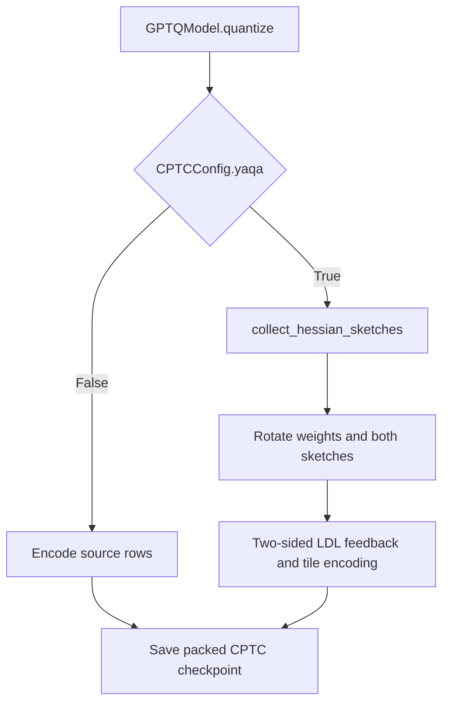
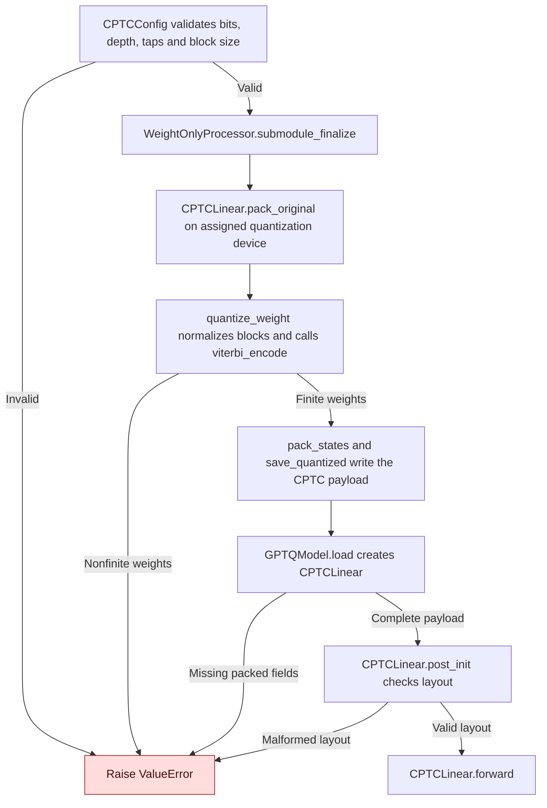
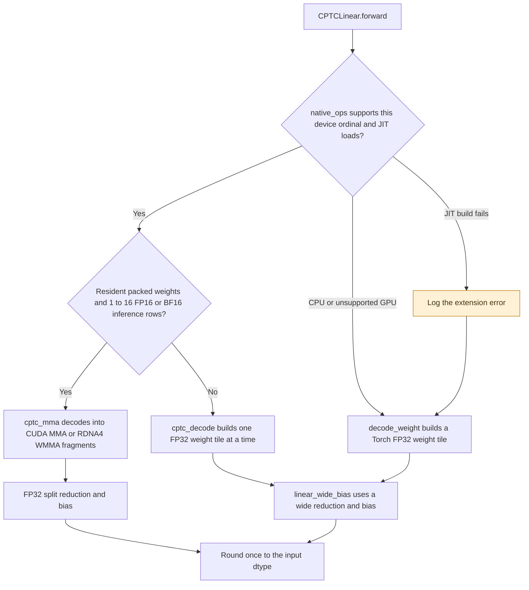

<!-- SPDX-FileCopyrightText: 2026 ModelCloud.ai
SPDX-License-Identifier: Apache-2.0 -->

# Computed Permutation Trellis Coding

CPTC quantizes blocks of weights jointly. A two-pass Viterbi search picks a
tail-biting bitstream for each block. During inference, the decoder multiplies
each overlapping state by two fixed coefficients and adds the top bits of
their 16-bit products to index a small E2M5 codebook. [CPTC paper](https://arxiv.org/abs/2611.22019)

## Quantize and load

```python
from gptqmodel import CPTCConfig, GPTQModel

qcfg = CPTCConfig(bits=4, trellis_depth=16, block_size=128, device="cuda:0")
model = GPTQModel.load("path/to/dense-model", quantize_config=qcfg)
model.quantize()
model.save("path/to/cptc-checkpoint")

model = GPTQModel.load("path/to/cptc-checkpoint", device="cuda:0")
```

`bits` accepts 1–6. `trellis_depth` ranges from `bits` to 16, and `table_q`
ranges from `bits` to 6. The block size is 128 or 256 values. Dynamic rules
can change the bit rate or exclude layers. For the installed PyTorch runtime,
`cuda:0` is the execution device on both NVIDIA and AMD. Use `device="cpu"`
for CPU quantization. A shallower trellis reduces the encoder's state count.

Load CPTC safetensors checkpoints with `GPTQModel.load`.

## YAQA calibration

```python
from gptqmodel import CPTCConfig, CalibrationConfig, GPTQModel

qcfg = CPTCConfig(bits=3, block_size=256, yaqa=True, yaqa_seed=2718, device="cuda:0")
model = GPTQModel.load("path/to/dense-model", quantize_config=qcfg)
model.quantize(CalibrationConfig(dataset=calibration_samples, batch_size=8))
model.save("path/to/calibrated-cptc")
```

`yaqa=True` gathers input and output partial-trace Fisher sketches from the
dense model, using next-token samples drawn from its own distribution.
It rotates the weights and sketches with signed Hadamard transforms, damps
each sketch by 0.01 of its mean diagonal, and uses two-sided block LDL error
feedback to form the tile targets for Viterbi. The tiles are 8 × 16 with
128-weight blocks and 16 × 16 with 256-weight blocks. The Gaussian
codebook uses 0.9 loading and the packer applies the E2M5 range bound per tile.
Calibration holds the complete teacher and its FP32 sketch pairs on the
quantization device. Both projection dimensions need a supported Hadamard
width and must be divisible by their tile dimensions.

The paper's LLM experiment uses these transforms and two-sided rounding with
its larger Sketch-B corpus. GPT-QModel uses its E2M5 tables and traverses each
tile in row-major order. The CUDA and RDNA4 kernels consume both checkpoint
layouts. [CPTC paper](https://arxiv.org/abs/2611.22019) ·
[YAQA reference](https://github.com/Cornell-RelaxML/yaqa-quantization)



## Quantization and checkpoint flow



| Stage | Base `46e5539e5` | CPTC |
| --- | --- | --- |
| Format resolution | `gptqmodel/quantization/config.py:10013` resolves supported checkpoint methods. | `METHOD.CPTC` resolves to `CPTCConfig` and `FORMAT.CPTC`. |
| Weight-only packing | `gptqmodel/looper/weight_only_processor.py:110` selects direct pack for GGUF, BitsAndBytes, and NF12. | CPTC joins direct pack and encodes on the selected worker device. |
| Checkpoint load | The native loader verifies the buffers declared by each quantized kernel. | CPTC declares `.cptc_packed`, `.cptc_table`, `.cptc_coeffs`, and `.cptc_scale_bits` as required. |

For each output row, the input axis is divided into contiguous blocks and
the last block is padded with zeros. Each block stores `block_size * bits / 8`
bytes, little-endian, with its final windows wrapping to its own first bytes.
The two Viterbi passes search in FP32 and pin the shared boundary bits in
the second pass.
The default depth and tap width use fitted Gaussian E2M5 tables from
`fit_gaussian_table`. Other geometries initialize their tables from Gaussian
conditional means. Direct weight encoding starts from a per-block RMS
scale. Before Viterbi, it raises the scale as needed to bring the block's
positive and negative extremes into the reachable codebook range.

| Tensor | Checkpoint representation |
| --- | --- |
| `cptc_packed` | `uint8`, `[out_features, blocks, block_bytes]` |
| `cptc_table` | `uint8`, E2M5 codes, `2**table_q` entries. The upper indices use a mirrored lookup and sign flip. |
| `cptc_coeffs` | `int32`, two 16-bit multiplication constants |
| `cptc_scale_bits` | `int32`, IEEE FP32 scale bits, `[out_features, blocks]` |
| `bias` | Optional stored bias in its original dtype |

With YAQA calibration, `cptc_packed` and `cptc_scale_bits` are indexed by
tile row and tile column. The checkpoint also carries two `int8` Hadamard
sign vectors, `cptc_input_signs` and `cptc_output_signs`. Inference applies
the input transform before the packed multiplication and inverts the
output transform before bias and final rounding.

The scale bit pattern survives model dtype conversion. FP32 scales add 0.25
bits per weight with 128-value blocks and 0.125 with 256-value blocks, before
padding and per-layer metadata. See the [forward dtype contract](../contracts/kernel/forward-dtype.md)
for the module's activation dtype policy.

## Inference dispatch



| Path | Device contract | Runtime evidence |
| --- | --- | --- |
| Fused FP16 and BF16 | NVIDIA SM80+ | RTX 4090 (`sm_89`) and RTX 5090 (`sm_120`) |
| Fused FP16 and BF16 | ROCm RDNA4 wave32, `gfx1200` and `gfx1201` | Built both targets, ran on Radeon AI PRO R9700 (`gfx1201`) |
| Tiled native decode with FP32 matmul | Same GPU families, prefill or FP32 input | RTX 4090, RTX 5090, R9700 |
| Tiled Torch decode with FP32 matmul | CPU and fallback on other CUDA or ROCm architectures | CPU validated |

The fused path multiplies the exact E2M5 values on the matrix units and
applies the per-block scales in FP32. Bias joins the complete FP32 result.
Prefill holds a decoded tile only for its matmul. Every path retains the
four packed checkpoint tensors and optional bias between forwards. The
projection-fusion inventory classifies CPTC as a separate format.

## Measurements

The fitted 4-bit, depth-16, 256-value codebook reached 3.934 effective bits
on 524,288 held-out standard-normal values. The decoder matched the
independent bitstream oracle exactly for all six rates. The two native
Viterbi schedules produced the same packed codes as the FP32 Torch reference
in the tested blocks. Native FP16 and BF16 outputs met `rtol=atol=2e-3`
against the independently decoded FP64 result rounded to the output dtype.
A small Llama checkpoint produced identical BF16 logits through the native
and Transformers loaders.

The 4-bit, 4096 × 4096 fixture with FP32 bias retains 8,929,352 bytes on
each device. The table shows FP16 warm-input medians from seven CUDA event
timing batches of 40 calls at 1 and 16 rows and 10 calls at 128 rows.
The allocation column measures peak live bytes above the pre-call baseline,
including temporary outputs and BLAS workspace.

| Device | Rows | Latency | Peak extra allocation |
| --- | ---: | ---: | ---: |
| RTX 4090 | 1 | 50 µs | 0.27 MiB |
| RTX 4090 | 16 | 104 µs | 4.25 MiB |
| RTX 4090 | 128 | 260 µs | 27.38 MiB |
| Radeon AI PRO R9700 | 1 | 177 µs | 0.27 MiB |
| Radeon AI PRO R9700 | 16 | 201 µs | 4.25 MiB |
| Radeon AI PRO R9700 | 128 | 1,158 µs | 99.25 MiB |

For 512 resident blocks of 128 values at 4 bits and depth 16, Viterbi reached
18.65 million values/s on the RTX 4090 and 1.53 million values/s on the R9700
with the register-cached E2M5 codebook. The generic FP32-codebook search
reached 0.31 and 0.13 million values/s on the same devices. The timings cover
the two passes and the backtrace. Test runtimes were PyTorch `2.15.0+cu132`
and `2.16.0.dev20261025+rocm10.1` respectively.

Run `python -m pytest tests/test_cptc.py` on each GPU runtime and on CPU.
GPU cases skip on other architectures and fail when a supported device
cannot build or run the native extension.

[Implementation PR #5959](https://github.com/ModelCloud/GPTQModel/pull/5959) · [Tracking issue #5954](https://github.com/ModelCloud/GPTQModel/issues/5954)
