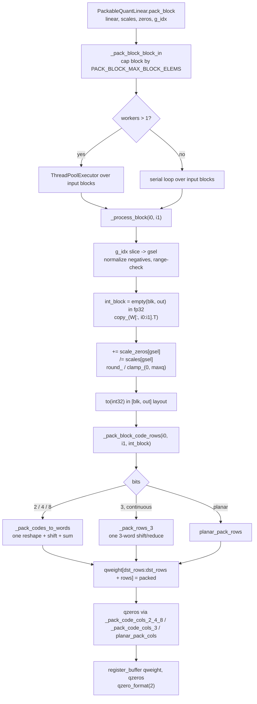
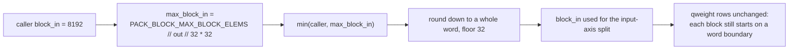

# CPU block packing

`PackableQuantLinear.pack_block` is the CPU packer for every GPTQ width
(2/3/4/8-bit continuous and the planar `gptq_p` layout). It converts
`nn.Linear` weights into the packed `qweight`/`qzeros` words for one layer. This
page documents how a block is quantized and packed, and why the block is
bounded by an element budget.

## What the flow is

The packer partitions the **input** axis into blocks. Each block owns a
disjoint range of `qweight` rows, so blocks are independent and may run on a
caller-supplied thread pool. Within a block the order is: gather the block's
group scales/zero points, quantize to integer codes, then pack every 32-input
group into words.

Two properties keep the batches exact:

- `_pack_codes_to_words` views the block as `[groups, pack_factor, out]` and
  sums the shifted fields. The fields are disjoint, so the shifted sum equals
  OR-ing them field by field — the same bytes the old per-group loop wrote.
- `_pack_rows_3` performs the 3-bit `10 | 1 | 10 | 1 | 10` scheme on
  `[groups, 32, out]` and stacks the three word planes. The old helper wrote
  three rows per call; the batched form writes `groups * 3` rows in one call
  with identical arithmetic.

## Why the block is budgeted

Both the quant math and the pack view are `[block_in, out_features]`. A block
sized from the caller's `block_in=8192` default therefore covers a whole
4096-wide matrix and keeps several `[in, out]` temporaries live at once: the
fp32 block, the int32 codes, and the int64 shift view. On a 4096x4096 layer that
peaks at hundreds of MiB above the packed output for a 32 MiB weight.

`PACK_BLOCK_MAX_BLOCK_ELEMS` (1 MiB elements) caps the block so the transient
is bounded independently of the matrix width. The block only partitions the
input axis, so the cap cannot change a packed word; a test pins every budget
against one reference.

The 3-bit continuous layout packs whole 32-input groups too, so its block is
also a word-aligned partition.

## What changed

| Before | After |
| --- | --- |
| Affine math in `[out, block]`, then `.T.contiguous()` on the fp32 result | Affine math in `[block, out]`, transposed once on the input weight via `copy_` |
| One `_pack_block_rows_2_4_8` / `_pack_block_rows_3` / `planar_pack_rows` call per 32-input group | One `_pack_codes_to_words` / `_pack_rows_3` / `planar_pack_rows` call per block |
| `block_in` = caller's value (8192 default) | `block_in` capped by `PACK_BLOCK_MAX_BLOCK_ELEMS`, word-aligned |
| `_pack_code_cols_3` and `pack_original`'s 3-bit path looped per group | Same batched `_pack_rows_3` helper |

`pack_original` keeps its own packing paths, but its 3-bit qweight path and the
3-bit qzeros helper now share `_pack_rows_3`, which is covered by the same
oracle test.

## Failure and ambiguity contract

| Situation | Behaviour |
| --- | --- |
| `g_idx` value out of range after negative normalization | `IndexError` with the observed min/max |
| `in_features % 32 != 0` or `out_features % 32 != 0` | `ValueError` from the packer's alignment guard |
| `pack_dtype != int32` | `ValueError`; only 32-bit words are supported |
| Any unsupported width | `NotImplementedError` |
| Block smaller than one 32-input group | Cannot happen: `_pack_block_block_in` floors at 32 |
| `block_in` not a multiple of 32 | Rounded down to a word boundary |

## Tests

`tests/test_pack_block_batched.py` pins:

| Invariant | Test |
| --- | --- |
| Packed words equal an independent per-group Torch oracle, bits 2/3/4/8, several block sizes and shapes | `test_pack_block_matches_independent_oracle` |
| The element budget cannot change the packed words | `test_block_budget_does_not_change_packed_words` |
| Block cap is word-aligned, budgeted, and never grows the caller's request | `test_block_in_is_word_aligned_and_budgeted` |
| The batched 3-bit helper equals the per-group schedule | `test_batched_3bit_rows_match_the_per_group_schedule` |
| Saturation still applies and the caller's weight is never mutated | `test_pack_block_saturates_and_keeps_caller_weight` |
| Threaded blocks equal single-thread blocks | `test_pack_block_threaded_matches_single_thread` |
| Planar `gptq_p` packing still matches `planar_pack_rows` | `test_pack_block_gptq_p_planar_rows`, `test_pack_block_planar_batched_rows` |
