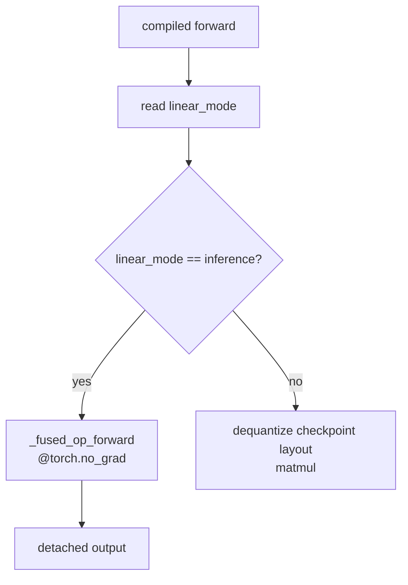
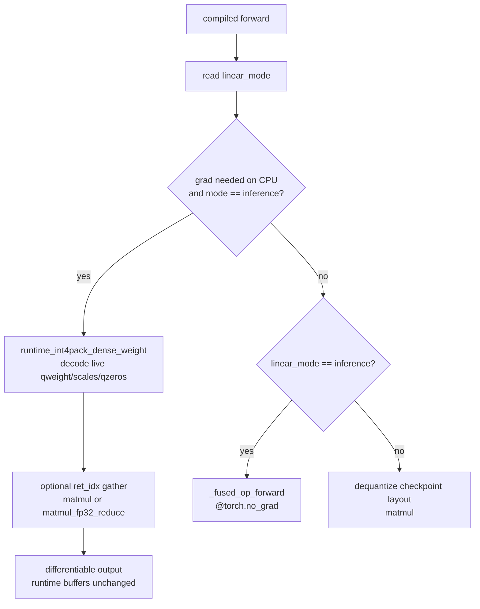

<!-- SPDX-FileCopyrightText: 2026 ModelCloud.ai -->
<!-- SPDX-License-Identifier: Apache-2.0 -->

# Compiled CPU int4pack gradient fallback

The CPU int4pack GPTQ and AWQ kernels (`TorchFusedLinear`, `TorchAtenLinear`,
`TorchFusedAwqLinear`, `TorchAtenAwqLinear`) replace their checkpoint
`qweight`/`qzeros` with the ATen int4pack runtime layout on the first inference
forward. The fused op runs under `torch.no_grad`, so a later grad-requiring
call must not use it. The eager path restores the checkpoint layout before the
call; a traced graph cannot perform that restore because it mutates packed
buffers.

This page documents the compile-only fallback that decodes the live runtime
operands instead. Introduced by #5499.

## Old compiled flow



## New compiled flow



The fallback is selected only while `torch.compiler.is_compiling()` is true,
the call needs an activation gradient, the device is CPU, and the module is
already latched to the inference layout. It decodes the runtime words with
`int4pack_to_codes` and applies the same affine identity the fused op uses:

```text
scale * (code - 2**(bits - 1)) + zero_offset
```

The decoded weight is a local `[in, out]` temporary consumed by the matmul. It
is not stored on the module, in a buffer, in a cache, or as a compiled graph
constant. The module keeps `linear_mode == inference` and its packed buffers.

For `desc_act` GPTQ layers the runtime codes are in `ret_idx` order, so the
fallback gathers the activations with `ret_idx` exactly like
`_fused_op_forward`. Biased layers use `matmul_fp32_reduce`, matching the
eager dense path.

## Before and after

| Area | Before | After |
| --- | --- | --- |
| Compiled grad call after an inference warmup | Took the fused no-grad branch; the output had no `grad_fn` | Takes the runtime dense fallback; the output keeps `grad_fn` |
| Runtime layout after the call | n/a | `linear_mode` and packed buffers are unchanged |
| Dense weight lifetime | n/a | Local to the call; released after the matmul |
| Eager grad call | Restores the checkpoint layout (#5314, #5392) | Unchanged |
| Non-CPU devices | Existing fused inference branch | Unchanged |

File pointers:

- `gptqmodel/nn_modules/qlinear/torch_fused.py:661-725`
- `gptqmodel/nn_modules/qlinear/torch_aten_kernel.py:495-573`
- `gptqmodel/nn_modules/qlinear/torch_fused_awq.py:461-530`
- `gptqmodel/nn_modules/qlinear/torch_aten_kernel_awq.py:382-447`
- `gptqmodel/nn_modules/qlinear/_cpu_int4pack_layout.py:111-205`
- `gptqmodel/nn_modules/qlinear/_fused_train_state.py:243-255`

## Failure and ambiguity contract

| Situation | Behaviour |
| --- | --- |
| Runtime layout has no verified int4pack block size | `RuntimeError`; the transform caches the block size before the graph is traced |
| Packed weight is not 4-bit int4pack | `RuntimeError` from `runtime_int4pack_dense_weight` |
| `scales`/`qzeros` shape does not match the packed weight | `RuntimeError` with the observed shapes |
| `desc_act` layout with a non-identity `ret_idx` | Activations are gathered before the matmul |
| Non-CPU device | Existing behavior; this page documents the CPU fallback only |

## Tests

`tests/test_cpu_fused_compiled_grad_5369.py` pins:

| Invariant | Test |
| --- | --- |
| Compiled and eager gradients match for GPTQ/AWQ fused and ATen kernels | `test_compiled_grad_forward_after_eager_warm_keeps_gradient` |
| A compiled inference call followed by a compiled grad call keeps the gradient | `test_compiled_inference_then_grad_forward_keeps_gradient` |
| Biased layers keep the gradient and the bias epilogue | `test_compiled_grad_forward_with_bias_keeps_gradient` |
| `desc_act` activation gather is applied | `test_compiled_grad_forward_gathers_desc_act_activations` |
| The runtime layout is not restored or replaced by a dense weight | `test_compiled_grad_forward_keeps_the_runtime_layout` |
| The issue fixture produces the scalar gradient `-8` | `test_issue_5369_fixture_compiled_grad_matches_eager` |

The reference gradient is computed from a separate checkpoint-layout module in
float32 (`dequantize_weight`/`dequantize_gemm`), not from the runtime decode
under test. The visible path is BF16, so the regression uses the same `2e-2`
tolerance as the existing CPU fused gradient family; measured maximum absolute
drift is about `7.3e-3` for GPTQ and `1.4e-2` for AWQ.
