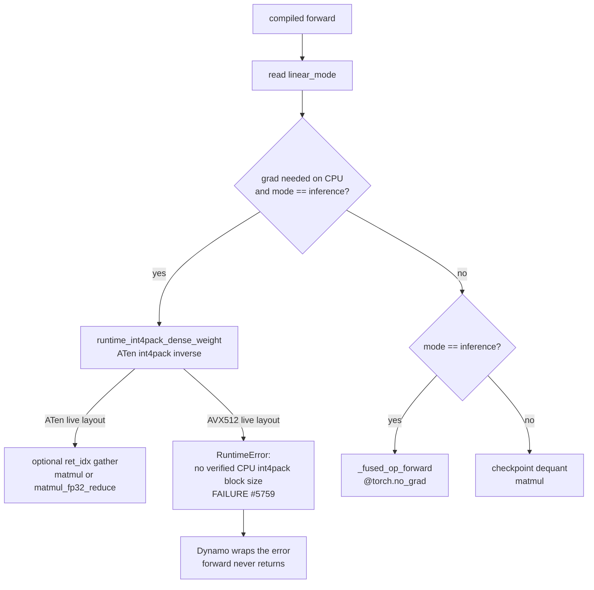
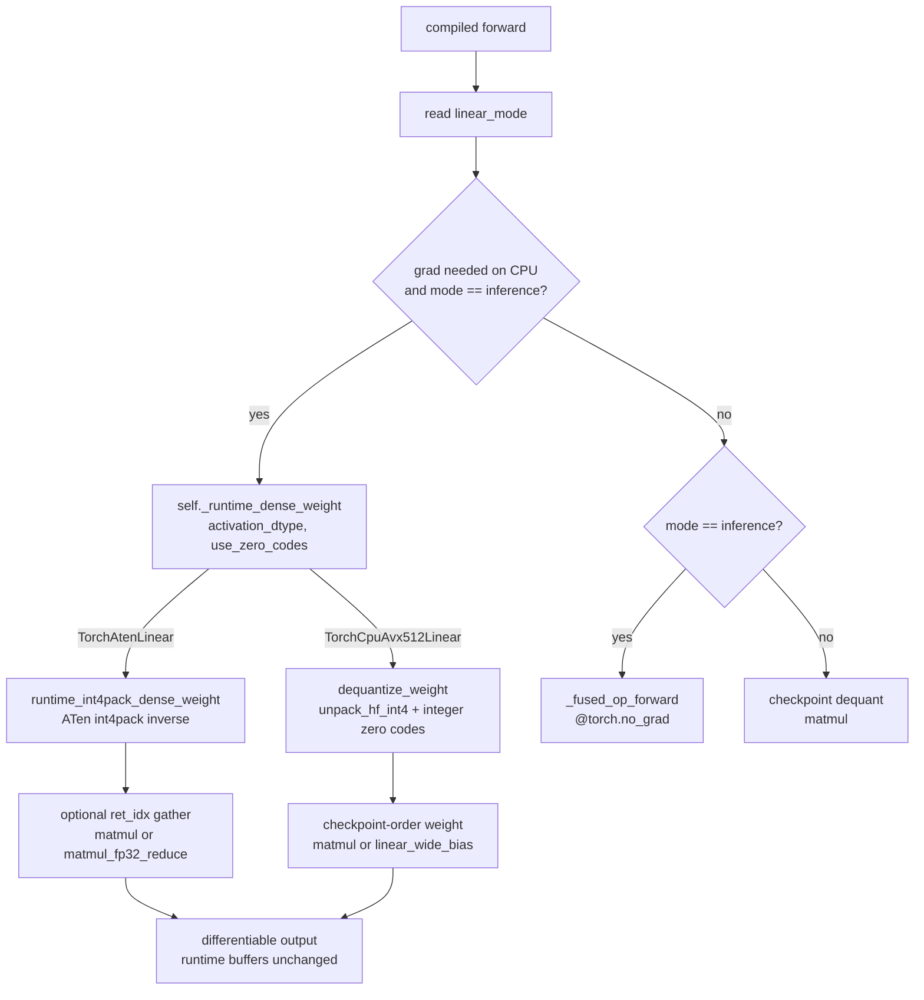

<!-- SPDX-FileCopyrightText: 2026 ModelCloud.ai -->
<!-- SPDX-License-Identifier: Apache-2.0 -->

# Compiled CPU int4pack gradient fallback

The CPU int4pack GPTQ and AWQ kernels (`TorchFusedLinear`, `TorchAtenLinear`,
`TorchFusedAwqLinear`, `TorchAtenAwqLinear`) replace their checkpoint
`qweight`/`qzeros` with the ATen int4pack runtime layout on the first inference
forward. The fused op runs under `torch.no_grad`, so a later grad-requiring
call must not use it. The eager path restores the checkpoint layout before the
call; a traced graph cannot perform that restore because it mutates packed
buffers.

The AVX512-BF16 GPTQ kernel (`TorchCpuAvx512Linear`) shares that forward but
installs a *different* live layout: `pack_gptq_int4` writes grouped nibbles and
keeps the checkpoint's integer zero codes. Its dense fallback must decode that
layout instead of inverting ATen's int4pack permutation.

This page documents the compile-only fallback that decodes the live runtime
operands instead (introduced by #5499) and the AVX512 dispatch that lets its
own live layout be decoded (#5759).

## Old flow

The eager dense fallback had the same split: `_runtime_dense_weight()` took no
arguments while the shared forward passed the activation dtype, and
`dequantize_weight(dtype=...)` was rejected by the AVX512 override. An FP16
checkpoint never reaches the BF16-only fused op, so its first forward hit the
missing `dtype` keyword.

## New flow

The fallback is selected only while `torch.compiler.is_compiling()` is true,
the call needs an activation gradient, the device is CPU, and the module is
already latched to the inference layout. `_runtime_dense_weight` is the single
dispatch point, so each kernel decodes the layout it actually installed:

- ATen int4pack (`TorchAtenLinear`) inverts the packer with `int4pack_to_codes`
  and applies `scale * (code - 2**(bits - 1)) + zero_offset`.
- AVX512 GPTQ (`TorchCpuAvx512Linear`) unpacks `pack_gptq_int4` nibbles with
  `unpack_hf_int4` and applies `scale * (code - zero)` with the checkpoint's
  integer zero codes, then restores checkpoint channel order.

The decoded weight is a local `[in, out]` temporary consumed by the matmul. It
is not stored on the module, in a buffer, in a cache, or as a compiled graph
constant. The module keeps `linear_mode == inference` and its packed buffers.

For `desc_act` ATen layers the runtime codes are in `ret_idx` order, so the
fallback gathers the activations with `ret_idx` exactly like
`_fused_op_forward`. AVX512 decodes back to checkpoint order and sets
`_runtime_dense_weight_is_checkpoint_order = True`, so the shared forward skips
that gather. Biased layers use `matmul_fp32_reduce` or `linear_wide_bias`,
matching the eager dense path.

The AVX512 live decode accepts an `activation_dtype` and converts the codes,
integer zero points, and scales before the arithmetic. A half activation gets
the range-safe dtype from `int4pack_decode_dtype` (`decode_dtype_for_scales`);
`None` keeps the export behavior (FP32 arithmetic, checkpoint scale dtype on
return). `use_zero_codes` is already the installed form for AVX512 because
`transform_cpu` keeps the checkpoint's integer zero codes instead of ATen's
affine offsets.

## Before and after

| Area | Before | After |
| --- | --- | --- |
| Compiled grad after an inference warmup | `runtime_int4pack_dense_weight` was called directly, so AVX512 raised `RuntimeError: ... has no verified CPU int4pack block size` (`torch_aten_kernel.py:587-590` at `85caf6cc5`) | Calls the polymorphic `self._runtime_dense_weight(x.dtype, use_zero_codes=True)` (`torch_aten_kernel.py:602`) |
| Eager grad after an inference warmup | `_runtime_dense_weight()` took no arguments, so the shared call raised `TypeError` (`torch_aten_kernel.py:619` at `85caf6cc5`) | AVX512 accepts `activation_dtype` and `use_zero_codes` (`torch_cpu_avx512.py:210`) |
| Cold FP16 or training dense decode | `dequantize_weight(dtype=...)` raised `TypeError` on AVX512 (`torch_cpu_avx512.py:318` at `85caf6cc5`) | AVX512 `dequantize_weight(num_itr=1, dtype=None)` applies the dtype before arithmetic and forwards it to the checkpoint-layout superclass (`torch_cpu_avx512.py:337`) |
| Runtime layout after the call | n/a | `linear_mode` and packed buffers are unchanged |
| Dense weight lifetime | n/a | Local to the call; released after the matmul |
| Non-CPU devices | Existing fused inference branch | Unchanged |

File pointers:

- `gptqmodel/nn_modules/qlinear/torch_aten_kernel.py:540-565` (dense hooks)
- `gptqmodel/nn_modules/qlinear/torch_aten_kernel.py:590-610` (compiled dispatch)
- `gptqmodel/nn_modules/qlinear/torch_aten_kernel.py:625-685` (eager dispatch)
- `gptqmodel/nn_modules/qlinear/torch_cpu_avx512.py:208-236` (AVX512 live decode)
- `gptqmodel/nn_modules/qlinear/torch_cpu_avx512.py:337-379` (AVX512 `dequantize_weight`)
- `gptqmodel/nn_modules/qlinear/_cpu_int4pack_layout.py:141-205`
- `gptqmodel/nn_modules/qlinear/_decode_dtype.py`

## Failure and ambiguity contract

| Situation | Behaviour |
| --- | --- |
| ATen runtime layout has no verified int4pack block size | `RuntimeError`; the transform caches the block size before the graph is traced |
| AVX512 `dequantize_weight` called with `num_itr != 1` | `NotImplementedError`; the kernel only walks full groups once |
| AVX512 live decode before `transform_cpu` | Uses the checkpoint-layout decoder; no crash and no assumed runtime layout |
| Packed weight is not 4-bit int4pack | `RuntimeError` from `runtime_int4pack_dense_weight` |
| `scales`/`qzeros` shape does not match the packed weight | `RuntimeError` with the observed shapes |
| `desc_act` ATen layout with a non-identity `ret_idx` | Activations are gathered before the matmul |
| `desc_act` AVX512 layout | Weight is restored to checkpoint order; activations are not gathered |
| Later forward with a different activation dtype | `RuntimeError` from the forward dtype lock; a dtype switch is a caller bug |
| Non-CPU device | Existing behavior; this page documents the CPU fallback only |

## Tests

`tests/test_cpu_fused_compiled_grad_5369.py` pins:

| Invariant | Test |
| --- | --- |
| Compiled and eager gradients match for GPTQ/AWQ fused and ATen kernels | `test_compiled_grad_forward_after_eager_warm_keeps_gradient` |
| A compiled inference call followed by a compiled grad call keeps the gradient | `test_compiled_inference_then_grad_forward_keeps_gradient` |
| Biased layers keep the gradient and the bias epilogue | `test_compiled_grad_forward_with_bias_keeps_gradient` |
| `desc_act` activation gather is applied | `test_compiled_grad_forward_gathers_desc_act_activations` |
| The runtime layout is not restored or replaced by a dense weight | `test_compiled_grad_forward_keeps_the_runtime_layout` |
| The issue fixture produces the scalar gradient `-8` | `test_issue_5369_fixture_compiled_grad_matches_eager` |

`tests/test_cpu_avx512_dense_fp16_5759.py` pins the AVX512 half against an
FP64 Torch oracle built from the checkpoint codes, integer zero points, and
stored scales:

| Invariant | Test |
| --- | --- |
| A cold FP16 layer decodes the checkpoint layout in FP64 bit-exactly | `test_fp16_dense_fallback_matches_fp64_oracle` |
| The FP16 dense forward matches the FP64 oracle rounded to the visible dtype | `test_fp16_dense_fallback_matches_fp64_oracle` |
| A grad forward after the fused warm-up decodes the live AVX512 layout, not the checkpoint words | `test_dense_fallback_after_fused_warm_up_matches_fp64_oracle` |
| Output and activation gradient match the FP64 oracle | `test_dense_fallback_after_fused_warm_up_matches_fp64_oracle` |
| A later no-grad forward still uses the installed fused layout | `test_dense_fallback_after_fused_warm_up_matches_fp64_oracle` |

`tests/test_cpu_avx512_compiled_grad_5569.py::test_avx512_gptq_compiled_grad_forward_after_fused_warm_up`
keeps the compiled node of the same regression. The reference gradient is
computed from a separate checkpoint-layout module in float32
(`dequantize_weight`/`dequantize_gemm`), not from the runtime decode under
test. The visible path is BF16, so the regression uses the same `2e-2`
tolerance as the existing CPU fused gradient family; measured maximum absolute
drift is about `7.3e-3` for GPTQ and `1.4e-2` for AWQ.
