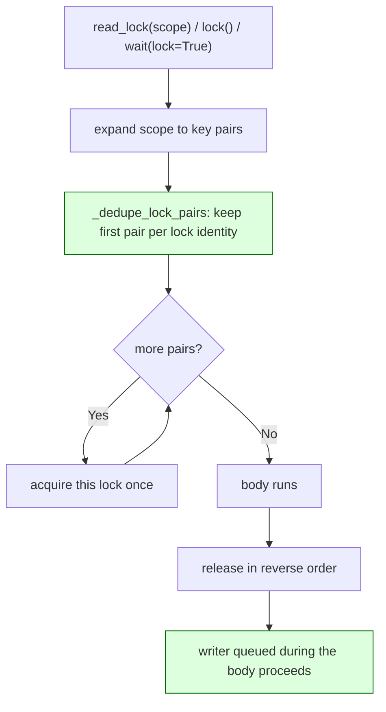
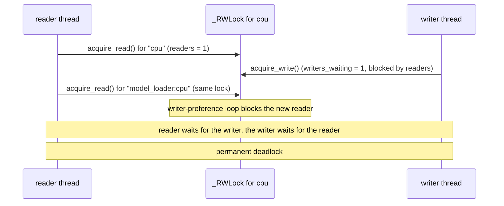

<!-- SPDX-FileCopyrightText: 2026 ModelCloud.ai -->
<!-- SPDX-License-Identifier: Apache-2.0 -->

# CPU pool lock scopes

`DeviceThreadPool` guards each device worker with a writer-preference
`_RWLock`. A *scope* is a set of device keys whose locks are acquired together:
a family scope such as `read_lock("cpu")`, the `all` scope, `lock()`, and
`wait(lock=True)`. Scope members are keyed by name, but names are not locks —
a virtual pool key reuses its parent's lock object — so a scope must acquire
each lock once, not each name once.

## Why the pool has virtual keys

A virtual pool (`alias:parent`) shares the parent device's `_RWLock`
(`gptqmodel/utils/threadx.py`, `self._locks[v_key] = self._locks[parent_key]`).
That is deliberate: two worker groups on the same physical device must
serialize against each other. The shipped default config uses this for
`model_loader:cpu`, which shares `cpu`'s lock so model loading and CPU task
execution cannot interleave on the same device.

The family map then lists both names for the `cpu` family, so
`read_lock("cpu")` expands to `[("cpu", L), ("model_loader:cpu", L)]` with the
same `L` twice.

## Scope acquisition

`_dedupe_lock_pairs` keys on `id(lock)`, not on the name, and keeps the
first-seen order so the acquisition order stays deterministic. Because
`_LockGroup`, `_ReadLockGroup`, and `_WaitAndLock` all construct through it,
every multi-lock path gets the same rule.

## Failure path before the fix

`_RWLock.acquire_read` blocks new readers while any writer is waiting. It
recognizes the writer re-entering as a reader, but a reader re-entering behind a
queued writer is treated as a brand-new reader, so the second acquisition of the
same lock never completes.

## Previous behavior

| Mechanism | Previous behavior | New behavior |
| --- | --- | --- |
| `_LockGroup.__init__` (`gptqmodel/utils/threadx.py:256`) | `self._pairs = ordered_pairs` | Deduplicated by lock identity |
| `_ReadLockGroup.__init__` (`gptqmodel/utils/threadx.py:278`) | `self._pairs = ordered_pairs` | Deduplicated by lock identity |
| Family scope expansion (`:1296`, `:1311`) | One pair per key, including the alias | Still one pair per key; dedup happens at acquisition |
| `read_lock("all")` | Acquired the aliased lock twice | Acquires each lock once |
| `wait(lock=True)` | Same double acquisition | Acquires each lock once |

Virtual key sharing (`:822`) and writer preference in `acquire_read` (`:229`)
are unchanged.

## Contracts

- A scope acquires each distinct lock exactly once; a scope whose keys all alias
  one lock acquires that lock once.
- Acquisition order is first-seen order from the scope expansion; release order
  is the exact reverse. Distinct locks keep their canonical sorted order, so two
  scopes over the same locks cannot interleave and deadlock.
- Deduplication is by lock identity. Two names for the same device still appear
  in `_family_keys`, so scope expansion and `wait()` inflight bookkeeping are
  unchanged.
- Writer preference is not weakened: a queued writer still blocks readers that
  have not yet acquired the lock.

## Validation

| Test | Invariant |
| --- | --- |
| `tests/test_threadx_cpu_locks.py::test_virtual_alias_shares_its_parent_lock` | The alias still shares the parent lock and both names stay in the family map |
| `::test_family_read_lock_acquires_the_shared_lock_once` | `read_lock("cpu")` acquires one distinct lock |
| `::test_all_read_lock_acquires_each_lock_once` | `read_lock("all")` acquires every distinct pool lock once |
| `::test_wait_lock_true_acquires_each_lock_once` | `wait(lock=True)` uses the deduplicated group |
| `::test_family_read_lock_does_not_deadlock_against_a_waiting_writer` | The issue interleaving completes: reader and writer both finish |
| `::test_lock_group_still_acquires_every_distinct_lock` | A genuine two-lock scope acquires both, in order, and releases in reverse |

Measured on an RTX 4090 host with torch 2.16.0.dev20261102+cu130:
`pytest tests/test_threadx_cpu_locks.py -q` reports 6 passed after the fix and
4 failed, 2 passed on unmodified `origin/main` (66d27f9d).
