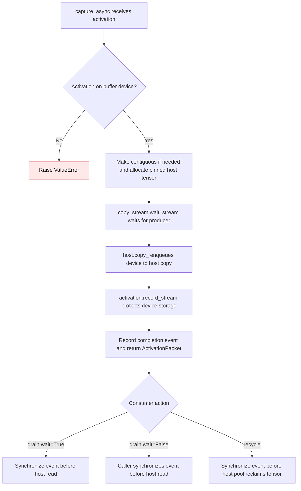

# CUDA activation copy lifecycle

`CudaEventActivationBuffer.capture_async` copies a forward activation into
pinned host memory on a dedicated CUDA stream. The producer stream finishes
writing the activation before the copy begins. The device allocation must
remain unavailable for reuse until the copy finishes, even if the forward hook
drops its last tensor reference immediately. `recycle` must likewise wait
before returning a host buffer to a caller-provided pool.

| Storage | Before | Current |
| --- | --- | --- |
| Device activation | `capture_async` queued the side-stream copy without informing the caching allocator (`d3253c2:gptqmodel/utils/cuda_activation_buffer.py:110-115`). The producer could release and overwrite the same storage before the copy read it. | `activation.record_stream(copy_stream)` protects the allocation through the queued copy (`gptqmodel/utils/cuda_activation_buffer.py:113-120`). |
| Pinned host buffer | `recycle` called the host reclaimer even when `capture_async(enqueue=False)` or `drain(wait=False)` returned an in-flight packet (`d3253c2:gptqmodel/utils/cuda_activation_buffer.py:147-152`). | `recycle` synchronizes the packet event before passing its tensor to the pool (`gptqmodel/utils/cuda_activation_buffer.py:152-162`). |

The CUDA regression tests delay the copy stream, release the original device
tensor, and allocate a replacement. Before the fix, the host received the
replacement's `9.0` values instead of the original `3.0` values on NVIDIA
GB10; the reclaimer also observed an incomplete event. Both conditions pass
after the fix, including a noncontiguous activation that creates a temporary
contiguous copy.

`record_stream` protects against allocator reuse. Callers must still avoid
modifying an activation in place while its copy is pending and must wait for
the packet event before reading the host tensor. See PyTorch's
[`record_stream` contract](https://docs.pytorch.org/docs/stable/generated/torch.Tensor.record_stream.html)
and [CUDA stream guidance](https://docs.pytorch.org/docs/stable/notes/cuda.html).

Introduced in #3646.
