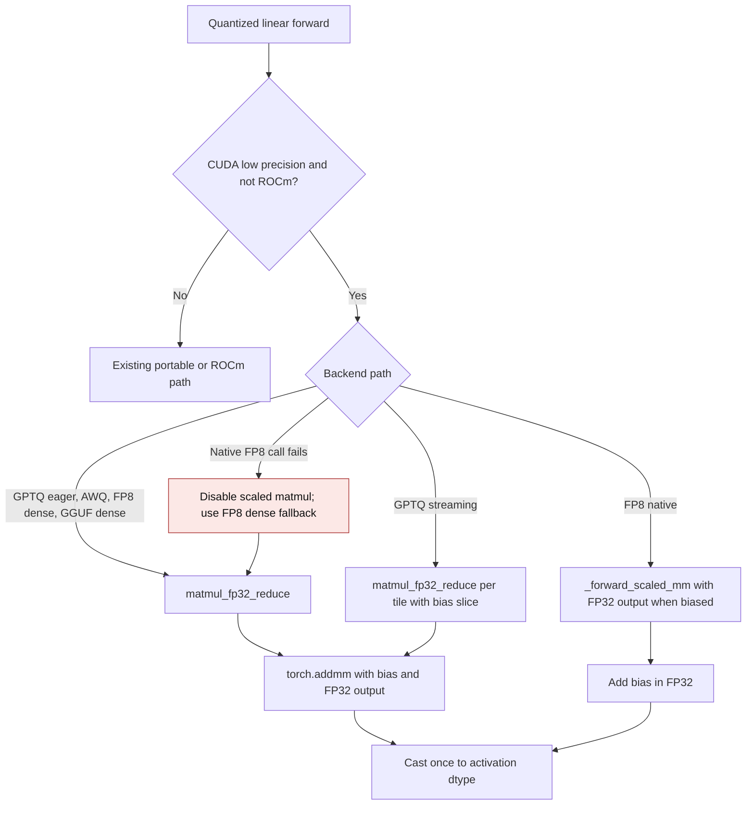
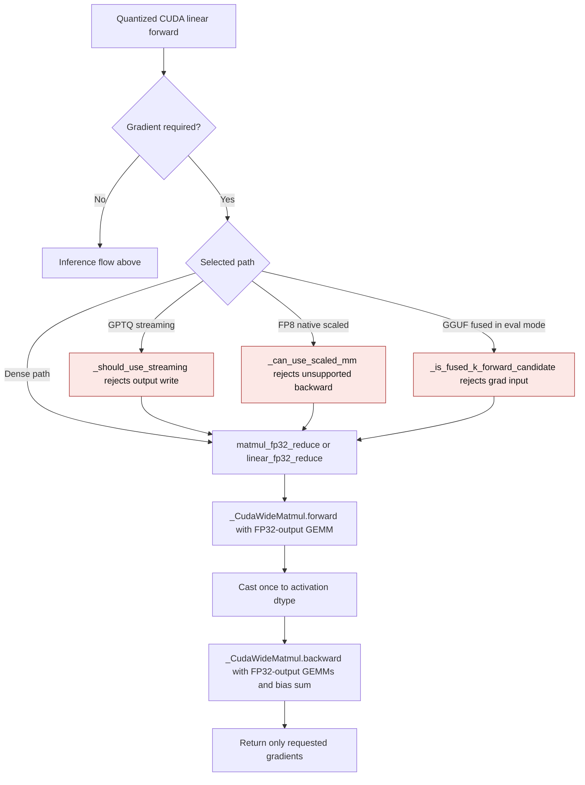

# CUDA quantized linear bias epilogue

GPT-QModel's portable GPTQ, AWQ, FP8, and GGUF linear backends may use an FP32
accumulator with FP16 or BF16 activations on NVIDIA CUDA. When a layer has a
bias, that bias must be added before the accumulator is rounded to the output
dtype. Otherwise a finite biased result can become `inf` at an intermediate
FP16 conversion, and ordinary values can round twice.

## Inference flow

The dense helper requests an FP32 `torch.addmm` output while retaining
low-precision tensor-core operands. GPTQ streaming keeps the wide value only
for one output tile; it does not retain an expanded weight. FP8 native scaled
matmul requests FP32 output only when a bias is present. The output still has
the activation dtype, and unsupported native FP8 calls use the dense fallback.

## Gradient flow

PyTorch's FP32-output CUDA `mm` and `addmm` operations do not provide an
autograd derivative on the tested runtime. Quantized layers that accept training
therefore use `_CudaWideMatmul` when an input, temporary dequantized weight, or
bias requires a gradient. Its forward uses the same FP32-output GEMM and output
rounding as inference. Its backward computes first-order input and weight
gradients through FP32-output GEMMs and reduces the bias gradient in FP32.

The backward saves only low-precision operands needed for requested gradients.
A bias-only gradient does not retain a temporary dequantized weight. GPTQ
streaming, FP8 native scaled matmul, and GGUF fused execution use their dense
or eager path when their native backward cannot represent the requested input
gradient. No persistent expanded weight cache is created.

| Path | Previous mechanism | Current mechanism |
| --- | --- | --- |
| CUDA wide GEMM | `_numerics.py:39` and `_numerics.py:50` used FP32-output ATen GEMMs directly; backward raised `derivative for aten::addmm/mm is not implemented` | `_CudaWideMatmul` supplies first-order gradients for inputs, weights, and bias |
| FP8 native scaled | `fp8.py:540` selected `_scaled_mm` for differentiable activations; backward raised `derivative for aten::_scaled_mm is not implemented` | `_can_use_scaled_mm` sends differentiable inputs to the dense path |
| GPTQ streaming | `torch.py:706` selected streaming for differentiable activations despite its output writes | `_should_use_streaming` selects eager execution when a gradient is required |
| GGUF fused | `gguf.py:1601` could select fused execution in eval mode with a differentiable input | `_is_fused_k_forward_candidate` selects dense execution for that input |

The line references in this table refer to the implementation immediately
before the gradient change. First-order gradients are covered; higher-order
autograd is outside this contract.

## Previous and current behavior

| Path | Previous mechanism | Current mechanism |
| --- | --- | --- |
| GPTQ eager, AWQ, FP8 dense, GGUF dense | `matmul_fp32_reduce` rounded before bias at `_numerics.py:35`; callers added bias at `torch.py:413`, `torch_awq.py:288`, `fp8.py:648`, and `gguf.py:1839` | `matmul_fp32_reduce` adds bias with FP32 `torch.addmm`, then rounds once |
| GPTQ streaming | `torch.addmm` wrote an FP16/BF16 output tile at `torch.py:571`; `torch.py:591` added bias afterward | Each biased NVIDIA tile computes and adds bias in FP32 before copying to the output |
| FP8 native scaled matmul | `fp8.py:614` requested low-precision output; `fp8.py:648` added bias afterward | Biased NVIDIA calls request FP32 output, add bias, then cast once |
| Native FP8 unavailable | `fp8.py:625` selected dense fallback after a failed scaled matmul | The fallback passes bias into the wide dense epilogue |

The `file:line` references in the previous-mechanism column refer to the
pre-change implementation. The ROCm and CPU matmul paths retain their existing
arithmetic and dtype behavior.

## Validation contract

Tests in `tests/kernels/test_cuda_bias_epilogue.py` use packed quantized layers
and an independent constant-weight FP64 oracle. They cover GPTQ eager and
streaming, AWQ, FP8 dense and native scaled matmul, and GGUF dense fallback in
FP16 and BF16, including repeat forwards and checks for retained dense weights.
The same file also compares CUDA forward and backward results against an
independent FP32 Torch oracle for FP16 and BF16, 2D and 3D inputs, biased and
unbiased GEMMs, and each training-capable portable backend.

The FP16 regression case has a matmul of `66000` and a bias of `-1000`:
the previous GPTQ and AWQ outputs were `inf`, while the FP32 oracle rounds
`65000` to `64992`. FP8 and GGUF dense fallbacks likewise returned `inf`
for finite oracle results of `60640` and `62752` respectively. All values
were observed on an NVIDIA GB10 (SM 12.1) with PyTorch 2.15.0+cu132.

This flow was introduced by [PR #3649](https://github.com/ModelCloud/GPTQModel/pull/3649).

For the gradient path, 16 deterministic core cases (two dtypes, two ranks,
biased and unbiased, matmul and linear) matched the independently evaluated
Torch FP32 forward and all requested gradients exactly. Twelve packed-layer
cases across six routes and both dtypes had maximum output, input-gradient,
and bias-gradient differences of `0` from their independent Torch oracles.
Empty-row CUDA forwards returned empty outputs and zero weight and bias
gradients in both dtypes.
The FP16 128×4096×4096 forward-and-backward benchmark used resident inputs,
three warmups, then the median of five runs of ten calls with CUDA
synchronization. The custom backward took `1.60 ms` versus `2.40 ms` for a
differentiable full-FP32-operand reference; the measured allocator peak delta
was `99.0 MiB` versus `167.0 MiB`. Its maximum input-gradient difference
was `5.96e-8`, with zero weight- and bias-gradient difference. These are
training-graph measurements; inference still uses the prior no-grad path.
