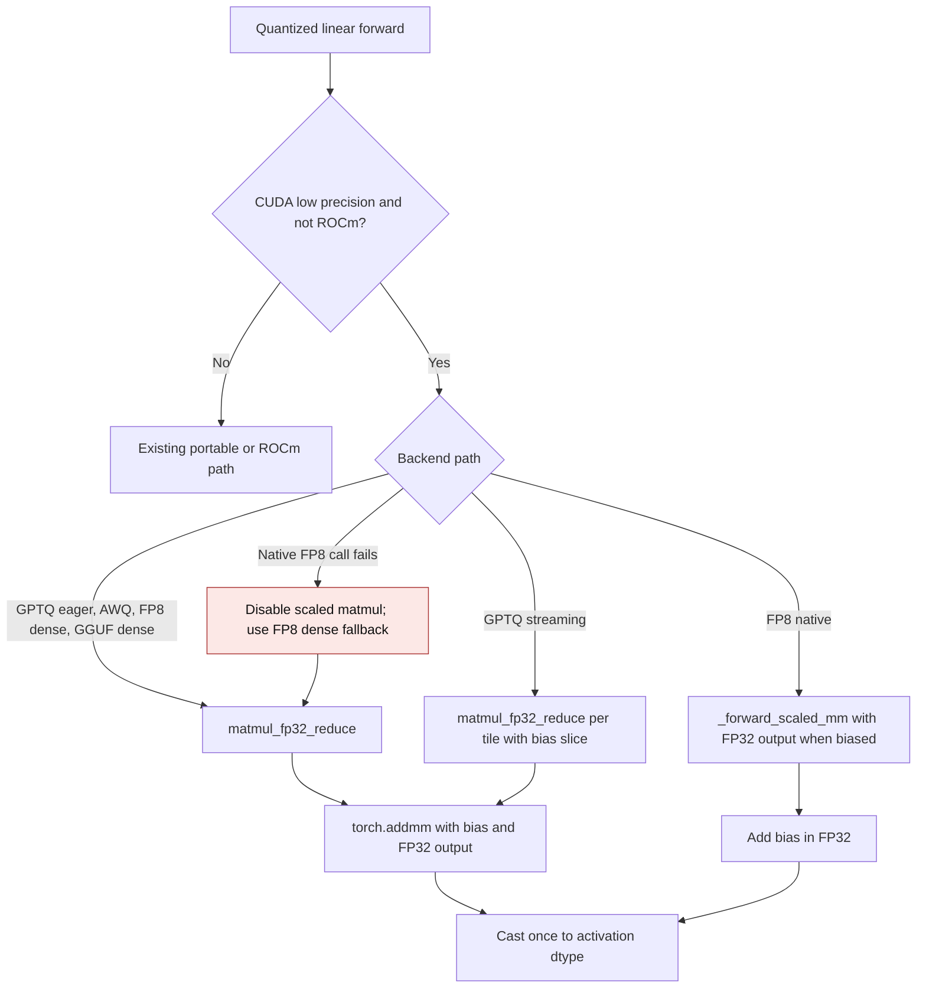

# CUDA quantized linear bias epilogue

GPT-QModel's portable GPTQ, AWQ, FP8, and GGUF linear backends may use an FP32
accumulator with FP16 or BF16 activations on NVIDIA CUDA. When a layer has a
bias, that bias must be added before the accumulator is rounded to the output
dtype. Otherwise a finite biased result can become `inf` at an intermediate
FP16 conversion, and ordinary values can round twice.

## Flow

The dense helper requests an FP32 `torch.addmm` output while retaining
low-precision tensor-core operands. GPTQ streaming keeps the wide value only
for one output tile; it does not retain an expanded weight. FP8 native scaled
matmul requests FP32 output only when a bias is present. The output still has
the activation dtype, and unsupported native FP8 calls use the dense fallback.

## Previous and current behavior

| Path | Previous mechanism | Current mechanism |
| --- | --- | --- |
| GPTQ eager, AWQ, FP8 dense, GGUF dense | `matmul_fp32_reduce` rounded before bias at `_numerics.py:35`; callers added bias at `torch.py:413`, `torch_awq.py:288`, `fp8.py:648`, and `gguf.py:1839` | `matmul_fp32_reduce` adds bias with FP32 `torch.addmm`, then rounds once |
| GPTQ streaming | `torch.addmm` wrote an FP16/BF16 output tile at `torch.py:571`; `torch.py:591` added bias afterward | Each biased NVIDIA tile computes and adds bias in FP32 before copying to the output |
| FP8 native scaled matmul | `fp8.py:614` requested low-precision output; `fp8.py:648` added bias afterward | Biased NVIDIA calls request FP32 output, add bias, then cast once |
| Native FP8 unavailable | `fp8.py:625` selected dense fallback after a failed scaled matmul | The fallback passes bias into the wide dense epilogue |

The `file:line` references in the previous-mechanism column refer to the
pre-change implementation. The ROCm and CPU matmul paths retain their existing
arithmetic and dtype behavior.

## Validation contract

Tests in `tests/kernels/test_cuda_bias_epilogue.py` use packed quantized layers
and an independent constant-weight FP64 oracle. They cover GPTQ eager and
streaming, AWQ, FP8 dense and native scaled matmul, and GGUF dense fallback in
FP16 and BF16, including repeat forwards and checks for retained dense weights.

The FP16 regression case has a matmul of `66000` and a bias of `-1000`:
the previous GPTQ and AWQ outputs were `inf`, while the FP32 oracle rounds
`65000` to `64992`. FP8 and GGUF dense fallbacks likewise returned `inf`
for finite oracle results of `60640` and `62752` respectively. All values
were observed on an NVIDIA GB10 (SM 12.1) with PyTorch 2.15.0+cu132.
