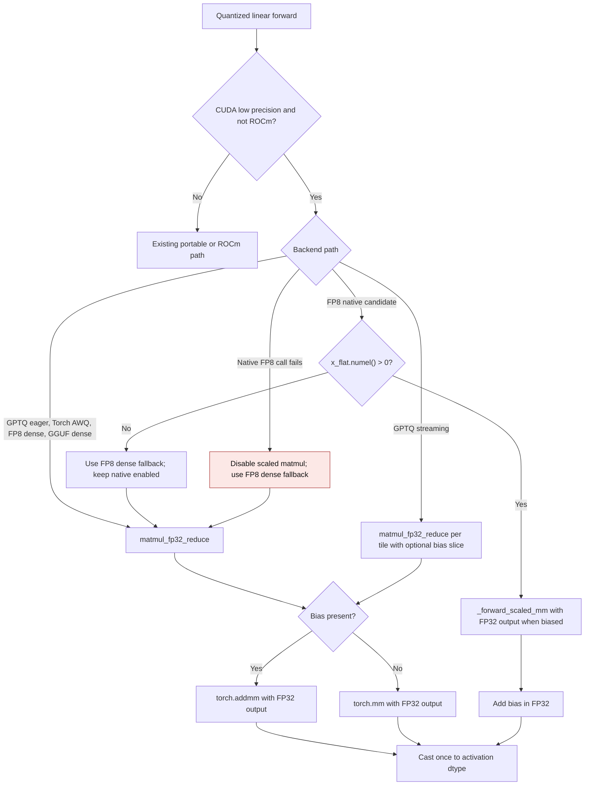
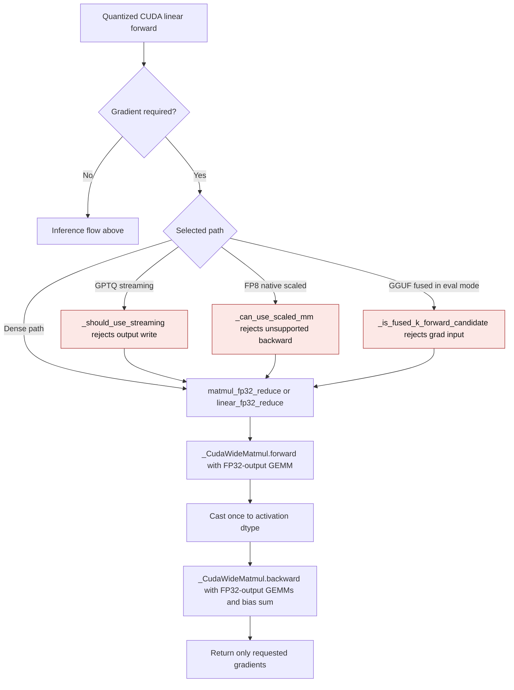
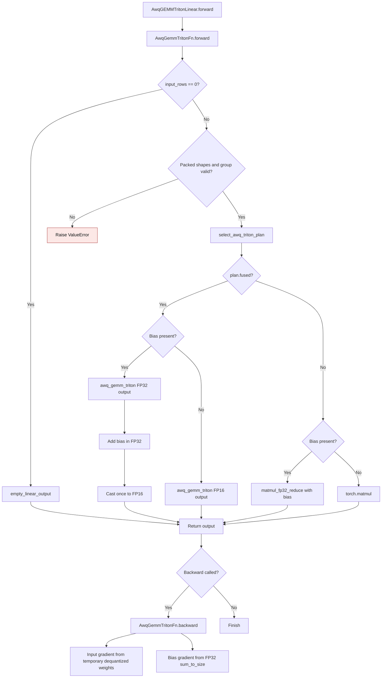

# CUDA quantized linear epilogue

GPT-QModel's portable GPTQ, Torch AWQ, FP8, and GGUF linear backends may use an FP32
accumulator with FP16 or BF16 activations on NVIDIA CUDA. When a layer has a
bias, that bias must be added before the accumulator is rounded to the output
dtype. Otherwise a finite biased result can become `inf` at an intermediate
FP16 conversion, and ordinary values can round twice.
The same wide output is needed for unbiased GPTQ streaming: a narrow split
reduction can produce `NaN` even when positive and negative terms cancel to
zero.

## Inference flow

The shared helper requests an FP32 `torch.mm` or `torch.addmm` output while
retaining low-precision tensor-core operands. GPTQ streaming uses it for every
NVIDIA tile, with or without bias, and keeps the wide value only for that tile;
it does not retain an expanded weight. FP8 native scaled
matmul requests FP32 output only when a bias is present. The output still has
the activation dtype, and unsupported native FP8 calls use the dense fallback.
An empty FP8 activation uses the dense fallback without calling `_scaled_mm`.
It does not set `_scaled_mm_hard_disabled`, so a later nonempty activation can
still use the native path.

## Gradient flow

PyTorch's FP32-output CUDA `mm` and `addmm` operations do not provide an
autograd derivative on the tested runtime. Quantized layers that accept training
therefore use `_CudaWideMatmul` when an input, temporary dequantized weight, or
bias requires a gradient. Its forward uses the same FP32-output GEMM and output
rounding as inference. Its backward computes first-order input and weight
gradients through FP32-output GEMMs and reduces the bias gradient in FP32.

The backward saves only low-precision operands needed for requested gradients.
A bias-only gradient does not retain a temporary dequantized weight. GPTQ
streaming, FP8 native scaled matmul, and GGUF fused execution use their dense
or eager path when their native backward cannot represent the requested input
gradient. No persistent expanded weight cache is created.

## AWQ Triton fused and dense paths

`AwqGemmTritonFn` has its own backward and uses the legacy or selected AWQ
plan. A biased fused call requests an FP32 result from `awq_gemm_triton`, adds
the bias in FP32, then rounds once to FP16. This also applies when a caller
sets `fp32_accum=False`: bias correctness requires a wide accumulation target.
A biased dense call passes the temporary dequantized weight and bias to
`matmul_fp32_reduce`. Unbiased calls retain their existing output paths. The
backward reduces the bias gradient in FP32, including zero-row inputs, and
saves only packed weights, zeros, and scales for the input gradient.

| Path | Previous mechanism | Current mechanism |
| --- | --- | --- |
| Fused bias | `gemm_awq_triton.py:120-124` returned an FP16 GEMM result, then added bias | `awq_gemm_triton` returns FP32 for biased calls; bias is added before one FP16 cast |
| Dense bias | `gemm_awq_triton.py:113-115` used FP16 `torch.matmul` before adding bias | `matmul_fp32_reduce` adds bias during FP32-output `torch.addmm` on NVIDIA CUDA |
| Bias backward | `gemm_awq_triton.py:152-155` returned `None` for bias, including zero-row input | `AwqGemmTritonFn.backward` returns an FP32-reduced bias gradient |

The line references in this table refer to the implementation before the AWQ
Triton epilogue change. This flow was introduced by
[PR #3658](https://github.com/ModelCloud/GPTQModel/pull/3658).

On an NVIDIA GB10 (SM 12.1), PyTorch 2.15.0+cu132, and Triton 3.9.0, the
packed-unit-weight FP16 cases at 1×128×128 (fused) and 129×128×128 (dense)
matched an independent FP32 Torch oracle exactly after output rounding. The
old output was `inf`; the corrected result is `65024`. Input and bias gradients
also matched the independent Torch oracle exactly, including the zero bias
gradient for empty rows. Both `fp32_accum` settings were tested; the relevant
AWQ suite completed with 99 passed and 1 skipped.

With resident FP16 inputs, five warmups, and the median of seven runs of 30
calls timed with CUDA events, the direct old and new biased epilogues measured:

| Path and shape (M×K×N) | Old latency | New latency | Old peak allocator delta | New peak allocator delta |
| --- | ---: | ---: | ---: | ---: |
| Fused 16×1024×1024 | 0.0796 ms | 0.0855 ms | 0.09 MiB | 0.13 MiB |
| Dense 129×1024×1024 | 0.0724 ms | 0.1016 ms | 34.25 MiB | 3.51 MiB |

The peak delta includes temporary output and library scratch. After two
forwards through each public-module path, only the packed qweight, packed
qzeros, scales, and bias remained in the module; retained expanded-weight
storage was 0 bytes. The dense path still creates a temporary dequantized
weight for each forward.

| Path | Previous mechanism | Current mechanism |
| --- | --- | --- |
| CUDA wide GEMM | `_numerics.py:39` and `_numerics.py:50` used FP32-output ATen GEMMs directly; backward raised `derivative for aten::addmm/mm is not implemented` | `_CudaWideMatmul` supplies first-order gradients for inputs, weights, and bias |
| FP8 native scaled | `fp8.py:540` selected `_scaled_mm` for differentiable activations; backward raised `derivative for aten::_scaled_mm is not implemented` | `_can_use_scaled_mm` sends differentiable inputs to the dense path |
| GPTQ streaming | `torch.py:706` selected streaming for differentiable activations despite its output writes | `_should_use_streaming` selects eager execution when a gradient is required |
| GGUF fused | `gguf.py:1601` could select fused execution in eval mode with a differentiable input | `_is_fused_k_forward_candidate` selects dense execution for that input |

The line references in this table refer to the implementation immediately
before the gradient change. First-order gradients are covered; higher-order
autograd is outside this contract.

## Previous and current behavior

| Path | Previous mechanism | Current mechanism |
| --- | --- | --- |
| GPTQ eager, AWQ, FP8 dense, GGUF dense | `matmul_fp32_reduce` rounded before bias at `_numerics.py:35`; callers added bias at `torch.py:413`, `torch_awq.py:288`, `fp8.py:648`, and `gguf.py:1839` | `matmul_fp32_reduce` adds bias with FP32 `torch.addmm`, then rounds once |
| GPTQ streaming with bias | `torch.addmm` wrote an FP16/BF16 output tile at `torch.py:571`; `torch.py:591` added bias afterward | Each NVIDIA tile computes and adds bias in FP32 before copying to the output |
| GPTQ streaming without bias | `torch.py:536` selected the wide tile only when bias existed; `torch.py:576` and `torch.py:577` wrote the unbiased GEMM directly to an FP16/BF16 output tile, producing `NaN` for a cancelled FP16 reduction | Every NVIDIA FP16/BF16 tile uses `matmul_fp32_reduce` and rounds once when copied to the output |
| FP8 native scaled matmul | `fp8.py:614` requested low-precision output; `fp8.py:648` added bias afterward | Biased NVIDIA calls request FP32 output, add bias, then cast once |
| FP8 native empty input | `fp8.py:540` admitted zero-element activations; `fp8.py:534` raised in `amax()`, and `fp8.py:634` permanently disabled native scaled matmul | `_can_use_scaled_mm` rejects empty activations; the dense path returns the empty output and later nonempty calls retain native eligibility |
| Native FP8 unavailable | `fp8.py:625` selected dense fallback after a failed scaled matmul | The fallback passes bias into the wide dense epilogue |

The bias rows cite the implementation before PR #3649; the unbiased streaming
row cites the implementation before PR #3654; the empty FP8 row cites the
implementation before PR #3655. The ROCm and CPU matmul paths retain
their existing arithmetic and dtype behavior.

## Validation contract

Tests in `tests/kernels/test_cuda_bias_epilogue.py` use packed quantized layers
and an independent constant-weight FP64 oracle. They cover GPTQ eager and
streaming, AWQ, FP8 dense and native scaled matmul, and GGUF dense fallback in
FP16 and BF16, including repeat forwards and checks for retained dense weights.
The same file also compares CUDA forward and backward results against an
independent FP32 Torch oracle for FP16 and BF16, 2D and 3D inputs, biased and
unbiased GEMMs, and each training-capable portable backend.

The FP16 regression case has a matmul of `66000` and a bias of `-1000`:
the previous GPTQ and AWQ outputs were `inf`, while the FP32 oracle rounds
`65000` to `64992`. FP8 and GGUF dense fallbacks likewise returned `inf`
for finite oracle results of `60640` and `62752` respectively. All values
were observed on an NVIDIA GB10 (SM 12.1) with PyTorch 2.15.0+cu132.

This flow was introduced by [PR #3649](https://github.com/ModelCloud/GPTQModel/pull/3649).

For the gradient path, 16 deterministic core cases (two dtypes, two ranks,
biased and unbiased, matmul and linear) matched the independently evaluated
Torch FP32 forward and all requested gradients exactly. Twelve packed-layer
cases across six routes and both dtypes had maximum output, input-gradient,
and bias-gradient differences of `0` from their independent Torch oracles.
Empty-row CUDA forwards returned empty outputs and zero weight and bias
gradients in both dtypes.
The FP16 128×4096×4096 forward-and-backward benchmark used resident inputs,
three warmups, then the median of five runs of ten calls with CUDA
synchronization. The custom backward took `1.60 ms` versus `2.40 ms` for a
differentiable full-FP32-operand reference; the measured allocator peak delta
was `99.0 MiB` versus `167.0 MiB`. Its maximum input-gradient difference
was `5.96e-8`, with zero weight- and bias-gradient difference. These are
training-graph measurements; inference still uses the prior no-grad path.

The gradient flow was introduced by [PR #3651](https://github.com/ModelCloud/GPTQModel/pull/3651).

`tests/kernels/test_inference_numeric_range.py` also checks unbiased GPTQ
streaming with 16×2048 FP16 and BF16 activations and 256 outputs, across four
64-column tiles. Each packed weight is exactly `1`; the input halves are
equal and opposite, so the independent FP64 oracle is `0`. On the NVIDIA GB10,
the previous FP16 output contained `NaN`, while the current output is exactly
`0` in both dtypes. A random FP16 sample's maximum absolute error versus an
independent FP32 sum fell from `0.03125` to `0`. With resident inputs, ten
warmups, and the median of seven runs of thirty calls with CUDA synchronization,
the streaming forward took `0.799 ms` before and `0.887 ms` after. Both runs
had approximately `32.5 MiB` measured peak allocator delta, including CUDA
library scratch; no expanded weight persists between forwards.

The unbiased streaming flow was introduced by [PR #3654](https://github.com/ModelCloud/GPTQModel/pull/3654).

## Empty FP8 activation contract

`tests/kernels/test_fp8_kernel.py` checks FP16 and BF16, biased and unbiased,
and 2D and 3D zero-row activations on the NVIDIA GB10. Before the empty-input
gate, `_can_use_scaled_mm` admitted the empty activation, `amax()` raised, and
the catch block set `_scaled_mm_hard_disabled=True`. The empty output still had
the requested shape, but all later nonempty forwards used dense dequantization.
With the gate, all eight cases return an empty output without calling native
scaled matmul, release any temporary dense weight, and use the native path for
the next nonempty forward.

Resident-input FP16 timing used five warmups and the median of five runs of ten
forwards with CUDA synchronization. The comparison toggled the module's native
path flag after warmup, reproducing the state caused by the previous empty
forward. The peak allocator delta includes CUDA library scratch.

| Shape (M×K×N) | Native path after empty input | Dense path after the old disable |
| --- | --- | --- |
| 128×1024×1024 | 0.177 ms; 1.5 MiB peak | 0.091 ms; 34.5 MiB peak |
| 128×4096×4096 | 0.187 ms; 6.0 MiB peak | 1.733 ms; 160.0 MiB peak |

Native FP8 is slower for the smaller benchmark and faster for the larger one;
the regression is that one empty request permanently changes the execution
path for later requests.

The empty FP8 flow was introduced by [PR #3655](https://github.com/ModelCloud/GPTQModel/pull/3655).
