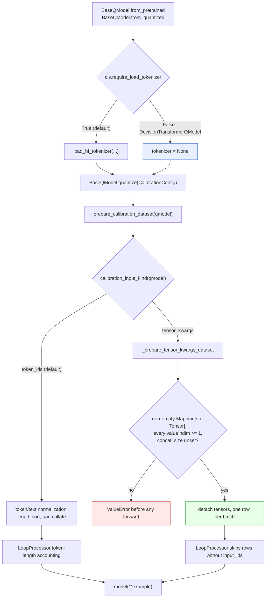

# Decision Transformer: tokenizer-optional load and tensor calibration

Decision Transformer (`decision_transformer`) offline-RL checkpoints are not
causal LMs: they ship no tokenizer and `DecisionTransformerModel.forward` takes
named tensors (`states`, `actions`, `rewards`, `returns_to_go`, `timesteps`)
instead of `input_ids`. Before this change both assumptions in the text path
failed before model selection:

- `load_hf_tokenizer()` raised `Couldn't instantiate the backend tokenizer`.
- `prepare_calibration_dataset()` rejected every tensor row with
  `Quantize: unsupported calibration example structure`.

`DecisionTransformerQModel` now opts into two definition flags. Every other
model keeps the default token path, byte for byte.

## Flow

The loader skip and the calibration branch are independent decisions: a future
tensor-input model can set either flag without the other, and an unknown
`calibration_inputs` value fails closed in `calibration_input_kind()`.

## Before and after

| Mechanism | Before | After |
| --- | --- | --- |
| `from_pretrained` tokenizer | unconditional `load_hf_tokenizer`, `gptqmodel/models/loader.py:2053` | gated by `cls.require_load_tokenizer`, `gptqmodel/models/loader.py:2051` |
| `from_quantized` tokenizer | unconditional `load_hf_tokenizer`, `gptqmodel/models/loader.py:2685` | gated by `cls.require_load_tokenizer`, `gptqmodel/models/loader.py:2686` |
| Non-causal embedding accessors | `model.get_input_embeddings()` raised `NotImplementedError`, `gptqmodel/models/loader.py:2966` | `try/except NotImplementedError` treats them as absent, same line |
| Accepted calibration rows | `_CALIBRATION_COLUMNS` only, `gptqmodel/utils/calibration.py:137`; else raise at `:812` | `calibration_inputs == "tensor_kwargs"` branch in `prepare_calibration_dataset`, `gptqmodel/utils/calibration.py:481`, validator at `:173` |
| Token-length accounting | `avg = total_input_ids_length / len(calibration_dataset)`, `gptqmodel/looper/loop_processor.py:651` | divides by `token_rows`, the rows that actually carry `input_ids`, `gptqmodel/looper/loop_processor.py:650` |
| Registry | no `decision_transformer` entry | `MODEL_MAP["decision_transformer"]`, `gptqmodel/models/auto.py:293` |

## Failure and ambiguity contract

| Situation | Result |
| --- | --- |
| Definition sets an unknown `calibration_inputs` | `ValueError` listing the accepted kinds |
| Tensor row reaches a `token_ids` model | Existing `unsupported calibration example structure` error |
| `tensor_kwargs` row holds a non-tensor value | `ValueError` naming the offending keys |
| `tensor_kwargs` row holds a 0-D tensor | `ValueError`: include the batch dimension |
| `calibration_dataset_concat_size` with `tensor_kwargs` | `ValueError`: concatenation is token-based |
| Empty tensor dataset | `ValueError` |
| `batch_size != 1` with `tensor_kwargs` | Logged and ignored; each row already carries its own batch dimension |
| Decision Transformer heads | Not quantized: 1-8 wide heads stay native dtype |

## Module plan

| Root | Decoder layers | Ordered blocks |
| --- | --- | --- |
| `encoder` | `encoder.h` | `ln_1:!`, `attn.c_attn`, `attn.c_proj`, `ln_2:!`, `mlp.c_fc`, `mlp.c_proj` |

`encoder.wte`, `encoder.wpe`, `encoder.drop`, `encoder.ln_f`, and the eight
`embed_*`/`predict_*` heads are declared base modules, so they stay native.
The heads are materialized from the lazy checkpoint shell because `embed_*`
runs before the first decoder block.

## Tests

| Test | Invariant |
| --- | --- |
| `tests/test_decision_transformer_4755.py::test_decision_transformer_definition_is_registered` | Registry entry, tree prefix, and both flags |
| `tests/test_decision_transformer_4755.py::test_tensor_kwargs_calibration_passes_rows_through` | Rows pass through with shapes intact |
| `tests/test_decision_transformer_4755.py::test_tensor_kwargs_calibration_is_gated_by_the_definition` | A token model still rejects tensor rows |
| `tests/test_decision_transformer_4755.py::test_tensor_kwargs_calibration_rejects_non_tensor_values` | Non-tensor values fail closed |
| `tests/test_decision_transformer_4755.py::test_tiny_decision_transformer_quantizes_with_tensor_calibration` | 4-bit quantize, finite heads, packed modules only under `.attn.`/`.mlp.`, save and tokenizer-less reload |
| `tests/module_tree/test_decision_transformer_model_tree.py` | Real `meta` model: prefix, layer count, every block weight owner through `ModulePlan.find()`, `:!` norms, native heads |

## Not in scope

- AWQ scaling/search is not claimed for Decision Transformer in this change;
  only the GPTQ path is tested. Treat AWQ on this definition as unverified.
- `lm_head` does not exist on these checkpoints, and no attention/MLP fusion
  profile is qualified (the GPT-2 tree has no separate QKV or gate/up group).
