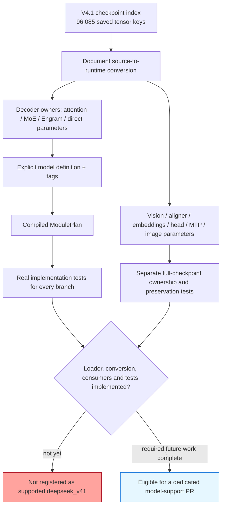

# DeepSeek V4.1 Flash: checkpoint module inventory

This is a verified **checkpoint inventory and integration guide**, not a claim
that GPT-QModel can already load or quantize DeepSeek V4.1 Flash. The
`deepseek_v41` type is absent from the registry at the module-plan implementation
revision `7d03a349`; the installed Transformers 5.22.1 also lacks that config.
The upstream Transformers model directory checked on 2026-11-07 lists
`deepseek_v4`, but not `deepseek_v41`.

The checkpoint now includes reference inference Python code. Its config does
not provide an `auto_map` that makes that code a Transformers AutoModel
implementation. A dedicated integration is still required. The existing
`DeepSeekV4QModel` is for V4, and must not be relabeled as V4.1.

Start with the [module-plan guide](module-plan-guide.md) for APIs, tags, and
new-model tests. This page explains the actual V4.1 weight paths, including
weights outside the decoder and tensors that should not be mistaken for weights.

## Pinned evidence

The following artifacts come from `deepseek-ai/DeepSeek-V4.1-Flash`, revision
**`314113f8a7dadb388215396ba5fbee2c610a04d6`**, inspected on 2026-11-07:

| Artifact | What it establishes |
| --- | --- |
| [config.json](https://huggingface.co/deepseek-ai/DeepSeek-V4.1-Flash/blob/314113f8a7dadb388215396ba5fbee2c610a04d6/config.json) | `deepseek_v41`, nested text/vision configs, layer/expert counts, source quantization metadata. |
| [model.safetensors.index.json](https://huggingface.co/deepseek-ai/DeepSeek-V4.1-Flash/blob/314113f8a7dadb388215396ba5fbee2c610a04d6/model.safetensors.index.json) | Exact saved tensor keys and shard membership. Counts below come from this index, without downloading weight shards. |
| [inference/model.py](https://huggingface.co/deepseek-ai/DeepSeek-V4.1-Flash/blob/314113f8a7dadb388215396ba5fbee2c610a04d6/inference/model.py) | Reference module ownership, expert projection roles, direct parameters, conditional branches, runtime buffers. |
| [inference/convert.py](https://huggingface.co/deepseek-ai/DeepSeek-V4.1-Flash/blob/314113f8a7dadb388215396ba5fbee2c610a04d6/inference/convert.py) | Reference name/format conversion and tensor-parallel sharding. This is not a GPT-QModel converter. |
| [inference/vision.py](https://huggingface.co/deepseek-ai/DeepSeek-V4.1-Flash/blob/314113f8a7dadb388215396ba5fbee2c610a04d6/inference/vision.py) | Vision and aligner ownership. |

The config declares 40 text layers, hidden size 5120, 384 routed experts with
6 selected per token, and one shared expert. It also declares 32 vision layers
and three next-token prediction layers. The source format declares FP8 with
32-by-32 weight blocks and FP4 experts; stored scale tensors are part of the
checkpoint inventory. These facts do not establish GPTQ/AWQ compatibility.

## Whole-checkpoint view

The index contains **96,085 tensor keys**. Counts include scales and biases;
they are not parameter counts, module counts, or tensor element totals.

| Saved namespace | Tensor keys | Coverage responsibility |
| --- | ---: | --- |
| `layers.*` | 93,415 | Backbone decoder: attention, MoE, hyper-connections, optional compression/indexing/Engram. |
| `mtp.*` | 2,401 | Three auxiliary prediction blocks and their additional heads/projections. |
| `vision.*` | 259 | Patch embedding, 32 vision blocks, final vision norm. |
| `aligner.*` | 4 | Vision-to-language projection weights and biases. |
| `embed.weight` | 1 | Token embedding. |
| `norm.weight` | 1 | Final text norm. |
| `head.weight` | 1 | Output head. |
| `image_start`, `image_end`, `image_newline` | 3 | Learned image delimiter parameters on the model root. |
| **Total** | **96,085** | Every saved key belongs to an explicit inventory category. |

The names below are the **actual checkpoint namespace**, not an invented HF
`model.layers.*` layout. Bracketed ranges abbreviate repeated numeric segments.

```text
checkpoint
├─ embed.weight
├─ image_start / image_end / image_newline        direct root parameters
├─ vision
│  ├─ patch_embed.proj                           weight + bias
│  ├─ blocks.[0..31]
│  │  ├─ norm1 / norm2                          weight
│  │  ├─ attn.wqkv / attn.wo                    weight + bias
│  │  └─ mlp.w1 / mlp.w2                        weight
│  └─ norm.weight
├─ aligner.w1 / aligner.w2                       weight + bias
├─ layers.[0..39]                               detailed below
├─ norm.weight
├─ head.weight
└─ mtp.[0..2]                                   prediction blocks
   ├─ attn / ffn / attn_norm / ffn_norm / hc_*   block weight families
   ├─ main_norm / norm                          weight
   ├─ main_proj                                weight + scale
   ├─ markov_head.embed / markov_head.head      weight
   └─ confidence_head.proj                     weight
```

The module-plan implementation currently compiles decoder-relative owners.
That does not automatically include `vision`, `aligner`, `mtp`, embeddings,
heads, or direct model-root parameters. A full V4.1 integration must give these
weights explicit ownership and preservation tests, and extend the public
inventory if it is to expose a whole-checkpoint view.

## One backbone decoder layer

This is the union of saved backbone-layer paths, not a claim that every optional
branch exists in every layer. The index has **50 distinct key templates** after
normalizing numeric layer and expert indices.

```text
layers.N
├─ hc_attn_fn / hc_attn_base / hc_attn_scale     direct layer parameters
├─ hc_ffn_fn / hc_ffn_base / hc_ffn_scale        direct layer parameters
├─ attn_norm.weight
├─ attn
│  ├─ attn_sink                                direct attention parameter
│  ├─ wq_a                                     weight + scale; query factor A
│  ├─ q_norm.weight
│  ├─ wq_b                                     weight + scale; query factor B
│  ├─ wkv                                      weight + scale; shared KV latent
│  ├─ kv_norm.weight
│  ├─ wo_a / wo_b                              weight + scale; output factors
│  ├─ compressor                               only KV-source layers
│  │  ├─ norm.weight
│  │  ├─ wkv.weight
│  │  └─ wgate.weight                          only ratio > 1
│  └─ indexer                                  only index-source layers
│     ├─ wq_b                                  weight + scale
│     ├─ wk.weight
│     ├─ k_norm.weight
│     └─ weights_proj.weight
├─ engram                                      only layers 1 and 14
│  ├─ embed                                    weight + scale
│  ├─ wkv                                      weight + scale
│  └─ q_weight / k_weight                      direct Engram parameters
├─ ffn_norm.weight
└─ ffn                                         MoE root
   ├─ gate                                     weight + bias + bias_vl
   ├─ experts.[0..383]
   │  ├─ w1                                    weight + scale; gate projection
   │  ├─ w3                                    weight + scale; up projection
   │  └─ w2                                    weight + scale; down projection
   └─ shared_experts
      ├─ w1                                    weight + scale; gate projection
      ├─ w3                                    weight + scale; up projection
      └─ w2                                    weight + scale; down projection
```

| Branch | Backbone layers with saved keys |
| --- | --- |
| Base attention, routing, routed/shared experts, norms, hyper-connections | 0–39 |
| `attn.compressor` | 2, 8, 14, 20 |
| `attn.compressor.wgate` | 2, 8, 14; layer 20 has ratio 1 and no gating projection |
| `attn.indexer` | 2, 8, 14, 20, 24, 28, 32, 36 |
| `engram` | 1, 14 |

This makes a layer-zero-only test insufficient. It misses compression, indexing,
and Engram even if all its attention and expert projections resolve.

## Translating evidence into definition tags

Use the post-conversion runtime shell as the canonical module namespace, with
explicit checkpoint mappings. For example, **if an integration preserves the
reference `ffn` namespace**, its expert branch can be represented as follows:

```python
from gptqmodel import ModulePlan

# Partial authoring example only: not a complete or registered V4.1 definition.
# Groups illustrate expert processing order; they do not enable a backend.
expert_tree = [
    "layers", "#",
    {
        "ffn:moe": {
            "gate": ("gate:!",),
            "experts": {
                "#": ("w1:0:gate", "w3:0:up", "w2:1:down"),
            },
            "shared_experts": ("w1:0:gate", "w3:0:up", "w2:1:down"),
        },
    },
]
plan = ModulePlan.from_tree(expert_tree)
assert plan.roles("ffn.experts.3.w1") == ("gate",)
assert plan.expert_root("ffn.experts.3.w2") == "ffn.experts.3"
assert plan.shared_expert_containers() == ("ffn.shared_experts",)
assert not plan.find("ffn.gate").quantize
assert plan.find("ffn.experts.3.unknown") is None
plan.print(color=False, show_summary=False)
```

The reference forward computes the MLP gate with `w1`, the up branch with `w3`,
and the down projection with `w2`. The router named `gate` is a different
operation and must not receive the MLP `:gate` role. The illustration deliberately
does not opt into shared-input reuse; that requires a real-forward test.

Attention needs a separate policy. Both query factors contribute to query
construction; `wkv` supplies a shared latent; output is factorized too. Explicit
roles can represent those facts, but a consumer requiring one projection per
role may reject them. Tags cannot make a Llama-specific rotation valid for this
architecture. Check the actual forward and consumer contract before selecting
quantization subsets or assigning combined roles.

For non-quantized ownership, `attn:!` can account for the direct `attn_sink`
while child projections retain their own policies. Engram's `q_weight` and
`k_weight` belong to the `engram` owner. The six `hc_*` tensors belong directly
to the decoder layer itself: **they are parameters, not child modules**.
An integration must explicitly support those owners or declare its structural
conversion. Creating fictitious `hc_attn_fn` modules just to pass a lookup is not
valid coverage.



This diagram describes the **remaining integration requirements**, not an
implemented loading path.

## Saved scales versus runtime memory

| Example | Checkpoint-owned? | Treatment |
| --- | --- | --- |
| `layers.0.attn.wq_a.scale` | Yes | Saved inference metadata associated with `wq_a`; include in source ownership/conversion audit. |
| `layers.0.ffn.gate.bias_vl` | Yes | Saved routing parameter, even if a text-only run does not exercise image routing. |
| `layers.14.engram.q_weight` | Yes | Direct parameter on `engram`; absence from a linear-module list is irrelevant. |
| `layers.0.hc_attn_fn` | Yes | Direct decoder-layer parameter; cannot be dropped from coverage. |
| `image_start` | Yes | Direct model-root parameter outside the decoder-only plan. |
| `window_kv_cache`, `compress_kv_cache` | No saved keys in this index | Runtime attention caches; not model-definition weight obligations. |
| Compressor `kv_state` / `score_state`, generated `freqs_cis` | No saved keys in this index | Runtime state or generated positional data; keep separate from checkpoint weights. |

The reference converter consumes `wo_a.weight` and its saved scale to produce
a BF16 runtime weight. A missing runtime scale after that transformation is not
missing checkpoint coverage if the conversion is accounted for explicitly.
Conversely, a newly allocated cache does not become a checkpoint weight because
it has tensor storage. Audit provenance, not just Python tensor type.

## Reproduce the inventory without loading weights

Download only the pinned index and count its keys:

```python
import json
from collections import Counter
from urllib.request import urlopen

revision = "314113f8a7dadb388215396ba5fbee2c610a04d6"
url = (
    "https://huggingface.co/deepseek-ai/DeepSeek-V4.1-Flash/resolve/"
    f"{revision}/model.safetensors.index.json"
)
with urlopen(url, timeout=60) as response:
    weight_map = json.load(response)["weight_map"]
counts = Counter(key.split(".", 1)[0] for key in weight_map)
assert len(weight_map) == 96085
assert counts["layers"] == 93415
assert counts["mtp"] == 2401
print(dict(sorted(counts.items())))
```

Index inspection verifies saved names, not tensor contents, shapes, loader
compatibility, quantization accuracy, or a successful inference run. Before
claiming support, add the registry contract and a real V4.1 module-plan test,
exercise every optional branch and non-decoder family, and validate conversion
plus quantize/save/reload against the actual implementation. The current
conditional V4.1 test only activates when the upstream config becomes available;
it is not evidence that V4.1 already passes.
