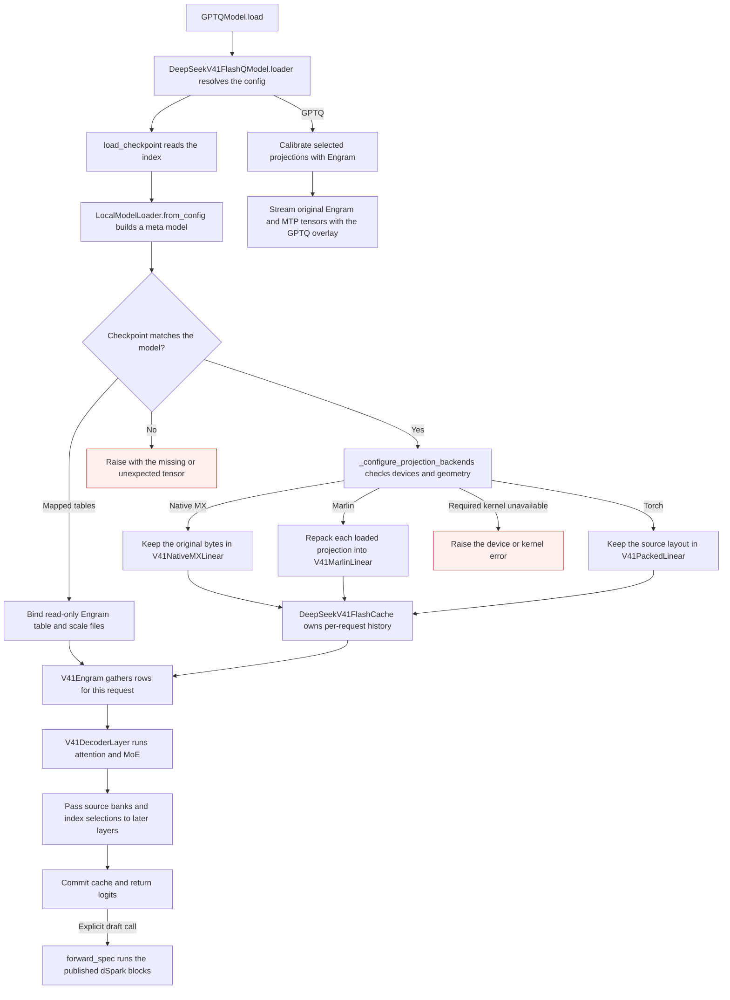

# DeepSeek V4.1 Flash checkpoint layout and loading

`GPTQModel.load()` accepts the published block-32 FP8 and FP4 checkpoints for
DeepSeek V4.1 Flash and Flash-1017. GPT-QModel runs the text backbone, Engram,
vision tower, and aligner. It loads the published dSpark weights under
`mtp.*`. The two Engram tables are mapped from safetensors, and the model
reads and decodes only the hashed rows needed by each request.

The package-owned `DeepSeekV41FlashQModel.loader` selects the config and model
for the published checkpoint. The separate `ports/deepseek_v41` reference
decoder remains available through the explicit V4.1 calibration API.

```python
from gptqmodel import GPTQModel

model = GPTQModel.load(
    "deepseek-ai/DeepSeek-V4.1-Flash-1017",
    device_map="auto",
)
```

Use a local checkpoint directory or a Hugging Face repository ID.
`device_map="auto"` places whole decoder layers, and an explicit device map can
pin those layers. The devices must have room for the packed weights and
execution workspace. On NVIDIA Blackwell, the default backend uses Triton
block-scaled MMA directly on the published weights. Older NVIDIA GPUs with
compute capability 8.0 or later use Marlin for tile-aligned projections.
`backend="marlin"` explicitly requires Marlin for every packed projection.
`backend="torch"` selects the reference path, which decodes one projection
at a time. The cache stores keys and values in BF16.

The Blackwell path keeps the original weight and scale bytes and passes E4M3
activation codes with their block-32 E8M0 scales to the matrix multiply.
On SM12x, Triton takes the hardware path with matching formats, so the kernel
converts E2M1 weight tiles to their exact E4M3 codes inside the multiply.

Marlin repacks the published E2M1 and E4M3 codes during loading, one projection
at a time. The FP8 source scales cover 32 output rows and 32 input columns.
Marlin repeats each FP8 exponent byte across those 32 rows. FP4 source scales
already have one byte per row and input group. Automatic placement budgets for
the repeated scales. Marlin keeps the same number of weight bytes as the
checkpoint and decodes weight tiles during matrix multiplication. Activations
are dynamically rounded to block-32 FP8 and passed to Marlin as BF16. The
grouped `wo_a` projection keeps its head groups separate.

Text inputs use unpadded sequences. For images, pass flattened RGB patches as
`pixel_values`, one `[1, patch_rows, patch_columns]` entry per image as
`image_grid_thw`, and the checkpoint's image placeholder tokens in
`input_ids`. Each image requires a start token, an aligned grid with a newline
after each row, and an end token.

## Engram and draft execution

Engram runs before attention at the configured decoder layers. The tokenizer
supplies normalized IDs for hashing. Each request stores only the last
`engram_max_ngram_size - 1` compressed tokens, so a split prefill or decode
continues the same n-grams. An image span stops the look-back and masks the
Engram contribution at its own positions. When passing `inputs_embeds`,
provide the matching `engram_input_ids`.

For dSpark, call the backbone with `output_mtp_features=True` and
`use_cache=True`. The result contains `mtp_features` and the request cache.
`model.model.forward_spec(input_ids, main_hidden, cache=cache)` seeds the
draft window from the prefill features. A continuation passes the accepted
features, the next draft input token per batch element, and `start_pos` equal
to the number of accepted tokens already added to the draft cache. It returns
the proposal IDs, logits, and confidence scores.

## Selected-projection GPTQ

Pass a GPTQ quantization config when loading the published checkpoint.
Projection names identify the matrices to calibrate and pack.

```python
from gptqmodel import GPTQModel
from gptqmodel.quantization.config import CalibrationConfig, QuantizeConfig

model = GPTQModel.load(
    "deepseek-ai/DeepSeek-V4.1-Flash-1017",
    device_map="auto",
    quantize_config=QuantizeConfig(bits=4, group_size=128),
)
model.quantize(
    CalibrationConfig(dataset=calibration_rows),
    projections=["layers.1.attn.wq_a", "layers.14.attn.indexer.wq_b"],
)
model.save("deepseek-v41-flash-gptq")
```

Calibration runs the backbone with Engram and keeps dSpark disabled. The save
streams unchanged checkpoint tensors from their original byte ranges and
overlays the selected GPTQ projections. This preserves the Engram tables,
their projections and gates, and all MTP tensors in the exported checkpoint.
The exported index also works when a mapped table and its scale land in
different shards. Load the export with `GPTQModel.load()`.

## Selected-projection Q4NX EXL3

Use `EXL3Config` for routed `layers.N.ffn.experts.E.w1`, `w3`, and `w2`
projections. The encoder uses the original FP4 weights and the BF16 inputs
observed at each projection during calibration. Supply rows that exercise each
selected projection. Both the encoder and the inference kernels use EXL3
activation handling for the replaced projections.

```python
from gptqmodel import GPTQModel
from gptqmodel.quantization import EXL3Config
from gptqmodel.quantization.config import CalibrationConfig

model = GPTQModel.load(
    "deepseek-ai/DeepSeek-V4.1-Flash",
    device_map="auto",
    quantize_config=EXL3Config(bits=3.5, codebook="q4nx"),
)
model.quantize(
    CalibrationConfig(dataset=calibration_rows),
    projections=[f"layers.14.ffn.experts.0.w{i}" for i in (1, 3, 2)],
)
model.save("deepseek-v41-flash-q4nx")
```

The indexed export specifies each replaced projection's rate and codebook in
`gptqmodel_v41_projections`. It stores the packed trellis, `suh`, `svh`, and
`q4nx` marker in safetensors. The loader checks the marker against the
projection declaration and reports missing or unexpected tensors before
serving. The source format configuration still describes the other weights.

`backend="exl3_exllama_v3"` explicitly selects NVIDIA SM80+ for Q4NX
projections. AUTO can use native EXL3 on a compatible device.
`backend="exl3_torch"` selects portable EXL3 and source projections.
A routed layer with all eligible Q4NX experts uses the grouped CUDA path.
Layers with partial replacements or heterogeneous expert layouts use
the standard expert loop. [Grouped routing and limits](exl3-routed-decode.md#deepseek-v41-flash-q4nx)

## Pinned evidence

The following artifacts come from `deepseek-ai/DeepSeek-V4.1-Flash`, revision
**`314113f8a7dadb388215396ba5fbee2c610a04d6`**, inspected on 2026-11-07:

| Artifact | What it establishes |
| --- | --- |
| [config.json](https://huggingface.co/deepseek-ai/DeepSeek-V4.1-Flash/blob/314113f8a7dadb388215396ba5fbee2c610a04d6/config.json) | `deepseek_v41`, nested text/vision configs, layer/expert counts, source quantization metadata. |
| [model.safetensors.index.json](https://huggingface.co/deepseek-ai/DeepSeek-V4.1-Flash/blob/314113f8a7dadb388215396ba5fbee2c610a04d6/model.safetensors.index.json) | Exact saved tensor keys and shard membership. Counts below come from this index, without downloading weight shards. |
| [inference/model.py](https://huggingface.co/deepseek-ai/DeepSeek-V4.1-Flash/blob/314113f8a7dadb388215396ba5fbee2c610a04d6/inference/model.py) | Reference module ownership, expert projection roles, direct parameters, conditional branches, runtime buffers. |
| [inference/convert.py](https://huggingface.co/deepseek-ai/DeepSeek-V4.1-Flash/blob/314113f8a7dadb388215396ba5fbee2c610a04d6/inference/convert.py) | Reference name/format conversion and tensor-parallel sharding. This is not a GPT-QModel converter. |
| [inference/vision.py](https://huggingface.co/deepseek-ai/DeepSeek-V4.1-Flash/blob/314113f8a7dadb388215396ba5fbee2c610a04d6/inference/vision.py) | Vision and aligner ownership. |

The config declares 40 text layers, hidden size 5120, 384 routed experts with
6 selected per token, and one shared expert. It also declares 32 vision layers
and three next-token prediction layers. The source format declares FP8 with
32-by-32 weight blocks and FP4 experts; stored scale tensors are part of the
checkpoint inventory. These facts do not establish GPTQ/AWQ compatibility.

## Whole-checkpoint view

The index contains **96,085 tensor keys**. Counts include scales and biases;
they are not parameter counts, module counts, or tensor element totals.

| Saved namespace | Tensor keys | Coverage responsibility |
| --- | ---: | --- |
| `layers.*` | 93,415 | Backbone decoder: attention, MoE, hyper-connections, optional compression/indexing/Engram. |
| `mtp.*` | 2,401 | Three auxiliary prediction blocks and their additional heads/projections. |
| `vision.*` | 259 | Patch embedding, 32 vision blocks, final vision norm. |
| `aligner.*` | 4 | Vision-to-language projection weights and biases. |
| `embed.weight` | 1 | Token embedding. |
| `norm.weight` | 1 | Final text norm. |
| `head.weight` | 1 | Output head. |
| `image_start`, `image_end`, `image_newline` | 3 | Learned image delimiter parameters on the model root. |
| **Total** | **96,085** | Every saved key belongs to an explicit inventory category. |

The names below are the **actual checkpoint namespace**, not an invented HF
`model.layers.*` layout. Bracketed ranges abbreviate repeated numeric segments.

```text
checkpoint
├─ embed.weight
├─ image_start / image_end / image_newline        direct root parameters
├─ vision
│  ├─ patch_embed.proj                           weight + bias
│  ├─ blocks.[0..31]
│  │  ├─ norm1 / norm2                          weight
│  │  ├─ attn.wqkv / attn.wo                    weight + bias
│  │  └─ mlp.w1 / mlp.w2                        weight
│  └─ norm.weight
├─ aligner.w1 / aligner.w2                       weight + bias
├─ layers.[0..39]                               detailed below
├─ norm.weight
├─ head.weight
└─ mtp.[0..2]                                   prediction blocks
   ├─ attn / ffn / attn_norm / ffn_norm / hc_*   block weight families
   ├─ main_norm / norm                          weight
   ├─ main_proj                                weight + scale
   ├─ markov_head.embed / markov_head.head      weight
   └─ confidence_head.proj                     weight
```

The module plan covers decoder owners. The checkpoint loader also validates
the vision tower, aligner, token embedding, head, and image delimiter keys.

## One backbone decoder layer

This is the union of saved backbone-layer paths, not a claim that every optional
branch exists in every layer. The index has **50 distinct key templates** after
normalizing numeric layer and expert indices.

```text
layers.N
├─ hc_attn_fn / hc_attn_base / hc_attn_scale     direct layer parameters
├─ hc_ffn_fn / hc_ffn_base / hc_ffn_scale        direct layer parameters
├─ attn_norm.weight
├─ attn
│  ├─ attn_sink                                direct attention parameter
│  ├─ wq_a                                     weight + scale; query factor A
│  ├─ q_norm.weight
│  ├─ wq_b                                     weight + scale; query factor B
│  ├─ wkv                                      weight + scale; shared KV latent
│  ├─ kv_norm.weight
│  ├─ wo_a / wo_b                              weight + scale; output factors
│  ├─ compressor                               only KV-source layers
│  │  ├─ norm.weight
│  │  ├─ wkv.weight
│  │  └─ wgate.weight                          only ratio > 1
│  └─ indexer                                  only index-source layers
│     ├─ wq_b                                  weight + scale
│     ├─ wk.weight
│     ├─ k_norm.weight
│     └─ weights_proj.weight
├─ engram                                      only layers 1 and 14
│  ├─ embed                                    weight + scale
│  ├─ wkv                                      weight + scale
│  └─ q_weight / k_weight                      direct Engram parameters
├─ ffn_norm.weight
└─ ffn                                         MoE root
   ├─ gate                                     weight + bias + bias_vl
   ├─ experts.[0..383]
   │  ├─ w1                                    weight + scale; gate projection
   │  ├─ w3                                    weight + scale; up projection
   │  └─ w2                                    weight + scale; down projection
   └─ shared_experts
      ├─ w1                                    weight + scale; gate projection
      ├─ w3                                    weight + scale; up projection
      └─ w2                                    weight + scale; down projection
```

| Branch | Backbone layers with saved keys |
| --- | --- |
| Base attention, routing, routed/shared experts, norms, hyper-connections | 0–39 |
| `attn.compressor` | 2, 8, 14, 20 |
| `attn.compressor.wgate` | 2, 8, 14; layer 20 has ratio 1 and no gating projection |
| `attn.indexer` | 2, 8, 14, 20, 24, 28, 32, 36 |
| `engram` | 1, 14 |

This makes a layer-zero-only test insufficient. It misses compression, indexing,
and Engram even if all its attention and expert projections resolve.

## Loading and decoder state

| Stage | Before this integration | Current path |
| --- | --- | --- |
| Dispatch | `deepseek_v41` failed config detection on Transformers releases without V4.1. | GPT-QModel selects `DeepSeekV41FlashQModel.loader` from the checkpoint's model type. |
| Load | `V41Source` provided an explicit calibration API. | `load_checkpoint` validates the backbone, mapped Engram tables, vision, and dSpark keys before binding the runtime. |
| Forward | The public loader had no V4.1 runtime. | Engram updates the residual before the decoder block. `V41AttentionState` shares compressed KV and selections between blocks. |
| Quantization and save | The initial loader recognized the published weight formats. | `quantize_projections` captures the backbone with Engram active. `save_checkpoint` streams untouched weights and writes the GPTQ overlay. |
| Packed projections | The initial V4.1 runtime decoded each FP4 or FP8 projection into a temporary BF16 matrix. | `V41NativeMXLinear` uses hardware block-scaled MMA on Blackwell. `V41MarlinLinear` supplies the packed fallback on older NVIDIA GPUs, and `V41PackedLinear` provides the Torch path. |



Source names map directly to runtime paths except for the six `hc_*`
parameters. The loader attaches them to `attn_hc` and `ffn_hc` so the
module plan can name their owners. The plan marks Engram and other preserved
backbone weights with `:!`. MTP lives outside the backbone projection plan.
The router owns the text and image correction biases, and the attention
module owns the sink.

The focused tests use six reduced decoder blocks patterned on published
layers 1, 14, 15, 20, 21, and 24. Together they exercise sliding-window
attention, pooled and unpooled compressors, both kinds of shared KV
consumers, and candidate pruning. One vision block exercises the aligner and
image routing.

## Saved scales versus runtime memory

| Example | Checkpoint-owned? | Treatment |
| --- | --- | --- |
| `layers.0.attn.wq_a.scale` | Yes | Saved quantization metadata for `wq_a` that belongs in the source ownership and conversion audit. |
| `layers.0.ffn.gate.bias_vl` | Yes | Saved routing parameter, even if a text-only run does not exercise image routing. |
| `layers.14.engram.q_weight` | Yes | Direct parameter on `engram`; absence from a linear-module list is irrelevant. |
| `layers.0.hc_attn_fn` | Yes | Direct decoder-layer parameter; cannot be dropped from coverage. |
| `image_start` | Yes | Direct model-root parameter outside the decoder-only plan. |
| `window_kv_cache`, `compress_kv_cache` | No saved keys in this index | Runtime attention caches; not model-definition weight obligations. |
| Compressor `kv_state` / `score_state`, generated `freqs_cis` | No saved keys in this index | Runtime state or generated positional data; keep separate from checkpoint weights. |

The reference converter consumes `wo_a.weight` and its saved scale to produce
a BF16 runtime weight. A missing runtime scale after that transformation is not
missing checkpoint coverage if the conversion is accounted for explicitly.
Conversely, a newly allocated cache does not become a checkpoint weight because
it has tensor storage. Audit provenance, not just Python tensor type.

## Reproduce the inventory without loading weights

Download only the pinned index and count its keys:

```python
import json
from collections import Counter
from urllib.request import urlopen

revision = "314113f8a7dadb388215396ba5fbee2c610a04d6"
url = (
    "https://huggingface.co/deepseek-ai/DeepSeek-V4.1-Flash/resolve/"
    f"{revision}/model.safetensors.index.json"
)
with urlopen(url, timeout=60) as response:
    weight_map = json.load(response)["weight_map"]
counts = Counter(key.split(".", 1)[0] for key in weight_map)
assert len(weight_map) == 96085
assert counts["layers"] == 93415
assert counts["mtp"] == 2401
print(dict(sorted(counts.items())))
```

Use index inspection to audit saved names. The layer tests exercise storage
shapes, weights, and forward execution separately.
