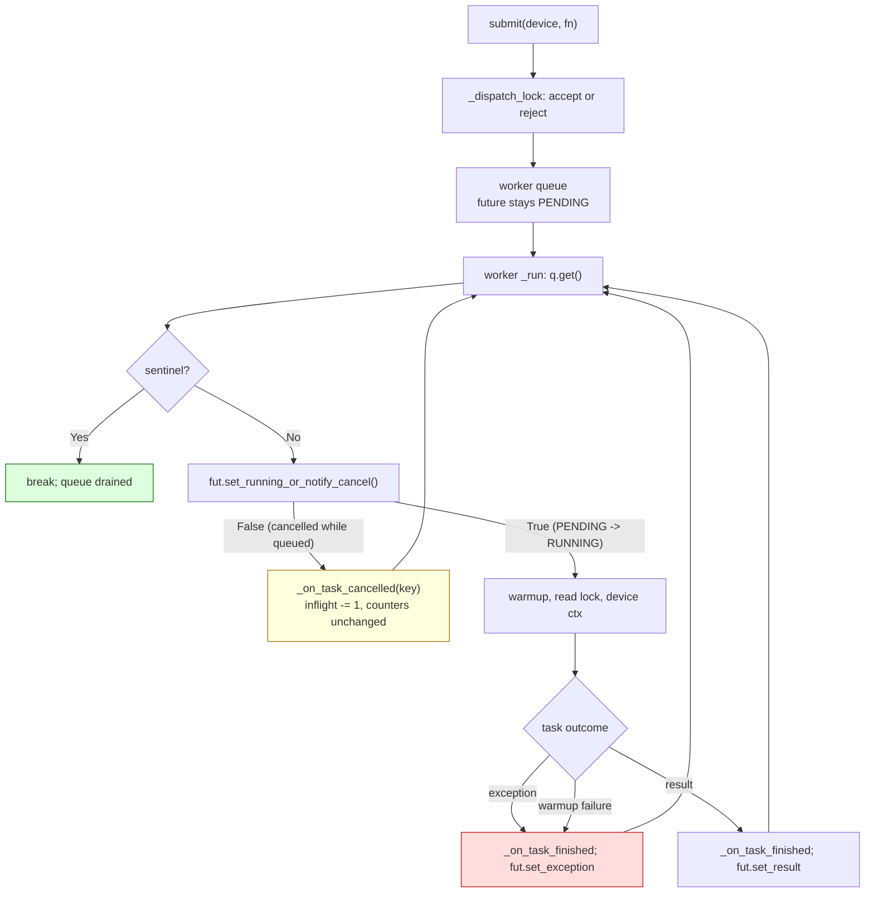

<!-- SPDX-FileCopyrightText: 2026 ModelCloud.ai -->
<!-- SPDX-License-Identifier: Apache-2.0 -->

# Device thread pool task cancellation

`DeviceThreadPool.submit` and `submit_serial` hand back a
`concurrent.futures.Future`, so callers reasonably expect `future.cancel()` to
follow the `concurrent.futures` state contract. The pool owns that contract on
the worker side: the future stays PENDING while the task waits in the worker
queue, the worker takes the PENDING -> RUNNING transition immediately before it
runs the task, and only then is the result or the exception published.

Before this change the worker never took that transition. Every submitted
future stayed PENDING for its whole life, which inverted the contract in two
ways: `cancel()` succeeded for a task that was already running, and the worker
then silently dropped that task's result or exception; and a task cancelled
while still queued ran anyway, spending a device slot on work the caller had
already abandoned.

## New flow

The cancelled branch consumes the queue item in place, so the tasks submitted
before and after it keep their order; nothing is re-queued and no other task is
skipped. Because the task never ran, it releases its in-flight slot through
`_on_task_cancelled` instead of `_on_task_finished`: `wait()` and the shutdown
drain track accepted work and must reach zero, while the completion counters
that drive the janitor's GC thresholds and `stats()` must not move for work that
did not happen.

## Future lifecycle

```mermaid
stateDiagram-v2
    state "PENDING (queued)" as P
    state "RUNNING (on a worker)" as R
    state "FINISHED (result or exception)" as F
    state "CANCELLED (skipped in place)" as C
    [*] --> P: submit
    P --> C: cancel() True; worker skips it
    P --> R: set_running_or_notify_cancel() True
    R --> F: set_result / set_exception
    C --> [*]
    F --> [*]
    style C fill:#ffd,stroke:#a60
    style F fill:#dfd,stroke:#060
```

`cancel()` returns False from the moment the worker takes the transition, so a
caller that races a running task cannot drop its result or exception: the worker
always publishes one of them. `_SyncWorker` takes the same transition before it
executes inline, so both worker kinds expose identical semantics.

## Before and after

Pointers are to the branch base, `origin/main` at `b49ab73a9`.

| Concern | Before | After |
| --- | --- | --- |
| Worker dispatch | dequeued task executed unconditionally (`gptqmodel/utils/threadx.py:640`) | `set_running_or_notify_cancel()` gates execution (`threadx.py:664`) |
| Future state | never left PENDING (`threadx.py:547`) | PENDING -> RUNNING on the worker, then FINISHED (`threadx.py:558`, `:664`) |
| Cancelled queued task | ran anyway; side effects of abandoned work | skipped in place, `fn` never called (`threadx.py:668-674`) |
| In-flight accounting | decremented only by the completion path (`threadx.py:678`) | cancelled tasks release the slot via `_on_task_cancelled` (`threadx.py:1985`) |
| Completion counters | one per accepted task, cancelled or not (`threadx.py:678`) | one per executed task; cancelled work is not counted |
| `cancel()` on a running task | returned True; result/exception dropped (`threadx.py:657`, `:678`, `:684`) | returns False; result/exception always published (`threadx.py:664`) |
| `_SyncWorker` | same dropped-result window (`threadx.py:723`, `:738`, `:742`) | same transition, same guarantees (`threadx.py:752`, `:756`) |

## Failure and ambiguity contract

| Situation | Before | After |
| --- | --- | --- |
| Task cancelled while queued | executed; `cancel()` had no effect on the work | skipped; `future.result()` raises `CancelledError` |
| Task cancelled while running | `cancel()` returned True and the worker dropped the outcome | `cancel()` returns False; result or exception arrives |
| Cancelled task and `pool.wait()` | slot released only because the task ran | slot released by the cancellation path; `wait()` returns |
| Cancelled task and `stats()` / GC thresholds | counted as completed work | not counted; GC triggers only for executed tasks |
| Queue order around a cancelled item | irrelevant, everything ran | preserved; only the cancelled item is skipped |
| `submit_serial` / `_SyncWorker` | inline execution, same dropped-result window | identical transition and guarantees |

There is no silent fallback: a cancelled task never runs and never produces a
value, and an executed task always resolves its future.

## Scope

The change adds no PyTorch API, no device work and no environment-variable
switch; it only adds the missing `concurrent.futures` state transition and a
cancellation-aware accounting path, so `pytorch_gil_0_compat.md` is unchanged.
Regression coverage lives in `tests/test_threadx_cancellation.py` (CPU, no
device required), and the existing suites (`tests/test_threadx.py`,
`tests/test_threadx_cpu.py`, `tests/test_threadx_shutdown.py`,
`tests/test_threadx_cpu_locks.py`, `tests/test_threadx_warmup_accounting.py`,
`tests/test_thread_pool_exit.py`) stay green.
