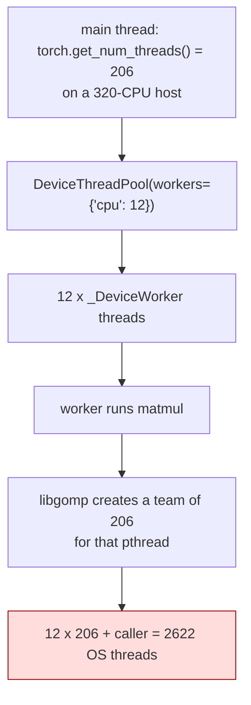
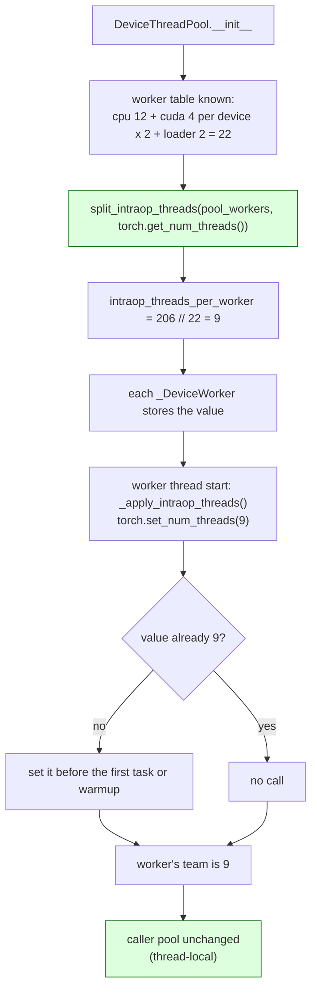

<!-- SPDX-FileCopyrightText: 2026 ModelCloud.ai -->
<!-- SPDX-License-Identifier: Apache-2.0 -->

# Device thread pool intra-op budget

`DeviceThreadPool` runs tasks on one Python thread per worker. Each of those
threads can enter a Torch parallel region (matmul, reduction, dequantize), and
libgomp gives **every pthread that enters a parallel region its own OpenMP
team**, sized from that thread's intra-op count. Before this contract, a worker
inherited the spawning thread's count, so a pool of *N* workers owned *N* full
teams on top of the caller's team.

## The old flow



Measured at `f7890430a` with the default pool and 64 submitted CPU tasks: 134
threads before the pool, **2622** after. Nothing capped the *team size*; only
the worker count was capped (`gptqmodel/__init__.py`, `_default_cpu_workers`).

## The new flow



Reproduced with the same workload on the same host: the isolated 64-task
repro went from 2622 to **308** threads, and a 2-layer GPTQ `quantize()` run
went from 2943 to **833**. The residual growth is the HF tokenizers rayon pool
(320 threads on that host, independent of `torch.set_num_threads`), which is
outside this contract.

## Contract

| Item | Value |
| --- | --- |
| Parameter | `DeviceThreadPool(intraop_threads_per_worker=...)`, set from `KernelConfig.pool_intraop_threads` by `_build_device_thread_pool()` |
| `None` (default) | split `torch.get_num_threads()` across the pool's worker count |
| `n > 0` | every worker uses exactly `n` |
| `n <= 0` | workers keep the pool inherited from the spawning thread |
| Applied at | `_DeviceWorker._apply_intraop_threads()`, before the queue loop, so before any warmup or task |
| Scope | the worker thread and the threads it spawns; never the caller |
| Failure | `set_num_threads` raising is logged once and the worker keeps the inherited value |

`split_intraop_threads(worker_count, total)` always returns at least `1`, so a
pool with more workers than the process budget still gives every worker a valid
team instead of zero threads.

The value is resolved once, when the pool is built. `DeviceThreadPool` does not
re-resolve it after a worker restart, and it does not react to a later
`torch.set_num_threads` by the caller.

## Where it is set

`gptqmodel/__init__.py` builds the process-wide pool through
`_build_device_thread_pool()`, which passes
`KernelConfig.pool_intraop_threads`. Its default `None` means "split across
that pool's workers"; set `0` to keep the inherited pool, or a positive value
to pin one size. `gptqmodel/utils/stream.py` builds the stream-sync pool the
same way. Command-line tools and tests that want an explicit value pass it
directly.

## Verifying

```bash
python -c "
import os, torch
from gptqmodel.utils.threadx import DeviceThreadPool
pool = DeviceThreadPool(devices=[torch.device('cpu')], include_cuda=False,
                        include_xpu=False, include_npu=False, include_mps=False,
                        workers={'cpu': 4}, empty_cache_every_n=0)
seen = []
pool.submit(torch.device('cpu'), lambda: seen.append(torch.get_num_threads())).result()
print(seen)  # [8 // 4] when torch.get_num_threads() == 8
pool.shutdown(wait=True)
"
python -m pytest tests/test_thread_caps.py -q
```

`tests/test_thread_caps.py` pins the split arithmetic, the worker value, the
explicit override, and the `<= 0` pass-through. The GIL=0 ledger row and probe
(`pytorch_gil_0_compat.md`, `scripts/gil0_api_probe.py --only 'torch.set_num_threads (per worker)'`)
pin the thread-local, non-leaking behaviour on a free-threaded build.
