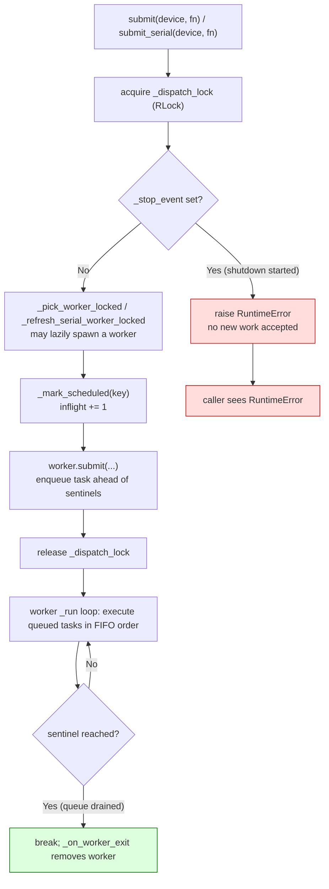
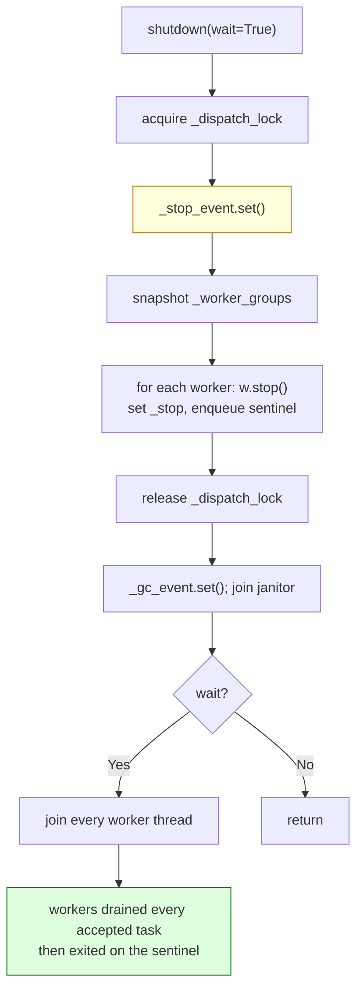
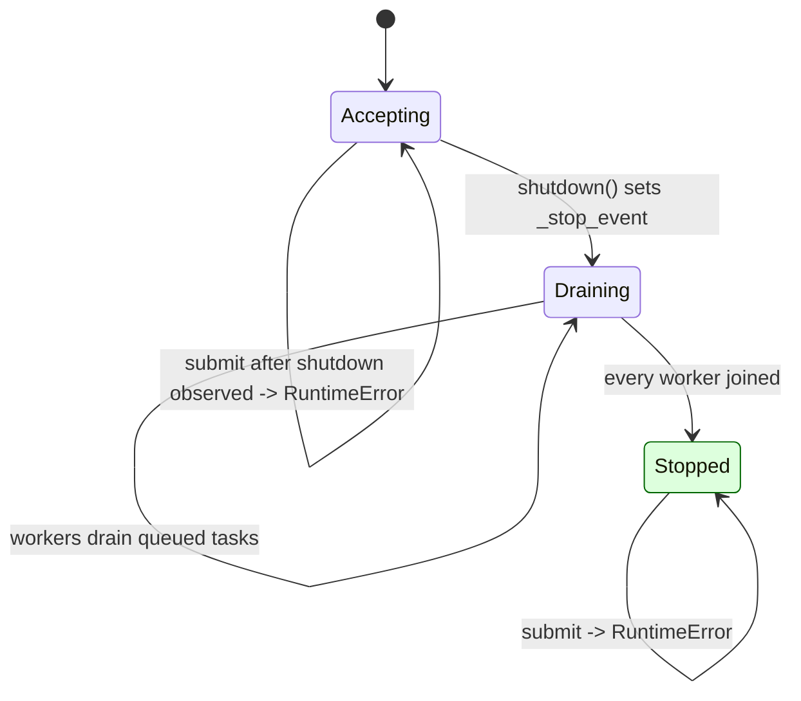

<!-- SPDX-FileCopyrightText: 2026 ModelCloud.ai -->
<!-- SPDX-License-Identifier: Apache-2.0 -->

# Device thread pool shutdown

`DeviceThreadPool` has one shutdown contract: once `shutdown()` starts, every
task the pool already accepted is drained and resolved, and every later
`submit` / `submit_serial` is rejected. The contract is enforced by a single
lock, `_dispatch_lock`, that both sides take.

Before this change the two halves of the contract disagreed. A worker's run
loop exited as soon as its `_stop` flag was set, so a task that had been
accepted while the worker was busy stayed in the queue with a pending future
and a non-zero in-flight count. Submission had the mirror problem: nothing
checked the stop event, so a late caller could enqueue behind the worker's
sentinel (nothing would ever run it) or lazily start a fresh worker after the
pool had shut down.

## New flow

### Submission: accept or reject atomically

### Shutdown: stop accepting, then drain

`stop()` queues its sentinel with `_q.put`, after every task the pool already
accepted, so reaching the sentinel proves the queue is drained. That is why the
run loop exits on the sentinel (`while True:` plus `break` on the non-task item)
instead of on `_stop.is_set()`.

## Before and after

Pointers are to `origin/main` at `d1d3da04`.

| Concern | Before | After |
| --- | --- | --- |
| Worker exit condition | `while not self._stop.is_set():` at `gptqmodel/utils/threadx.py:518`; exits before reading queued tasks once stop is set | `while True:` at the same loop; exits only on the sentinel, which `stop()` queues after accepted work |
| `submit` acceptance | worker picked and task enqueued with no shutdown check (`threadx.py:1146`) | `_require_accepting_locked()` runs under `_dispatch_lock` before selection and enqueue |
| `submit_serial` acceptance | enqueued after the `_dispatch_lock` block was released (`threadx.py:1175`) | check, selection and enqueue all inside the same lock block |
| Lazy worker spawn | `_pick_worker()` (`threadx.py:1465`) took the lock itself and could spawn a worker after shutdown | `_pick_worker_locked()` runs under the caller's lock, after the acceptance check |
| Shutdown ordering | `shutdown()` set `_stop_event` then snapshotted under the lock, but issued `w.stop()` outside it (`threadx.py:1233`, `:1257`) | sets `_stop_event` and issues every `w.stop()` inside `_dispatch_lock` |
| Lock type | `threading.Lock()` (`threadx.py:725`) | `threading.RLock()`: `_SyncWorker.stop()` re-enters `_on_worker_exit`, which takes the dispatch lock |

## Failure and ambiguity contract

| Situation | Before | After |
| --- | --- | --- |
| Task queued when `shutdown()` starts | abandoned; future pending forever, `_inflight` never drops, `wait()` can hang | drained in FIFO order, future resolved, `_inflight` reaches 0 |
| `submit` racing `shutdown()` | could enqueue behind the sentinel and never run | serialized: enqueued ahead of every sentinel (and drained) or rejected |
| `submit` after `shutdown()` | accepted; future never resolves | `RuntimeError("DeviceThreadPool is shutting down; ...")` |
| `submit_serial` after `shutdown()` | spawned a worker and enqueued | same `RuntimeError` |
| Empty worker group after shutdown | lazy selection repopulated it | rejected before selection; no thread is started |
| `_SyncWorker` stop during shutdown | stops were issued outside the lock, so no re-entry happened | `RLock` lets the shutdown thread re-enter `_on_worker_exit` without self-deadlocking |

There is no silent fallback: a rejected submission raises, and a task that was
accepted before shutdown is guaranteed to run. The only ambiguity is ordering
between a `submit` and a `shutdown` that race — the lock decides it, and either
outcome is well defined.

## Scope

The change adds no PyTorch API and no environment-variable switch; it only
reorders existing `threading` primitives, so `pytorch_gil_0_compat.md` is
unchanged. Regression coverage lives in `tests/test_threadx_shutdown.py`;
the existing threadx suites (`tests/test_threadx.py`,
`tests/test_threadx_cpu.py`, `tests/test_threadx_cpu_locks.py`,
`tests/test_threadx_warmup_accounting.py`) stay green.
