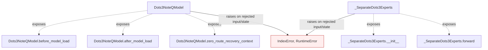

# Expose dots3 note routed experts individually

Register Dots3 Note with separate per-expert checkpoint names, native top-k scatter, auxiliary tensor passthrough, and grouped-router recovery. Preserve the existing model adapter; do not refactor the expert implementation in this extraction.

This page describes the shipped API and conditional calls carried from the working fork. It is a structural call map, with no invented execution ordering between public entry points. Solid edges name calls present in the source; dashed edges expose class entry points. Rejected states and propagated failures are marked separately.

| Before this extraction layer | Carried implementation |
|---|---|
| API absent in the previous stack layer (path/symbol checked) | `gptqmodel/models/definitions/dots3_note.py:44`: `Dots3NoteQModel` |
| API absent in the previous stack layer (path/symbol checked) | `gptqmodel/models/definitions/dots3_note.py:13`: `_SeparateDots3Experts` |

The previous stack layer supplies dependencies. Standalone store/policy APIs are connected by the later processor, looper and model layers rather than being enabled implicitly here.

Validation for this extraction is limited to Python parsing, dependency inspection and whitespace checks. Existing regression/oracle tests are carried with the feature; no new model quantization, accelerator work, hardware benchmark or broad runtime revalidation was performed. The author reports successful prior use in the fork. This draft seeks initial feedback on value and scope before further refactoring or validation.
