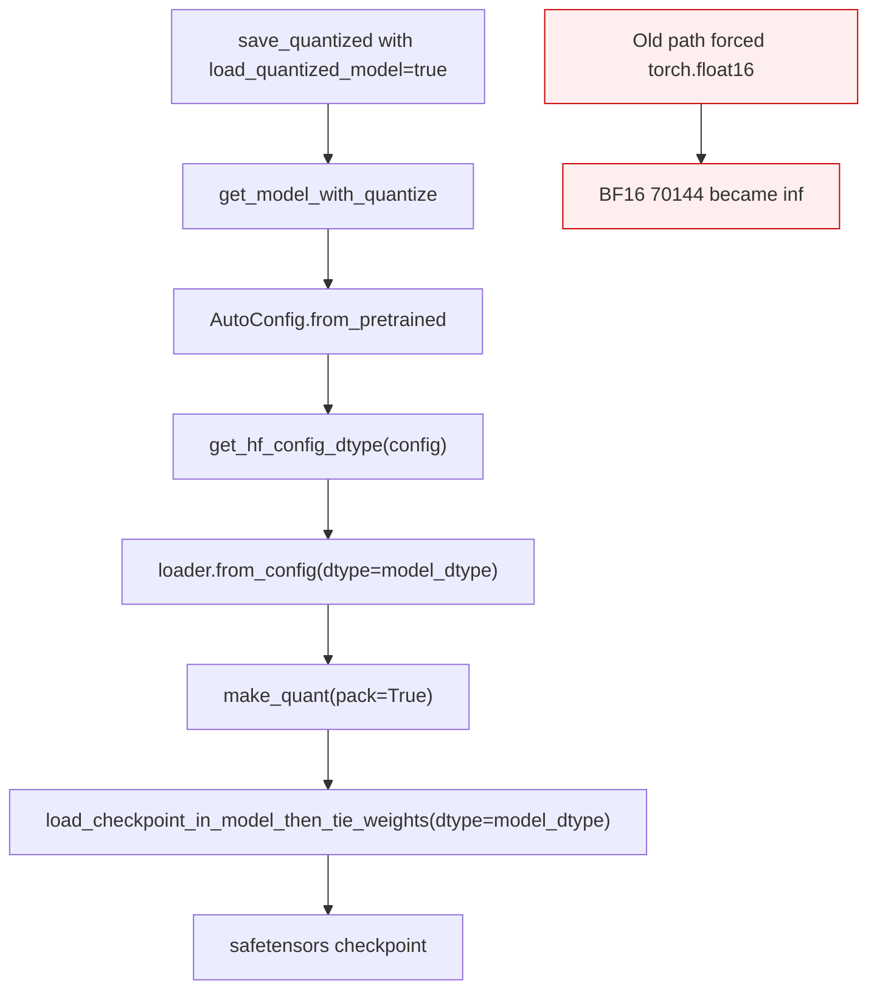
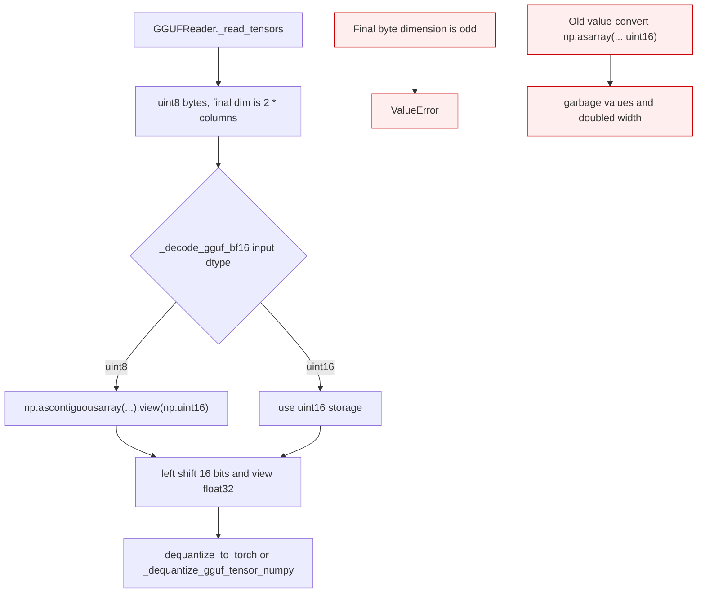
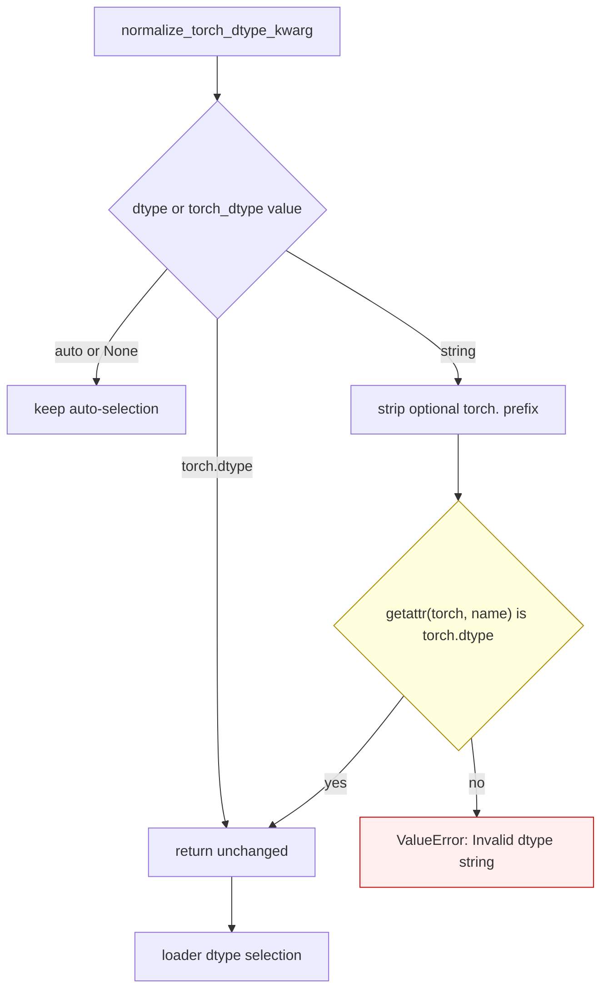
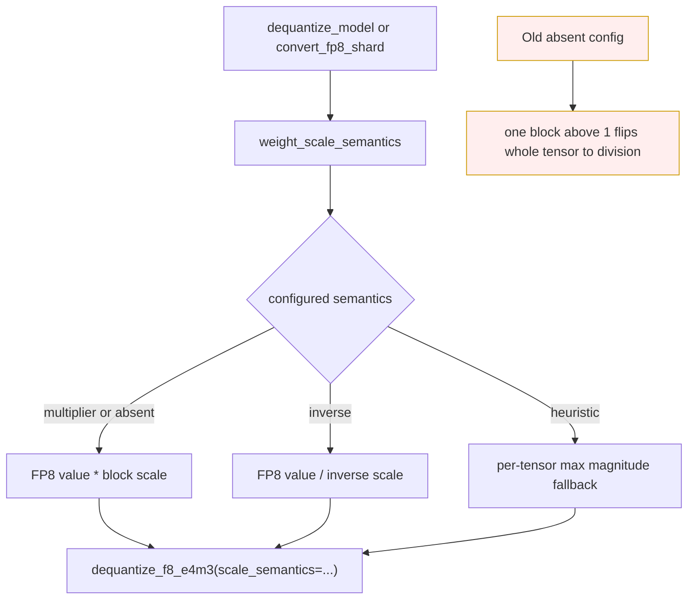

<!-- SPDX-FileCopyrightText: 2026 ModelCloud.ai -->
<!-- SPDX-License-Identifier: Apache-2.0 -->

# Checkpoint dtype boundary preservation

GPT-QModel preserves the dtype and bit pattern of values that cross a
checkpoint or format boundary. The decisions below cover a loaded quantized
model that is saved again, GGUF BF16 storage, GPTQ bias packing, explicit
string dtype requests, and FP8 block-scale semantics.

## Loaded quantized checkpoint resave

`save_quantized` rebuilds a loaded quantized shell through
`get_model_with_quantize`. `get_hf_config_dtype` now supplies one dtype to both
`loader.from_config` and `load_checkpoint_in_model_then_tie_weights`, so
non-quantized embeddings, norms, biases, and output heads retain the checkpoint
dtype.

The checkpoint serializer remains safetensors. The round-trip regression reads
the saved norm tensors back as BF16 and compares their `uint16` bit patterns to
the source model.

## GGUF BF16 bytes

`GGUFReader._read_tensors` exposes BF16 payloads as `uint8` storage with an
even final dimension. `_decode_gguf_bf16` reinterprets those bytes as
contiguous `uint16` pairs before shifting into FP32. Both
`dequantize_to_torch` and `_dequantize_gguf_tensor_numpy` use this decoder.

## GPTQ bias storage

All three GPTQ packers now copy the source bias dtype:

| Packer | Symbol | Result |
| --- | --- | --- |
| CPU block | `GPTQQuantLinear.pack_block` | Preserve source dtype on CPU |
| GPU pack | `GPTQQuantLinear.pack_gpu` | Preserve source dtype after device-to-CPU transfer |
| Original | `GPTQQuantLinear.pack_original` | Register a detached source-dtype buffer |

A finite BF16 bias of `1e5` remains finite BF16 instead of becoming FP16
infinity.

## Dtype argument resolution

Explicit strings now reach the loader as torch dtypes. Unknown strings fail
closed instead of silently becoming `auto`.

## FP8 `weight_scale_inv`

The default is multiplier semantics because DeepSeek/Qwen-style checkpoints
store block `amax / 448` under the historical `weight_scale_inv` name.
`weight_scale_semantics="inverse"` remains the explicit path for native
GPT-QModel inverse scales.

## Before and after

| Old mechanism at `origin/main` (`d18e2ba1`) | Old location | New mechanism | Failure removed |
| --- | --- | --- | --- |
| Loaded shell forced to FP16 | `gptqmodel/models/writer.py:2156-2168` and `:2218-2225` | `get_hf_config_dtype` at `gptqmodel/models/writer.py:2157-2169` and `:2221-2228` | BF16 norm infinity and config rewrite |
| BF16 byte values converted to uint16 | `gptqmodel/nn_modules/qlinear/gguf.py:1037-1039`, `gptqmodel/utils/internal_gguf.py:386-388` | `_decode_gguf_bf16` at `gptqmodel/nn_modules/qlinear/gguf.py:1030-1051` | Garbage BF16 and doubled width |
| Bias forced to FP16 | `gptqmodel/nn_modules/qlinear/__init__.py:1492`, `:1727`, `:1884` | Source dtype at `:1491-1492`, `:1726-1727`, `:1881-1884` | Large bias infinity |
| String dtype returned unchanged | `gptqmodel/utils/hf.py:247-275` | String resolution at `:247-295` | Explicit BF16 silently became auto |
| FP8 scale chosen from tensor-wide max | `gptqmodel/quantization/dtype.py:270-282`, `:350-369` | Explicit semantics at `:270-291`, `:354-383` | One large block flipped the whole tensor |
| FP8 conversion defaulted to heuristic | `gptqmodel/utils/model_dequant.py:1037-1043`, `:1797-1799` | Multiplier default at `:1037-1043`, `:1798-1802` | Multiply/divide corruption |

## Failure and ambiguity contract

| Situation | Before | After |
| --- | --- | --- |
| BF16 checkpoint saved again | FP16; finite values above 65504 become inf | Loaded config dtype retained |
| BF16 GGUF payload | Byte values interpreted as uint16 | Byte pairs reinterpreted as BF16 |
| Odd BF16 byte width | Garbage or shape mismatch | `ValueError` |
| BF16 bias `1e5` | FP16 infinity | Finite BF16 |
| `dtype="bfloat16"` | Auto-selected device dtype | Explicit `torch.bfloat16` |
| Invalid dtype string | Silent auto selection | `ValueError` |
| FP8 scale 1.5 without semantics | Whole tensor divided | Block multiplied |
| Explicit FP8 inverse semantics | Division | Division, unchanged |

## Validation

| Test | Invariant |
| --- | --- |
| `tests/test_save_loaded_quantized_model_dtype.py` | Tiny BF16 GPTQ quantize-save-load-resave preserves exact norm bits |
| `tests/test_internal_gguf.py::test_internal_gguf_bf16_reader_reinterprets_byte_pairs` | Reader and both decoders match a NumPy BF16 byte oracle |
| `tests/test_quant_scale_overflow.py::test_packers_preserve_source_bfloat16_bias_bits` | All three GPTQ packers preserve BF16 bias |
| `tests/test_hf_config_compat.py::test_normalize_torch_dtype_kwarg_resolves_dtype_strings` | String dtypes resolve and invalid strings fail |
| `tests/test_model_dequant_fp8.py::test_fp8_weight_scale_inv_defaults_to_multiplier` | Default multiplication and explicit inverse both match FP64 oracles |
