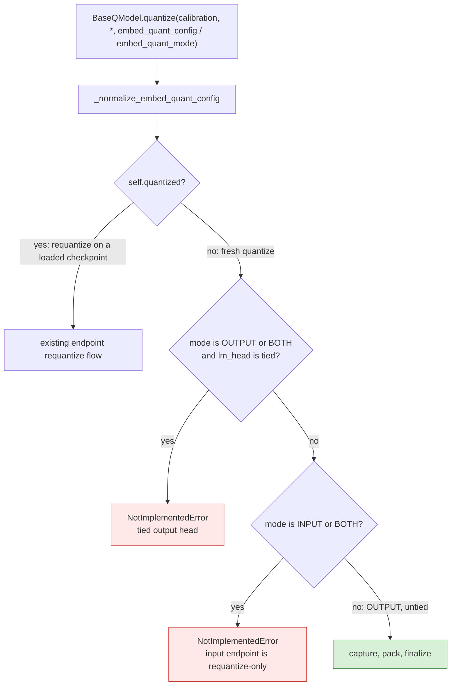
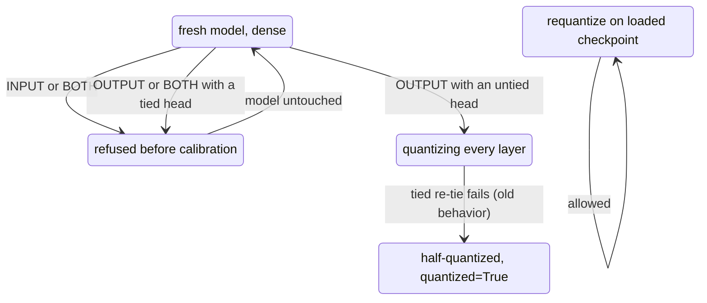

# Embedding-endpoint quantization: fresh quantize vs requantize

`quantize(embed_quant_config=...)` and `quantize(embed_quant_mode=...)` select
the input embedding, the output head, or both. These endpoints are
**requantize** targets: `requantize()` re-packs them from a loaded quantized
checkpoint whose endpoint is already a real module. A fresh `quantize()` starts
from a LazyTurtle shell, so the same flow cannot begin there. This page
describes the fail-closed boundary introduced for #5111.

## New flow



The guards live in `gptqmodel/models/base.py:2384-2420` and run before `fuse`,
backend selection, dataset preparation, rotation, or any looper work. A refused
call leaves `model.quantized` false and replaces no module.

## Why the fresh input endpoint is refused

Before #5111, `StageInputsCapture.cache_inputs` skipped materializing the input
embedding for `INPUT`/`BOTH` (`gptqmodel/looper/stage_inputs_capture.py:410-414`
at `e2f9676c6`). That skip is correct for requantize, where the endpoint is
already real. A fresh quantize is a LazyTurtle shell instead, so the capture
forward executed the embedding on `meta` and transformers'
`create_causal_mask` called `.item()` on a meta tensor:

```
File "gptqmodel/models/base.py", line 3555, in run_input_capture
...
RuntimeError: Tensor.item() cannot be called on meta tensors
```

Materializing the endpoint for capture (the other suggested fix) was measured
and rejected: the packed endpoint stores FP16 scales, so it emits FP16 while the
dense decoder remains BF16. The in-session model then fails its first forward:

```
RuntimeError: mat1 and mat2 must have the same dtype, but got Float and BFloat16
```

An endpoint-only result leaves a dense decoder behind a packed endpoint; making
that consistent needs an endpoint output-dtype contract, not a one-line
materialization. Fresh `INPUT`/`BOTH` is therefore refused before calibration.

## Why fresh output on a tied model is refused

`quantize()` refused only a model that was already quantized
(`gptqmodel/models/base.py:2415` at `e2f9676c6`), and `ModuleLooper` applied the
tied check only to `quantize_config.lm_head`
(`gptqmodel/looper/module_looper.py:2056-2062`), never to `embed_quant_config`.
So `OUTPUT` on a tied model ran every decoder layer, replaced the tied
`lm_head` with `TorchLinear`, and only then failed while restoring base
modules (`gptqmodel/utils/offload.py:255` → `:264`):

```
KeyError: "attribute 'weight' already exists"
RuntimeError: Offload: base modules remain on the meta device after quantization (<tie_weights>).
```

The call raised, but `model.quantized` was already `True` and the head was no
longer tied. The new guard reuses `lm_head_quantization_is_tied()` and refuses
before calibration. A loaded quantized checkpoint remains allowed because its
endpoints are already independent packed modules.

## Before and after

| Flow | Before (`e2f9676c6`) | After |
| --- | --- | --- |
| Fresh `INPUT`/`BOTH` | Capture skipped the input embedding (`stage_inputs_capture.py:410-414`) and forwarded it on `meta`; `RuntimeError: Tensor.item() cannot be called on meta tensors` in `run_input_capture` (`base.py:3555`). | `NotImplementedError` before calibration (`base.py:2408-2420`). |
| Fresh `OUTPUT`/`BOTH`, tied head | No tied check for `embed_quant_config`; every layer quantized, then `retie_tied_weights` failed (`offload.py:255-264`) and left `quantized=True`. | `NotImplementedError` before calibration (`base.py:2390-2404`). |
| Fresh `OUTPUT`, untied head | Worked; the dense decoder consumes the packed head's logits. | Unchanged; still quantizes and forwards. |
| `requantize()` on a loaded quantized checkpoint | Worked (#3050/#5124). | Unchanged; the guard is gated on `not self.quantized`. |

## Failure paths



`Refused` is the only exit for the two unsupported fresh flows; the model keeps
its dense modules and `quantized=False`. `Half` is removed for `OUTPUT` on a
tied model because the run no longer starts.

## Tests

`tests/test_fresh_embed_quant_5111.py` pins the contract with a tiny Llama:

- `test_fresh_input_endpoint_is_refused_before_calibration[input|both]` — the
  calibration capture is never called, no module is quantized, and
  `quantized` stays false.
- `test_fresh_output_on_tied_model_is_refused_before_calibration[output|both]`
  — the tied refusal fires before calibration; `lm_head` and `embed_tokens`
  remain dense and `quantize_config.dynamic` is untouched.
- `test_fresh_output_on_untied_model_still_quantizes_and_forwards` — the
  supported fresh path still packs the head and forwards.
- `test_requantize_both_on_tied_quantized_checkpoint_still_works` — the
  #3050/#5124 requantize path on a tied, already-quantized checkpoint still
  repacks both endpoints and forwards.
