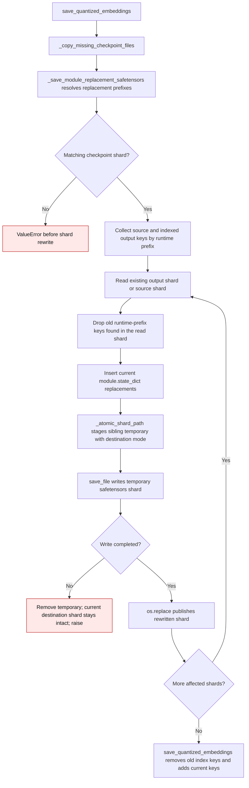

# Embedding checkpoint shard replacement

`save_quantized_embeddings()` copies missing source files, then rewrites only
the safetensors shards that contain replaced modules. Each rewritten shard is
read from the existing output when present, or from the source checkpoint
otherwise. The writer stages the new shard beside its destination so a failed
serialization leaves that destination shard intact. On a repeated save, indexed
prior tensor keys under each replaced module prefix, plus matching keys found
in affected shards, are removed before the current `module.state_dict()` is
written. An index, when present, is updated to match.

| Step | Prior behavior or issue | Current contract |
| --- | --- | --- |
| Rewrite one affected shard | `save_file(tensors, target_path)` opened the destination directly (`gptqmodel/models/writer.py:448` before PR #3623). An I/O failure after opening it could leave a partial shard. | `save_file` writes a sibling temporary under `_atomic_shard_path`; only a successful write reaches `os.replace` (`gptqmodel/models/writer.py:453-454`). |
| Existing destination mode | A direct rewrite retained the file's mode. | `_atomic_shard_path` applies the destination's mode to the temporary before replacement (`gptqmodel/utils/model.py:2790-2830`). A new shard follows the process umask. |
| Failed write | The destination could be truncated, while its index still pointed to it. | The temporary is removed and the destination shard remains readable. The exception stops the save before the index update. |
| Prior module keys on repeated save | Only source checkpoint keys and existing `weight`/`bias` keys were dropped. Old layout keys such as `proj.old_scale` stayed in the shard and index (`gptqmodel/models/writer.py:396-405` before this change). | `_save_module_replacement_safetensors` collects every indexed key under each runtime prefix and also filters such keys while reading a shard (`gptqmodel/models/writer.py:398-405, 442-449`). `save_quantized_embeddings` removes those names from the index before adding current keys (`gptqmodel/models/writer.py:942-945`). |

The guarantee is per shard. If a later shard fails, earlier successfully
rewritten shards stay published; the export as a whole is not transactional.
The normal streaming writer has used atomic shard replacement since
[PR #3584](https://github.com/ModelCloud/GPTQModel/pull/3584).
The module-replacement writer gained the same per-shard protection in
[PR #3623](https://github.com/ModelCloud/GPTQModel/pull/3623).
Repeated saves also remove keys from prior replacement layouts as described in
[PR #3624](https://github.com/ModelCloud/GPTQModel/pull/3624).
