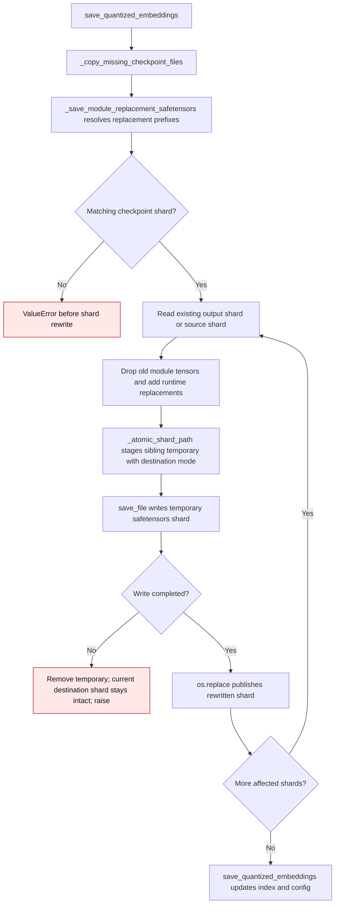

# Embedding checkpoint shard replacement

`save_quantized_embeddings()` copies missing source files, then rewrites only
the safetensors shards that contain replaced modules. Each rewritten shard is
read from the existing output when present, or from the source checkpoint
otherwise. The writer stages the new shard beside its destination so a failed
serialization leaves that destination shard intact.

| Step | Earlier behavior | Current behavior |
| --- | --- | --- |
| Rewrite one affected shard | `save_file(tensors, target_path)` opened the destination directly (`gptqmodel/models/writer.py:448` on the parent revision). An I/O failure after opening it could leave a partial shard. | `save_file` writes a sibling temporary under `_atomic_shard_path`; only a successful write reaches `os.replace` (`gptqmodel/models/writer.py:449-450`). |
| Existing destination mode | A direct rewrite retained the file's mode. | `_atomic_shard_path` applies the destination's mode to the temporary before replacement (`gptqmodel/utils/model.py:2790-2830`). A new shard follows the process umask. |
| Failed write | The destination could be truncated, while its index still pointed to it. | The temporary is removed and the destination shard remains readable. The exception stops the save before the index update. |

The guarantee is per shard. If a later shard fails, earlier successfully
rewritten shards stay published; the export as a whole is not transactional.
The normal streaming writer has used atomic shard replacement since
[PR #3584](https://github.com/ModelCloud/GPTQModel/pull/3584).
