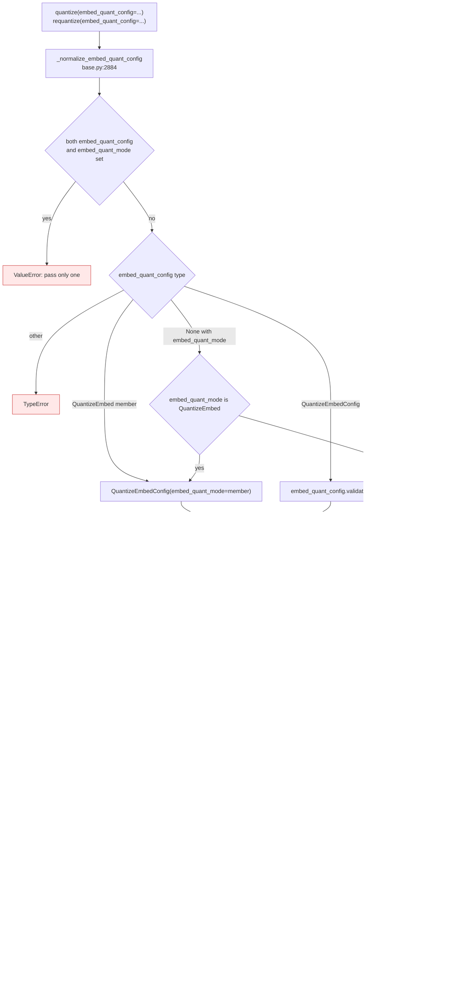
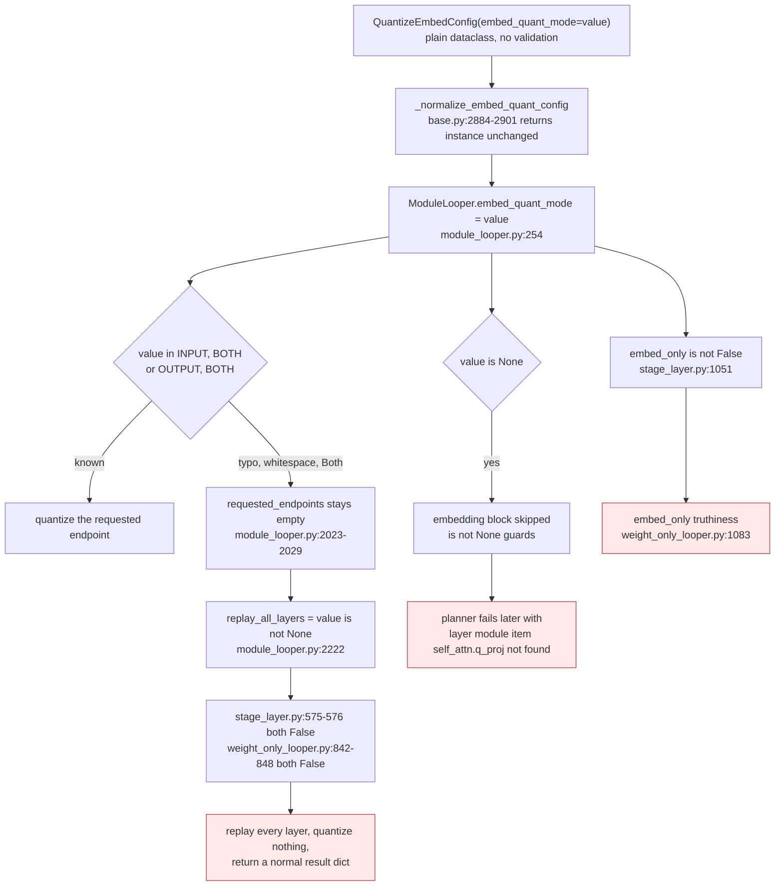
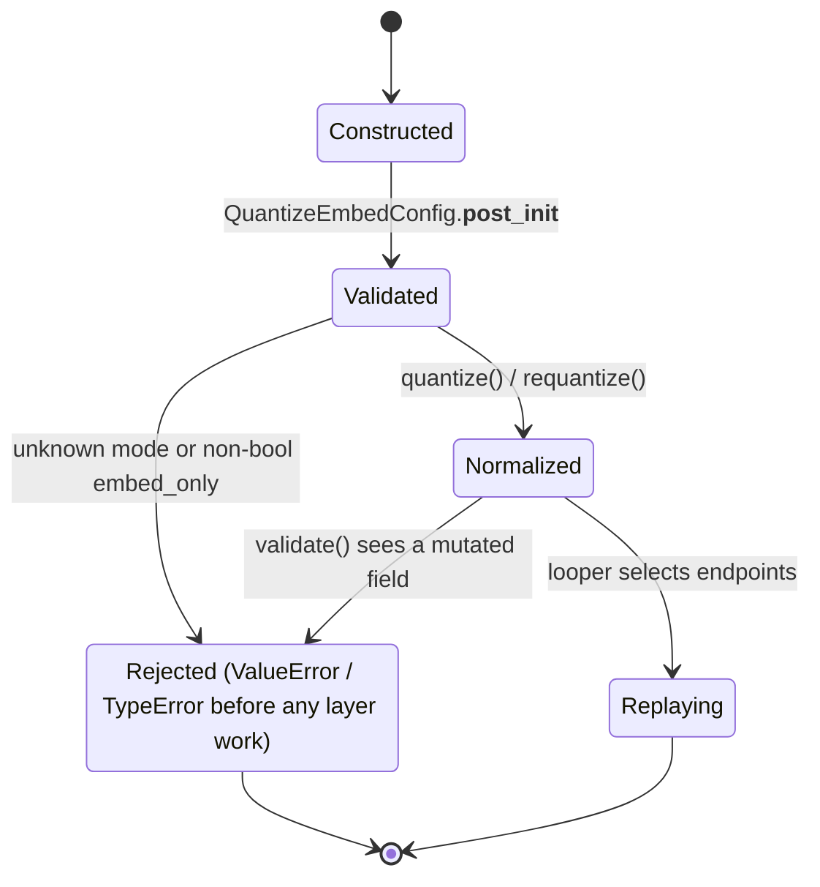

<!-- SPDX-FileCopyrightText: 2026 ModelCloud.ai -->
<!-- SPDX-License-Identifier: Apache-2.0 -->

# Embedding quantization config validation

`quantize(embed_quant_config=...)` and `requantize(embed_quant_config=...)`
choose which model endpoints are requantized: the input embedding
(`embed_tokens`), the output head (`lm_head`), or both. `QuantizeEmbedConfig`
owns that choice, so it is validated where it is created and again where it
enters the model. A mode that matches no consumer branch can no longer start a
full calibration replay and quietly quantize nothing.

Introduced by PR #5136.

## New flow

`__post_init__` (`gptqmodel/quantization/config.py:269`) does two things:

1. `embed_quant_mode = QuantizeEmbed(value)`. Enum members and the lower-case
   values `"input"`, `"output"`, `"both"` are accepted; anything else (a
   misspelling, surrounding whitespace, `None`, a number) raises `ValueError`
   naming the field and the three valid values.
2. `embed_only` goes through `_require_bool_value`, the helper #4668 added for
   every `QuantizeConfig` bool field, so `"False"`, `"True"`, `1` and `None`
   raise `TypeError` instead of being coerced.

`BaseQModel._normalize_embed_quant_config` calls `validate()` on a passed
instance (`gptqmodel/models/base.py:2896-2899`), which reruns `__post_init__`.
Both `quantize()` (`base.py:2387`) and `requantize()` (`base.py:2921`) call the
normalizer before dataset preparation, kernel selection, offload or any layer
replay, so a mutated instance cannot reach the looper either.

## Removed mechanism

Before this change `QuantizeEmbedConfig` was a bare dataclass with no
`__post_init__` (`gptqmodel/quantization/config.py:242-245` at `e2f9676c6`),
and `_normalize_embed_quant_config` returned a passed instance unchanged
(`gptqmodel/models/base.py:2884-2901`). The looper then compared the stored
value against enum members:

| situation | before (`e2f9676c6`) | after |
| --- | --- | --- |
| `QuantizeEmbedConfig(embed_quant_mode="inptu")` | accepted; matches no branch; full replay; returns `{"gptq": ...}` with the embedding still `Embedding` | ``ValueError: QuantizeEmbedConfig: `embed_quant_mode` must be one of 'input', 'output', 'both' (a QuantizeEmbed value), got 'inptu'.`` |
| `QuantizeEmbedConfig(embed_quant_mode="Both ")` | same silent no-op | same `ValueError`, with `'Both '` quoted |
| `QuantizeEmbedConfig(embed_quant_mode=None)` | `is not None` guards skipped the embedding block, then the planner raised `ValueError: layer module item self_attn.q_proj not found in model` | `ValueError` naming `embed_quant_mode` and the valid values |
| `QuantizeEmbedConfig(embed_only="False")` | truthy; `embed_only is not False` and `bool(...) and self.embed_only` behaved as `True` | ``TypeError: QuantizeEmbedConfig: `embed_only` must be a bool, got str ('False').`` |
| config mutated after construction (`config.embed_quant_mode = "inptu"`) | returned unchanged and reached the looper | `validate()` rejects it in `_normalize_embed_quant_config` before replay |

The two entry points also keep their existing argument-level checks:
`embed_quant_config` must be a `QuantizeEmbedConfig` or `QuantizeEmbed`
member, the compatibility `embed_quant_mode=` keyword must be a `QuantizeEmbed`
member (a bare string is rejected there), and passing both raises
`ValueError: Pass only one of ...`.

## Failure and ambiguity paths

* Unknown mode, `None`, or a non-string value: `ValueError` listing
  `'input'`, `'output'`, `'both'`.
* Non-`bool` `embed_only`: `TypeError`, matching the #4668 format
  ``Owner: `field` must be a bool, got ...``.
* Both `embed_quant_config=` and `embed_quant_mode=`: `ValueError` before
  either is inspected.
* `embed_quant_mode=` as a bare string: `TypeError`; use
  `QuantizeEmbedConfig(embed_quant_mode="input")` or
  `embed_quant_mode=QuantizeEmbed.INPUT`.
* Rejection happens before dataset preparation, calibration capture, layer
  offload and any layer replay: the tests replace `quantize()` /
  `_quantize_with_calibration` with a failing spy and assert it is not called.

Tests: `tests/test_embed_quant_api.py` (construction, coercion, mutated
instances through both entry points, and a real cached GPTQ checkpoint on
CUDA).
