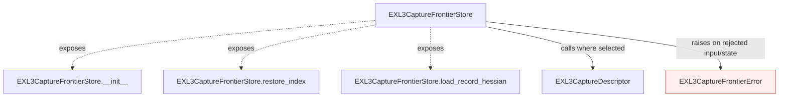
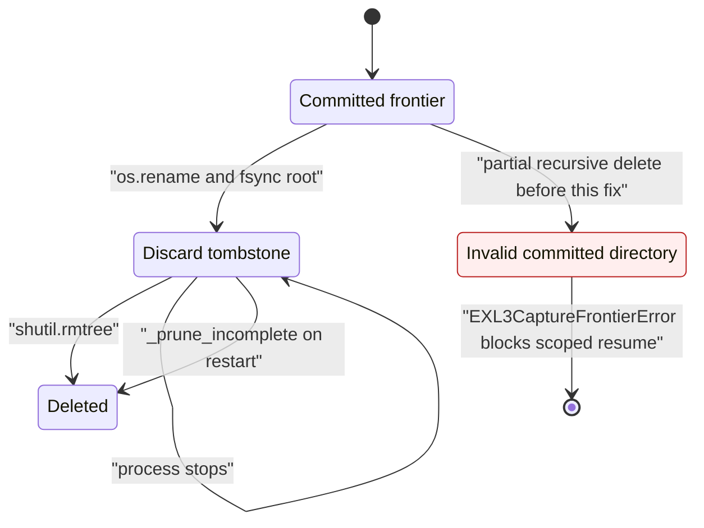

# Persist authenticated capture frontiers

Preserve durable capture descriptors, tensor/route evidence, bounded frontier hydration, and namespace-scoped cleanup as a standalone store for the following looper integration.

This page describes the shipped API and conditional calls carried from the working fork. It is a structural call map, with no invented execution ordering between public entry points. Solid edges name calls present in the source; dashed edges expose class entry points. Rejected states and propagated failures are marked separately.

| Before this extraction layer | Carried implementation |
|---|---|
| API absent in the previous stack layer (path/symbol checked) | `gptqmodel/utils/exl3_capture_frontier.py:56`: `EXL3CaptureDescriptor` |
| API absent in the previous stack layer (path/symbol checked) | `gptqmodel/utils/exl3_capture_frontier.py:142`: `EXL3CaptureFrontierStore` |

The previous stack layer supplies dependencies. Standalone store/policy APIs are connected by the later processor, looper and model layers rather than being enabled implicitly here.

Validation for this extraction is limited to Python parsing, dependency inspection and whitespace checks. Existing regression/oracle tests are carried with the feature; no new model quantization, accelerator work, hardware benchmark or broad runtime revalidation was performed. The author reports successful prior use in the fork. This draft seeks initial feedback on value and scope before further refactoring or validation.

## Restart-safe scoped discard

`EXL3CaptureFrontierStore.discard_through` first renames a selected committed frontier to a `.discard-*.tmp` tombstone and fsyncs the root directory. Only then does it recursively delete the tombstone. `_prune_incomplete` finishes interrupted `.capture-*.tmp` publications and `.discard-*.tmp` removals.

| Situation | Before | After |
|---|---|---|
| Crash during scoped removal | committed-looking directory could lose `manifest.json` | rename is atomic before any payload deletion |
| Restart discovery | only `.capture-*.tmp` was pruned | `.discard-*.tmp` tombstones are also pruned |
| Resume behavior | scoped discard raised on the incomplete committed directory | cleanup completes without touching a committed record |
