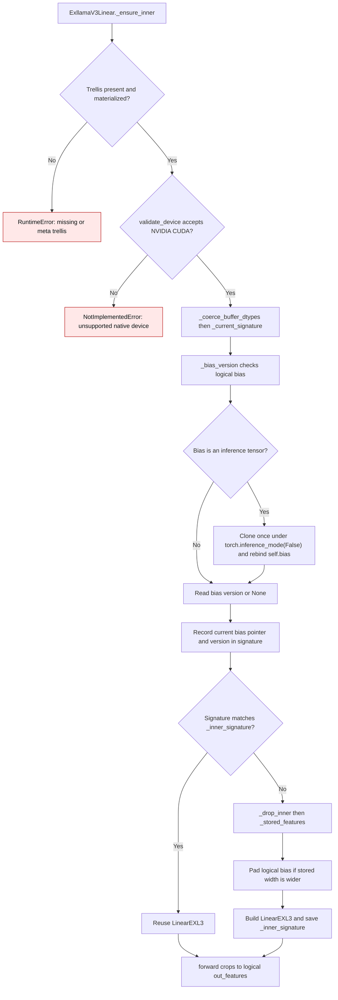

# EXL3 native bias lifecycle

The native EXL3 module holds quantized trellis storage and a logical output
bias. When the stored output width is padded, `LinearEXL3` receives a widened
bias copy. `ExllamaV3Linear._current_signature()` uses the logical bias version
to rebuild that copy after an in-place edit.

A bias created while `torch.inference_mode()` is active has no version counter.
`_bias_version()` clones it once with inference mode disabled and rebinds the
logical buffer before `_current_signature()` records its pointer and version.
Later forwards reuse the native inner module until the bias changes. This
normalization keeps the logical bias shape and the packed trellis unchanged.

| Condition | Before | Current behavior |
| --- | --- | --- |
| Inference-created bias | `_bias_version()` read `bias._version` directly and raised `RuntimeError` (`gptqmodel/nn_modules/exllamav3.py:115` before this change). | The bias is cloned once outside inference mode and rebound (`gptqmodel/nn_modules/exllamav3.py:114-121`). |
| Signature after normalization | A direct `_version` read needed no buffer rebind. | `_current_signature()` normalizes before collecting buffer pointers, so its first signature matches the inner module it builds (`gptqmodel/nn_modules/exllamav3.py:128-137`). |
| In-place bias edit | A normal bias already triggered a native rebuild; an inference-created bias could not reach its first forward. | The versioned logical bias triggers a rebuild after mutation, including for padded outputs. Repeated unchanged forwards reuse the inner module. |

The native inner keeps the packed trellis and scale vectors. Its padded bias is
a small output vector, not a dense reconstructed weight matrix. The original
inference-created bias is no longer retained by the module after rebinding.

Introduced in [PR #3625](https://github.com/ModelCloud/GPTQModel/pull/3625).
