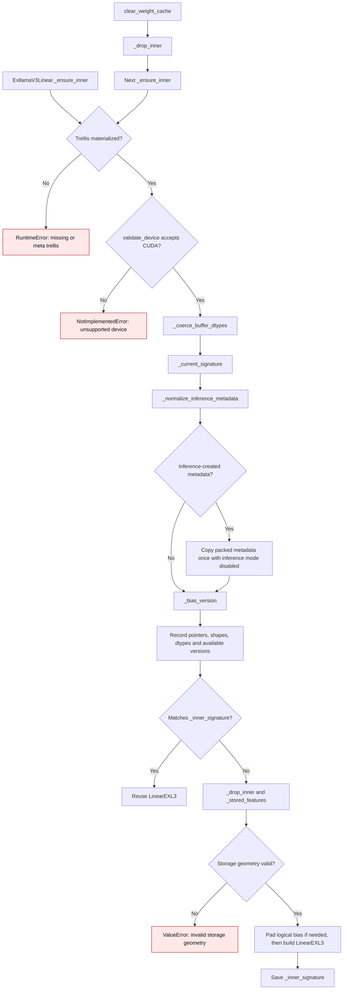

# EXL3 native buffer lifecycle

`ExllamaV3Linear` keeps the quantized trellis and metadata as checkpoint
buffers. `LinearEXL3` reads the trellis through its original tensor, but it
unpacks `su` and `sv` into separate sign vectors when the native handle is
built. A padded output also gives the handle a widened copy of the logical
bias. These derived values must be refreshed after their sources change.

An inference-mode tensor has no version counter. Before constructing a cache
signature, `_normalize_inference_metadata()` rebinds inference-created
`suh`, `svh`, `su`, `sv`, `mcg`, and `mul1` as normal versioned tensors.
`_bias_version()` does the same for bias. This is a one-time normalization of
metadata in the checkpoint representation; it does not retain a decoded or
dense weight. The packed trellis is not copied because both the native and
Torch paths read its storage directly on every forward.

| Condition | Before | Current behavior |
| --- | --- | --- |
| Inference-created `su` or `sv` edited in place | `_current_signature()` recorded `version=None`; the native handle reused old unpacked signs (`gptqmodel/nn_modules/exllamav3.py:137-145` before PR #3732). | `_normalize_inference_metadata()` rebinds versioned packed signs before handle construction (`gptqmodel/nn_modules/exllamav3.py:125-146`). The next edit changes the signature and rebuilds the handle. |
| Other inference-created runtime metadata | The signature also lacked a version counter. | `suh`, `svh`, `mcg`, and `mul1` receive the same one-time normalization. Unchanged forwards keep the handle. |
| Inference-created bias | `_bias_version()` already normalized it before a padded copy was built. | The existing bias path is preserved (`gptqmodel/nn_modules/exllamav3.py:105-123`). |
| Packed trellis content edited in place | The native handle held the original tensor, so it read the edited bytes. | The trellis remains aliased and is not duplicated; pointer, shape, dtype, and device changes still invalidate the signature. |
| External writes that bypass a tensor version counter | No explicit clear method was available. | `clear_weight_cache()` drops the native and Torch handles so the next forward rebuilds them (`gptqmodel/nn_modules/exllamav3.py:180-182`). |

The CPU regression uses inference-created packed signs and a stand-in native
handle to verify reuse, `su`/`sv` mutation, unload, rebuild, trellis aliasing,
and explicit clear. A CUDA-gated test compares native output before and after
a packed-sign edit with an independent Torch reconstruction oracle. It must
run on a host with the native EXL3 extension to establish device accuracy.

Bias normalization was introduced in [PR #3625](https://github.com/ModelCloud/GPTQModel/pull/3625).
Packed metadata normalization is added in [PR #3732](https://github.com/ModelCloud/GPTQModel/pull/3732).
