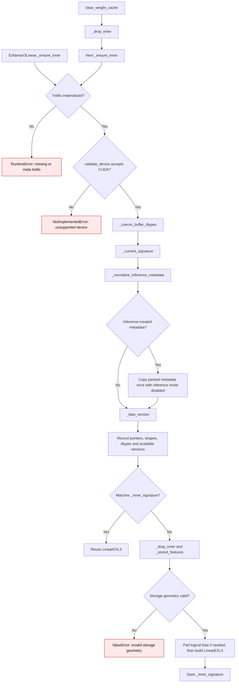
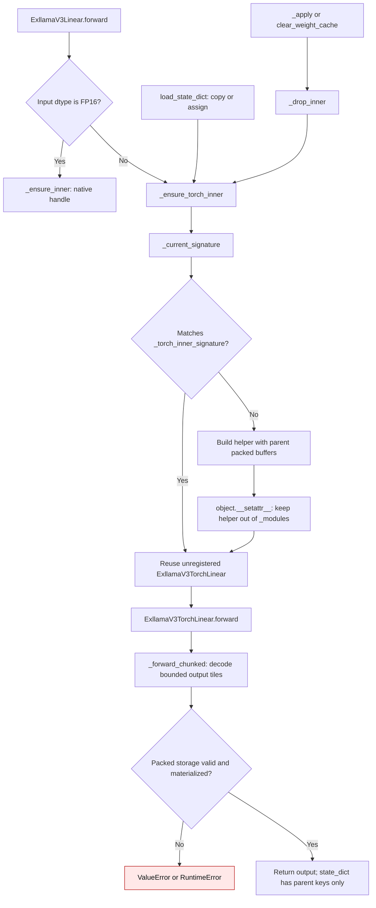

# EXL3 inference buffer lifecycle

`ExllamaV3Linear` owns the checkpoint's packed tensors. Its native handle and
Torch wide-input helper are derived runtime objects; neither owns a second
checkpoint representation.

## Native handle

`ExllamaV3Linear` keeps the quantized trellis and metadata as checkpoint
buffers. `LinearEXL3` reads the trellis through its original tensor, but it
unpacks `su` and `sv` into separate sign vectors when the native handle is
built. A padded output also gives the handle a widened copy of the logical
bias. These derived values must be refreshed after their sources change.

An inference-mode tensor has no version counter. Before constructing a cache
signature, `_normalize_inference_metadata()` rebinds inference-created
`suh`, `svh`, `su`, `sv`, `mcg`, and `mul1` as normal versioned tensors.
`_bias_version()` does the same for bias. This is a one-time normalization of
metadata in the checkpoint representation; it does not retain a decoded or
dense weight. The packed trellis is not copied because both the native and
Torch paths read its storage directly on every forward.

| Condition | Before | Current behavior |
| --- | --- | --- |
| Inference-created `su` or `sv` edited in place | `_current_signature()` recorded `version=None`; the native handle reused old unpacked signs (`gptqmodel/nn_modules/exllamav3.py:137-145` before PR #3732). | `_normalize_inference_metadata()` rebinds versioned packed signs before handle construction (`gptqmodel/nn_modules/exllamav3.py:125-146`). The next edit changes the signature and rebuilds the handle. |
| Other inference-created runtime metadata | The signature also lacked a version counter. | `suh`, `svh`, `mcg`, and `mul1` receive the same one-time normalization. Unchanged forwards keep the handle. |
| Inference-created bias | `_bias_version()` already normalized it before a padded copy was built. | The existing bias path is preserved (`gptqmodel/nn_modules/exllamav3.py:105-123`). |
| Packed trellis content edited in place | The native handle held the original tensor, so it read the edited bytes. | The trellis remains aliased and is not duplicated; pointer, shape, dtype, and device changes still invalidate the signature. |
| External writes that bypass a tensor version counter | No explicit clear method was available. | `clear_weight_cache()` drops the native and Torch handles so the next forward rebuilds them (`gptqmodel/nn_modules/exllamav3.py:180-182`). |

The CPU regression uses inference-created packed signs and a stand-in native
handle to verify reuse, `su`/`sv` mutation, unload, rebuild, trellis aliasing,
and explicit clear. A CUDA-gated test compares native output before and after
a packed-sign edit with an independent Torch reconstruction oracle. It must
run on a host with the native EXL3 extension to establish device accuracy.

Bias normalization was introduced in [PR #3625](https://github.com/ModelCloud/GPTQModel/pull/3625).
Packed metadata normalization is added in [PR #3732](https://github.com/ModelCloud/GPTQModel/pull/3732).

## Torch wide-input helper

BF16 and FP32 activations use `ExllamaV3TorchLinear` for bounded FP32
reconstruction. `_ensure_torch_inner()` gives that helper references to the
parent's packed buffers. It stores the helper outside `nn.Module._modules`, so
`state_dict()` has the same checkpoint keys before and after a wide-input
forward. The helper's temporary decoded output tiles are released after the
forward; no dense weight is retained. `_current_signature()` replaces the
helper when packed metadata changes or buffers are replaced. `_apply()` and
`clear_weight_cache()` discard it before a move or explicit cache reset.

| Mechanism | Before | After |
| --- | --- | --- |
| Wide-input helper ownership | `self._torch_inner = ExllamaV3TorchLinear(...)` registered an `nn.Module` child (`gptqmodel/nn_modules/exllamav3.py:272` before this change). | `object.__setattr__` stores a runtime helper without child registration (`gptqmodel/nn_modules/exllamav3.py:272-285`). |
| Checkpoint keys | The first BF16 or FP32 forward added `_torch_inner.*` packed-buffer keys; a pre-forward checkpoint failed strict reload. | `state_dict()` retains only parent keys; the same checkpoint strictly reloads before and after forward. |
| Buffer move and replacement | The child also appeared in module traversal even though it borrowed parent buffers. | `_apply()` drops the helper before moving parent buffers; a signature change after `load_state_dict(assign=True)` rebuilds it from the new packed tensors. |

The CPU regression exercises BF16 and FP32 at 128 input by 576 logical output
channels, compares against an independent Torch bitstream/FP32 oracle at
`rtol=atol=2e-3`, and checks strict reload, in-place mutation, assignment,
dtype move, and explicit cache clear. The fixture retains 23,168 checkpoint
bytes before and after forward; changing the logical bias to FP32 during a
model-wide cast changes that to 24,320 bytes. The helper retains no additional
packed copy or dense weight.

Checkpoint-stable Torch fallback ownership was added in
[PR #3738](https://github.com/ModelCloud/GPTQModel/pull/3738).
