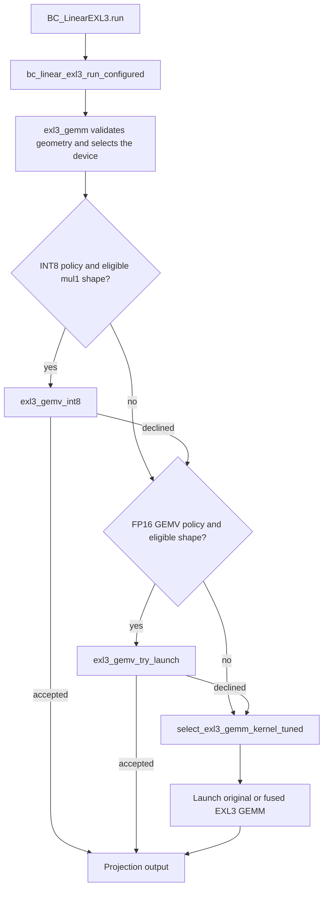

# Native EXL3 CUDA dispatch

GPT-QModel runs EXL3 projections directly from their packed trellis. The CUDA
GEMV and GEMM kernels come from ExLlamaV3 v1.6.7, with the GPT-QModel Torch
operator boundary, packed launch-selection table, and per-call scratch.
The source revision is [8c593e4](https://github.com/turboderp-org/exllamav3/tree/8c593e4e5c88da76a4aaf8f1b1838bb7c1fce4e0).

The codebooks are `3inst`, `mcg` and `mul1`. All three handle integer
rates from 1 to 8 bits per weight. The `mul1` codebook also handles
1.5, 2.5 and 3.5 bits per weight, with 24, 40 and 56 16-bit words per
16×16 tile. The half-bit tiles alternate widths and use the same codebook
values as their integer relatives.

## Runtime policy

```python
from gptqmodel import GPTQModel
from gptqmodel.backend import EXL3CUDAConfig

fast = EXL3CUDAConfig(fp16_gemv=True, fused_gemm=True)
model = GPTQModel.load(checkpoint, backend=fast)
model_with_int8 = GPTQModel.load(checkpoint, backend=EXL3CUDAConfig(int8_gemv=1))
```

`fp16_gemv` enables the upstream small-batch heuristic for supported shapes
with up to eight rows. `fused_gemm` enables the upstream GEMM, which shares
packed weight reads across rows and applies the output transform in shared
memory. Existing integer checkpoints default to the original GEMM for its
summation and rounding order. Half-bit checkpoints default to fused GEMM.
The CUDA FP16 paths accumulate in FP32.

`int8_gemv=0` is the default. Mode `1` uses error-feedback residuals in
eligible single-row `mul1` calls. Mode `2` uses plain INT8 activations in
eligible one- or two-row `mul1` calls. These modes change the arithmetic.
Eligibility depends on device resources, bitrate, and aligned dimensions.
GEMV requests outside those limits use the applicable FP16 path.

## Dispatch

| Operation | Earlier dense path | Current native path |
| --- | --- | --- |
| Layer policy | One integer packed GEMM entry | Per-layer FP16 and INT8 GEMV policy |
| Small batch | GEMM | Configured GEMV when eligible, or GEMM |
| Larger batch | Each 16-row slab rereads the packed weights | Selected 16-, 32-, 48-, or 64-row tile |
| Output transform | Separate device pass inside the cooperative kernel | Transform from the final shared-memory output tile |
| CUDA stream state | Per-launch Hadamard and split-K scratch | Per-launch Hadamard, split-K and INT8 scratch |



The original integer Torch operator and default Python call remain available.
The configured operator accepts a float bitrate and returns the selected path
for diagnostics. NVIDIA CUDA serves the native tensor-core paths. The EXL3
Torch backend provides the CPU and ROCm inference paths. NVIDIA CUDA also
serves the new half-bit Viterbi quantizer.

Only immutable launch geometry and function attributes are cached across
streams. CUDA graph allocations retain the pointer addresses of each graph's
working buffers. Inference retains the packed trellis, scale and bias
buffers. The kernels decode weights into temporary tiles.
