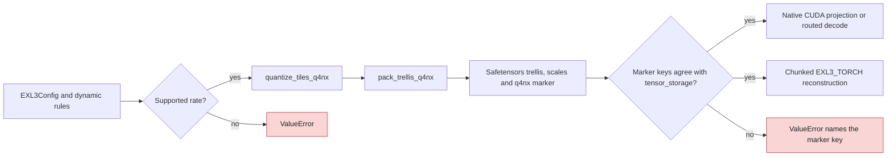
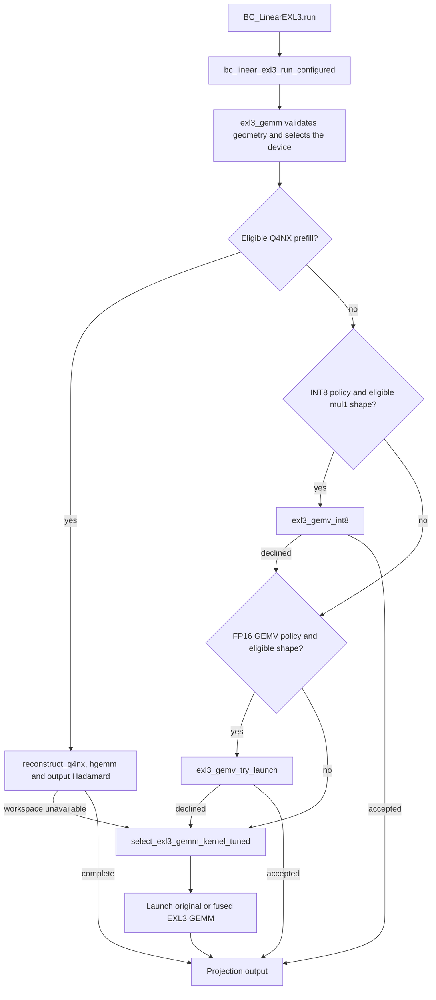
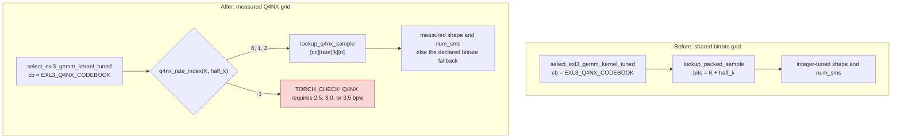

# Native EXL3 CUDA dispatch

GPT-QModel runs EXL3 projections directly from their packed trellis. The CUDA
GEMV and GEMM kernels come from ExLlamaV3 v1.6.7 by TurboDerp and contributors.
GPT-QModel supplies the Torch operator boundary, packed launch-selection
table, and per-call scratch. Its EXL3 port also adapts AlexBrandes's Q4NX
codebook, beam encoder, and CUDA fragment decoder. [ExLlamaV3 v1.6.7 source](https://github.com/turboderp-org/exllamav3/tree/8c593e4e5c88da76a4aaf8f1b1838bb7c1fce4e0) · [EXL3 source credits](../gptqmodel/exllamav3/CREDITS.md)

The `3inst`, `mcg` and `mul1` codebooks handle integer
rates from 1 to 8 bits per weight. The `mul1` codebook also handles
1.5, 2.5 and 3.5 bits per weight, with 24, 40 and 56 16-bit words per
16×16 tile. The half-bit tiles alternate widths and use the same codebook
values as their integer relatives.

## Q4NX

Q4NX was designed for routed MoE experts at 2.5 and 3.0 bits per weight.
Qubitium extended Q4NX to 3.5 bits per weight using the same layout. [Original Q4NX format specification](https://github.com/AlexBrandes/exllamav3/blob/41ef7819945fe421626da3c40c678053d240d051/doc/q4nx.md)

Set `EXL3Config(bits=2.5, codebook="q4nx")` for all selected projections,
or assign both the rate and codebook to a subset through `dynamic`.

```python
from gptqmodel.quantization import EXL3Config

qcfg = EXL3Config(
    bits=4,
    codebook="mcg",
    dynamic={
        r"^model\.layers\.\d+\.mlp\.experts\.\d+\.(gate|up|down)_proj$": {
            "bits": 2.5,
            "codebook": "q4nx",
        },
    },
)
```

| Tile property | `3inst`, `mcg`, `mul1` | `q4nx` |
| --- | --- | --- |
| 16×16 payload at 2.5, 3.0, and 3.5 bpw | 40, 48, and 56 int16 words, respectively. The half-bit rates use `mul1`. | 40, 48, and 56 int16 words, respectively |
| State | 256 scalar steps with overlapping 16-bit states | 64 steps with four weights per state and 22, 20, or 18 state bits |
| Tile boundary | Window wraps to the end of the same tile | Bits before the start are zero |
| Checkpoint selection | `.mcg`, `.mul1` or no marker | A scalar int32 `.q4nx` marker with multiplier `0x83DCD12D` |

Each step adds a 10-, 12-, or 14-bit suffix, most significant bit first. Safetensors
stores each 32-bit word as its low and then high 16-bit halfword. The nibble
sums of the low 32 bits of `state * 0x83DCD12D` give four
integers in `[-15, 15]`. The decoder divides them by `sqrt(42.5)`. NVIDIA
CUDA kernels feed the integer values into FP16 tensor-core operands and
apply the normalization in FP32 after accumulation. W2.5 and W3.0 use a
16-state beam for scale search and a 128-state beam for final encoding.
W3.5 preserves all 16 overlap classes at each step and uses exact Viterbi
search for both operations.



Quantization requires NVIDIA CUDA. Inference uses native CUDA kernels for
FP16 and BF16 on NVIDIA, or `BACKEND.EXL3_TORCH` for portable reconstruction.
Q4NX CUDA dispatch on Ampere selects a packed GEMV for one to eight rows when
the column groups fit in a co-resident wave. Each warp unpacks AlexBrandes's
zero-prefixed windows, including Qubitium's W3.5 extension, from registers.
The kernel accumulates in FP32 and applies normalization with the output
Hadamard transform.

For large Q4NX prefill on Ampere, the native decoder writes the integer
weights into temporary FP16 storage, then HGEMM and the output transform
produce FP32 results. The path handles projections of 4 to 24 Mi weight
elements and begins at 64 rows up to 12 Mi elements, or at 128 rows for
larger projections. Weight scratch peaks at 48 MiB per call and is released
after HGEMM. Shapes outside the tuned range and calls short of workspace use
packed GEMM.

Set `EXL3CUDAConfig(fused_gemm=True, fp16_gemv=False)` to pin Q4NX to packed
GEMM. With `fused_gemm=True` and `fp16_gemv=True`, Q4NX can select GEMV while
prefill uses packed GEMM. INT8 GEMV remains a `mul1` policy.
The FP32 packed GEMM variants also tune the launch grid on Ampere for the
5120 → 2304, 5120 → 4608, and 2304 → 5120 expert projections. The selected
row ranges use 128-column tiles and distribute work across all available SMs.
Q4NX weights also work with the explicit [routed decode operator](exl3-routed-decode.md).
The saved quantization config keeps the default `codebook` and the
`dynamic` recipe. Its `tensor_storage` entry lists each projection's
`.q4nx` tensor and its dtype and shape. The loader selects the decoder
from the per-projection marker, so a checkpoint can mix Q4NX and other EXL3
codebooks. Both loaders verify marker keys against the actual safetensors
contents before constructing a decoder. A dynamic output-head rule can
select a different codebook. The effective head rate is validated against
that codebook.

| Checkpoint state | Loader result |
| --- | --- |
| The storage manifest and safetensors agree on the markers | Construct the selected decoder. |
| Either side is missing a marker present on the other | Raise a `ValueError` identifying the tensor. |

Packed FP16 forward uses FP32 for split-K partials, the output Hadamard
transform, scales and bias, then casts once. The BF16 bridge rescales the raw
projection, adds the canonical bias in FP32, and writes BF16. [Activation dispatch](exl3-wide-activation-dispatch.md)

## Runtime policy

```python
from gptqmodel import GPTQModel
from gptqmodel.backend import EXL3CUDAConfig

fast = EXL3CUDAConfig(fp16_gemv=True, fused_gemm=True)
model = GPTQModel.load(checkpoint, backend=fast)
model_with_int8 = GPTQModel.load(checkpoint, backend=EXL3CUDAConfig(int8_gemv=1))
```

`fp16_gemv` enables the upstream small-batch heuristic for supported shapes
with up to eight rows. `fused_gemm` enables the upstream GEMM, which shares
packed weight reads across rows and applies the output transform in shared
memory. Existing integer checkpoints default to the original GEMM for its
summation and rounding order. Half-bit checkpoints default to fused GEMM.
Both GEMM variants use FP32 tensor-core accumulators. The small-batch QTIP
kernel folds short FP16 accumulation intervals into FP32, as in upstream.
Use the GEMM path for inputs that need FP32 range through the inner
product. On a W3 `mul1` stress fixture with one row, K=512 and N=256,
constant activations of 4,000 and 5,500 made all 256 QTIP outputs
non-finite. Both GEMM paths stayed finite. At a constant activation of
1,000, QTIP was finite with a 0.26938 maximum absolute projection difference
against the original GEMM. These stress values describe the tested fixture.

`int8_gemv=0` is the default. Mode `1` uses error-feedback residuals in
eligible single-row `mul1` calls. Mode `2` uses plain INT8 activations in
eligible one- or two-row `mul1` calls. These modes change the arithmetic.
Eligibility depends on device resources, bitrate, and aligned dimensions.
GEMV requests outside those limits use the applicable FP16 path.

## Dispatch

| Operation | Earlier dense path | Current native path |
| --- | --- | --- |
| Layer policy | One integer packed GEMM entry | Per-layer FP16 and INT8 GEMV policy |
| Small batch | GEMM | Configured GEMV when eligible, or GEMM |
| Larger batch | Each 16-row slab rereads the packed weights | Selected 16-, 32-, 48-, or 64-row tile |
| Output transform | Separate device pass inside the cooperative kernel | Transform from the final shared-memory output tile |
| CUDA stream state | Per-launch Hadamard and split-K scratch | Per-launch Hadamard, split-K and INT8 scratch |
| Q4NX small batch | Packed GEMM | Register decode and FP32 GEMV on eligible Ampere shapes |
| Q4NX large prefill | Packed GEMM for every row tile | One native reconstruction per call and FP32 HGEMM on tuned Ampere shapes |



The original integer Torch operator and default Python call remain available.
The configured operator accepts a float bitrate and returns the selected path
for diagnostics. NVIDIA CUDA serves the native tensor-core paths. The EXL3
Torch backend provides the CPU and ROCm inference paths. NVIDIA CUDA also
serves the new half-bit Viterbi quantizer.

Only immutable launch geometry and function attributes are cached across
streams. CUDA graph allocations retain the pointer addresses of each graph's
working buffers. Inference retains the packed trellis, scale and bias
buffers. The kernels decode weights into temporary tiles or into the
call-private matrix consumed by prefill HGEMM.

For gate, up and down projections in an expert layer, the extension also
provides the [routed decode operator](exl3-routed-decode.md).

### Q4NX launch table on Ada

The packed launch table stores one sample per `(cc, bits, k, n)`. Q4NX rates
are 10, 12 or 14 bits per step, so they do not line up with the integer
`bits = K + half_k` rows. Before this table, every Q4NX launch read the integer
sample for the nearest bitrate: `lookup_packed_sample(table, cc_idx, K + half_k,
k_idx, n_idx)` at `exl3_kernel_map.cu:266` in the parent commit. The retune
adds a `[cc][rate][k][n]` grid (`exl3_packed::samples_*_q4nx`) that only the
Q4NX codebook reads.



| Mechanism | Parent commit | This change |
| --- | --- | --- |
| Q4NX sample | `lookup_packed_sample(..., K + half_k, ...)`, `exl3_kernel_map.cu:266` | `lookup_q4nx_sample(..., q4nx_rate_index(K, half_k), ...)` |
| Unknown Q4NX rate | nearest integer row | `TORCH_CHECK` fails closed |
| Grid | integer samples only | 585 measured Ada Q4NX cells, 0 fallbacks |
| Coverage | implicit | the generator refuses an undeclared missing cell |

`tests/benchmark_exl3_q4nx_tuning_ada.py` measures each shape with five
warmups and the median of 100 launches at m=1 and m=16, picks the shape with
the smallest worst-case slowdown across those rows, and scores the `num_sms`
cap across m=16 and m=2048. `scripts/generate_exl3_kernel_map_packed.py`
requires every Ada `(rate, k, n)` cell to be measured or listed in the JSON
`fallback` array; a declared fallback copies the integer `bits = K + half_k`
sample, which is exactly the launch the parent commit used. The generator also
rejects a JSON measured on another capability or device, and the generated
header records the measured and fallback counts. The checked-in table has
585/585 measured cells and no fallbacks.

`exl3_gemm_force_tuned_config(shape_idx, num_sms)` pins one `(shape, cap)` pair
so a sweep can measure every shape from a single build. Production dispatch
never calls it, and a non-positive shape restores the tuned lookup.

Reproduce with:

```bash
CUDA_DEVICE_ORDER=PCI_BUS_ID CUDA_VISIBLE_DEVICES=4 \
    python tests/benchmark_exl3_q4nx_tuning_ada.py sweep --max-weight-gb 6 \
    --emit-json /tmp/q4nx_ada.json --raw-json /tmp/q4nx_ada_raw.json
cp /tmp/q4nx_ada.json scripts/exl3_kernel_map_q4nx_ada.json
python scripts/generate_exl3_kernel_map_packed.py
```

## A100 validation

The W3 `mcg` Llama 3.2 1B checkpoint produced 20 bit-identical logit
tensors on the integer default path, against GPT-QModel `a54f05d4` with
the same Transformers 5.23.0 and PyTorch 2.15.0 runtime. The opt-in FP16
path had a maximum absolute final-logit difference of 0.07421875 in that
probe. It selected a different next token at one exact baseline top-logit
tie and changed two interior prefill argmax positions at margins of 0.015625.
Those observations motivated retaining the original integer default.

The projection benchmark used identical packed payloads, scales and FP16
inputs on one A100, and rotated more than three times the 48 MiB L2 over
41 warmed CUDA graph replays. Times are medians in microseconds per W3
`mul1` projection. The INT8 columns include call-private workspace setup.

| Projection | Rows | Original | Opt-in FP16 | Residual INT8 | Plain INT8 |
| --- | ---: | ---: | ---: | ---: | ---: |
| Gate + up (5120 → 4608) | 1 | 73.67 | 31.35 | 28.50 | 26.40 |
| Gate + up (5120 → 4608) | 2 | 73.96 | 31.52 | 31.80 | 34.70 |
| Gate + up (5120 → 4608) | 6 | 64.51 | 32.14 | 32.37 | 32.37 |
| Gate + up (5120 → 4608) | 24 | 123.96 | 80.84 | 80.95 | 80.84 |
| Gate (5120 → 2304) | 1 | 44.06 | 23.44 | 25.20 | 22.39 |
| Down (2304 → 5120) | 1 | 40.73 | 18.20 | 21.33 | 19.20 |

These are projection timings on synthetic packed inputs. On the W2.5/W3/W4
shape grid, versus upstream FP16 on the same fixtures, the worst relative
RMS was 0.0612% for FP16, 0.0650% for residual INT8 and 0.7537% for plain
INT8. The corresponding maximum absolute projection differences were
0.0078125, 0.0078125 and 0.046875. INT8 dispatched only on eligible
row counts, so some columns include the FP16 path.

The packaged extension also passed 148 focused A100 tests, including changed
inputs on graph replay, live graphs on independent streams, round trips for
half-bit tiles, and grouped decode. ROCm, Turing, and newer NVIDIA
architectures remain unmeasured for this port.

## Llama 3.2 1B Instruct at 3.5 bits

The full-model test quantizes all 112 attention and MLP projections with
`mul1` using 256 C4 training windows of 512 tokens. It saves the model as
safetensors, verifies the 56-word trellises, and reloads the native CUDA
backend. It compares both models on all WikiText-2 test tokens and the same
256 seeded GSM8K questions. A second reload with the Torch backend checks
prefill loss and cached decode logits using the same packed weights.

| Metric | BF16 | EXL3 W3.5 |
| --- | ---: | ---: |
| WikiText-2 test perplexity | 11.6343 | 12.2846 |
| GSM8K correct | 125/256 | 116/256 |
| Safetensors payload | 2.472 GB | 0.953 GB |

The A100 results and sampling details are in the
[PR discussion](https://github.com/ModelCloud/GPTQModel/pull/5619#issuecomment-7029571986).

Run the test with a local Llama 3.2 1B Instruct BF16 checkpoint, an Ampere
or newer NVIDIA GPU, and a directory containing these evaluation assets.

- `c4-train-*.arrow` from Hugging Face Datasets
  `load_dataset("allenai/c4", data_files="en/c4-train.00001-of-01024.json.gz", split="train", revision="1588ec454efa1a09f29cd18ddd04fe05fc8653a2")`.
  This shard contains 356,318 documents.
- `wikitext-test.arrow` from `load_dataset("Salesforce/wikitext", "wikitext-2-raw-v1", split="test", revision="b08601e04326c79dfdd32d625aee71d232d685c3")`.
- `gsm8k-test.jsonl` from the [official GSM8K test split](https://raw.githubusercontent.com/openai/grade-school-math/3101c7d5072418e28b9008a6636bde82a006892c/grade_school_math/data/test.jsonl).

Use the Arrow files listed in each dataset's `cache_files` in their shard order.

```bash
GPTQMODEL_EXL3_E2E_MODEL_DIR=/path/to/Llama-3.2-1B-Instruct \
GPTQMODEL_EXL3_E2E_DATA_DIR=/path/to/eval-data \
python -m pytest -m exl3_cuda_e2e tests/models/test_llama3_2_exl3_cuda.py
```

The test permits up to a 10% perplexity increase and a ten percentage-point
GSM8K drop relative to the BF16 baseline measured in the same run. The regular
CUDA suite covers W3.5 save and reload on a tiny Llama without external assets.
