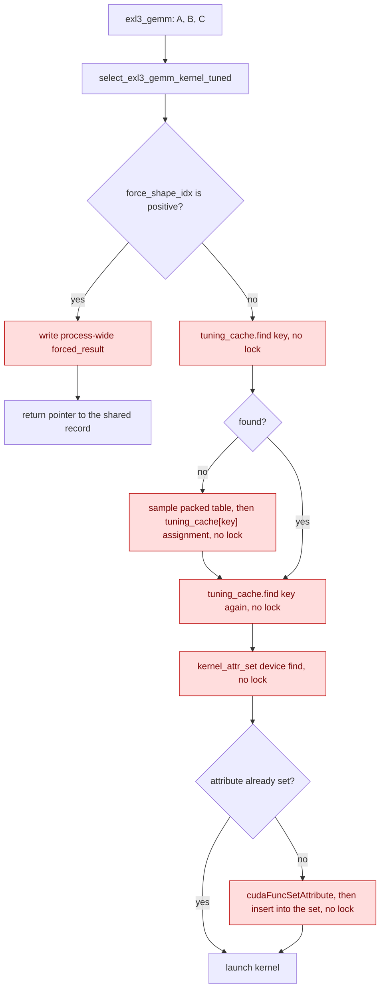
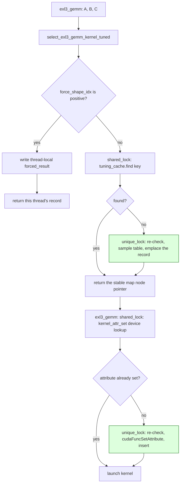

# EXL3 native dispatch caches under a free-threaded interpreter

`exl3_gemm` is the native EXL3 tensor-core matmul reached from
`LinearEXL3.forward` through `ext.BC_LinearEXL3.run`. Two process-wide host
containers on that path are filled on first use:

- `tuning_cache`, a `std::map` in `select_exl3_gemm_kernel_tuned`
  (`gptqmodel_ext/exllamav3/quant/exl3_kernel_map.cu`), keyed by
  `(size_k, size_n, cc, K, cb, c_fp32)` and holding the selected kernel pointer,
  shape index, SMS count and block dimension.
- `kernel_attr_set[device]`, a `std::set` in `exl3_gemm`
  (`gptqmodel_ext/exllamav3/quant/exl3_gemm.cu`), recording which kernel
  variants already had `cudaFuncAttributeMaxDynamicSharedMemorySize` raised.

Both were read and written with no synchronization. Under `PYTHON_GIL=0` two
Python threads can enter the same native operator at the same time, so a
concurrent read and write of either container is a C++ data race. The per-device
`OptionalCUDAGuard` protects context selection; it does not serialize these host
containers.

## Old flow

## New flow

The steady state of both caches is a shared lock, so concurrent GEMM dispatches
for keys that are already cached still run in parallel. The exclusive lock is
entered only on a miss, and only to publish a new entry. `std::map` and
`std::set` nodes are stable and nothing erases from either container, so a
pointer returned from under the lock stays valid after it is released.

## Before and after

| Mechanism | Before | After |
| --- | --- | --- |
| Tuned-kernel cache | `exl3_kernel_map.cu:29` `std::map` read and written unlocked at `:173` and `:193` | `exl3_kernel_map.cu:38` with `std::shared_mutex` at `:39`; shared lookup at `:192`, exclusive publish at `:203` |
| Duplicate lookup | `exl3_kernel_map.cu:201` re-found the key after insertion | the `emplace` iterator is returned directly (`:224`) |
| Forced-shape record | `exl3_kernel_map.cu:30` one process-wide `TResult forced_result` | `exl3_kernel_map.cu:45` `thread_local TResult forced_result` |
| Kernel attribute set | `exl3_gemm.cu:29` `std::set` read and written unlocked at `:119` | `exl3_gemm.cu:37` with `std::shared_mutex` at `:38`; shared probe at `:130`, exclusive setup at `:138` |
| Setup failure | the record was inserted before `cuda_check` ran | the entry is published only after the check passes, so a failed setup is retried |

## Failure and ambiguity contract

| Situation | Before | After |
| --- | --- | --- |
| Two threads dispatch different shapes for the first time | concurrent `find` and insert on one `std::map` | one writer under `unique_lock`; readers under `shared_lock` |
| Two threads dispatch the same shape for the first time | both may insert; the second lookup decides | second thread blocks, then re-checks and reuses the published entry |
| Two threads force a shape at once | one caller's `forced_result` overwrites the other's | each caller has its own `thread_local` record |
| First launch of a kernel variant on two devices | concurrent insert into two sets without a lock | shared probe, then one exclusive publish per (device, kernel) |
| `cudaFuncSetAttribute` fails | the variant was marked done before the error was raised | the error propagates and the variant stays unmarked |

## Tests

| Test | Invariant |
| --- | --- |
| `tests/test_exl3_dispatch_concurrency.py::test_concurrent_first_use_of_the_exl3_dispatch_caches` | Eight threads on a barrier, fresh process, `PYTHON_GIL=0`, four distinct `(in_features, out_features)` pairs: no crash, no exception, finite output, and every result matches the reconstruct + hgemm path that never touches either cache |

## Validation

| Command | Result |
| --- | --- |
| `pytest tests/test_exl3_dispatch_concurrency.py -q` | 2 passed |
| ad-hoc probe: `PYTHON_GIL=0`, 16 threads on a barrier, 16 shapes, 6 fresh processes | 6/6 OK |
| `pytest` over the 14 importable `tests/test_exl3_*.py` plus `tests/test_exllamav3.py`, `tests/test_exllamav3_cpu.py`, `tests/test_exllamav3_jit.py` | 197 passed, 4 skipped |

Six other `tests/test_exl3_*.py` files cannot be collected on this host because the CUDA venv lacks `xxhash`; that gap predates this change.

### Known limitation

The pre-fix race is undefined behaviour and does not reproduce deterministically
on the review host: the concurrency test passes against the unfixed sources as
well. The fix is justified by the C++ memory model rather than by a captured
corruption. The native tensor-core GEMM is NVIDIA-only; on ROCm the kernel
tables are null and `exl3_gemm` fails closed with an actionable message, so the
test skips there.
