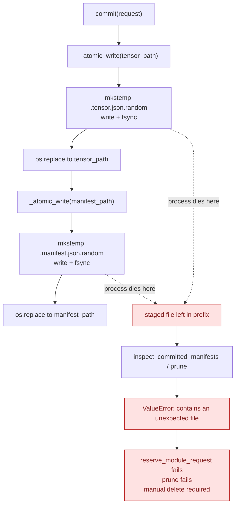
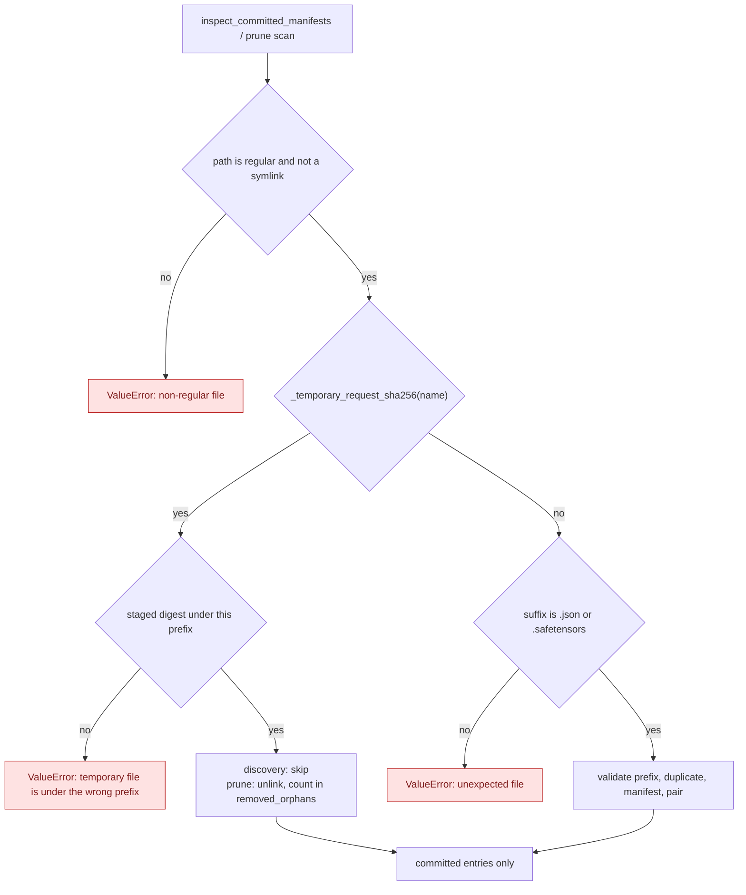

<!-- SPDX-FileCopyrightText: 2026 ModelCloud.ai
SPDX-License-Identifier: Apache-2.0 -->

# EXL3 projection publication recovery

`EXL3ProjectionCheckpointStore` publishes one packed projection as a pair of
files: `<request>.safetensors` (payload) and `<request>.json` (manifest, the
commit marker). Both are staged with `_atomic_write`, which creates
`.<final-name>.<mkstemp random>` in the final shard prefix and publishes it with
`os.replace`. A process killed between `mkstemp` and the replace leaves that
staged file behind.

This page documents how a later run treats those leftovers. Introduced for
issue #4473.

## The staged namespace

`_atomic_write` owns exactly this shape, in the prefix directory of the request
it publishes:

```text
<root>/<sha[:2]>/<sha[2:4]>/.<sha>.json.<random>
<root>/<sha[:2]>/<sha[2:4]>/.<sha>.safetensors.<random>
```

`_temporary_request_sha256` recognises only that shape (64 lowercase hex digits,
one of the two suffixes, an `[A-Za-z0-9_]+` mkstemp suffix). A hidden file that
does not match is still corruption and is rejected. The staged file is never a
committed result: it was never `os.replace`d, and the manifest — the commit
marker — may not exist yet.

## Old flow

Discovery and prune walked every file and rejected anything whose suffix was not
`.json`/`.safetensors`, so a staged file looked like an unexpected file and the
whole store became unusable until someone deleted it by hand.



## New flow

Discovery ignores the staged file, prune reclaims it, and every other check is
unchanged. The committed control (`<sha>.json` + `<sha>.safetensors`) stays
readable, and the interrupted module can be reserved and recomputed.



`commit` is unchanged: a retry re-stages both files with fresh random names and
replaces them, so the leftover never blocks publication and is reclaimed by the
next `prune`.

## Failure and ambiguity contract

| Situation | Before | After |
| --- | --- | --- |
| Staged `.safetensors` temp, manifest never written | `ValueError: unexpected file` on discovery/prune | Ignored by discovery; pruned and counted in `removed_orphans` |
| Staged `.json` temp, tensor already published | Same `ValueError`; tensor also treated as an orphan | Temp reclaimed, orphan tensor reclaimed |
| Committed control entry | Loadable | Loadable |
| Hidden file not matching the staged shape | `ValueError` | `ValueError` (unchanged) |
| Staged-shaped file under the wrong prefix | n/a (rejected as unexpected) | `ValueError: temporary file is under the wrong prefix` |
| Retry after interruption | Blocked until manual delete | `reserve_module_request` and `commit` succeed |

## Scope

`prune` reclaims a staged file unconditionally, the same way it already
reclaims an uncommitted tensor orphan. That is safe for the serialized remote
worker that owns the store; it is not a cross-process lock, and this change does
not add one. Manifest/tensor ordering, the commit marker, and the safetensors
container are unchanged.
