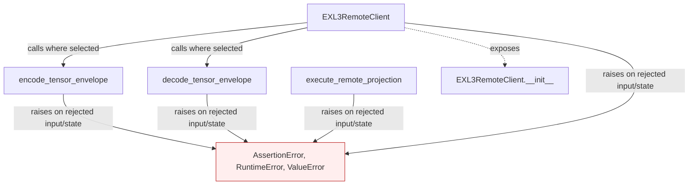
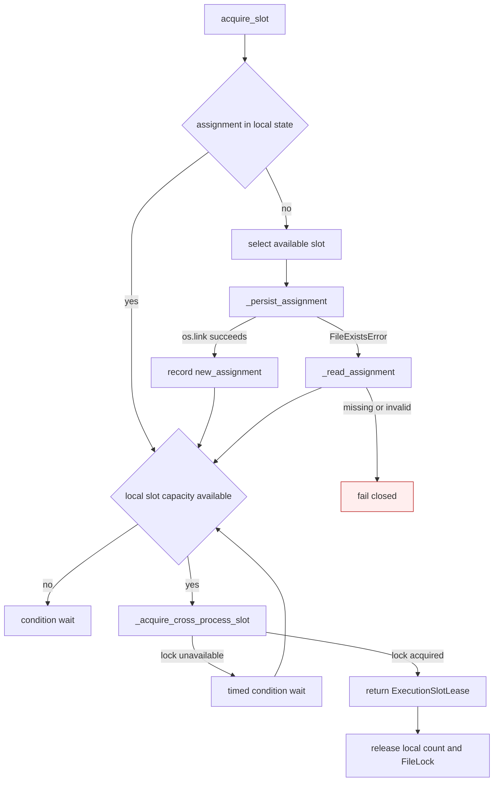

# Dispatch authenticated projections to pipelined workers

Carry authenticated tensor transport, dynamic coordinator/remote slot scheduling, projection checkpoint reuse, bounded scratch retention, per-device serialization, and remote Hessian failure diagnostics. This preserves the existing explicit NVIDIA execution contract; it does not newly qualify ROCm.

This page describes the shipped API and conditional calls carried from the working fork. It is a structural call map, with no invented execution ordering between public entry points. Solid edges name calls present in the source; dashed edges expose class entry points. Rejected states and propagated failures are marked separately.

| Before this extraction layer | Carried implementation |
|---|---|
| API absent in the previous stack layer (path/symbol checked) | `gptqmodel/utils/exl3_remote.py:243`: `encode_tensor_envelope` |
| API absent in the previous stack layer (path/symbol checked) | `gptqmodel/utils/exl3_remote.py:266`: `decode_tensor_envelope` |
| API absent in the previous stack layer (path/symbol checked) | `gptqmodel/utils/exl3_remote.py:473`: `execute_remote_projection` |
| API absent in the previous stack layer (path/symbol checked) | `gptqmodel/utils/exl3_remote.py:627`: `EXL3RemoteClient` |

The previous stack layer supplies dependencies. Standalone store/policy APIs are connected by the later processor, looper and model layers rather than being enabled implicitly here.

Validation for this extraction is limited to Python parsing, dependency inspection and whitespace checks. Existing regression/oracle tests are carried with the feature; no new model quantization, accelerator work, hardware benchmark or broad runtime revalidation was performed. The author reports successful prior use in the fork. This draft seeks initial feedback on value and scope before further refactoring or validation.

## Atomic assignment and cross-process slot ownership

`EXL3RemoteClient.acquire_slot` publishes assignments with an exclusive hard link and holds a file lock for the duration of each physical-slot lease. A losing coordinator reads the authoritative assignment instead of overwriting it. Local busy counts remain the fast in-process gate; the file lock extends that gate across coordinator processes that share `assignment_store_path`.

| Mechanism | Before | After |
|---|---|---|
| Assignment publication | `os.replace()` could overwrite a record published concurrently | `os.link()` publishes only when the destination is absent |
| Concurrent loser | selected from process-local state and reported `new_assignment=True` | reads and validates the authoritative record, reporting `new_assignment=False` |
| Physical-slot ownership | process-local busy counter only | process-local counter plus a `FileLock` per slot position |
| Waiting for a remote holder | no notification source | 50 ms condition polling while cross-process locks are enabled |
