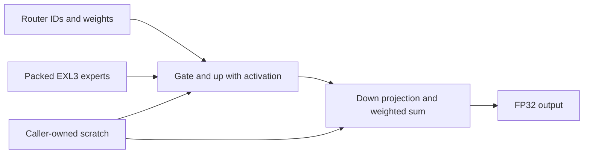

# EXL3 routed decode

`gptqmodel.exllamav3.ext.exllamav3_ext.exl3_moe_coop` runs the gate and up
projections, activation, down projection and weighted sum of already-routed
experts on NVIDIA SM80 or newer. It accepts the three EXL3 codebooks and the
native half-bit rates for `mul1`. The model's router supplies the expert IDs
and coefficients. Integrations call the operator explicitly.

Callers provide these tensors on the input device.

- A contiguous FP16 activation matrix, a contiguous INT64 selected-expert
  matrix and a contiguous FP16 routing-weight matrix.
- INT64 pointer tables for packed trellis, SU, SV and optional bias. Each
  table is a one-dimensional device array with an entry per local expert.
  Gate and up share a bitrate. Down may use another bitrate with the same
  codebook. Keep the packed tensors and tables alive through execution and
  graph replay. Synchronize the publishing stream before consuming them.
- Caller-owned scratch for `S` slots, where `rows * topk <= S <= 256`.
  If the padded gate input, intermediate and down output widths are `H`,
  `I` and `O`, allocate FP16 `had_gate[S,H]`, `had_up[S,H]` and
  `activated[S,I]`. Use two `[S,I]` matrices of the same FP16 or FP32 dtype
  for gate and up, and FP32 `down_out[S,O]`. All three padded widths are
  positive multiples of 128.
- Zero-initialized INT32 counters with at least
  `S * (I // 128) + out.shape[0] * (O // 128) + 2 * S + 3` elements.
  The native stages reset completed counters before reuse. Allocate
  independent scratch for overlapping calls on separate streams or graphs.
- A contiguous FP32 output with at least one row per input row, and width at
  most `O`. An optional FP32 shared-expert output can be added, with an
  optional FP16 shared gate vector.

Pass `-1, -1` for a common expert table or a half-open local expert range
for an expert-parallel shard. Zero-weight or nonlocal routes contribute
zero. The activation arguments follow upstream's IDs for SiLU, GELU,
ReLU-squared and SwiGLU with limit.

The operator launches on the caller's current CUDA stream. Warm it before
CUDA graph capture to initialize device launch attributes. The caller
retains the same tensor addresses throughout graph replay.

The kernel source is from [ExLlamaV3 1.6.7](https://github.com/turboderp-org/exllamav3/blob/8c593e4e5c88da76a4aaf8f1b1838bb7c1fce4e0/exllamav3/exllamav3_ext/quant/exl3_moe_coop.cu).
