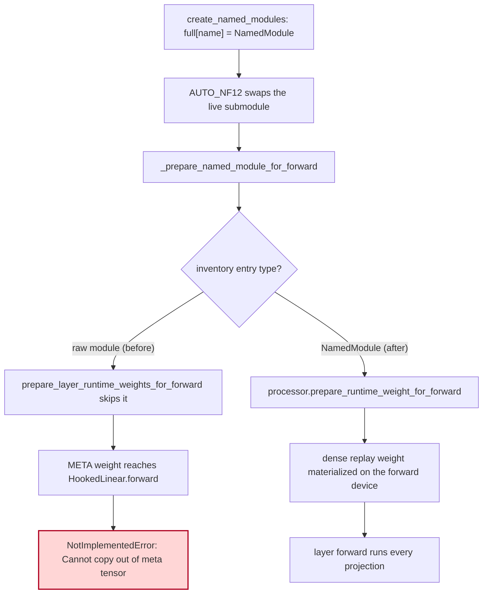
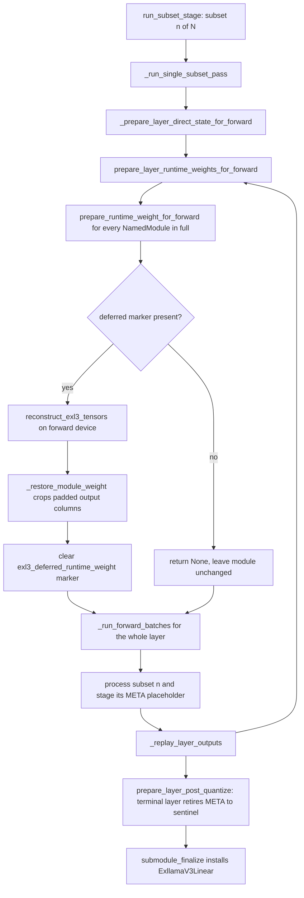
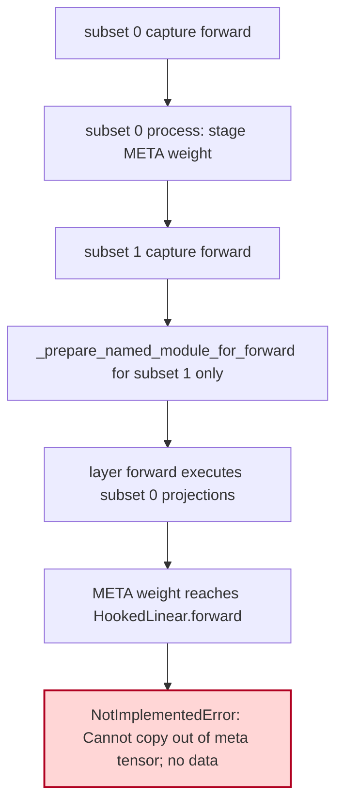
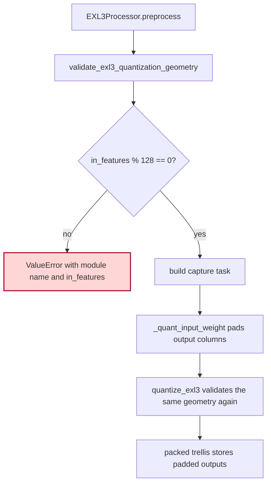

# EXL3 runtime weight lifecycle

EXL3 packs a projection into trellis/sign tensors and then drops the dense
source weight. The dense weight is reconstructed only for the layer forward
that produces the next layer's calibration inputs, and is replaced by the
packed module at finalization. This page describes that lifecycle, the layer
wide refresh that keeps it correct across subsets, and the 128-channel geometry
contract for the generic `EXL3Processor`. The refresh was introduced with
[PR #4026](https://github.com/ModelCloud/GPTQModel/pull/4026).

## Why the layer inventory is refreshed, not only the subset

One decoder layer is quantized in subsets. After subset `n` is packed,
`EXL3Processor._stage_runtime_weight` (`gptqmodel/looper/exllamav3_processor.py:2388`)
replaces that subset's dense weight with a META placeholder and stores a marker
in `NamedModule.state`. The layer forward that follows still executes every
module in the layer: earlier subsets are already packed, and later subsets are
still dense. Therefore the subset that is currently being quantized is not the
set of modules whose runtime weights must be ready.

`prepare_layer_runtime_weights_for_forward`
(`gptqmodel/looper/loop_processor.py:87`) walks the complete layer inventory
and offers every `NamedModule` to each processor's
`prepare_runtime_weight_for_forward` hook. The hook materializes a deferred
dense weight directly on the forward device and clears the marker, so a second
call is a no-op. The two call sites are the subset capture forward
(`gptqmodel/looper/stage_subset.py:943`) and the post-process replay
(`gptqmodel/looper/stage_layer.py:321`).

## The inventory entry must stay a NamedModule

The sweep can only reach a processor's deferred state through the
`NamedModule` wrapper: `prepare_runtime_weight_for_forward` reads and clears
`NamedModule.state`. AUTO_NF12 used to replace the inventory entry with the raw
live module after the capture forward and again after the quant source was
restored. Those raw entries were skipped, so a projection packed by an earlier
subset kept EXL3's META placeholder and the next layer forward raised
`NotImplementedError: Cannot copy out of meta tensor; no data!` (issue #4063).

The inventory now keeps the `NamedModule` in both places.
`_prepare_layer_direct_state_for_forward` already unwraps `.module`, so the
direct-META exclusion still targets the live tree module, and
`_prepare_named_module_for_quantization` updates `NamedModule.module` in step
with the module it installs in the tree.

| Old mechanism | Location | New mechanism |
| --- | --- | --- |
| Replace `full[name]` with the raw AUTO_NF12 wrapper after the capture forward | `gptqmodel/looper/stage_subset.py` (pre-fix, `_run_single_subset_pass`) | Keep the `NamedModule`; the sweep reads its state |
| Replace `full[name]` with the raw restored quant source after quant preparation | `gptqmodel/looper/gptq_processor.py` call site in `stage_subset.py` (pre-fix) | Keep the `NamedModule`; `.module` is updated by the quantizer |

## Before the fix

Only the current subset was prepared before its forward, and the layer-wide
sweep ran only for a fully skipped layer. A projection packed by an earlier
subset therefore reached the next forward as a META parameter.

| Old mechanism | Location | New mechanism |
| --- | --- | --- |
| Prepare only `subset.values()` before a subset forward | `gptqmodel/looper/stage_subset.py` (pre-fix loop over the subset) | `prepare_layer_runtime_weights_for_forward(..., full=full)` before every subset forward |
| Prepare `full` only when the whole layer is skipped | `gptqmodel/looper/stage_layer.py` (pre-fix skipped-layer branch) | The same sweep runs inside `_replay_layer_outputs` for every replay |
| Deferred weight is reconstructed without an output crop | `_restore_module_weight` | Padded stored columns are cropped back to the logical `out_features` |

## 128-channel geometry contract

EXL3 applies a 128-wide signed Hadamard transform to the weight and the
captured Hessian, and the runtime reconstructs in 128-wide output blocks.
`validate_exl3_quantization_geometry`
(`gptqmodel/exllamav3/modules/quant/exl3_lib/quantize.py:48`) enforces the
contract:

| Dimension | Rule | Action |
| --- | --- | --- |
| `in_features` | must be a positive multiple of 128 | reject in `EXL3Processor.preprocess` and in `quantize_exl3`, before capture |
| `out_features` | any positive value | zero-pad stored columns to `ceil(out_features / 128) * 128`; `ExllamaV3Linear.forward` crops the result |
| weight layout passed to `quantize_exl3` | `(in_features, stored_out_features)` | `_quant_input_weight` builds the padded tensor |

Input channels are not padded. The runtime's `_stored_features` requires
`trellis.shape[0] * 16 == in_features` and has no activation-padding boundary,
so a padded input would change the stored module geometry. Failing before
calibration is the supported behavior for such models; output padding is fully
supported because the runtime already crops padded stored features.

## Failure and ambiguity contract

| Situation | Before | After |
| --- | --- | --- |
| Earlier subset packed, next subset forward runs | META tensor reaches the forward | Whole layer is refreshed first |
| Deferred weight exists during post-process replay | Not prepared unless a device override touched it | Refreshed before `_run_forward_batches` |
| `in_features` is not 128-aligned | bare `AssertionError` after calibration | `ValueError` from `preprocess` before capture |
| `out_features` is not 128-aligned | bare `AssertionError` in the quantizer | zero-padded stored columns, cropped at forward |
| Module has no deferred marker | unchanged | unchanged; the hook returns `None` |
| AUTO_NF12 projection packed by an earlier subset | raw inventory entry was skipped, META reached the forward | `NamedModule` stays in the inventory and is refreshed |

## Not in scope

This page does not add activation padding for non-128-aligned input widths.
That would require a runtime input boundary and a different stored geometry.
