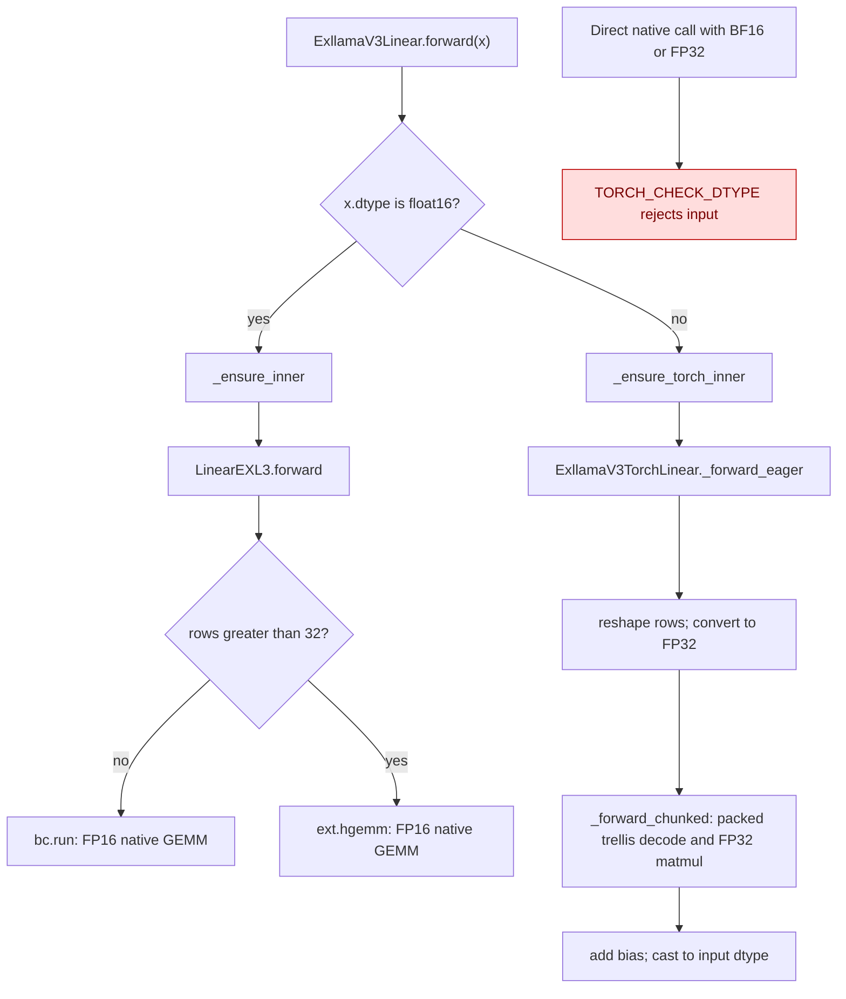

# EXL3 wide activation dispatch

`ExllamaV3Linear.forward` sends only FP16 activations to native EXL3.
BF16 and FP32 activations use `ExllamaV3TorchLinear`, which computes in FP32,
decodes packed trellis weights in bounded output tiles, and rounds the result
once to the caller's dtype. This routing was introduced by #3731. Native EXL3
requires FP16 inputs in both its small-row GEMM and large-row HGEMM paths.

The row-count decision is inside `LinearEXL3.forward`. Wide inputs leave
`ExllamaV3Linear.forward` before that decision, so both 32 and 33 rows take
the same Torch route. A direct wide call to the lower-level native class is
outside this bridge contract and reaches the native dtype check.

| Mechanism | Before this follow-up | After this follow-up |
| --- | --- | --- |
| Dtype dispatch | `gptqmodel/nn_modules/exllamav3.py:294-306` already routed BF16/FP32 to Torch | Same dispatch, now covered at 1, 32, 33, and 64 rows |
| Wide-input flattening | `gptqmodel/nn_modules/exllamav3_torch.py:548` used `view`, which raised for transposed batch dimensions | `reshape` accepts those strides while preserving logical row order |
| Native dtype contract | `gptqmodel_ext/exllamav3/quant/exl3_gemm.cu:52` and `gptqmodel_ext/exllamav3/hgemm.cu:32` required FP16 | Unchanged; FP16 still selects native at both row boundaries |

The wide path keeps trellis, sign scales, and bias in packed checkpoint form.
`_forward_chunked` decodes at most 512 output columns at a time, then releases
that decoded weight after the forward. For a 128-by-128 four-bit test layer,
the packed trellis plus scales and bias occupy 8,960 bytes and the FP32 decoded
weight chunk occupies 65,536 transient bytes. The helper borrows the bridge's
packed buffers and retains no dense weight copy after repeated forwards.

The CPU oracle tests use independently packed EXL3 symbols and a separate
float64 weight reconstruction. CUDA tests exercise the same bridge on NVIDIA
when available. The test inputs include 131,072, above FP16's finite range.
