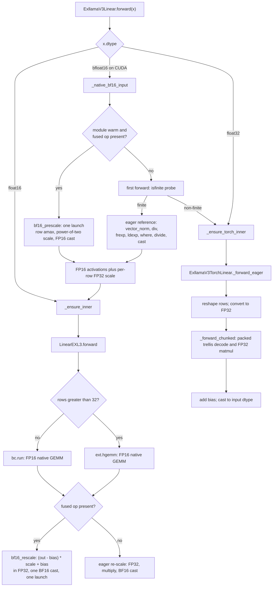
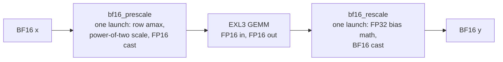

# EXL3 activation dispatch

`ExllamaV3Linear.forward` sends FP16 and BF16 activations to the native EXL3
kernels. FP32 keeps `ExllamaV3TorchLinear`, which computes in FP32, decodes
packed trellis weights in bounded output tiles, and rounds the result once to
the caller's dtype.

BF16 is the default dtype of most EXL3 checkpoints (Llama-3.x, Qwen2.5/3, ...).
Before #4767 every non-FP16 activation took the Torch reconstruction path, so
the default way to run those checkpoints was 20-200x slower than the native
kernel. Native EXL3 still requires FP16 operands; the bridge now supplies them.

## BF16 to FP16 conversion

BF16's 8-bit significand is a subset of FP16's 11-bit one, so every BF16
value inside FP16's finite range converts exactly. That covers ordinary activations and is
bit-exact with the plain FP16 path.

When the tensor's `amax` exceeds
`_FP16_SAFE_AMAX = 65504 / sqrt(128) ~= 5789.8`, each **row** whose own `amax`
exceeds the threshold is divided by its own power of two before the cast, and
the kernel output row is multiplied back:

- The Hadamard rotation of a 128-wide block is bounded by `sqrt(128)` times the
  row maximum, so a row maximum at or below `65504 / sqrt(128)` survives the
  rotation without overflowing FP16. This preserves #3731's guarantee: wide
  BF16 activations neither overflow nor produce NaN.
- `torch.frexp(row_amax / _FP16_SAFE_AMAX)` gives `2**exponent > row_amax /
  bound`, so the scaled maximum lies in `(bound / 2, bound]`: the smallest
  power of two that fits, not a normalization to `(0.5, 1]`. Power-of-two
  scaling is exact, so relative rounding is unchanged.
- The scale is per row because a per-tensor scale let one massive activation
  (a BOS outlier at amax ~1e3) divide every other row of the batch by the same
  factor. Ordinary rows then fell into FP16 subnormals (smallest normal
  6.1e-5) and lost most of their precision: 9.9e-2 relative error instead of
  2.7e-3 (#4870). Rows already inside the safe range keep scale 1 and convert
  bit-exactly.
- Scaling only as far as the bound also matters for the outlier row itself. A
  row that mixes a huge activation with small values (`amax` 1e3-2e4 next to
  elements around 1e-2, which is what a BOS massive-activation row looks like)
  used to be divided by its whole `amax`, so those small elements fell into
  FP16 subnormals: their norm error was 3.7e-3 at `amax` 1176 and 5.6e-2 at
  20000. Bringing the row just inside the bound keeps them normal, and in
  practice exact, because BF16 divides exactly by a power of two.
- The Hadamard bound also covers the GEMM accumulation for EXL3's packed weight
  scales, so the output row stays finite before it is rescaled.
- The native kernels add the bias to the scaled accumulator. The bridge removes
  the bias, rescales, and restores it in FP32, so the bias is never scaled.
- The decision stays on the device (#4955). A per-row `inf`-norm reduction,
  `frexp`, and a `where` give every row its own scale, and a row that needs no
  scale gets exactly 1.0, which is the identity. Nothing is read back to the
  host, so a BF16 forward no longer drains the CUDA stream once per linear:
  that `float(amax)` read was 112 synchronizations per decoded token on a 1B
  model, 4-8x slower than the same math without it, and it also prevented CUDA
  graph capture of the BF16 path. Since #5148 that is one fused launch per
  half of the mapping, against the hundreds of launches the Torch
  reconstruction performs.

Non-finite BF16 activations (`inf`/`nan`) keep the FP32 Torch path: there is no
power of two that would make them finite. `isfinite` is checked once per
module, on its first BF16 forward, instead of on every forward - a per-forward
`isfinite` is the same device-to-host sync the device-side decision removed. A
module whose first BF16 activation is non-finite keeps the FP32 reconstruction
and probes again on its next forward; once an activation is finite the module
stays on the native path.

## BF16 activation adaptation launch cost (#5148)

#4989 removed the per-forward host sync from this path, but the mapping was
still a chain of about a dozen eager kernels per linear: `vector_norm(inf)`,
`.float()`, `div`, `frexp`, `ones_like` x2, `ldexp`, `where`, `x / scale`,
`.to(fp16)`, then `result.to(fp32)`, `- bias`, `* scale`, `+ bias`, `.to(bf16)`.
At decode each is a microsecond kernel behind a full host dispatch, so the
33 us GEMM starved behind ~90 us of launches: BF16 decode ran 2.7x slower than
the same checkpoint in FP16.

Before, per BF16 linear (`gptqmodel/nn_modules/exllamav3.py` at 17a488e41,
`_native_bf16_input` + `_rescale_native_output`):

```mermaid
flowchart LR
    X["BF16 x"] --> A1["vector_norm inf"]
    A1 --> A2[".float"]
    A2 --> A3["div by bound"]
    A3 --> A4["frexp"]
    A4 --> A5["ones_like x2"]
    A5 --> A6["ldexp"]
    A6 --> A7["where"]
    A7 --> A8["x / scale"]
    A8 --> A9["to FP16"]
    A9 --> G["EXL3 GEMM"]
    G --> B1["to FP32"]
    B1 --> B2["- bias"]
    B2 --> B3["* scale"]
    B3 --> B4["+ bias"]
    B4 --> B5["to BF16"]
```

After, the same math in two launches
(`gptqmodel_ext/exllamav3/bf16_scale.cu`, reached through
`gptqmodel/nn_modules/exllamav3_bf16_kernels.py`):

The pre-scale is one program per row: the row `amax` has to be complete before
that row is cast, and a launch has no grid-wide barrier, so the row stays in one
block. `frexp(amax / bound)` becomes the exponent field of the `amax / bound`
quotient (the quotient is always above 1 on the rows that use it), and the
divide is a multiply by the exact power-of-two reciprocal. The re-scale keeps
`(out - bias) * scale + bias` as three separate FP32 roundings (`__fsub_rn`,
`__fmul_rn`, `__fadd_rn`, never an FMA) and casts once to BF16.

**Failure contract.** The fused path declines instead of approximating:

| Situation | Path |
| --- | --- |
| Extension build without `bf16_prescale`/`bf16_rescale` (stale prebuilt wheel) | eager reference |
| Non-CUDA trellis | portable FP32 reconstruction (unchanged, #4789) |
| Non-contiguous, FP16, FP32, or empty activation | eager reference |
| First BF16 forward of a module (the one `isfinite` probe) | eager reference |
| Non-finite BF16 activation | portable FP32 reconstruction (unchanged) |

Both halves are bit-identical to the eager sequence, so a fallback is a pure
performance choice. `tests/test_exl3_bf16_fused_prescale_5148.py` compares raw
bits of the pre-scale, the re-scale (FP16/BF16/FP32/no bias, padded stored
width) and the complete forward against the fallback branch at M=1/8/512/2048
plus all-zero, denormal, `65504`, `3e38`, mixed-outlier and `inf`/`nan` rows.

Measured on an RTX 5090 (sm_120, torch 2.15.0+cu132, CUDA 13.2), eight
Llama-3.1-8B-geometry decoder layers quantized to EXL3 W4 with random weights
(no EXL3 checkpoint was available offline; the projections, kernels and shapes
are the real ones), batch 1 unless noted:

| Configuration | decode step bs1 | decode step bs8 | prefill 2048 | `generate()` 128 tok |
| --- | --- | --- | --- | --- |
| dense HF BF16 | 3.74 ms | 4.22 ms | 48.0 ms | 267 tok/s |
| EXL3 FP16 | 4.52 ms | 4.53 ms | 44.4 ms | 221 tok/s |
| EXL3 BF16, eager (before) | 8.84 ms | 8.88 ms | 54.9 ms | 113 tok/s |
| EXL3 BF16, fused (after) | 5.27 ms | 5.37 ms | 46.6 ms | 190 tok/s |

Single `mlp.gate_proj` (4096 -> 14336), M=1, CUDA-event minimum per call:
FP16 32.8 us, BF16 eager 88.2 us (2.69x), BF16 fused 35.8 us (1.09x). The
fused cost is two launches of ~2 us of GPU time plus ~6 us of host dispatch,
against ~60 us of dispatch for the eager chain.

## Dispatch contract

The row-count decision is inside `LinearEXL3.forward`. The bridge hands it a
contiguous FP16 tensor for both 32 and 33 rows, so the native class still picks
`bc.run` below 33 rows and `ext.hgemm` above it. A direct call to the
lower-level native class with BF16 or FP32 is outside this bridge contract and
still reaches the native dtype check.

| Mechanism | Before #4767 | After #4767 |
| --- | --- | --- |
| Dtype dispatch | FP16 native; BF16 and FP32 Torch | FP16 and BF16 native; FP32 Torch |
| BF16 input conversion | none (Torch, FP32 compute) | exact FP16 cast; per-row power-of-two pre-scale for rows above `65504 / sqrt(128)` |
| Wide-input safety | Torch path, FP32 | native FP16 with exact pre-scale; non-finite stays Torch |
| Native dtype contract | `gptqmodel_ext/exllamav3/quant/exl3_gemm.cu:64` and `hgemm.cu:33` require FP16 | Unchanged; the bridge satisfies it |

The wide Torch path keeps trellis, sign scales, and bias in packed checkpoint
form. `_forward_chunked` decodes at most 512 output columns at a time, then
releases that decoded weight after the forward. For a 128x128 four-bit test
layer, the packed trellis plus scales and bias occupy 8,960 bytes and the FP32
decoded weight chunk occupies 65,536 transient bytes.

## Tests

`tests/test_exl3_wide_input.py` covers the dispatch choice at 1, 32, 33, and 64
rows with a mocked native kernel, the exact FP16 cast, the power-of-two
pre-scale for magnitudes from 1e4 to 1e30, finite numerics against an FP64
reference at 1e4 and 1e5, and the non-finite fallback. The CPU oracle tests use
independently packed EXL3 symbols and a separate float64 weight reconstruction;
CUDA tests exercise the same bridge on NVIDIA when the extension is available.

`tests/test_exl3_bf16_prescale_4870.py` covers the pre-scale trigger and its
precision: rows between the old threshold and the bound are passed through
untouched, the row that carries a massive activation keeps its own small
elements (amax 260 to 20000), a wide row is scaled to just inside the bound,
the scale is per row, and a mixed-magnitude batch (64 rows of `N(0, 0.3)` with
one outlier in row 0) keeps the ordinary rows at the plain FP16 path's
accuracy.

`tests/test_exl3_bf16_fused_prescale_5148.py` pins the fused path: raw-bit
equality with the eager reference for the pre-scale, the re-scale and the whole
forward at M=1/8/512/2048 and on adversarial rows, the fallbacks (missing fused
op, non-contiguous, FP16/FP32, CPU), the absence of any retained dense weight,
and an M=1 `bf16 <= 1.3x fp16` per-linear bound. That last test measures the
eager chain in the same process with the fused ops disabled, so it fails on
17a488e41 by construction (2.7x) rather than relying on a historical number.
